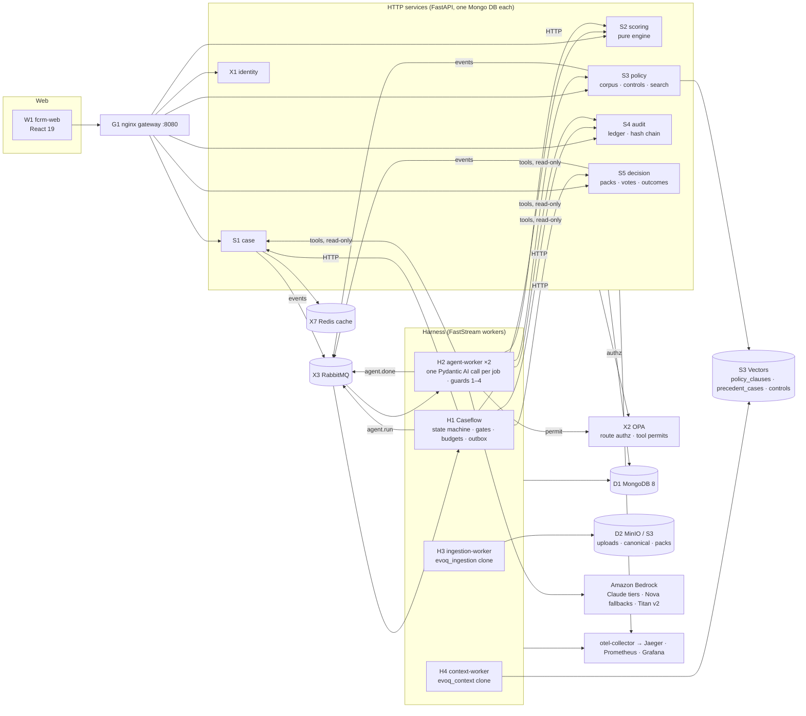

# TrustOps build plan

FCRM Risk Assessment Workbench · Genius Hacks Q3 2026 · Myridius
Plan version 1.0 · 3 October 2026 · submission 9 October 2026 (six build days)

This is the master plan. It is written so that Claude Code subagents can implement it without stopping for input. Depth lives in the three design documents; this file fixes the decisions, the structure, the order of work and the definition of done.

| Need | Read |
|---|---|
| Services, Caseflow state machine, events, data, compose | `docs/architecture/design/A-backend.md` |
| Agents, prompts, context packs, guards, memory, evals, tokens | `docs/architecture/design/B-ai-layer.md` |
| Web app, tests, ops, the AI-driven SDLC harness | `docs/architecture/design/C-web-tests-ops-sdlc.md` |
| Every decision and why | `docs/governance/decision-log.md` |
| Every human gate and why it sits where it does | `docs/governance/gates-register.md` |
| What the brief grades | `docs/requirements/research/01-brief-and-rubric.md` |
| The canonical demo data | `docs/requirements/research/06-walkthrough-seed-extraction.md` |

## 1. Context

**Problem.** A US bank must assess the AML/CFT and sanctions risk of a change (new product, feature, process, vendor, geography or customer segment) before it goes live. Today this takes 15–20 days; the target is about two. TrustOps gives three roles one workbench: the product owner raises the case and answers questions; the FCRM analyst reviews AI proposals item by item and owns configuration; the risk committee decides by hidden vote on Band 3–4 cases.

**What the panel grades.** 30% AI harness and agent orchestration · 20% AI across all six SDLC stages · 15% human gates with rationale · 10% evals · 10% context engineering · 5% each production readiness, token efficiency, engineering judgement. The repository is about three quarters of the evidence; commit history counts; the panel "probes decisions, not features".

**Hard rules from the brief.** Nothing is approved or rejected automatically. Four outcomes: approve, approve with conditions, defer, reject. Every rating traceable; audit trail immutable; rules tunable by the risk function; controls never eliminate risk; frameworks (FFIEC, FATF, OFAC) grounded, not invented; synthetic data only.

**What exists.** The team's approved spec set (v1.3 decisions, walkthrough v2 with the embedded seed), the BA's FCRM_v2 clickable prototype (reference only), and the EVOQ/AEO components to clone (ingestion and context engines, job worker, service template, identity, OPA). Nothing of the production system exists yet.

**Canonical demo.** Case FCRM-2026-0151, "Consumer remittances US → Mexico via payout partner" (Remesas del Norte S.A.). Priya Nair (PO), Rahul Iyer (analyst), Ana Mendes, Joseph Okafor, Lin Chen (committee). Score 9.8 / Band 2 with boundary flag → analyst overrides vendor due diligence 7.6 → 4.5 with a reason → 10.4 / Band 3 → committee → approve with conditions 2–1 → three conditions → 67 hash-chained audit records → examiner answers from the chain six months later.

## 2. Decisions in force

The team's decisions D-01…D-97 stand unless amended below. New rows are ADR-01…ADR-20 in `docs/governance/decision-log.md`. The ones that shape everything:

| ADR | Decision |
|---|---|
| 01 | One monorepo, the brief's layout, local git from commit 1 (supersedes D-64, D-90a "20 repos + umbrella") |
| 02 | RabbitMQ + FastStream is the job and event bus; Redis is cache only (amends D-28) |
| 03 | AWS everywhere: Amazon Bedrock for every model call, S3 Vectors for the three indexes, Titan Embed Text v2 for embeddings; no direct Anthropic or OpenAI keys |
| 04 | Model tiers on Bedrock (table in §3.4); critic and eval judge run on a different model than the assessor |
| 05 | AEO components are cloned into `src/`, fixed in place, each with an `UPSTREAM.md`; identity included |
| 06 | Web app rebuilt from scratch in `src/web`; FCRM_v2 contributes tokens and information architecture only (supersedes D-63) |
| 07 | Caseflow (H1) calls the scoring service; the assessment agent has no scoring tool |
| 08 | Committee outcome = the option with two identical votes of three; otherwise `no_majority`: a thread opens and a re-vote round is requested through the R6 path; nothing is ever auto-deferred |
| 09 | Observability: OpenTelemetry → otel-collector → Jaeger, Prometheus, Grafana, all in compose; Logfire dropped; AWS path (ADOT → X-Ray/CloudWatch) documented |
| 12 | Deterministic modes `FCRM_LLM_MODE=live\|replay\|mock` and `VECTOR_BACKEND=s3vectors\|memory`, so the full stack and the 21-scene E2E run offline and reproduce the seed figures every time |
| 13 | Boundary flag = within 0.5 of the next band's lower edge or of the edge just crossed (verified against all 18 flagged seed cases) |
| 14 | Agent retry: attempt 1 `FallbackModel(primary, fallback)`; attempt 2 fallback only with the validation error shown; then human hand-off |
| 16 | Seed P7 is extracted from the walkthrough's `FCRM_SEED`; `gen_seed.py` regenerates it byte-stable; case 0151 is seeded at `intake` so the demo runs live and its 67 records are the golden |
| 17 | SharePoint and OCR are out of the build; a `DocumentSource` connector interface ships with an S3/MinIO implementation |

Operator-only items (cannot be automated): AWS credentials in `.env`; accepting ADR rows (gate G-D1); the clean-clone proof (gate G-P1); the live AWS deployment.

## 3. Architecture

### 3.1 Overview



Principles: services talk HTTP for reads and RabbitMQ for work; no service reads another's database; agents propose, people decide, code scores; every state change is one Mongo transaction that also writes the outbox; every human decision produces an audit record.

### 3.2 Components

| ID | Unit (folder under `src/`) | Responsibility | Tech | Port |
|---|---|---|---|---|
| S1 | `services/case` · `fcrm_case` | cases, submission versions + diff, fields, documents, review items (gate subjects), clarification threads, conditions + 14-day reminders, four submit checks, two clocks, role-shaped responses, role-filtered SSE | FastAPI, PyMongo async, Redis fan-out | 8001 |
| S2 | `services/scoring` · `fcrm_scoring` | pure scoring engine, scoring model versions, routing rules v4 as data, `POST /score`, startup recompute of all 80 seed cases | FastAPI, Decimal arithmetic | 8002 |
| S3 | `services/policy` · `fcrm_policy` | corpus v14 (197 clauses), control inventory v9, jurisdiction lists, field sets, precedents, hybrid search (S3 Vectors + Mongo text, RRF) with metadata filters | FastAPI | 8003 |
| S4 | `services/audit` · `fcrm_audit` | evidence ledger (proposals), hash-chained append-only records, `GET /verify/{case}`, examiner read API; insert-only DB user with startup self-test | FastAPI | 8004 |
| S5 | `services/decision` · `fcrm_decision` | frozen pack snapshots with content hash, four release checks, hidden votes (DB-unique per member per round), tally in the third vote's transaction, outcomes, R6 threads, addenda, pack v2, re-vote | FastAPI | 8005 |
| X1 | `services/identity` · `fcrm_identity` | clone of evoqidentityservice: password login for seeded users, RS256 access (15 min) + refresh cookie (8 h), JWKS, `/core/validate` for nginx `auth_request`; ten listed security fixes | FastAPI | 8000 |
| H1 | `workers/caseflow` · `fcrm_caseflow` | original code: 13-state machine, 40 transitions, 15 gate types, budgets (tier caps, 120k per case), routing R1–R6, job dispatch with idempotency keys and leases, outbox relay, `case_runs` + `run_events` replay | FastStream | 9100 |
| H2 | `workers/agent-worker` · `fcrm_agent_worker` | consume `agent.run` → guards 1–4 → one Pydantic AI call (Bedrock, FallbackModel, ToolOutput) → `agent.done`; token record per attempt; OTel GenAI spans | FastStream, Pydantic AI 2.53 | 9101 |
| H3 | `workers/ingestion-worker` + `evoq_ingestion/` | documents → Markdown with page:line anchors; Guard 1 (presidio PII masking, injection scan) | FastStream | 9102 |
| H4 | `workers/context-worker` + `evoq_context/` | clause segmenter, embeddings, the three S3 Vectors indexes with metadata filters; AEO synthesis switched off | FastStream | 9103 |
| P1–P7 | `packages/{agents,tools,skills,prompts-loader,guardrails,contracts,seed}` | agent registry and builders; 13 read-only tools; 5 skills; prompt loader (Jinja, front-matter, locks); 7 guards + 8 rules; every Pydantic contract; seed generator and loaders | Python packages in the uv workspace | — |
| common | `packages/common` · `fcrm_common` | settings, errors (problem+json), JSON logging, OTel init, Mongo repository, transactional outbox + leased relay, health, HTTP client, JWT/JWKS auth, OPA client, ids, hashing, business days | — | — |
| W1 | `web` | React 19 + TS + Vite + Tailwind v4; TanStack Query; generated OpenAPI client; SSE hook; MSW mocks from the seed | Node 22 | 5173 dev / via gateway |
| G1 | `ops/nginx` | `/api/fcrm/*` routing, `auth_request` to X1, static web | nginx 1.27 | 8080 |
| X2 | `ops/opa` | `authz.rego` (routes, hierarchy from data), `tools.rego` (agent → tool permits from `tool_permits.json`), Rego tests | OPA 1.x | 8181 |
| X3 / X7 / D1 / D2 | compose | RabbitMQ 4 (quorum queues, DLX), Redis 7.4, MongoDB 8 replica set, MinIO | — | 5672/15672 · 6379 · 27017 · 9000/9001 |
| X6 | `evals/` | datasets, metrics, pydantic-evals runner, Bedrock judge, promotion gate, reports | — | — |
| obs | `ops/{otel,grafana,prometheus}` | collector, Jaeger 16686, Prometheus 9090, Grafana 3000 with three dashboards | — | 4317/4318 |

### 3.3 Case lifecycle (H1 `CaseState`)

`INTAKE → REVIEW_AND_SUBMIT → TRIAGE → SCREENING → ASSESS → CRITIC → COMPLETENESS → CLARIFICATION (one round, optional) → REVIEW → RECOMMEND → DECIDE → CLOSED`, plus `HANDOFF` for a step that failed after its retry. Oversight (conditions, watchlist re-flags, examiner) acts on closed cases and is not a state. The full transition table with guards, actions and audit records is design A §3.1.

Human gates (Guard 7), each opened by H1 and decided through the owning service: `po_confirm_category`, `po_confirm_value`, `po_reuse`, `po_answer_gaps`, `fast_lane_confirm`, `review_item`, `ack` (boundary or band change, R3), `completeness` (ask or proceed), `lock`, `pack_release`, `vote`, `reflag_ack`, `handoff`, `unlock`. Every gate has a rationale row in the gates register.

### 3.4 Multi-agent runtime

Nine agents, one Pydantic AI call each, never orchestrating, never scoring. Models on Bedrock (verified against the account on 3 Oct):

| Tier | Primary | Fallbacks | Agents | Budget per run |
|---|---|---|---|---|
| cheap | `us.anthropic.claude-haiku-4-5-20251001-v1:0` | `us.amazon.nova-lite-v1:0` | screening, intake (one job per document window), watchlist | 6k tokens / 60 s |
| mid | `us.anthropic.claude-sonnet-5-5` | `us.anthropic.claude-haiku-4-5-20251001-v1:0` | narrative (completeness and recommendation modes), examiner, policy_gap | 12k / 120 s |
| strong | `us.anthropic.claude-sonnet-5-5` | `us.anthropic.claude-opus-5-5`, `us.amazon.nova-pro-v1:0` | research, assessment | 20k / 180 s |
| judge | `us.anthropic.claude-opus-5-5` | `us.anthropic.claude-sonnet-5-5` | critic, eval judges | 20k / 180 s |

Embeddings: `amazon.titan-embed-text-v2:0` (1024-d). One retry per run (ADR-14); 120k tokens per case; realistic first run ≈ 82k. Model IDs live only in `ai/models/tiers.yaml`; a lock test fails if any other file names a model.

Seven guards in fixed order on every call: 1 input scan + PII masking · 2 OPA tool permit · 3 budget · 4 output shape (schema, every `source_ref` resolves, every quote exists verbatim) · 5 the eight rules as pure functions · 6 critic (scheduled by H1 after scoring) · 7 human gate. The eight rules: no agent writes a score; no bulk accept; the PO view has no restricted fields; the analyst never edits the submission; a closed case is untouched; an override has a reason; a planned control is not scored; policy is quoted, not generated.

Thirteen read-only tools (`document_reader`, `case_record`, `case_search`, `field_rules`, `policy_search`, `precedent_search`, `control_inventory`, `evidence_store`, `jurisdiction_list`, `rules_check`, `evidence_ledger`, `audit_log`, `submission_diff`), each with an OPA permit key. Five skills as instruction packs. Context packs are built per agent with section caps, fixed ordering, page-whole truncation and Bedrock cache points on the stable prefix; each pack is snapshotted (hash + MinIO key) so any call can be rebuilt.

Memory: working = the `agent.run` payload; short-term = `case_runs`, `run_events`, the S4 proposals ledger; long-term = precedent index, overrides, corpus and config versions; learning = override rates → eval rows → candidate prompt version → promotion gate (score ≥ baseline). No agent-memory products.

### 3.5 Data

| Store | Contents |
|---|---|
| `fcrm_case` | cases, submission_versions, field_values, documents, review_items, threads, conditions, counters |
| `fcrm_scoring` | scoring_model_versions (v3 active), routing_rules_versions (v4 active) |
| `fcrm_policy` | corpus_versions, clauses, control_inventory_versions, jurisdiction_list_versions, field_set_versions, precedents |
| `fcrm_audit` | proposals (ledger), audit_records (hash chain: `sha256(prev_hash + "\n" + canonical body)`, genesis hash, optimistic `seq`), written only by `fcrm_audit_writer` (insert-only) |
| `fcrm_decision` | packs (frozen snapshots), votes, threads, addenda, outcomes |
| `fcrm_harness` | case_runs, run_events, agent_jobs, gates, budgets, outbox, consumed_messages, model_calls, leases |
| `fcrm_identity` | users (11 seeded), refresh_tokens |
| MinIO / S3 | buckets `uploads`, `canonical`, `packs` (versioned), `vectors` (fixtures), `jobs` |
| S3 Vectors | bucket `fcrm-vectors`: indexes `policy_clauses`, `precedent_cases`, `controls`; metadata `corpus_version`, `trigger_type`, `risk_area`, `jurisdiction`, `closed_date` |
| Redis | JWKS cache, OPA decision cache (30 s), SSE fan-out channels, permit cache |

Each case pins `{scoring_v, corpus_v, controls_v, fieldset_v, jurisdictions_v, routing_v, prompts_v}` at run start; config changes never reach back into an open case.

### 3.6 Scoring and routing (deterministic)

Inherent = L × I (1–5 each). Area CE = Σ(normalised catalogue weight × rating) over matched, non-planned controls. Retention = max(0.4, 1 − 0.6·CE/10). Residual = inherent × retention. Composite = Σ(area residual × domain weight normalised over in-scope domains), rounded once to one decimal (ROUND_HALF_UP) before band lookup. Bands 0–5.0 · 5.1–10.0 · 10.1–17.0 · 17.1–25.0. Domain weights customer 0.20, product 0.20, geography 0.24, channel 0.36.

Golden tests: demo before 9.803 → **9.8 Band 2** (boundary 0.3); after CTL-T01 7.6 → 4.5, channel CE 7.59 → 6.505, retention 0.61, residual 12.2 → composite 10.389 → **10.4 Band 3**; all 80 seed cases reproduce their stored score and band (19/49/11/1); all 18 boundary flags reproduce.

Routing v4 (data, evaluated by H1): R1 Band 1–2 analyst closes · R2 Band 3–4 committee, quorum 3, hidden votes, rationale required · R3 boundary and band-change acknowledgement · R4 fast lane proposed by screening, analyst confirms · R5 auto-triage to fewest open cases · R6 committee question → thread → addendum → if numbers change: unlock with reason, pack v2, re-vote. Outcome rule ADR-08.

### 3.7 Security and visibility

Identity issues RS256 JWTs (claims `sub, roles, name, typ, exp`); services verify locally against JWKS; nginx uses `auth_request` to `/core/validate`. OPA decides route authorization (`authz.rego`, inputs: roles, service, method, route template) and agent-to-tool permits (`tools.rego` over `data.tool_permits`); OPA is evaluated in services, cached 30 s in Redis. Roles: `fcrm_po`, `fcrm_analyst`, `fcrm_committee`, `fcrm_observer` (monitor only), `fcrm_service`. Visibility: the PO never receives `score.*`, `harness.*`, `audit.*` events or any score/band/rating field (a response-key scanner enforces it; black-box test BB-02); the analyst cannot write submission fields; closed cases reject writes (409).

### 3.8 Observability

Every container exports OTLP to the collector; one trace per case run, propagated over RabbitMQ headers (`traceparent`); Pydantic AI GenAI spans carry model, tokens and cost; H2 adds `case_id, run_id, job_id, agent, prompt_v, tier, attempt`. Metrics: HTTP latency, agent tokens/cost/latency by agent and model, gate wait seconds, override totals, outbox lag, queue depth, budget ratio. Dashboards: case throughput and gate waits; agent latency, tokens and cost; guard blocks and override rate. Logs are JSON with trace ids.

### 3.9 Error handling and resilience

One exception hierarchy in `fcrm_common.errors` mapped to RFC 9457 problem+json. Per-dependency timeouts and retries (Mongo 5 s selection, HTTP connect 2 s / read 10 s with two retries on 5xx, Bedrock per tier wall clock, S3 three retries); circuit breakers only on Bedrock and S3 Vectors. Queue-level redelivery up to three times then `<queue>.dlq`; nothing dropped; `make dlq-replay`. Leases on jobs with a reaper; `Idempotency-Key` on every state-changing route; consumed-message dedupe. `/healthz` and `/readyz` everywhere; graceful shutdown drains consumers. A failed agent step after its retry opens a `handoff` gate; the analyst completes by hand and the machine resumes.

## 4. Folder structure

Condensed view; the complete file-level tree for every unit is `docs/architecture/folder-structure.md`.

```
trustops/
  README.md                      setup · walkthrough · decision log pointer
  BUILD-PLAN.md                  this file
  CLAUDE.md                      repo guidance for Claude Code; package files under src/**/CLAUDE.md
  Makefile                       bootstrap · up · down · seed · demo · check · gate · test-* · e2e · evals · contracts · dlq · token-report · nightly
  docker-compose.yaml            base; compose.dev.yaml (bind mounts, vite), compose.test.yaml (replay mode), compose.obs.yaml
  .env.example                   every variable name, no values
  .pre-commit-config.yaml
  .claude/settings.json          hooks (protect paths, commit guard, formatters, Stop gate, SubagentStop report)
  ai/
    README.md  CLAUDE.md
    agents/<agent>.agent.yaml    nine specs: tier, tools, output schema, prompt ids, guards, budget, gate, eval set
    tools/<tool>.tool.yaml       thirteen specs: backing endpoint, read-only, permit key, schemas
    skills/<skill>.skill.md      five instruction packs
    prompts/MANIFEST.yaml        prompt set version = case pin prompts_v
    prompts/<agent>/<id>.v<N>.md Markdown + front-matter, Jinja
    models/tiers.yaml            the only file that names model ids; price table
    guards/{guards.yaml,thresholds.yaml,injection_patterns.txt,pii_entities.yaml,restricted_terms.txt}
    policies/{tools.rego,tool_permits.json}
    registry.lock/{agents,tools,skills,prompts}.lock
    schemas/                     generated JSON Schema exports
    guidance/                    coding-standards · commit-convention · subagent-brief-template · worktree-protocol · review-checklist · hooks/ · packages/*.CLAUDE.md
  docs/
    requirements/{source/,research/,spec.md,personas.md,rules.md,glossary.md,open-questions.md}
    architecture/{design/,c4-context.md,c4-container.md,sequences/,data-model.md,event-catalogue.md,openapi/*.json,events/*.json}
    governance/{decision-log.md,gates-register.md,rules.md,visibility-matrix.md,audit-chain.md,defect-trail.md,failure-log.md}
  evals/
    README.md  datasets/<agent>/*.jsonl  metrics/  runners/  judge/  fixtures/replay/<agent>/<case>.json  results/<date>/  trend.json  report.html
  tests/
    README.md  conftest.py (the only fixtures and shared fakes)
    unit/        mirrors src/: unit/services/scoring/… unit/workers/caseflow/… unit/packages/guardrails/…
    integration/ mirrors src/: one folder per service and worker, testcontainers
    contract/  e2e/{playwright.config.ts,fixtures/,demo/,blackbox/}  resilience/  perf/  fixtures/  tools/
  ops/
    nginx/  opa/{policy,data,tests}  mongo/init/  rabbitmq/definitions.json  minio/  otel/collector.yaml  prometheus/  grafana/provisioning/
    scripts/{wait_for_ready.py,dlq_replay.py,token_report.py,claude_usage.py,backup.sh,restore.sh}  runbooks/  aws/deployment-path.md  env/contract.md  token-analysis/  reports/nightly/
  src/
    pyproject.toml  uv.lock        uv workspace: members services/*, workers/*, packages/*
    services/{case,scoring,policy,audit,decision,identity}/   each: pyproject.toml · fcrm_<name>/ (source only) · Dockerfile · CLAUDE.md · requirements*.txt exported from uv.lock · (UPSTREAM.md for clones)
    workers/{caseflow,agent-worker,ingestion-worker,context-worker}/   same shape; H3 and H4 carry evoq_ingestion/ and evoq_context/ clones
    packages/{contracts,common,guardrails,agents,tools,skills,prompts-loader,seed}/   same shape
    web/                           package.json · vite.config.ts · src/{app,api,auth,design,components,features,lib,mocks,test} · Dockerfile · CLAUDE.md
```

Every Python unit builds and ships alone (`uv run --package <name>`; one Dockerfile; `python:3.13-slim`, non-root). Import names are `fcrm_*`. Tests never sit beside source: they live under `/tests/unit` and `/tests/integration` mirroring the `src/` path, with fixtures only in `tests/conftest.py` (ADR-21; the cloned `evoq_*` engines keep their upstream suites inside the clone, recorded in `UPSTREAM.md`). Configuration never sits in `src/`: YAML lives under `ai/` and `ops/`, settings come from environment variables. The coding standards are `ai/guidance/coding-standards.md`. `api/generated` in the web app is regenerated by `make api-gen` and committed.

## 5. Execution: one continuous run

The build is a single autonomous run from scaffold to freeze. The lead session executes the dependency graph below continuously: a lane starts the moment its dependencies are merged, up to six lanes run at once, and nothing waits for the operator. Each lane is one Claude Code subagent in its own git worktree (`ws/<lane>/<topic>`), briefed from `ai/guidance/subagent-brief-template.md`, and is done only when `make gate` passes on the merged tree and its report lists Changed / Failed / Decided. The lead merges, re-plans on failure (retry with the failure in the brief, then split the lane, then record a defect and continue), and keeps the governance tables current. "Order" below is a dependency rank, not a pause.

Operator gates (G-R1, G-D1, G-D2, G-C2, G-T2, G-P1, G-O1) are non-blocking during the run: the run records the evidence, marks the gate "passed pending operator review" and continues; the operator reviews asynchronously and objects by adding an ADR or defect row. Proposed ADR rows count as accepted from the moment the run starts. The only inputs the run cannot produce itself are AWS credentials in `.env` (it runs in `replay`/`memory` mode until they exist, then switches to live automatically) and the final deck narration.

**Status key:** ✅ merged to `main` · 🔄 a dispatched subagent is working in an isolated worktree, not yet merged · ⬜ not yet dispatched.

| Order | Lane | Produces | Depends on | Done when | Status |
|---|---|---|---|---|---|
| 0 | bootstrap | uv and Node 22 installed user-space; repo scaffold; uv workspace; hooks, pre-commit, governance tables | — | `make check` green on the skeleton | ✅ (hooks/pre-commit wiring still pending the ai-files lane) |
| 0 | contracts (P6) | `fcrm_contracts`: enums, API models per service, event envelope + 50 payload types, nine proposal schemas with the `Claim` mixin, `PinnedVersions`, the 13 tool schemas, the shared vote tally | — | `fcrm_contracts` ruff/mypy --strict/pytest green | ✅ 50 tests |
| 0 | seed (P7) | `gen_seed.py` reproducing `seed.json` byte-stable from the walkthrough extraction; loaders | contracts shapes | recompute of 80 cases = stored | ✅ (byte-stability self-check only; independent synthesis not implemented — ADR-16) |
| 0 | ai-files | `ai/` tree: tiers.yaml with the Bedrock ids, nine agent specs, thirteen tool specs, five skills, prompt v1 set, guards config, locks, Claude Code hooks | contracts | lock tests green | ✅ 683/687 checks (687 with a real OPA binary), 16/16 Rego tests; hook *scripts* merged, registration in `.claude/settings.json` deliberately deferred |
| 1 | common | `fcrm_common` | contracts | unit tests; Mongo testcontainer tests | ✅ 236/243 (7 skipped, no reachable live-Mongo container this environment); found and fixed 2 real Mongo bugs pre-merge |
| 1 | scoring (S2) | engine, golden tests, routes, startup recompute | contracts, common | 9.8 → 10.4 and 80/80 reproduce | ✅ engine + golden tests + HTTP routes + Mongo-backed store + startup recompute self-test (95 tests, live-Mongo verified) |
| 1 | audit (S4) | ledger, hash chain, insert-only user, verify, examiner read | contracts, common, mongo init | tamper test fails verification | ✅ chain core (9 tests, full 67-record demo replay); HTTP/Mongo pending common |
| 1 | identity + OPA + nginx (X1, X2, G1) | cloned identity with fixes, seeded users, RS256/JWKS, `/core/validate`; `authz.rego`, `tools.rego`, `opa test`; gateway conf | contracts | three roles log in; OPA tests green; PO gets 403 on `/monitor` | ✅ identity service (67 tests, all three verified AEO bugs fixed with regression tests; JWKS/login/validate live-verified with a real Mongo container) + OPA (`authz.rego`+`tools.rego`, 49/49) + nginx conf + Dockerfile |
| 1 | guardrails (P5) | seven guards, eight rules, verbatim matcher, restricted terms, PII masking, OPA client Protocol | contracts, common | property tests on rules; quote matcher golden tests | ✅ 352 tests, 99% coverage |
| 1 | prompts-loader (P4) + skills (P3) | YAML/Markdown parsing, sandboxed Jinja (four functions), registries, lock files | contracts | lock tests; render tests for all prompts | ✅ loader, sandbox, locks; real ai/ tree loads clean (68 tests; fixed a real YAML defect in examiner.user.v1.md) |
| 1 | web-shell | Vite app, tokens, ~25 primitives, AppShell, router, auth against identity, SSE hook, MSW from `seed.json` | contracts (OpenAPI stubs), ai-files | login works end to end with mocked services | ✅ 193 files, 71 tests, build+lint+test clean |
| 2 | case (S1) | routes, collections, SSE, submit checks, clocks, role shaping | common | BB-02 response-key scan passes; versions + diff | ✅ domain logic (field-set resolution, completion, submit checks — 12 tests); HTTP/Mongo pending common |
| 2 | policy (S3) + context-worker (H4) | cloned engine, filters, three indexes, hybrid search, `memory` backend and fixtures | common | search returns the demo's four clauses and 0118 at 0.81; works offline | ✅ RRF + Index Contract filters (8 tests) · ✅ H4 clone: synthesis-off switch verified by spy test, search() metadata filters, 495 tests; three named S3 Vectors indexes + hardening still pending (aioboto3 is the `s3vectors` extra, not installed by default — see context-worker/UPSTREAM.md) |
| 2 | ingestion-worker (H3) | cloned engine pruned, page:line anchors, Guard 1 | common, guardrails | demo PDFs → Markdown with anchors; PII masked | ✅ pruned to in-process only, page:line anchors in the renderer, Guard 1 wraps extraction, 473 tests (4 skip without `FCRM_RUN_SLOW=1` or a real-document fixture) |
| 2 | tools (P2) + agents (P1) + agent-worker (H2) | thirteen clients, nine agent builders with context packs, Pydantic AI adapter, FallbackModel, guards 1–4, token records, OTel; `fcrm-agent run` CLI | guardrails, prompts-loader | research runs against the seed with `TestModel` and live Bedrock; Guard 4 rejects a paraphrase | ✅ P2 tools + P1 agents + offline runtime + CLI (222 tests) + H2 real FastStream/RabbitMQ consumer, live-Bedrock-shaped guard pipeline, retry/DLQ-verified publisher (18 tests; Dockerfile live-verified); H1's own event-consumption layer (to translate `agent.failed` into its `AGENT_FAILED_AFTER_RETRY` trigger) still pending |
| 2 | caseflow (H1) | state machine, gates, budgets, routing, dispatch, outbox, event store, cores, audit map | common, guardrails, contracts | replay test (`rebuild(run) == snapshot`); every gate has an audit record; property tests on transitions | ✅ state machine + routing + replay (19 tests) + real FastStream/RabbitMQ/Mongo wiring: resolve/dispatch/gates/engine with outbox-in-transaction (124 tests incl. a live-Mongo atomicity proof; Dockerfile now boots); domain cores (intake_core etc., the real S1/S2/S3 business logic inside each action) still pending |
| 2 | web-po | PO screens (Dashboard, My Queue, New case, Case tabs incl. Review & submit, Conditions, Integrations) | web-shell | scenes 1–7 against MSW | ✅ built as part of the web-shell lane; visibility-fenced via eslint no-restricted-imports |
| 3 | decision (S5) | packs, release checks, hidden votes, tally, outcomes, R6, `no_majority`, re-vote | common | committee paths integration test | ✅ pack hashing, release checks, tally/outcomes (6 tests, real demo 2–1 vote replayed); HTTP/Mongo and R6 pending common |
| 3 | web-analyst | Workbench 8 tabs + Acknowledge, Assurance 4 tabs, Config 8 sections | web-shell | scenes 8–16 against MSW | ✅ built as part of the web-shell lane |
| 3 | web-committee-monitor | Committee Queue, Pack/Inbox/Vote, harness monitor | web-shell | scenes 17–21 against MSW | ✅ built as part of the web-shell lane |
| 3 | evals (X6) | datasets from the seed, metrics, runner, judge, gate, report, replay fixtures | agents | `make evals` runs offline; gate blocks a worsened prompt | ✅ 9 seed-derived datasets, per-agent metrics, echo/degrade gate, report/pipeline CLI (88 tests); code lives under `src/packages/evals/` per ADR-21, not bare `evals/` |
| 3 | tests | contract runner, black-box suite BB-01…BB-14, Playwright 21 scenes, resilience harness | contracts | red until services land, then green | ✅ contract-conformance (S2+X1), 6 BB scenarios real (01/02/04/10/11/14, 185 tests incl. live-Mongo), 8 named-skip stubs for unbuilt services (03/05/06/07/08/09/12/13, D-16: BB numbering disagrees between BUILD-PLAN and the design doc), cross-package route-agreement check, 8 MSW-backed Playwright scenes; 🔄 full 21-scene live-gateway run and the resilience harness blocked on the composed stack |
| 3 | ops-docs | compose services wiring, Makefile, dashboards, runbooks, env contract, AWS path, token report scripts | all | `make up` one command; `make token-report` | ✅ Makefile (`make check` green end to end incl. `--all-packages` pytest fix for cross-package collection), 23-service compose + dev/test/obs overlays, Mongo/RabbitMQ/OPA/nginx/MinIO/Grafana configs, env contract (64/96 vars), Dockerfiles for every built service/worker + web (fixed D-13, a real `APP_ROOT_PATH` mounting gap, live-verified); 🔄 `make up` still blocked on identity/agent-worker Dockerfiles (mid-build) and a local Docker Desktop permission grant for this host's `~/Downloads` path |
| 4 | integration | IC-2 → IC-4 verticals, live Bedrock on, dashboards populated, resilience green, evals baseline measured | everything | `make e2e` full green | ⬜ |

As of this revision: **9 packages merged and fully tested** (contracts, scoring, audit, caseflow, case, decision, policy, guardrails, common — 757 tests, ruff/ruff format/mypy --strict clean repo-wide) plus the **full `ai/` layer** (tiers, nine agent specs, thirteen tool specs, prompts, skills, guards, OPA policies, hook scripts) independently re-verified with a real OPA binary; **4 lanes still running** in isolated worktrees (ops infra, web-shell, tools/agents/prompts, evals, H3/H4 AEO clone — 5 lanes in flight). With `fcrm_common` merged, the next phase is wiring real HTTP routes, Mongo repositories and RabbitMQ events onto the already-tested pure core for every service and worker. `git log --oneline` is the authoritative, more granular record.
| 5 | hardening | docs/governance complete, README, clean-clone proof, deck, rehearsal, token analysis | — | G-P1 signed |

## 6. Milestones the run asserts

Milestones are automated assertions the run performs, logs to `ops/reports/`, and commits; they never wait for a person. Dates are the expected pace for the single run, not scheduled stops.

| Milestone | Assertion | Expected |
|---|---|---|
| **M0 skeleton** | hooks active, `make check` green on the skeleton, `make up-infra` healthy | 3 Oct night |
| **M1 contracts** | OpenAPI and event schemas committed, `make contracts` clean, web `api-gen` runs, identity login live for three roles, OPA tests green | 4 Oct midday |
| **M2 services up** | every container healthy with the seed loaded; `/score` reproduces 9.8 and 10.4 and all 80 cases; audit verify ok on a seeded chain | 4 Oct night |
| **M3 intake vertical** | scenes 1–7 pass live: web → S1 → H3 → intake agent → S4; PO stream carries no restricted events (BB-02) | 5 Oct |
| **M4 assessment vertical** | scenes 8–16: research, assessment, critic, narrative; override 9.8 → 10.4; acknowledge; lock; pack v1; BB-03/06/08/09/10/13 green | 6 Oct |
| **M5 decision and oversight** | scenes 17–21: votes, reveal, outcome, conditions, examiner, watchlist, monitor; `make e2e` and all BB green; `make demo` matches the 67-record type sequence | 7 Oct |
| **M6 hardened** | `make resilience` green; measured `make evals` committed; clean-clone `make up && make seed-verify && make e2e` in a fresh checkout; token reports; governance and README complete | 8 Oct |
| **M7 freeze** | final nightly report, release ADR, tag; no commits after the deadline | 9 Oct morning |

If a vertical is late, the run does not stop: the web keeps MSW for the missing service, the demo runs that scene from mocks with the scenario switch, the gap is written into the README's known-gaps list and a defect row, and the lane is re-queued. The static walkthrough HTML is the last-resort demo and is never presented as the build.

## 7. Test suite

| Layer | What | Runs in |
|---|---|---|
| Unit (Python) | every package; golden scoring (demo and 80 cases, rounding, boundary); rules as property tests; quote matcher; state-machine transitions; hash chain | `make check` (changed), `make gate` (all) |
| Integration | each service against testcontainers (Mongo, RabbitMQ, MinIO); H1 outbox and replay; H2 claims and leases; OPA policies; seed load | `make test-int` |
| Contract | OpenAPI snapshots (oasdiff), schemathesis per service, event payload JSON Schemas with fixtures | `make gate` |
| Web unit | vitest + Testing Library + axe; type tests that PO DTOs contain no score fields | `make check` / `make gate` |
| E2E | Playwright drives the 21 scenes as five users against the composed stack in `replay` mode; artifacts kept | `make e2e` |
| Black-box (third-party view) | `tests/e2e/blackbox`, public API and browser only: BB-01 no auto decision · BB-02 PO sees no score anywhere (REST, SSE, HTML) · BB-03 override requires reason · BB-04 analyst cannot edit submission · BB-05 closed case rejects writes · BB-06 audit chain verifies and a tampered record fails · BB-07 votes hidden until all cast · BB-08 pack frozen during voting · BB-09 planned control not scored · BB-10 band change needs acknowledgement · BB-11 no bulk accept endpoint · BB-12 every proposal claim resolves to a source · BB-13 scores only from `/score` (no agent output carries one) · BB-14 versions pinned per case | `make e2e` |
| Resilience | kill agent-worker mid-run; Bedrock timeout injected; RabbitMQ restart; Mongo restart; identity down; DLQ replay; budget exhaustion → handoff | `make resilience` (nightly) |
| Evals | per-agent datasets and metrics; promotion gate; measured baselines 5–8 Oct | `make evals`, pre-commit gate on prompt change |
| Perf smoke | k6: 20 concurrent uploads, 50 analysts reading; p95 read ≤ 500 ms | nightly |

Gate tiers: **commit** (`make check`, < 90 s, enforced by the Claude Code Stop hook and pre-commit) · **push / task done** (`make gate`, < 10 min) · **nightly** (`make nightly`: gate, integration, e2e, resilience, evals, token report, drift → `ops/reports/nightly/<date>.md`).

## 8. The AI-driven SDLC harness

| Stage | AI does | Human gate (risk it controls) | Artefact |
|---|---|---|---|
| Requirements | research and synthesis subagents expanded the brief; a `requirements-check` subagent diffs new work against `rules.md` | **G-R1 spec sign-off**: a wrong assumption multiplies through every stage | `docs/requirements/*` |
| Design | plan subagents produced designs A/B/C; diagrams and ADR drafts generated | **G-D1 architecture review**, **G-D2 contract freeze**: boundaries and contracts are the costliest things to change after code exists | `docs/architecture/*`, decision log |
| Development | subagents per lane in worktrees with package `CLAUDE.md`; prompts versioned in `/ai` | **G-C1 commit gate** (automatic), **G-C2 review** (`/code-review` on each merge; a human judges rule drift) | `src/**`, `ai/**`, commits with D/ADR refs, defect trail |
| Testing | tests generated from `rules.md` and the scene table; evals with a judge model | **G-T1 eval gate** (automatic), **G-T2 release gate** (human decides whether residual defects are acceptable) | `tests/**`, `evals/**` |
| Deployment | compose, Dockerfiles, runbooks, AWS path authored; `deploy-check` subagent runs the clean-clone proof | **G-P1 clean-clone proof**: "a demo that works once is not the bar" | `ops/**`, release ADR, tag |
| Operations | nightly suite, drift and token reports; examiner and watchlist agents are the product's own operations loop; a `triage` subagent opens defect rows | **G-O1 nightly review**: prioritisation is a human judgement | `ops/reports/nightly/*`, failure log, dashboards |

Mechanics: Claude Code hooks (protect paths, commit-message guard requiring a `D-xx`/`ADR-nn` reference and `Stage:` trailer, formatters on edit, a Stop hook that runs `make check` and blocks until green, a SubagentStop hook requiring a Changed/Failed/Decided report); pre-commit; append-only governance tables (`decision-log`, `gates-register`, `defect-trail`, `failure-log`) with a hook that refuses edits to existing rows; build-time token analysis from Claude Code session logs and runtime analysis from `fcrm_harness.model_calls`, both into `ops/token-analysis/`.

## 9. Risks and fallbacks

| Risk | Mitigation |
|---|---|
| Bedrock throttling or outage during demo | FallbackModel per tier across model families; `replay` mode for the rehearsal; recorded proposals committed as fixtures |
| S3 Vectors behaves differently from the fake client the engine was tested against | `memory` backend with fixtures is the default for tests; live backend exercised from day 3; hardening list in design A §7.2 |
| Scope: nine agents, 27 screens, six days | demo agents and screens first (lowest dependency ranks first); policy_gap and watchlist are oversight-only; Config screens last (D-95); MSW fallback per service |
| Cloned code quality (identity bugs, job runner, tracer gate) | fixes are the first commits in each clone with `UPSTREAM.md`; they are also governance evidence |
| Integration churn | contracts first and frozen at IC-1; a contract change touches fixtures and schema exports in the same commit |
| Seeded eval figures questioned by the panel | the Assurance screen shows measured results from `make evals` runs 5–8 Oct; the seed's figures are labelled as the generator's targets |
| Operator time | daily 10-minute G-O1 review; everything else runs through hooks and subagents |

## 10. Definition of done

1. `git clone` → `make bootstrap && make up && make seed-verify` on a clean machine brings 22 containers healthy and the seed loaded.
2. `make demo` drives FCRM-2026-0151 through the API as the five users and asserts 9.8 → 10.4, approve with conditions 2–1, three conditions, and a 67-record audit chain whose type sequence equals `demo.audit[].type`; `GET /verify` passes.
3. `make e2e` passes the 21 scenes and BB-01…BB-14; `make gate`, `make test-int`, `make resilience` green; `make evals` committed with measured baselines.
4. The PO never sees a score, band or rating in any response, stream or page (BB-02); every proposal claim resolves to a source (BB-12).
5. `/docs` complete: spec, rules, personas, glossary, architecture with diagrams, data model, event catalogue, OpenAPI and event schemas, decision log with every ADR accepted, gates register with rationale, visibility matrix, audit-chain spec, defect trail, failure log.
6. `/ops/token-analysis` holds both runtime and build-time reports; Grafana shows the three dashboards populated by the demo run.
7. Deck covering the brief's seven items, with screenshots from the E2E artifacts.

## 11. Operator inputs

The run needs exactly two things from the operator, neither of which blocks it:

1. **AWS credentials** for Bedrock, S3 and S3 Vectors in `.env` (names in `.env.example`; `AWS_REGION=us-east-1`). Until they exist the run works in `replay`/`memory` mode and switches to live automatically when they appear.
2. **Objections**, if any, as new rows in `docs/governance/decision-log.md` or `defect-trail.md`. Proposed ADR rows are treated as accepted when the run starts; the gates register records operator gates as "passed pending review".

Everything else — tooling installation into `~/.local` (no sudo), scaffolding, every lane, every milestone assertion, the clean-clone proof, reports and the deck draft — is performed by the run.

Full file-level folder structure: `docs/architecture/folder-structure.md`.
