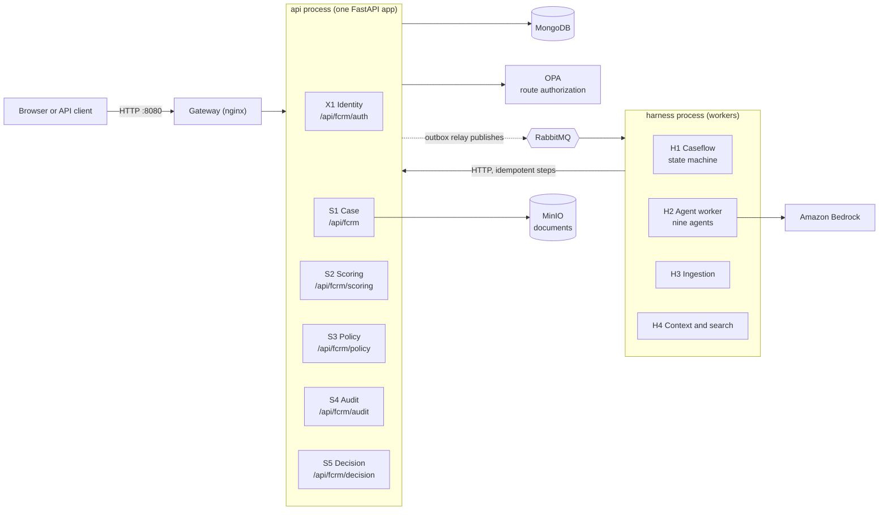
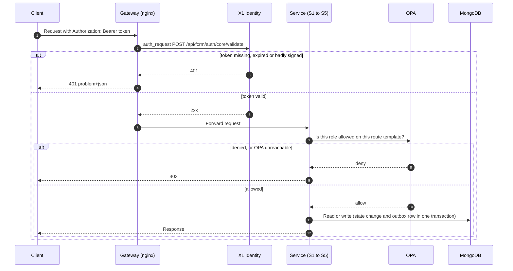
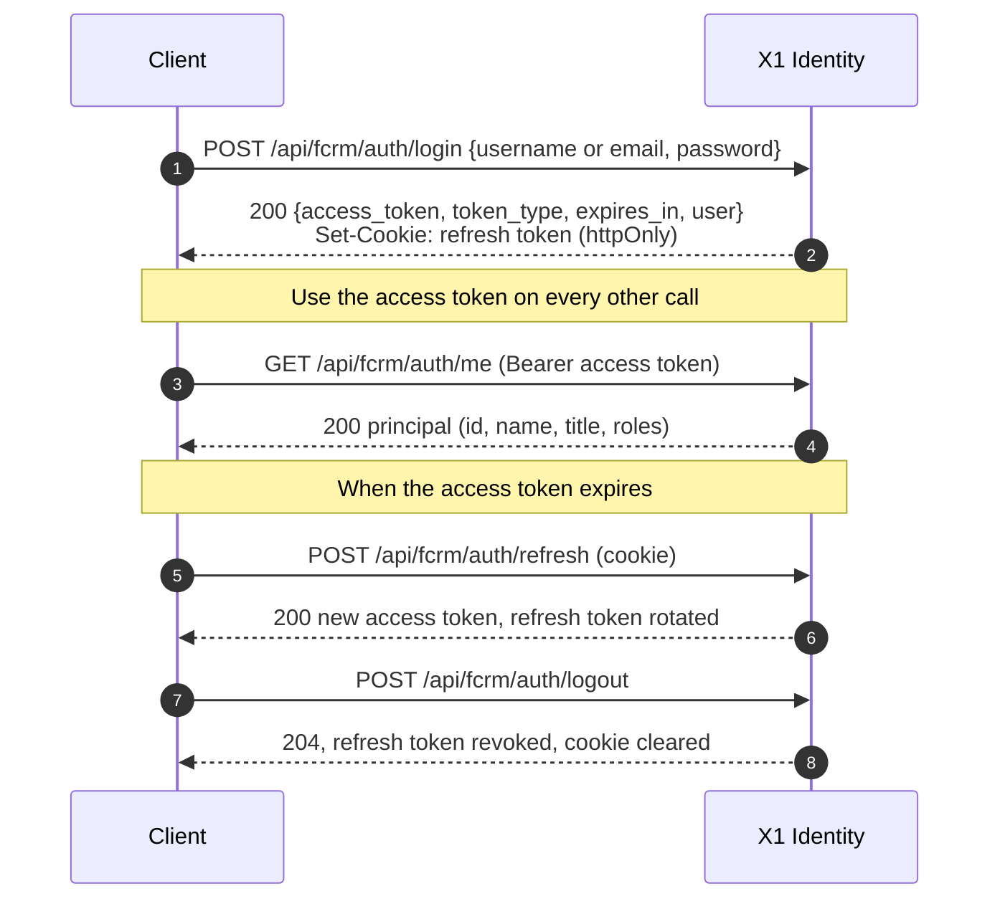
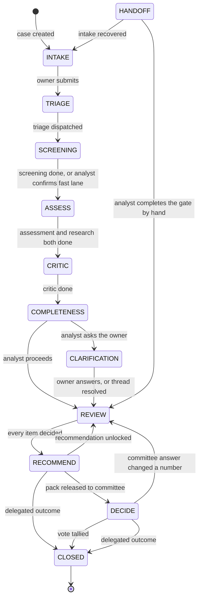
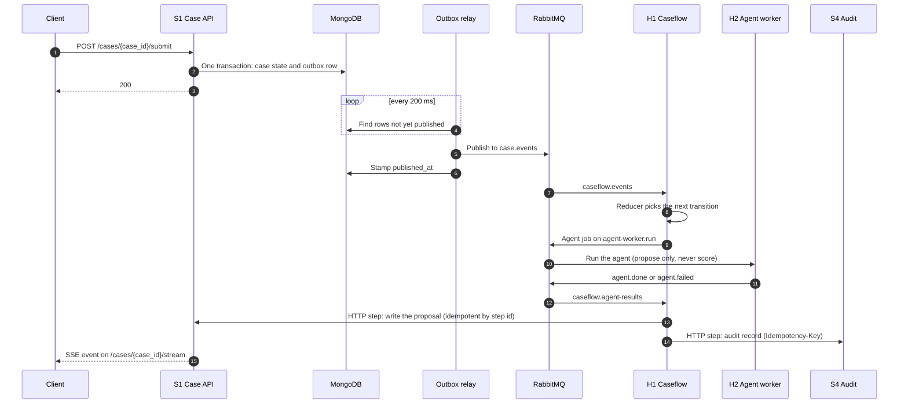
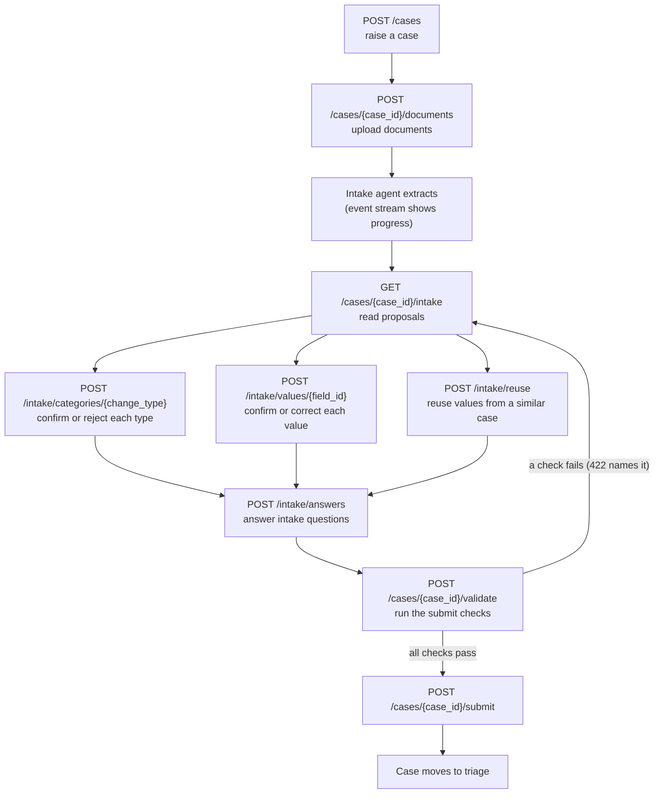
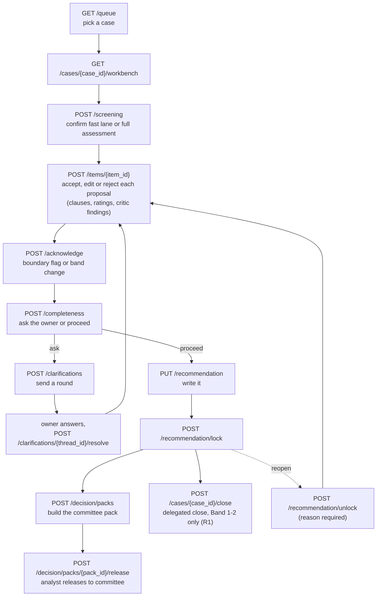
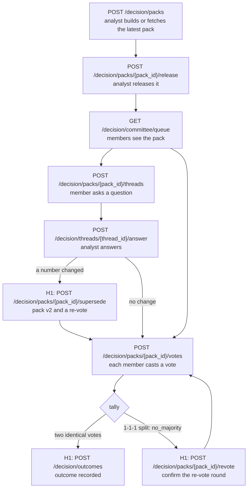
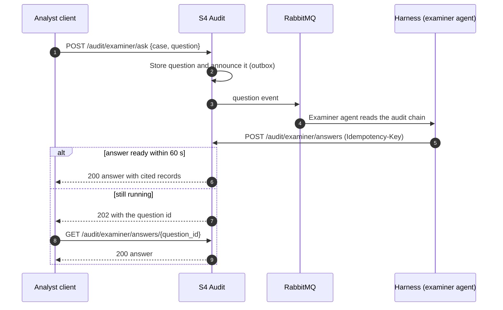
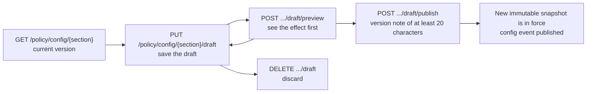

# TrustOps API Reference

TrustOps is the Genius Hacks Q3 2026 FCRM Risk Assessment Workbench. This document describes its HTTP API: how to reach it, how requests are authenticated and authorized, how a case moves through the system, and every endpoint with its parameters, request bodies, responses and the roles allowed to call it.

| | |
|---|---|
| API version | `0.1.0` (OpenAPI 3) |
| Operations | 127 (3 public, 6 service-to-service only) |
| Schemas | 319 |
| Base URL (local stack) | `http://localhost:8080` (the gateway; set `BASE` in the `curl` examples) |
| Source of truth | `trustops/docs/architecture/openapi/api.json` (generated by `make openapi`) and `trustops/ops/opa/data/permissions.json` (route authorization) |

> **How this document was produced.** The endpoint and schema sections are generated from the committed OpenAPI export, and the role lists are computed from the OPA permission rules, so they follow the code. Do not edit those sections by hand. After a route change, run `make openapi` in `trustops/`, then regenerate this file. Example bodies and `curl` snippets are illustrative values built from each schema, not recorded traffic.

## Contents

1. [System at a glance](#1-system-at-a-glance)
2. [Request lifecycle](#2-request-lifecycle)
3. [Authentication](#3-authentication)
4. [Authorization and roles](#4-authorization-and-roles)
5. [Conventions](#5-conventions)
6. [How a case moves](#6-how-a-case-moves)
7. [Workflows by API call](#7-workflows-by-api-call)
8. [Endpoint reference](#8-endpoint-reference)
  - [X1 Identity](#x1-identity-service) (9)
  - [S1 Case](#s1-case-service) (59)
  - [S2 Scoring](#s2-scoring-service) (8)
  - [S3 Policy](#s3-policy-service) (21)
  - [S4 Audit](#s4-audit-service) (14)
  - [S5 Decision](#s5-decision-service) (16)
9. [Schemas](#9-schemas)

---

## 1. System at a glance

Clients only ever talk to the **gateway** (nginx, port 8080). Behind it, one FastAPI process (`api`) hosts six services as sub-apps mounted by URL prefix. A second process (`harness`) runs the background workers. The two never call each other directly for events: they communicate through RabbitMQ, and the harness calls the services back over HTTP.



| ID | Service | Public prefix | Operations |
|---|---|---|---|
| X1 | Identity | `/api/fcrm/auth` | 9 |
| S1 | Case | `/api/fcrm` | 59 |
| S2 | Scoring | `/api/fcrm/scoring` | 8 |
| S3 | Policy | `/api/fcrm/policy` | 21 |
| S4 | Audit | `/api/fcrm/audit` | 14 |
| S5 | Decision | `/api/fcrm/decision` | 16 |

The gateway routes by prefix: `/api/fcrm/auth/*` to X1; `/api/fcrm/{cases,queue,conditions,reflags,dashboard,integrations,monitor,stream}` to S1; `/api/fcrm/scoring/*`, `/policy/*`, `/audit/*` and `/decision/*` to S2, S3, S4 and S5. Any other `/api/*` path returns a 404 problem response, and any path containing `/internal/` returns 404 (those routes are for the harness only).

## 2. Request lifecycle

Every request outside `/api/fcrm/auth/*` is checked twice: the gateway verifies the token with X1 (authentication), then the service asks OPA whether the caller's role may use that route (authorization). Both fail closed.



Two details matter when debugging:

- OPA is asked about the **route template** with the service prefix removed, for example `POST /cases/{id}/documents`, not the concrete URL.
- If X1 is unreachable the gateway answers 503, not 401.

## 3. Authentication

Tokens are JWTs issued by X1. The access token goes in the `Authorization: Bearer` header. The refresh token is an `httpOnly` cookie that never appears in a response body.



Practical points:

- `POST /login` takes `password` and exactly one of `username` or `email`. Unknown login, disabled account and wrong password all return the same 401, so the response never says which.
- An empty password signs a named user in only when the local demo picker is on (`GET /auth/demo-users` exists only then and returns 404 otherwise). In every other environment an empty password fails like any wrong one.
- `POST /refresh` rejects an access token, a revoked or expired refresh token, and a user who is no longer enabled.
- Server-sent-event streams cannot set headers from a browser `EventSource`, so stream routes also accept the token as `?access_token=`. Prefer a fetch-based client that sends the header; the query string is never logged.

## 4. Authorization and roles

Authorization is data, not code: `ops/opa/data/permissions.json` holds the rules. The default is **deny**, any matching `allow` grants access, and a matching `deny` overrides it. A deny rule matches the caller's own roles, not inherited ones.

| Role | Who | Inherits |
|---|---|---|
| `fcrm_po` | Product owner: raises cases and answers questions | itself |
| `fcrm_analyst` | Risk analyst: reviews, scores, recommends | itself |
| `fcrm_committee` | Committee member: votes on packs | itself |
| `fcrm_observer` | Read-only observer | itself |
| `fcrm_service` | The harness (Caseflow and workers) | analyst, PO and committee |

The service account inherits the human roles so Caseflow can call the services, but human decisions are fenced off from it with explicit deny rules: it cannot ask the examiner a question, release a pack, or cast a vote ("human gates are decided by people, never by the service account").

**Operations each role may call**, counted from the OPA rules over the non-internal, authenticated routes:

| Service | Operations | PO | Analyst | Committee | Observer | Service |
|---|---|---|---|---|---|---|
| X1 Identity | 9 | 3 | 4 | 4 | 3 | 4 |
| S1 Case | 59 | 26 | 41 | 5 | 2 | 28 |
| S2 Scoring | 8 | 0 | 1 | 4 | 0 | 5 |
| S3 Policy | 21 | 1 | 5 | 8 | 0 | 16 |
| S4 Audit | 14 | 0 | 11 | 9 | 2 | 13 |
| S5 Decision | 16 | 0 | 10 | 10 | 0 | 12 |

**The PO fence.** The product-owner role never receives score, band, rating, critic, vote, pack or harness data in any response, stream or page. It is enforced in three independent layers: the PO response models contain no such fields, S1 filters by role and event-type prefix, and a text scan checks the output. A PO also only sees cases it owns (S1 enforces ownership; for example another PO's case on the case stream is a 404, not a 403). This is why S1 has separate `po` and `analyst` route groups.

## 5. Conventions

**Errors.**

| Status | Meaning |
|---|---|
| `401` | Missing, expired or invalid token (gateway or service), or a failed login |
| `403` | The role is not allowed on this route, or OPA could not be reached |
| `404` | Unknown route, a case the caller may not see, or an internal route |
| `409` | A conflict with stored state, for example a different answer already stored for the same question |
| `413` | Body larger than the gateway limit |
| `422` | Validation failed. The body is `{"detail": [{"loc": [...], "msg": "...", "type": "..."}]}`; business-rule failures such as a failed submit check also use 422 and name the check |
| `429` | Rate limit exceeded |
| `503` | A dependency is down (identity, the broker, or an upstream) |

Responses generated by the gateway itself (401, 403, 404, 413, 429, 503) are `application/problem+json`; services' own error bodies pass through unchanged.

**Rate limits and size limits** (enforced at the gateway):

| Scope | Limit |
|---|---|
| Any authenticated route | 20 requests per second per user, burst 40 |
| `POST /auth/login` | 10 requests per minute per IP, burst 5 |
| `POST /cases/{case_id}/items/{item_id}` (gate decisions) | 5 requests per second per user, burst 5 |
| `POST /audit/examiner/ask` | burst 10; read timeout 75 s (the call waits up to 60 s) |
| Request body | 1 MB by default; 60 MB on document upload and corpus upload (50 MB per file) |
| Default read timeout | 30 s; document upload 300 s; event streams 1 hour |

**Idempotency.** Writes to S4 (audit) and S5 (decision) accept an `Idempotency-Key` header. Storing the same record or answer again is a replay and writes nothing; a different payload for the same key or question is a 409. Caseflow relies on this because it can run any step twice.

**Delivery guarantees.** Events are delivered to workers at least once, so consumers deduplicate. The API never publishes to RabbitMQ inside a request; see [How a case moves](#6-how-a-case-moves).

**Human decisions carry a reason.** Overrides, unlocks, handoff completions and similar actions require a reason in the body, and every state change writes an audit record.

**Live streams.** `GET /cases/{case_id}/stream` is a server-sent-event stream. Frames look like `id: <seq>` then `data: {type, caseId, seq, at, payload}`. Reconnect with `Last-Event-ID` (or `?last_event_id=`) to replay everything after that sequence number from the activity log. Two more stream routes exist at the gateway, a per-user stream (`/api/fcrm/stream`) and a harness monitor stream (`/api/fcrm/monitor/{id}/stream`), but they are not in the OpenAPI export.

**Internal routes.** Routes containing `/internal/` (`S2` model and routing-rule publishing, `S3` pins, clauses and precedents for the harness) belong to the service account and are not reachable through the gateway. They are listed here because they are part of the contract between H1 and the services.

## 6. How a case moves

### State machine

Caseflow (H1) owns the case state. It is a pure reducer: given the current state and a trigger it chooses the next state, and a person or an agent result supplies the trigger. Nothing is approved or rejected automatically.



`HANDOFF` is where a run goes when an agent job fails after its one retry: the analyst completes that gate by hand, with a reason. `REVIEW_AND_SUBMIT` also exists as an enum value, but the transition table does not use it as a separate step. A case may also be discarded before submit (`POST /cases/{case_id}/discard`).

Routing after the recommendation depends on the risk band (rules R1 to R6, served by S2): lower bands can be closed with a **delegated** outcome by the analyst (R1), higher bands go to the **committee** (R2). A committee needs two identical votes to win; a 1-1-1 split is `no_majority` and re-votes (R6).

### Event flow behind a single call

An API call never talks to RabbitMQ. A service writes its state and an outbox row in **one MongoDB transaction**; a relay publishes the row afterwards. Everything after the first response is asynchronous, which is why the web follows a case through its event stream instead of waiting on the request.



If RabbitMQ is down, rows simply wait in the outbox; the relay backs off up to 5 s and retries. A message can be delivered twice, so every consumer and every Caseflow step is safe to run twice.

## 7. Workflows by API call

### Product owner: raise and submit a case

The owner uploads documents, an intake agent proposes change types and field values with page and line sources, and the owner confirms each one. Nothing moves until the owner has decided every proposal.



After submission the owner can follow the case (`GET /cases/{case_id}`, `/activity`, `/stream`), answer analyst questions (`/clarifications/{thread_id}/answer`) and, once approved with conditions, upload evidence (`POST /cases/{case_id}/conditions/{condition_id}/evidence`).

### Analyst: review a case



`POST /cases/{case_id}/runs` requests a re-run of the agents with a reason. If a job fails, `GET /cases/{case_id}/handoff/gates` lists the gate and `POST /cases/{case_id}/handoff/{gate_id}/complete` finishes it by hand.

### Committee: pack, questions, vote

Some steps in this flow are taken by Caseflow with the service account (marked "H1" below), not by a person: a person's decision is always the vote, the question or the answer.



The four possible outcomes are `approve`, `approve_with_conditions`, `defer` and `reject`; there is no fifth value. Outcomes are read back with `GET /decision/packs/{pack_id}/outcome` or `GET /decision/cases/{case_id}/outcome`.

### Examiner: ask the audit chain a question

The examiner answers only from the case's verified audit chain and cites the records it used. The call waits for the answer up to a minute.



An answer that cites a record the chain does not hold is rejected with 422. A different answer for an already answered question is a 409.

### Analyst: change a policy configuration section

Configuration sections (routing rules, control inventory, jurisdiction list and similar) are edited as one draft per section and then published as a new immutable, versioned snapshot.



Publishing the jurisdiction list works by activating a stored list (`POST /policy/jurisdictions/versions/{version}/activate`), which also publishes `jurisdiction.list_published` in the same transaction so open cases can be re-flagged (`GET /reflags`, `POST /reflags/{reflag_id}/acknowledge`).

### Audit: verify a case

`GET /audit/records/{case_id}` lists the records in a case's hash chain, `GET /audit/head/{case_id}` returns the current chain head, and `GET /audit/verify/{case_id}` recomputes the chain and reports whether it is intact. Records are append-only; the harness appends them with `POST /audit/records` and an `Idempotency-Key`.

---

## 8. Endpoint reference

Each endpoint lists its authorized roles, parameters, request body, responses and, where useful, a `curl` example. Replace `$BASE` with `http://localhost:8080` and `$TOKEN` with an access token from `POST /api/fcrm/auth/login`. Path parameters appear as `{name}`.

<a id="x1-identity-service"></a>

### X1 Identity service

Login, refresh, logout, the current user, and the token check the gateway runs on every request.

Public prefix `/api/fcrm/auth`, 9 operations.

#### X1 · Identity

| Method | Path | Summary |
|---|---|---|
| `GET` | [`/api/fcrm/auth/core/userinfo`](#X1-get--api-fcrm-auth-core-userinfo) | Core Userinfo |
| `POST` | [`/api/fcrm/auth/core/validate`](#X1-post--api-fcrm-auth-core-validate) | Core Validate |
| `GET` | [`/api/fcrm/auth/demo-users`](#X1-get--api-fcrm-auth-demo-users) | Demo Users |
| `POST` | [`/api/fcrm/auth/login`](#X1-post--api-fcrm-auth-login) | Login |
| `POST` | [`/api/fcrm/auth/logout`](#X1-post--api-fcrm-auth-logout) | Logout |
| `GET` | [`/api/fcrm/auth/me`](#X1-get--api-fcrm-auth-me) | Me |
| `POST` | [`/api/fcrm/auth/refresh`](#X1-post--api-fcrm-auth-refresh) | Refresh |
| `GET` | [`/api/fcrm/auth/users`](#X1-get--api-fcrm-auth-users) | Users |
| `GET` | [`/api/fcrm/auth/users/me`](#X1-get--api-fcrm-auth-users-me) | Users Me |

<a id="X1-get--api-fcrm-auth-core-userinfo"></a>

##### `GET /api/fcrm/auth/core/userinfo`

**Core Userinfo**

_Roles: any signed-in user_

Alias of `POST /core/validate` (design A §8.1).

**Responses**

| Status | Meaning | Body |
|---|---|---|
| `200` | Successful Response | `application/json` [ValidateResponse](#s-ValidateResponse) |


<a id="X1-post--api-fcrm-auth-core-validate"></a>

##### `POST /api/fcrm/auth/core/validate`

**Core Validate**

_Roles: any signed-in user_

The AEO contract kept for nginx's `auth_request` (`ops/nginx`) and for any service falling back to it when JWKS is unreachable. `current_user` already rejects a non-access, expired or badly signed token with 401 before this body ever runs (bug 1's fix, shared with every other service via `TokenVerifier`).

**Responses**

| Status | Meaning | Body |
|---|---|---|
| `200` | Successful Response | `application/json` [ValidateResponse](#s-ValidateResponse) |


<a id="X1-get--api-fcrm-auth-demo-users"></a>

##### `GET /api/fcrm/auth/demo-users`

**Demo Users** (public, no token)

_Auth: none_

The seeded people grouped for the web's demo picker. Unauthenticated by design (it is shown before anyone has signed in) and therefore available only where password-less login is (`demo_login_active`).

**Raises**

- NotFoundError: Demo mode is off or `ENV` is not local -- the same 404 an unknown route gets, so the endpoint does not advertise itself.

**Responses**

| Status | Meaning | Body |
|---|---|---|
| `200` | Successful Response | `application/json` array of [DemoUserGroup](#s-DemoUserGroup) |


<a id="X1-post--api-fcrm-auth-login"></a>

##### `POST /api/fcrm/auth/login`

**Login** (public, no token)

_Auth: none_

Password login for a seeded user. Rate-limited at the gateway (nginx `limit_req zone=fcrm_login`), not here.

The account is named by `username` or `email` (exactly one, see `LoginRequest`). When the local demo picker is on (`demo_login_active`) an *empty* password signs the named, enabled user in without a hash check; in every other environment an empty password is checked like any other and fails.

**Raises**

- UnauthorizedError: Unknown login, disabled account or wrong password -- one message for all three, so the response never reveals which it was.

> Rate limit: 10 requests per minute per IP (burst 5).

**Request body** (required)

`application/json`: [LoginRequest](#s-LoginRequest)

| Field | Type | Required | Notes |
|---|---|---|---|
| `email` | string or null | no | min length 1; max length 254 |
| `password` | string | yes | max length 1024 |
| `username` | string or null | no | min length 1; max length 254 |

Example:

```json
{
  "password": "password"
}
```


**Responses**

| Status | Meaning | Body |
|---|---|---|
| `200` | Successful Response | `application/json` [LoginResponse](#s-LoginResponse) |
| `422` | Validation Error | `application/json` [HTTPValidationError](#s-HTTPValidationError) |


```bash
curl -X POST "$BASE/api/fcrm/auth/login" \
  -H "Content-Type: application/json" \
  -d '{"password":"password"}'
```


<a id="X1-post--api-fcrm-auth-logout"></a>

##### `POST /api/fcrm/auth/logout`

**Logout**

_Roles: PO, Analyst, Committee, Observer, Service_

Revoke the caller's refresh token (if one is presented and still decodes) and clear the cookie. Always 204: logging out an already-expired session is not an error.

**Request body**

`application/json`: [RefreshRequest](#s-RefreshRequest) or null


Example:

```json
{
  "refresh_token": "refresh_token"
}
```


**Responses**

| Status | Meaning | Body |
|---|---|---|
| `204` | Successful Response | none |
| `422` | Validation Error | `application/json` [HTTPValidationError](#s-HTTPValidationError) |


```bash
curl -X POST "$BASE/api/fcrm/auth/logout" \
  -H "Authorization: Bearer $TOKEN" \
  -H "Content-Type: application/json" \
  -d '{"refresh_token":"refresh_token"}'
```


<a id="X1-get--api-fcrm-auth-me"></a>

##### `GET /api/fcrm/auth/me`

**Me**

_Roles: PO, Analyst, Committee, Observer, Service_

The caller's own profile (id, name, roles, title, unit).

**Responses**

| Status | Meaning | Body |
|---|---|---|
| `200` | Successful Response | `application/json` [PrincipalOut](#s-PrincipalOut) |


<a id="X1-post--api-fcrm-auth-refresh"></a>

##### `POST /api/fcrm/auth/refresh`

**Refresh** (public, no token)

_Auth: none_

Rotate a refresh token for a new access token.

**Raises**

- UnauthorizedError: No refresh token presented, it is not a `refresh`-typed token (rejects an access token here, the mirror image of bug 1), it was never issued, is revoked or expired, or its owner is no longer enabled.

**Request body**

`application/json`: [RefreshRequest](#s-RefreshRequest) or null


Example:

```json
{
  "refresh_token": "refresh_token"
}
```


**Responses**

| Status | Meaning | Body |
|---|---|---|
| `200` | Successful Response | `application/json` [LoginResponse](#s-LoginResponse) |
| `422` | Validation Error | `application/json` [HTTPValidationError](#s-HTTPValidationError) |


```bash
curl -X POST "$BASE/api/fcrm/auth/refresh" \
  -H "Content-Type: application/json" \
  -d '{"refresh_token":"refresh_token"}'
```


<a id="X1-get--api-fcrm-auth-users"></a>

##### `GET /api/fcrm/auth/users`

**Users**

_Roles: Analyst, Committee, Service_

The enabled people holding `role`: the roster R5 auto-triage picks an analyst from and committee release counts members against. OPA lets analysts, committee members and the service account call it (`permissions.json`'s `identity-get-users-...` rule).

**Parameters**

| Name | In | Type | Required | Notes |
|---|---|---|---|---|
| `role` | query | [Role](#s-Role) | yes |  |


**Responses**

| Status | Meaning | Body |
|---|---|---|
| `200` | Successful Response | `application/json` array of [RosterUser](#s-RosterUser) |
| `422` | Validation Error | `application/json` [HTTPValidationError](#s-HTTPValidationError) |


```bash
curl -X GET "$BASE/api/fcrm/auth/users?role=…" \
  -H "Authorization: Bearer $TOKEN"
```


<a id="X1-get--api-fcrm-auth-users-me"></a>

##### `GET /api/fcrm/auth/users/me`

**Users Me**

_Roles: PO, Analyst, Committee, Observer, Service_

Alias of `GET /me` (design A §8.1).

**Responses**

| Status | Meaning | Body |
|---|---|---|
| `200` | Successful Response | `application/json` [PrincipalOut](#s-PrincipalOut) |


---

<a id="s1-case-service"></a>

### S1 Case service

The case record and everything a person does to it: the product owner's intake, the analyst's workbench, documents, live event streams, the queue and dashboards. Enforces the PO fence.

Public prefix `/api/fcrm`, 59 operations.

#### S1 · Product owner

| Method | Path | Summary |
|---|---|---|
| `GET` | [`/api/fcrm/cases`](#S1-get--api-fcrm-cases) | List Cases |
| `POST` | [`/api/fcrm/cases`](#S1-post--api-fcrm-cases) | Create Case |
| `GET` | [`/api/fcrm/cases/{case_id}`](#S1-get--api-fcrm-cases-case_id) | Get Case |
| `POST` | [`/api/fcrm/cases/{case_id}/clarifications/{thread_id}/answer`](#S1-post--api-fcrm-cases-case_id-clarifications-thread_id-answer) | Answer Question |
| `POST` | [`/api/fcrm/cases/{case_id}/conditions/{condition_id}/evidence`](#S1-post--api-fcrm-cases-case_id-conditions-condition_id-evidence) | Evidence Condition |
| `POST` | [`/api/fcrm/cases/{case_id}/discard`](#S1-post--api-fcrm-cases-case_id-discard) | Discard Case |
| `GET` | [`/api/fcrm/cases/{case_id}/documents`](#S1-get--api-fcrm-cases-case_id-documents) | Get Documents |
| `POST` | [`/api/fcrm/cases/{case_id}/documents`](#S1-post--api-fcrm-cases-case_id-documents) | Upload Documents |
| `GET` | [`/api/fcrm/cases/{case_id}/inbox`](#S1-get--api-fcrm-cases-case_id-inbox) | Get Inbox |
| `GET` | [`/api/fcrm/cases/{case_id}/intake`](#S1-get--api-fcrm-cases-case_id-intake) | Get Intake |
| `POST` | [`/api/fcrm/cases/{case_id}/intake/answers`](#S1-post--api-fcrm-cases-case_id-intake-answers) | Answer Questions |
| `POST` | [`/api/fcrm/cases/{case_id}/intake/categories/{change_type}`](#S1-post--api-fcrm-cases-case_id-intake-categories-change_type) | Decide Category |
| `POST` | [`/api/fcrm/cases/{case_id}/intake/reuse`](#S1-post--api-fcrm-cases-case_id-intake-reuse) | Reuse Values |
| `POST` | [`/api/fcrm/cases/{case_id}/intake/values/{field_id}`](#S1-post--api-fcrm-cases-case_id-intake-values-field_id) | Decide Value |
| `GET` | [`/api/fcrm/cases/{case_id}/review`](#S1-get--api-fcrm-cases-case_id-review) | Get Review |
| `POST` | [`/api/fcrm/cases/{case_id}/submit`](#S1-post--api-fcrm-cases-case_id-submit) | Submit Case |
| `POST` | [`/api/fcrm/cases/{case_id}/validate`](#S1-post--api-fcrm-cases-case_id-validate) | Validate Case |
| `GET` | [`/api/fcrm/dashboard`](#S1-get--api-fcrm-dashboard) | Dashboard |
| `GET` | [`/api/fcrm/integrations`](#S1-get--api-fcrm-integrations) | List Integrations |
| `POST` | [`/api/fcrm/integrations/{integration_id}/{action}`](#S1-post--api-fcrm-integrations-integration_id-action) | Set Integration |

<a id="S1-get--api-fcrm-cases"></a>

##### `GET /api/fcrm/cases`

**List Cases**

_Roles: PO, Service_

The owner's cases, newest first; `stage` and `needs_response` filter.

**Parameters**

| Name | In | Type | Required | Notes |
|---|---|---|---|---|
| `stage` | query | one of `"draft"`, `"submitted"`, `"under_assessment"`, `"awaiting_your_answer"`, `"decision"`, `"closed"` or null | no |  |
| `needs_response` | query | boolean | no | default `false` |
| `limit` | query | integer | no | min 1; max 200; default `50` |
| `cursor` | query | string or null | no |  |


**Responses**

| Status | Meaning | Body |
|---|---|---|
| `200` | Successful Response | `application/json` [Page_CasePOListItem_](#s-Page_CasePOListItem_) |
| `422` | Validation Error | `application/json` [HTTPValidationError](#s-HTTPValidationError) |


<a id="S1-post--api-fcrm-cases"></a>

##### `POST /api/fcrm/cases`

**Create Case**

_Roles: PO_

Raise a draft case: the id is minted and the versions in force pinned.

**Request body**

`application/json`: [CreateCaseBody](#s-CreateCaseBody) or null


Example:

```json
{
  "change_types": [],
  "mode": "ai_assisted",
  "title": "title"
}
```


**Responses**

| Status | Meaning | Body |
|---|---|---|
| `201` | Successful Response | `application/json` [CasePO](#s-CasePO) |
| `422` | Validation Error | `application/json` [HTTPValidationError](#s-HTTPValidationError) |


```bash
curl -X POST "$BASE/api/fcrm/cases" \
  -H "Authorization: Bearer $TOKEN" \
  -H "Content-Type: application/json" \
  -d '{"change_types":[],"mode":"ai_assisted","title":"title"}'
```


<a id="S1-get--api-fcrm-cases-case_id"></a>

##### `GET /api/fcrm/cases/{case_id}`

**Get Case**

_Roles: PO, Analyst, Service_

The case header, stage and what the owner does next.

**Parameters**

| Name | In | Type | Required | Notes |
|---|---|---|---|---|
| `case_id` | path | string | yes |  |


**Responses**

| Status | Meaning | Body |
|---|---|---|
| `200` | Successful Response | `application/json` [CasePO](#s-CasePO) |
| `422` | Validation Error | `application/json` [HTTPValidationError](#s-HTTPValidationError) |


<a id="S1-post--api-fcrm-cases-case_id-clarifications-thread_id-answer"></a>

##### `POST /api/fcrm/cases/{case_id}/clarifications/{thread_id}/answer`

**Answer Question**

_Roles: PO_

Answer one question (text, optionally values and documents). The answer that closes the round freezes submission v2 and tells Caseflow which fields changed and which documents were added.

**Parameters**

| Name | In | Type | Required | Notes |
|---|---|---|---|---|
| `case_id` | path | string | yes |  |
| `thread_id` | path | string | yes |  |


**Request body** (required)

`application/json`: [ThreadAnswerBody](#s-ThreadAnswerBody)

| Field | Type | Required | Notes |
|---|---|---|---|
| `documents` | array of string | no | max items 10 |
| `field_values` | array of [ThreadFieldValue](#s-ThreadFieldValue) | no | max items 20 |
| `text` | string | yes | min length 1; max length 2000 |

Example:

```json
{
  "text": "text"
}
```


**Responses**

| Status | Meaning | Body |
|---|---|---|
| `200` | Successful Response | `application/json` [InboxPO](#s-InboxPO) |
| `422` | Validation Error | `application/json` [HTTPValidationError](#s-HTTPValidationError) |


```bash
curl -X POST "$BASE/api/fcrm/cases/{case_id}/clarifications/{thread_id}/answer" \
  -H "Authorization: Bearer $TOKEN" \
  -H "Content-Type: application/json" \
  -d '{"text":"text"}'
```


<a id="S1-post--api-fcrm-cases-case_id-conditions-condition_id-evidence"></a>

##### `POST /api/fcrm/cases/{case_id}/conditions/{condition_id}/evidence`

**Evidence Condition**

_Roles: PO_

Attach evidence to one of the owner's own conditions (allowed after the case is closed): its status becomes `evidence_submitted` and FCRM reviews it.

**Parameters**

| Name | In | Type | Required | Notes |
|---|---|---|---|---|
| `case_id` | path | string | yes |  |
| `condition_id` | path | string | yes |  |


**Request body** (required)

`application/json`: [ConditionEvidenceBody](#s-ConditionEvidenceBody)

| Field | Type | Required | Notes |
|---|---|---|---|
| `note` | string | yes | min length 1; max length 2000 |

Example:

```json
{
  "note": "note"
}
```


**Responses**

| Status | Meaning | Body |
|---|---|---|
| `200` | Successful Response | `application/json` [ConditionPO](#s-ConditionPO) |
| `422` | Validation Error | `application/json` [HTTPValidationError](#s-HTTPValidationError) |


```bash
curl -X POST "$BASE/api/fcrm/cases/{case_id}/conditions/{condition_id}/evidence" \
  -H "Authorization: Bearer $TOKEN" \
  -H "Content-Type: application/json" \
  -d '{"note":"note"}'
```


<a id="S1-post--api-fcrm-cases-case_id-discard"></a>

##### `POST /api/fcrm/cases/{case_id}/discard`

**Discard Case**

_Roles: PO_

Discard an unsubmitted draft, with a reason.

**Parameters**

| Name | In | Type | Required | Notes |
|---|---|---|---|---|
| `case_id` | path | string | yes |  |


**Request body** (required)

`application/json`: [DiscardBody](#s-DiscardBody)

| Field | Type | Required | Notes |
|---|---|---|---|
| `reason` | string | yes | max length 1000 |

Example:

```json
{
  "reason": "reason"
}
```


**Responses**

| Status | Meaning | Body |
|---|---|---|
| `204` | Successful Response | none |
| `422` | Validation Error | `application/json` [HTTPValidationError](#s-HTTPValidationError) |


```bash
curl -X POST "$BASE/api/fcrm/cases/{case_id}/discard" \
  -H "Authorization: Bearer $TOKEN" \
  -H "Content-Type: application/json" \
  -d '{"reason":"reason"}'
```


<a id="S1-get--api-fcrm-cases-case_id-documents"></a>

##### `GET /api/fcrm/cases/{case_id}/documents`

**Get Documents**

_Roles: PO, Analyst, Service_

The Documents tab.

**Parameters**

| Name | In | Type | Required | Notes |
|---|---|---|---|---|
| `case_id` | path | string | yes |  |


**Responses**

| Status | Meaning | Body |
|---|---|---|
| `200` | Successful Response | `application/json` [DocumentsViewPO](#s-DocumentsViewPO) |
| `422` | Validation Error | `application/json` [HTTPValidationError](#s-HTTPValidationError) |


<a id="S1-post--api-fcrm-cases-case_id-documents"></a>

##### `POST /api/fcrm/cases/{case_id}/documents`

**Upload Documents**

_Roles: PO_

Upload files (multipart `files`), or use the committed demo documents (JSON `{"demo_files": [...]}`). Each file is checked, stored and announced to Caseflow in one transaction.

> Upload: up to 50 MB per file (gateway body limit 60 MB); the request is streamed.

**Parameters**

| Name | In | Type | Required | Notes |
|---|---|---|---|---|
| `case_id` | path | string | yes |  |


**Request body** (required)

`application/json`: object

| Field | Type | Required | Notes |
|---|---|---|---|
| `demo_files` | array of object | no |  |

Example:

```json
{
  "demo_files": [
    {
      "name": "name"
    }
  ]
}
```

`multipart/form-data`: object

| Field | Type | Required | Notes |
|---|---|---|---|
| `files` | array of string (binary) | yes |  |


**Responses**

| Status | Meaning | Body |
|---|---|---|
| `201` | Successful Response | `application/json` [DocumentsViewPO](#s-DocumentsViewPO) |
| `422` | Validation Error | `application/json` [HTTPValidationError](#s-HTTPValidationError) |


```bash
curl -X POST "$BASE/api/fcrm/cases/{case_id}/documents" \
  -H "Authorization: Bearer $TOKEN" \
  -H "Content-Type: application/json" \
  -d '{"demo_files":[{"name":"name"}]}' \
  -F "files=@document.pdf"
```


<a id="S1-get--api-fcrm-cases-case_id-inbox"></a>

##### `GET /api/fcrm/cases/{case_id}/inbox`

**Get Inbox**

_Roles: PO, Service_

The questions FCRM asked, by round, each "Re: <field>", with the owner's answers. Nothing the analyst keeps to themselves.

**Parameters**

| Name | In | Type | Required | Notes |
|---|---|---|---|---|
| `case_id` | path | string | yes |  |


**Responses**

| Status | Meaning | Body |
|---|---|---|
| `200` | Successful Response | `application/json` [InboxPO](#s-InboxPO) |
| `422` | Validation Error | `application/json` [HTTPValidationError](#s-HTTPValidationError) |


<a id="S1-get--api-fcrm-cases-case_id-intake"></a>

##### `GET /api/fcrm/cases/{case_id}/intake`

**Get Intake**

_Roles: PO, Service_

The Overview tab: proposed types, values with sources, precedent, questions.

**Parameters**

| Name | In | Type | Required | Notes |
|---|---|---|---|---|
| `case_id` | path | string | yes |  |


**Responses**

| Status | Meaning | Body |
|---|---|---|
| `200` | Successful Response | `application/json` [IntakeViewPO](#s-IntakeViewPO) |
| `422` | Validation Error | `application/json` [HTTPValidationError](#s-HTTPValidationError) |


<a id="S1-post--api-fcrm-cases-case_id-intake-answers"></a>

##### `POST /api/fcrm/cases/{case_id}/intake/answers`

**Answer Questions**

_Roles: PO_

Answer the assistant's questions (one decision per question).

**Parameters**

| Name | In | Type | Required | Notes |
|---|---|---|---|---|
| `case_id` | path | string | yes |  |


**Request body** (required)

`application/json`: [AnswersBody](#s-AnswersBody)

| Field | Type | Required | Notes |
|---|---|---|---|
| `answers` | array of [AnswerItem](#s-AnswerItem) | yes | min items 1; max items 50 |

Example:

```json
{
  "answers": [
    {}
  ]
}
```


**Responses**

| Status | Meaning | Body |
|---|---|---|
| `200` | Successful Response | `application/json` [IntakeViewPO](#s-IntakeViewPO) |
| `422` | Validation Error | `application/json` [HTTPValidationError](#s-HTTPValidationError) |


```bash
curl -X POST "$BASE/api/fcrm/cases/{case_id}/intake/answers" \
  -H "Authorization: Bearer $TOKEN" \
  -H "Content-Type: application/json" \
  -d '{"answers":[{}]}'
```


<a id="S1-post--api-fcrm-cases-case_id-intake-categories-change_type"></a>

##### `POST /api/fcrm/cases/{case_id}/intake/categories/{change_type}`

**Decide Category**

_Roles: PO_

Confirm or remove one proposed change type (a removal needs a reason).

**Parameters**

| Name | In | Type | Required | Notes |
|---|---|---|---|---|
| `case_id` | path | string | yes |  |
| `change_type` | path | [ChangeType](#s-ChangeType) | yes |  |


**Request body** (required)

`application/json`: [CategoryDecisionBody](#s-CategoryDecisionBody)

| Field | Type | Required | Notes |
|---|---|---|---|
| `decision` | one of `"confirm"`, `"remove"`, `"add"` | yes |  |
| `reason` | string or null | no | max length 1000 |

Example:

```json
{
  "decision": "confirm"
}
```


**Responses**

| Status | Meaning | Body |
|---|---|---|
| `200` | Successful Response | `application/json` [IntakeViewPO](#s-IntakeViewPO) |
| `422` | Validation Error | `application/json` [HTTPValidationError](#s-HTTPValidationError) |


```bash
curl -X POST "$BASE/api/fcrm/cases/{case_id}/intake/categories/{change_type}" \
  -H "Authorization: Bearer $TOKEN" \
  -H "Content-Type: application/json" \
  -d '{"decision":"confirm"}'
```


<a id="S1-post--api-fcrm-cases-case_id-intake-reuse"></a>

##### `POST /api/fcrm/cases/{case_id}/intake/reuse`

**Reuse Values**

_Roles: PO_

Reuse values from the precedent the assistant found.

**Parameters**

| Name | In | Type | Required | Notes |
|---|---|---|---|---|
| `case_id` | path | string | yes |  |


**Request body** (required)

`application/json`: [ReuseBody](#s-ReuseBody)

| Field | Type | Required | Notes |
|---|---|---|---|
| `field_ids` | array of string | yes | min items 1; max items 40 |
| `from_case_id` | string | yes | min length 1; max length 40 |

Example:

```json
{
  "field_ids": [
    "field_ids"
  ],
  "from_case_id": "FCRM-2026-0151"
}
```


**Responses**

| Status | Meaning | Body |
|---|---|---|
| `200` | Successful Response | `application/json` [IntakeViewPO](#s-IntakeViewPO) |
| `422` | Validation Error | `application/json` [HTTPValidationError](#s-HTTPValidationError) |


```bash
curl -X POST "$BASE/api/fcrm/cases/{case_id}/intake/reuse" \
  -H "Authorization: Bearer $TOKEN" \
  -H "Content-Type: application/json" \
  -d '{"field_ids":["field_ids"],"from_case_id":"FCRM-2026-0151"}'
```


<a id="S1-post--api-fcrm-cases-case_id-intake-values-field_id"></a>

##### `POST /api/fcrm/cases/{case_id}/intake/values/{field_id}`

**Decide Value**

_Roles: PO_

Confirm or correct one value; a correction keeps the original.

**Parameters**

| Name | In | Type | Required | Notes |
|---|---|---|---|---|
| `case_id` | path | string | yes |  |
| `field_id` | path | string | yes |  |


**Request body** (required)

`application/json`: [ValueDecisionBody](#s-ValueDecisionBody)

| Field | Type | Required | Notes |
|---|---|---|---|
| `decision` | one of `"confirm"`, `"correct"` | yes |  |
| `reason` | string or null | no | max length 1000 |
| `value` | string or null | no | max length 2000 |

Example:

```json
{
  "decision": "confirm"
}
```


**Responses**

| Status | Meaning | Body |
|---|---|---|
| `200` | Successful Response | `application/json` [ReviewViewPO](#s-ReviewViewPO) |
| `422` | Validation Error | `application/json` [HTTPValidationError](#s-HTTPValidationError) |


```bash
curl -X POST "$BASE/api/fcrm/cases/{case_id}/intake/values/{field_id}" \
  -H "Authorization: Bearer $TOKEN" \
  -H "Content-Type: application/json" \
  -d '{"decision":"confirm"}'
```


<a id="S1-get--api-fcrm-cases-case_id-review"></a>

##### `GET /api/fcrm/cases/{case_id}/review`

**Get Review**

_Roles: PO, Service_

The Review & submit tab.

**Parameters**

| Name | In | Type | Required | Notes |
|---|---|---|---|---|
| `case_id` | path | string | yes |  |


**Responses**

| Status | Meaning | Body |
|---|---|---|
| `200` | Successful Response | `application/json` [ReviewViewPO](#s-ReviewViewPO) |
| `422` | Validation Error | `application/json` [HTTPValidationError](#s-HTTPValidationError) |


<a id="S1-post--api-fcrm-cases-case_id-submit"></a>

##### `POST /api/fcrm/cases/{case_id}/submit`

**Submit Case**

_Roles: PO_

Run the four checks again and submit; 422 names the failing check.

**Parameters**

| Name | In | Type | Required | Notes |
|---|---|---|---|---|
| `case_id` | path | string | yes |  |


**Request body**

`application/json`: [EmptyBody](#s-EmptyBody) or null


Example:

```json
{}
```


**Responses**

| Status | Meaning | Body |
|---|---|---|
| `200` | Successful Response | `application/json` [SubmitResult](#s-SubmitResult) |
| `422` | Validation Error | `application/json` [HTTPValidationError](#s-HTTPValidationError) |


```bash
curl -X POST "$BASE/api/fcrm/cases/{case_id}/submit" \
  -H "Authorization: Bearer $TOKEN" \
  -H "Content-Type: application/json" \
  -d '{}'
```


<a id="S1-post--api-fcrm-cases-case_id-validate"></a>

##### `POST /api/fcrm/cases/{case_id}/validate`

**Validate Case**

_Roles: PO_

A dry run of the four submit checks (always 200).

**Parameters**

| Name | In | Type | Required | Notes |
|---|---|---|---|---|
| `case_id` | path | string | yes |  |


**Request body**

`application/json`: [EmptyBody](#s-EmptyBody) or null


Example:

```json
{}
```


**Responses**

| Status | Meaning | Body |
|---|---|---|
| `200` | Successful Response | `application/json` [SubmitResult](#s-SubmitResult) |
| `422` | Validation Error | `application/json` [HTTPValidationError](#s-HTTPValidationError) |


```bash
curl -X POST "$BASE/api/fcrm/cases/{case_id}/validate" \
  -H "Authorization: Bearer $TOKEN" \
  -H "Content-Type: application/json" \
  -d '{}'
```


<a id="S1-get--api-fcrm-dashboard"></a>

##### `GET /api/fcrm/dashboard`

**Dashboard**

_Roles: PO, Service_

The owner's KPIs and open cases.

**Responses**

| Status | Meaning | Body |
|---|---|---|
| `200` | Successful Response | `application/json` [DashboardPO](#s-DashboardPO) |


<a id="S1-get--api-fcrm-integrations"></a>

##### `GET /api/fcrm/integrations`

**List Integrations**

_Roles: PO, Service_

The owner's integrations and their choices.

**Responses**

| Status | Meaning | Body |
|---|---|---|
| `200` | Successful Response | `application/json` [Page_Integration_](#s-Page_Integration_) |


<a id="S1-post--api-fcrm-integrations-integration_id-action"></a>

##### `POST /api/fcrm/integrations/{integration_id}/{action}`

**Set Integration**

_Roles: PO_

Connect an integration to a location or channel, or disconnect it.

**Parameters**

| Name | In | Type | Required | Notes |
|---|---|---|---|---|
| `integration_id` | path | string | yes |  |
| `action` | path | one of `"connect"`, `"disconnect"` | yes |  |


**Request body**

`application/json`: [IntegrationActionBody](#s-IntegrationActionBody) or null


Example:

```json
{
  "scope": "scope"
}
```


**Responses**

| Status | Meaning | Body |
|---|---|---|
| `200` | Successful Response | `application/json` [Integration](#s-Integration) |
| `422` | Validation Error | `application/json` [HTTPValidationError](#s-HTTPValidationError) |


```bash
curl -X POST "$BASE/api/fcrm/integrations/{integration_id}/{action}" \
  -H "Authorization: Bearer $TOKEN" \
  -H "Content-Type: application/json" \
  -d '{"scope":"scope"}'
```


#### S1 · Analyst

| Method | Path | Summary |
|---|---|---|
| `POST` | [`/api/fcrm/cases/{case_id}/acknowledge`](#S1-post--api-fcrm-cases-case_id-acknowledge) | Acknowledge |
| `GET` | [`/api/fcrm/cases/{case_id}/activity`](#S1-get--api-fcrm-cases-case_id-activity) | Activity |
| `GET` | [`/api/fcrm/cases/{case_id}/assessment`](#S1-get--api-fcrm-cases-case_id-assessment) | Assessment |
| `POST` | [`/api/fcrm/cases/{case_id}/change-types`](#S1-post--api-fcrm-cases-case_id-change-types) | Retag Case |
| `GET` | [`/api/fcrm/cases/{case_id}/clarifications`](#S1-get--api-fcrm-cases-case_id-clarifications) | Clarifications |
| `POST` | [`/api/fcrm/cases/{case_id}/clarifications`](#S1-post--api-fcrm-cases-case_id-clarifications) | Send Round |
| `POST` | [`/api/fcrm/cases/{case_id}/clarifications/{thread_id}/resolve`](#S1-post--api-fcrm-cases-case_id-clarifications-thread_id-resolve) | Resolve Thread |
| `POST` | [`/api/fcrm/cases/{case_id}/clauses`](#S1-post--api-fcrm-cases-case_id-clauses) | Add Clause |
| `POST` | [`/api/fcrm/cases/{case_id}/completeness`](#S1-post--api-fcrm-cases-case_id-completeness) | Decide Completeness |
| `POST` | [`/api/fcrm/cases/{case_id}/controls/planned`](#S1-post--api-fcrm-cases-case_id-controls-planned) | Add Planned Control |
| `POST` | [`/api/fcrm/cases/{case_id}/gaps`](#S1-post--api-fcrm-cases-case_id-gaps) | Record Gap |
| `GET` | [`/api/fcrm/cases/{case_id}/handoff`](#S1-get--api-fcrm-cases-case_id-handoff) | Handoff |
| `GET` | [`/api/fcrm/cases/{case_id}/handoff/gates`](#S1-get--api-fcrm-cases-case_id-handoff-gates) | Get Handoff Gates |
| `POST` | [`/api/fcrm/cases/{case_id}/handoff/{gate_id}/complete`](#S1-post--api-fcrm-cases-case_id-handoff-gate_id-complete) | Complete Handoff |
| `GET` | [`/api/fcrm/cases/{case_id}/harness`](#S1-get--api-fcrm-cases-case_id-harness) | Harness |
| `POST` | [`/api/fcrm/cases/{case_id}/items/{item_id}`](#S1-post--api-fcrm-cases-case_id-items-item_id) | Decide Item |
| `GET` | [`/api/fcrm/cases/{case_id}/outcome`](#S1-get--api-fcrm-cases-case_id-outcome) | Outcome |
| `GET` | [`/api/fcrm/cases/{case_id}/policy`](#S1-get--api-fcrm-cases-case_id-policy) | Policy |
| `POST` | [`/api/fcrm/cases/{case_id}/questions`](#S1-post--api-fcrm-cases-case_id-questions) | Ask Owner |
| `GET` | [`/api/fcrm/cases/{case_id}/recommendation`](#S1-get--api-fcrm-cases-case_id-recommendation) | Get Recommendation |
| `PUT` | [`/api/fcrm/cases/{case_id}/recommendation`](#S1-put--api-fcrm-cases-case_id-recommendation) | Put Recommendation |
| `POST` | [`/api/fcrm/cases/{case_id}/recommendation/lock`](#S1-post--api-fcrm-cases-case_id-recommendation-lock) | Lock Recommendation |
| `POST` | [`/api/fcrm/cases/{case_id}/recommendation/unlock`](#S1-post--api-fcrm-cases-case_id-recommendation-unlock) | Unlock Recommendation |
| `GET` | [`/api/fcrm/cases/{case_id}/risk`](#S1-get--api-fcrm-cases-case_id-risk) | Risk |
| `POST` | [`/api/fcrm/cases/{case_id}/runs`](#S1-post--api-fcrm-cases-case_id-runs) | Request Rerun |
| `POST` | [`/api/fcrm/cases/{case_id}/screening`](#S1-post--api-fcrm-cases-case_id-screening) | Decide Screening |
| `GET` | [`/api/fcrm/cases/{case_id}/submissions`](#S1-get--api-fcrm-cases-case_id-submissions) | Submissions |
| `GET` | [`/api/fcrm/cases/{case_id}/submissions/diff`](#S1-get--api-fcrm-cases-case_id-submissions-diff) | Submission Diff |
| `GET` | [`/api/fcrm/cases/{case_id}/workbench`](#S1-get--api-fcrm-cases-case_id-workbench) | Workbench |
| `GET` | [`/api/fcrm/dashboard/analyst`](#S1-get--api-fcrm-dashboard-analyst) | Analyst Dashboard |
| `GET` | [`/api/fcrm/queue`](#S1-get--api-fcrm-queue) | Queue |

<a id="S1-post--api-fcrm-cases-case_id-acknowledge"></a>

##### `POST /api/fcrm/cases/{case_id}/acknowledge`

**Acknowledge**

_Roles: Analyst_

Acknowledge a boundary flag or a band change (R3): `gate.decided ack` for every open gate of that kind, read from the score that opened it.

**Parameters**

| Name | In | Type | Required | Notes |
|---|---|---|---|---|
| `case_id` | path | string | yes |  |


**Request body** (required)

`application/json`: [AcknowledgeBody](#s-AcknowledgeBody)

| Field | Type | Required | Notes |
|---|---|---|---|
| `kind` | one of `"boundary"`, `"band_change"` | yes |  |
| `note` | string or null | no | max length 2000 |

Example:

```json
{
  "kind": "boundary"
}
```


**Responses**

| Status | Meaning | Body |
|---|---|---|
| `202` | Successful Response | `application/json` [AcknowledgeResult](#s-AcknowledgeResult) |
| `422` | Validation Error | `application/json` [HTTPValidationError](#s-HTTPValidationError) |


```bash
curl -X POST "$BASE/api/fcrm/cases/{case_id}/acknowledge" \
  -H "Authorization: Bearer $TOKEN" \
  -H "Content-Type: application/json" \
  -d '{"kind":"boundary"}'
```


<a id="S1-get--api-fcrm-cases-case_id-activity"></a>

##### `GET /api/fcrm/cases/{case_id}/activity`

**Activity**

_Roles: PO, Analyst, Service_

The case's activity, newest first. An owner reads their own case's feed in plain words (`PoService.activity`: only what the owner may see, no actor, no audit record); an analyst reads every row with who did it, the audit record it cites and its gate. Each caller's service is built only on its own branch, so an owner's read never needs the analyst's stores.

**Parameters**

| Name | In | Type | Required | Notes |
|---|---|---|---|---|
| `case_id` | path | string | yes |  |
| `limit` | query | integer | no | min 1; max 200; default `50` |
| `cursor` | query | string or null | no |  |


**Responses**

| Status | Meaning | Body |
|---|---|---|
| `200` | Successful Response | `application/json` [Page_ActivityEventPO_](#s-Page_ActivityEventPO_) or [Page_ActivityAnalyst_](#s-Page_ActivityAnalyst_) |
| `422` | Validation Error | `application/json` [HTTPValidationError](#s-HTTPValidationError) |


<a id="S1-get--api-fcrm-cases-case_id-assessment"></a>

##### `GET /api/fcrm/cases/{case_id}/assessment`

**Assessment**

_Roles: Analyst, Service_

The Summary tab: what the submission holds, what to notice, the critic's findings, the completeness report and the score box. The score is withheld until the analyst has opened the risk view.

**Parameters**

| Name | In | Type | Required | Notes |
|---|---|---|---|---|
| `case_id` | path | string | yes |  |


**Responses**

| Status | Meaning | Body |
|---|---|---|
| `200` | Successful Response | `application/json` [AssessmentSummary](#s-AssessmentSummary) |
| `422` | Validation Error | `application/json` [HTTPValidationError](#s-HTTPValidationError) |


<a id="S1-post--api-fcrm-cases-case_id-change-types"></a>

##### `POST /api/fcrm/cases/{case_id}/change-types`

**Retag Case**

_Roles: Analyst_

Add a change type with a reason (adds only): the fields and domains that follow are stored with it, then `case.retagged` is emitted.

**Parameters**

| Name | In | Type | Required | Notes |
|---|---|---|---|---|
| `case_id` | path | string | yes |  |


**Request body** (required)

`application/json`: [ChangeTypeBody](#s-ChangeTypeBody)

| Field | Type | Required | Notes |
|---|---|---|---|
| `change_type` | [ChangeType](#s-ChangeType) | yes |  |
| `reason` | string | yes |  |

Example:

```json
{
  "change_type": "new_product",
  "reason": "reason"
}
```


**Responses**

| Status | Meaning | Body |
|---|---|---|
| `200` | Successful Response | `application/json` [ChangeTypeResult](#s-ChangeTypeResult) |
| `422` | Validation Error | `application/json` [HTTPValidationError](#s-HTTPValidationError) |


```bash
curl -X POST "$BASE/api/fcrm/cases/{case_id}/change-types" \
  -H "Authorization: Bearer $TOKEN" \
  -H "Content-Type: application/json" \
  -d '{"change_type":"new_product","reason":"reason"}'
```


<a id="S1-get--api-fcrm-cases-case_id-clarifications"></a>

##### `GET /api/fcrm/cases/{case_id}/clarifications`

**Clarifications**

_Roles: Analyst, Service_

The Inbox tab: the questions drafted for the owner, the round sent, each question with the owner's answer, and whether the analyst's clock is paused on the owner.

**Parameters**

| Name | In | Type | Required | Notes |
|---|---|---|---|---|
| `case_id` | path | string | yes |  |


**Responses**

| Status | Meaning | Body |
|---|---|---|
| `200` | Successful Response | `application/json` [ClarificationsView](#s-ClarificationsView) |
| `422` | Validation Error | `application/json` [HTTPValidationError](#s-HTTPValidationError) |


<a id="S1-post--api-fcrm-cases-case_id-clarifications"></a>

##### `POST /api/fcrm/cases/{case_id}/clarifications`

**Send Round**

_Roles: Analyst_

Send the round the composer prepared: the same round as `ask` with the analyst's own questions (one round, sent once).

**Parameters**

| Name | In | Type | Required | Notes |
|---|---|---|---|---|
| `case_id` | path | string | yes |  |


**Request body** (required)

`application/json`: [RoundBody](#s-RoundBody)

| Field | Type | Required | Notes |
|---|---|---|---|
| `questions` | array of [RoundQuestion](#s-RoundQuestion) | yes | min items 1; max items 50 |

Example:

```json
{
  "questions": [
    {}
  ]
}
```


**Responses**

| Status | Meaning | Body |
|---|---|---|
| `201` | Successful Response | `application/json` [CompletenessResult](#s-CompletenessResult) |
| `422` | Validation Error | `application/json` [HTTPValidationError](#s-HTTPValidationError) |


```bash
curl -X POST "$BASE/api/fcrm/cases/{case_id}/clarifications" \
  -H "Authorization: Bearer $TOKEN" \
  -H "Content-Type: application/json" \
  -d '{"questions":[{}]}'
```


<a id="S1-post--api-fcrm-cases-case_id-clarifications-thread_id-resolve"></a>

##### `POST /api/fcrm/cases/{case_id}/clarifications/{thread_id}/resolve`

**Resolve Thread**

_Roles: Analyst_

Resolve an answered question.

**Parameters**

| Name | In | Type | Required | Notes |
|---|---|---|---|---|
| `case_id` | path | string | yes |  |
| `thread_id` | path | string | yes |  |


**Request body**

`application/json`: [ResolveThreadBody](#s-ResolveThreadBody) or null


Example:

```json
{
  "note": "note"
}
```


**Responses**

| Status | Meaning | Body |
|---|---|---|
| `200` | Successful Response | `application/json` [ThreadResolveResult](#s-ThreadResolveResult) |
| `422` | Validation Error | `application/json` [HTTPValidationError](#s-HTTPValidationError) |


```bash
curl -X POST "$BASE/api/fcrm/cases/{case_id}/clarifications/{thread_id}/resolve" \
  -H "Authorization: Bearer $TOKEN" \
  -H "Content-Type: application/json" \
  -d '{"note":"note"}'
```


<a id="S1-post--api-fcrm-cases-case_id-clauses"></a>

##### `POST /api/fcrm/cases/{case_id}/clauses`

**Add Clause**

_Roles: Analyst_

Add a clause found by searching the corpus, with a reason of at least 20 characters. It is accepted when added (no gate) and never scored. 409 `wrong_stage` outside review or an unlocked recommendation, 409 `clause_on_case` when it is already on the case and not removed, 422 when the pinned corpus has no such quotable clause, 503 when S3 cannot be read (nothing is stored). The same addition again replays.

**Parameters**

| Name | In | Type | Required | Notes |
|---|---|---|---|---|
| `case_id` | path | string | yes |  |


**Request body** (required)

`application/json`: [ClauseAddBody](#s-ClauseAddBody)

| Field | Type | Required | Notes |
|---|---|---|---|
| `clause_id` | string | yes | min length 1; max length 64 |
| `reason` | string | yes | max length 2000 |

Example:

```json
{
  "clause_id": "clause_id",
  "reason": "reason"
}
```


**Responses**

| Status | Meaning | Body |
|---|---|---|
| `201` | Successful Response | `application/json` [ClauseAddResult](#s-ClauseAddResult) |
| `422` | Validation Error | `application/json` [HTTPValidationError](#s-HTTPValidationError) |


```bash
curl -X POST "$BASE/api/fcrm/cases/{case_id}/clauses" \
  -H "Authorization: Bearer $TOKEN" \
  -H "Content-Type: application/json" \
  -d '{"clause_id":"clause_id","reason":"reason"}'
```


<a id="S1-post--api-fcrm-cases-case_id-completeness"></a>

##### `POST /api/fcrm/cases/{case_id}/completeness`

**Decide Completeness**

_Roles: Analyst_

Ask the owner one round of questions, or proceed to review (D-16). `ask` opens round 1 with the questions in the body (else the drafted, kept ones), pauses the analyst clock and emits `gate.decided completeness` and `case.clarification_sent`; `proceed` emits the gate decision only.

**Parameters**

| Name | In | Type | Required | Notes |
|---|---|---|---|---|
| `case_id` | path | string | yes |  |


**Request body** (required)

`application/json`: [CompletenessBody](#s-CompletenessBody)

| Field | Type | Required | Notes |
|---|---|---|---|
| `decision` | one of `"ask"`, `"proceed"` | yes |  |
| `questions` | array of [RoundQuestion](#s-RoundQuestion) or null | no | max items 50 |

Example:

```json
{
  "decision": "ask"
}
```


**Responses**

| Status | Meaning | Body |
|---|---|---|
| `202` | Successful Response | `application/json` [CompletenessResult](#s-CompletenessResult) |
| `422` | Validation Error | `application/json` [HTTPValidationError](#s-HTTPValidationError) |


```bash
curl -X POST "$BASE/api/fcrm/cases/{case_id}/completeness" \
  -H "Authorization: Bearer $TOKEN" \
  -H "Content-Type: application/json" \
  -d '{"decision":"ask"}'
```


<a id="S1-post--api-fcrm-cases-case_id-controls-planned"></a>

##### `POST /api/fcrm/cases/{case_id}/controls/planned`

**Add Planned Control**

_Roles: Analyst_

Record a planned control (`case.control_planned`): shown and recorded, never scored (rule 7): it is not a review item, so no score request holds it.

**Parameters**

| Name | In | Type | Required | Notes |
|---|---|---|---|---|
| `case_id` | path | string | yes |  |


**Request body** (required)

`application/json`: [PlannedControlBody](#s-PlannedControlBody)

| Field | Type | Required | Notes |
|---|---|---|---|
| `control_id` | string or null | no | max length 32 |
| `description` | string | yes | min length 1; max length 2000 |
| `due` | string | yes | min length 1; max length 64 |
| `owner` | string | yes | min length 1; max length 200 |

Example:

```json
{
  "description": "description",
  "due": "due",
  "owner": "owner"
}
```


**Responses**

| Status | Meaning | Body |
|---|---|---|
| `201` | Successful Response | `application/json` [RecordedWrite](#s-RecordedWrite) |
| `422` | Validation Error | `application/json` [HTTPValidationError](#s-HTTPValidationError) |


```bash
curl -X POST "$BASE/api/fcrm/cases/{case_id}/controls/planned" \
  -H "Authorization: Bearer $TOKEN" \
  -H "Content-Type: application/json" \
  -d '{"description":"description","due":"due","owner":"owner"}'
```


<a id="S1-post--api-fcrm-cases-case_id-gaps"></a>

##### `POST /api/fcrm/cases/{case_id}/gaps`

**Record Gap**

_Roles: Analyst_

Record a policy gap found by searching the corpus by hand (`case.gap_recorded`).

**Parameters**

| Name | In | Type | Required | Notes |
|---|---|---|---|---|
| `case_id` | path | string | yes |  |


**Request body** (required)

`application/json`: [GapBody](#s-GapBody)

| Field | Type | Required | Notes |
|---|---|---|---|
| `text` | string | yes | min length 1; max length 2000 |

Example:

```json
{
  "text": "text"
}
```


**Responses**

| Status | Meaning | Body |
|---|---|---|
| `201` | Successful Response | `application/json` [RecordedWrite](#s-RecordedWrite) |
| `422` | Validation Error | `application/json` [HTTPValidationError](#s-HTTPValidationError) |


```bash
curl -X POST "$BASE/api/fcrm/cases/{case_id}/gaps" \
  -H "Authorization: Bearer $TOKEN" \
  -H "Content-Type: application/json" \
  -d '{"text":"text"}'
```


<a id="S1-get--api-fcrm-cases-case_id-handoff"></a>

##### `GET /api/fcrm/cases/{case_id}/handoff`

**Handoff**

_Roles: Analyst, Service_

The Handoff tab: the pack Caseflow built (id, version, hash, status), its four release checks, the route and band, and who the committee is.

**Parameters**

| Name | In | Type | Required | Notes |
|---|---|---|---|---|
| `case_id` | path | string | yes |  |


**Responses**

| Status | Meaning | Body |
|---|---|---|
| `200` | Successful Response | `application/json` [HandoffView](#s-HandoffView) |
| `422` | Validation Error | `application/json` [HTTPValidationError](#s-HTTPValidationError) |


<a id="S1-get--api-fcrm-cases-case_id-handoff-gates"></a>

##### `GET /api/fcrm/cases/{case_id}/handoff/gates`

**Get Handoff Gates**

_Roles: Analyst, Service_

The jobs an agent failed twice on and that wait for the analyst, with the ones already completed by hand.

**Parameters**

| Name | In | Type | Required | Notes |
|---|---|---|---|---|
| `case_id` | path | string | yes |  |


**Responses**

| Status | Meaning | Body |
|---|---|---|
| `200` | Successful Response | `application/json` [HandoffGatesView](#s-HandoffGatesView) |
| `422` | Validation Error | `application/json` [HTTPValidationError](#s-HTTPValidationError) |


<a id="S1-post--api-fcrm-cases-case_id-handoff-gate_id-complete"></a>

##### `POST /api/fcrm/cases/{case_id}/handoff/{gate_id}/complete`

**Complete Handoff**

_Roles: Analyst_

Finish a failed job by hand: the proposals the agent should have produced and a reason of at least 20 characters. The output is checked like an agent's (422 names each problem), stored, then `gate.decided handoff` carries it to Caseflow, which resumes the run as if the agent had finished.

**Parameters**

| Name | In | Type | Required | Notes |
|---|---|---|---|---|
| `case_id` | path | string | yes |  |
| `gate_id` | path | string | yes |  |


**Request body** (required)

`application/json`: [HandoffCompleteBody](#s-HandoffCompleteBody)

| Field | Type | Required | Notes |
|---|---|---|---|
| `output` | array of object | yes | max items 200 |
| `reason` | string | yes | min length 20; max length 2000 |

Example:

```json
{
  "output": [
    {}
  ],
  "reason": "reason"
}
```


**Responses**

| Status | Meaning | Body |
|---|---|---|
| `202` | Successful Response | `application/json` [HandoffCompleteResult](#s-HandoffCompleteResult) |
| `422` | Validation Error | `application/json` [HTTPValidationError](#s-HTTPValidationError) |


```bash
curl -X POST "$BASE/api/fcrm/cases/{case_id}/handoff/{gate_id}/complete" \
  -H "Authorization: Bearer $TOKEN" \
  -H "Content-Type: application/json" \
  -d '{"output":[{}],"reason":"reason"}'
```


<a id="S1-get--api-fcrm-cases-case_id-harness"></a>

##### `GET /api/fcrm/cases/{case_id}/harness`

**Harness**

_Roles: Analyst, Committee, Observer, Service_

The harness monitor: the case's run as Caseflow last pushed it (the agents run against the 120k budget, the guards, the log, the chain check). For the analyst, the committee and the observer; the owner never receives it (ADR-19). 404 until a run has pushed a snapshot.

**Parameters**

| Name | In | Type | Required | Notes |
|---|---|---|---|---|
| `case_id` | path | string | yes |  |


**Responses**

| Status | Meaning | Body |
|---|---|---|
| `200` | Successful Response | `application/json` [HarnessSnapshot](#s-HarnessSnapshot) |
| `422` | Validation Error | `application/json` [HTTPValidationError](#s-HTTPValidationError) |


<a id="S1-post--api-fcrm-cases-case_id-items-item_id"></a>

##### `POST /api/fcrm/cases/{case_id}/items/{item_id}`

**Decide Item**

_Roles: Analyst_

Decide ONE review item (Gate A, rule 2): accept or remove a clause, confirm, override or remove a control, confirm or override a rating, explain a critic finding. An override, a removal and an explanation need a reason of at least 20 characters. The decision is stored, then `gate.decided review_item` is emitted; Caseflow re-scores from the stored value when it changed an input.

> Rate limit: 5 requests per second per user (burst 5); one gate item per call.

**Parameters**

| Name | In | Type | Required | Notes |
|---|---|---|---|---|
| `case_id` | path | string | yes |  |
| `item_id` | path | string | yes |  |


**Request body** (required)

`application/json`: [ItemDecisionBody](#s-ItemDecisionBody)

| Field | Type | Required | Notes |
|---|---|---|---|
| `decision` | one of `"accept"`, `"confirm"`, `"remove"`, `"override"`, `"explain"`, `"adjust"` | yes |  |
| `impact` | integer or null | no | min 1.0; max 5.0 |
| `likelihood` | integer or null | no | min 1.0; max 5.0 |
| `reason` | string or null | no | max length 2000 |
| `value` | number or null | no | min 0.0; max 10.0 |

Example:

```json
{
  "decision": "accept"
}
```


**Responses**

| Status | Meaning | Body |
|---|---|---|
| `200` | Successful Response | `application/json` [ItemDecisionResult](#s-ItemDecisionResult) |
| `422` | Validation Error | `application/json` [HTTPValidationError](#s-HTTPValidationError) |


```bash
curl -X POST "$BASE/api/fcrm/cases/{case_id}/items/{item_id}" \
  -H "Authorization: Bearer $TOKEN" \
  -H "Content-Type: application/json" \
  -d '{"decision":"accept"}'
```


<a id="S1-get--api-fcrm-cases-case_id-outcome"></a>

##### `GET /api/fcrm/cases/{case_id}/outcome`

**Outcome**

_Roles: PO, Analyst, Committee, Service_

The recorded outcome. An owner reads their own case's plain one (`PoFollowupService.outcome`: the label, the summary and the conditions in words, no score, band, vote or rationale); the analyst and the committee read how it was decided (committee vote or delegated close), by whom, why, and the conditions it activated. Each caller's service is built only on its own branch.

**Parameters**

| Name | In | Type | Required | Notes |
|---|---|---|---|---|
| `case_id` | path | string | yes |  |


**Responses**

| Status | Meaning | Body |
|---|---|---|
| `200` | Successful Response | `application/json` [OutcomePO](#s-OutcomePO) or [OutcomeAnalyst](#s-OutcomeAnalyst) |
| `422` | Validation Error | `application/json` [HTTPValidationError](#s-HTTPValidationError) |


<a id="S1-get--api-fcrm-cases-case_id-policy"></a>

##### `GET /api/fcrm/cases/{case_id}/policy`

**Policy**

_Roles: Analyst, Service_

The Policy tab: the clauses research proposed, each with its stored verbatim quote and source, and its decision; the gap research declared.

**Parameters**

| Name | In | Type | Required | Notes |
|---|---|---|---|---|
| `case_id` | path | string | yes |  |


**Responses**

| Status | Meaning | Body |
|---|---|---|
| `200` | Successful Response | `application/json` [PolicyView](#s-PolicyView) |
| `422` | Validation Error | `application/json` [HTTPValidationError](#s-HTTPValidationError) |


<a id="S1-post--api-fcrm-cases-case_id-questions"></a>

##### `POST /api/fcrm/cases/{case_id}/questions`

**Ask Owner**

_Roles: Analyst_

Ask the owner one or more questions at any stage from triage to an unlocked recommendation (ADR-73): one thread per question, then `case.question_asked`. No gate is decided and the analyst clock keeps running; the one clarification round (D-16) is untouched. A question that names a reserved term is refused (422), and so is one asked at a stage that takes none (409 `wrong_stage`).

**Parameters**

| Name | In | Type | Required | Notes |
|---|---|---|---|---|
| `case_id` | path | string | yes |  |


**Request body** (required)

`application/json`: [QuestionsBody](#s-QuestionsBody)

| Field | Type | Required | Notes |
|---|---|---|---|
| `questions` | array of [AdhocQuestion](#s-AdhocQuestion) | yes | min items 1; max items 10 |

Example:

```json
{
  "questions": [
    {}
  ]
}
```


**Responses**

| Status | Meaning | Body |
|---|---|---|
| `201` | Successful Response | `application/json` [QuestionsResult](#s-QuestionsResult) |
| `422` | Validation Error | `application/json` [HTTPValidationError](#s-HTTPValidationError) |


```bash
curl -X POST "$BASE/api/fcrm/cases/{case_id}/questions" \
  -H "Authorization: Bearer $TOKEN" \
  -H "Content-Type: application/json" \
  -d '{"questions":[{}]}'
```


<a id="S1-get--api-fcrm-cases-case_id-recommendation"></a>

##### `GET /api/fcrm/cases/{case_id}/recommendation`

**Get Recommendation**

_Roles: Analyst, Service_

The narrative agent's draft with the analyst's edits applied, the outcome, the conditions, the lock and what still blocks it.

**Parameters**

| Name | In | Type | Required | Notes |
|---|---|---|---|---|
| `case_id` | path | string | yes |  |


**Responses**

| Status | Meaning | Body |
|---|---|---|
| `200` | Successful Response | `application/json` [Recommendation](#s-Recommendation) |
| `422` | Validation Error | `application/json` [HTTPValidationError](#s-HTTPValidationError) |


<a id="S1-put--api-fcrm-cases-case_id-recommendation"></a>

##### `PUT /api/fcrm/cases/{case_id}/recommendation`

**Put Recommendation**

_Roles: Analyst_

Store the analyst's edits of the draft (narrative, outcome, business summary); no reason is needed, the lock is the gate. Refused once locked.

**Parameters**

| Name | In | Type | Required | Notes |
|---|---|---|---|---|
| `case_id` | path | string | yes |  |


**Request body** (required)

`application/json`: [RecommendationEditBody](#s-RecommendationEditBody)

| Field | Type | Required | Notes |
|---|---|---|---|
| `business_summary` | string or null | no | max length 2000 |
| `conditions` | array of [ConditionEdit](#s-ConditionEdit) or null | no | max items 20 |
| `narrative` | string or null | no | max length 20000 |
| `outcome` | [Outcome](#s-Outcome) or null | no |  |

Example:

```json
{
  "business_summary": "business_summary",
  "conditions": [],
  "narrative": "narrative"
}
```


**Responses**

| Status | Meaning | Body |
|---|---|---|
| `200` | Successful Response | `application/json` [Recommendation](#s-Recommendation) |
| `422` | Validation Error | `application/json` [HTTPValidationError](#s-HTTPValidationError) |


```bash
curl -X PUT "$BASE/api/fcrm/cases/{case_id}/recommendation" \
  -H "Authorization: Bearer $TOKEN" \
  -H "Content-Type: application/json" \
  -d '{"business_summary":"business_summary","conditions":[],"narrative":"narrative"}'
```


<a id="S1-post--api-fcrm-cases-case_id-recommendation-lock"></a>

##### `POST /api/fcrm/cases/{case_id}/recommendation/lock`

**Lock Recommendation**

_Roles: Analyst_

Lock the recommendation (`case.locked`). 409 `gate_required` unless every item is decided and every acknowledgement given, naming each blocker.

**Parameters**

| Name | In | Type | Required | Notes |
|---|---|---|---|---|
| `case_id` | path | string | yes |  |


**Request body**

`application/json`: [LockBody](#s-LockBody) or null


Example:

```json
{}
```


**Responses**

| Status | Meaning | Body |
|---|---|---|
| `200` | Successful Response | `application/json` [Recommendation](#s-Recommendation) |
| `422` | Validation Error | `application/json` [HTTPValidationError](#s-HTTPValidationError) |


```bash
curl -X POST "$BASE/api/fcrm/cases/{case_id}/recommendation/lock" \
  -H "Authorization: Bearer $TOKEN" \
  -H "Content-Type: application/json" \
  -d '{}'
```


<a id="S1-post--api-fcrm-cases-case_id-recommendation-unlock"></a>

##### `POST /api/fcrm/cases/{case_id}/recommendation/unlock`

**Unlock Recommendation**

_Roles: Analyst_

Unlock with a reason of at least 20 characters (`case.unlocked`): the pack is superseded and every item is decided again.

**Parameters**

| Name | In | Type | Required | Notes |
|---|---|---|---|---|
| `case_id` | path | string | yes |  |


**Request body** (required)

`application/json`: [UnlockBody](#s-UnlockBody)

| Field | Type | Required | Notes |
|---|---|---|---|
| `reason` | string | yes |  |

Example:

```json
{
  "reason": "reason"
}
```


**Responses**

| Status | Meaning | Body |
|---|---|---|
| `200` | Successful Response | `application/json` [Recommendation](#s-Recommendation) |
| `422` | Validation Error | `application/json` [HTTPValidationError](#s-HTTPValidationError) |


```bash
curl -X POST "$BASE/api/fcrm/cases/{case_id}/recommendation/unlock" \
  -H "Authorization: Bearer $TOKEN" \
  -H "Content-Type: application/json" \
  -d '{"reason":"reason"}'
```


<a id="S1-get--api-fcrm-cases-case_id-risk"></a>

##### `GET /api/fcrm/cases/{case_id}/risk`

**Risk**

_Roles: Analyst, Service_

The Risk & Controls tab: the score of record by domain with the controls behind it, the planned controls (never scored) and the critic's banner. Opening it is what starts review: the case's own analyst's first read stores the time, once, and the score is shown from then on.

**Parameters**

| Name | In | Type | Required | Notes |
|---|---|---|---|---|
| `case_id` | path | string | yes |  |


**Responses**

| Status | Meaning | Body |
|---|---|---|
| `200` | Successful Response | `application/json` [RiskView](#s-RiskView) |
| `422` | Validation Error | `application/json` [HTTPValidationError](#s-HTTPValidationError) |


<a id="S1-post--api-fcrm-cases-case_id-runs"></a>

##### `POST /api/fcrm/cases/{case_id}/runs`

**Request Rerun**

_Roles: Analyst_

Ask for research and assessment to run again, with a reason (`case.rerun_requested`).

**Parameters**

| Name | In | Type | Required | Notes |
|---|---|---|---|---|
| `case_id` | path | string | yes |  |


**Request body** (required)

`application/json`: [RerunBody](#s-RerunBody)

| Field | Type | Required | Notes |
|---|---|---|---|
| `reason` | string | yes |  |
| `scope` | one of `"changed_fields"`, `"full"` | no | default `"full"` |

Example:

```json
{
  "reason": "reason"
}
```


**Responses**

| Status | Meaning | Body |
|---|---|---|
| `202` | Successful Response | `application/json` [RerunResult](#s-RerunResult) |
| `422` | Validation Error | `application/json` [HTTPValidationError](#s-HTTPValidationError) |


```bash
curl -X POST "$BASE/api/fcrm/cases/{case_id}/runs" \
  -H "Authorization: Bearer $TOKEN" \
  -H "Content-Type: application/json" \
  -d '{"reason":"reason"}'
```


<a id="S1-post--api-fcrm-cases-case_id-screening"></a>

##### `POST /api/fcrm/cases/{case_id}/screening`

**Decide Screening**

_Roles: Analyst_

Confirm or decline the fast lane the screening agent proposed (R4): `gate.decided fast_lane_confirm`. Declining needs a reason.

**Parameters**

| Name | In | Type | Required | Notes |
|---|---|---|---|---|
| `case_id` | path | string | yes |  |


**Request body** (required)

`application/json`: [FastLaneBody](#s-FastLaneBody)

| Field | Type | Required | Notes |
|---|---|---|---|
| `decision` | one of `"confirm_fast_lane"`, `"decline"` | yes |  |
| `reason` | string or null | no | max length 2000 |

Example:

```json
{
  "decision": "confirm_fast_lane"
}
```


**Responses**

| Status | Meaning | Body |
|---|---|---|
| `202` | Successful Response | `application/json` [GateWriteResult](#s-GateWriteResult) |
| `422` | Validation Error | `application/json` [HTTPValidationError](#s-HTTPValidationError) |


```bash
curl -X POST "$BASE/api/fcrm/cases/{case_id}/screening" \
  -H "Authorization: Bearer $TOKEN" \
  -H "Content-Type: application/json" \
  -d '{"decision":"confirm_fast_lane"}'
```


<a id="S1-get--api-fcrm-cases-case_id-submissions"></a>

##### `GET /api/fcrm/cases/{case_id}/submissions`

**Submissions**

_Roles: Analyst, Committee, Service_

The case's frozen submissions, oldest first: every field with its value, origin and source, and what a corrected value replaced.

**Parameters**

| Name | In | Type | Required | Notes |
|---|---|---|---|---|
| `case_id` | path | string | yes |  |


**Responses**

| Status | Meaning | Body |
|---|---|---|
| `200` | Successful Response | `application/json` [Page_SubmissionVersion_](#s-Page_SubmissionVersion_) |
| `422` | Validation Error | `application/json` [HTTPValidationError](#s-HTTPValidationError) |


<a id="S1-get--api-fcrm-cases-case_id-submissions-diff"></a>

##### `GET /api/fcrm/cases/{case_id}/submissions/diff`

**Submission Diff**

_Roles: Analyst, Committee, Service_

What changed between two submissions: the fields (value and origin before and after) and the documents added. 404 when either version does not exist.

**Parameters**

| Name | In | Type | Required | Notes |
|---|---|---|---|---|
| `case_id` | path | string | yes |  |
| `from` | query | integer | yes | min 1 |
| `to` | query | integer | yes | min 1 |


**Responses**

| Status | Meaning | Body |
|---|---|---|
| `200` | Successful Response | `application/json` [SubmissionDiff](#s-SubmissionDiff) |
| `422` | Validation Error | `application/json` [HTTPValidationError](#s-HTTPValidationError) |


```bash
curl -X GET "$BASE/api/fcrm/cases/{case_id}/submissions/diff?from=…&to=…" \
  -H "Authorization: Bearer $TOKEN"
```


<a id="S1-get--api-fcrm-cases-case_id-workbench"></a>

##### `GET /api/fcrm/cases/{case_id}/workbench`

**Workbench**

_Roles: Analyst, Service_

The case summary header: stage, strip, clocks, pinned versions and what is owed before the case can be released.

**Parameters**

| Name | In | Type | Required | Notes |
|---|---|---|---|---|
| `case_id` | path | string | yes |  |


**Responses**

| Status | Meaning | Body |
|---|---|---|
| `200` | Successful Response | `application/json` [WorkbenchHeader](#s-WorkbenchHeader) |
| `422` | Validation Error | `application/json` [HTTPValidationError](#s-HTTPValidationError) |


<a id="S1-get--api-fcrm-dashboard-analyst"></a>

##### `GET /api/fcrm/dashboard/analyst`

**Analyst Dashboard**

_Roles: Analyst, Service_

The analyst dashboard: counts and averages computed from the stored cases and scores, the viewer's own open cases and the seed's reference tables.

**Responses**

| Status | Meaning | Body |
|---|---|---|
| `200` | Successful Response | `application/json` [DashboardAnalyst](#s-DashboardAnalyst) |


<a id="S1-get--api-fcrm-queue"></a>

##### `GET /api/fcrm/queue`

**Queue**

_Roles: Analyst, Service_

The analyst's queue, the cases that need them first. `scope` is the analyst's own, everyone's or the unassigned; `stage` and `band` filter (the band of the latest score; a closed case is listed only for `stage=closed`).

**Parameters**

| Name | In | Type | Required | Notes |
|---|---|---|---|---|
| `scope` | query | one of `"mine"`, `"all"`, `"unassigned"` | no | default `"mine"` |
| `stage` | query | one of `"new"`, `"assessing"`, `"review"`, `"awaiting_business"`, `"recommend"`, `"handoff"`, `"committee"`, `"closed"`, `"fast_lane"` or null | no |  |
| `band` | query | one of `"1"`, `"2"`, `"3"`, `"4"` or null | no |  |
| `limit` | query | integer | no | min 1; max 200; default `50` |
| `cursor` | query | string or null | no |  |


**Responses**

| Status | Meaning | Body |
|---|---|---|
| `200` | Successful Response | `application/json` [Page_QueueItem_](#s-Page_QueueItem_) |
| `422` | Validation Error | `application/json` [HTTPValidationError](#s-HTTPValidationError) |


#### S1 · Case

| Method | Path | Summary |
|---|---|---|
| `POST` | [`/api/fcrm/cases/{case_id}/close`](#S1-post--api-fcrm-cases-case_id-close) | Close Case |
| `GET` | [`/api/fcrm/cases/{case_id}/conditions`](#S1-get--api-fcrm-cases-case_id-conditions) | List Conditions |
| `GET` | [`/api/fcrm/cases/{case_id}/stream`](#S1-get--api-fcrm-cases-case_id-stream) | Stream Case |
| `PATCH` | [`/api/fcrm/conditions/{condition_id}`](#S1-patch--api-fcrm-conditions-condition_id) | Patch Condition |
| `GET` | [`/api/fcrm/reflags`](#S1-get--api-fcrm-reflags) | List Reflags |
| `POST` | [`/api/fcrm/reflags/{reflag_id}/acknowledge`](#S1-post--api-fcrm-reflags-reflag_id-acknowledge) | Acknowledge Reflag |

<a id="S1-post--api-fcrm-cases-case_id-close"></a>

##### `POST /api/fcrm/cases/{case_id}/close`

**Close Case**

_Roles: Analyst_

Ask for a delegated close (R1, Band 1-2).

Refused unless the case is open, the analyst holds it, its latest score routes to the analyst (Band 1-2) and its recommendation is locked; a summary that names a score, band or rating is refused too, because the owner reads it. Asking twice with the same content is a no-op; a different second request is a 409.

**Raises**

- NotFoundError: No such case. ForbiddenError: The caller is not the case's analyst. fcrm_case.errors.CaseClosedError: The case is closed. RuleViolationError: R1: no score yet, or the band routes to committee. GateRequiredError: The recommendation is not locked. ValidationError: The plain summary names a restricted term.

**Parameters**

| Name | In | Type | Required | Notes |
|---|---|---|---|---|
| `case_id` | path | string | yes |  |


**Request body** (required)

`application/json`: [CloseCaseRequest](#s-CloseCaseRequest)

| Field | Type | Required | Notes |
|---|---|---|---|
| `outcome` | [Outcome](#s-Outcome) | yes |  |
| `plain_summary` | string | yes | min length 1; max length 2000 |
| `reason` | string | yes |  |

Example:

```json
{
  "outcome": "approve",
  "plain_summary": "plain_summary",
  "reason": "reason"
}
```


**Responses**

| Status | Meaning | Body |
|---|---|---|
| `202` | Successful Response | `application/json` [CloseRequested](#s-CloseRequested) |
| `422` | Validation Error | `application/json` [HTTPValidationError](#s-HTTPValidationError) |


```bash
curl -X POST "$BASE/api/fcrm/cases/{case_id}/close" \
  -H "Authorization: Bearer $TOKEN" \
  -H "Content-Type: application/json" \
  -d '{"outcome":"approve","plain_summary":"plain_summary","reason":"reason"}'
```


<a id="S1-get--api-fcrm-cases-case_id-conditions"></a>

##### `GET /api/fcrm/cases/{case_id}/conditions`

**List Conditions**

_Roles: PO, Analyst, Service_

The case's conditions, soonest due first (one query on `{case_id}`).

Role-shaped (ADR-30, one route, two shapes): an analyst reads `Page[ConditionAnalyst]` (above); the owner of the case reads the plain `Page[ConditionPO]` of `case_po` (text, owner, due, status, `mine`; nothing about where a condition came from), through the PO response guard. Another owner's case is a 404.

**Parameters**

| Name | In | Type | Required | Notes |
|---|---|---|---|---|
| `case_id` | path | string | yes |  |


**Responses**

| Status | Meaning | Body |
|---|---|---|
| `200` | Successful Response | `application/json` [Page_ConditionAnalyst_](#s-Page_ConditionAnalyst_) |
| `422` | Validation Error | `application/json` [HTTPValidationError](#s-HTTPValidationError) |


<a id="S1-get--api-fcrm-cases-case_id-stream"></a>

##### `GET /api/fcrm/cases/{case_id}/stream`

**Stream Case**

_Roles: PO, Analyst, Committee, Observer, Service_

The case's live event stream (`fcrm_case.sse`): unnamed frames `id: <seq>` / `data: {type, caseId, seq, at, payload}`.

`Last-Event-ID` (or `?last_event_id=`) replays everything after that `seq` from the activity log; without one the stream starts at the case's current head. A PO must own the case (another PO's case is a 404) and is shown `po`/`all` entries only, never score, harness or audit events; analysts, committee members, observers and the service account are shown the analyst feed too.

> Server-sent events. `EventSource` cannot send headers, so stream routes also accept `?access_token=`. Gateway timeout 1 hour; the query string is never logged.

**Parameters**

| Name | In | Type | Required | Notes |
|---|---|---|---|---|
| `case_id` | path | string | yes |  |
| `last_event_id` | query | string or null | no |  |
| `last-event-id` | header | string or null | no |  |


**Responses**

| Status | Meaning | Body |
|---|---|---|
| `200` | Successful Response | none |
| `422` | Validation Error | `application/json` [HTTPValidationError](#s-HTTPValidationError) |


<a id="S1-patch--api-fcrm-conditions-condition_id"></a>

##### `PATCH /api/fcrm/conditions/{condition_id}`

**Patch Condition**

_Roles: Analyst_

Move a condition's status (reason of at least 20 characters) and/or record a note on the evidence the analyst reviewed.

**Raises**

- NotFoundError: No such condition (or its case). ForbiddenError: The caller is not the case's analyst. fcrm_case.errors.ConditionClosedError: Closing is terminal. fcrm_case.errors.ConditionMoveError: Not a move an analyst may make.

**Parameters**

| Name | In | Type | Required | Notes |
|---|---|---|---|---|
| `condition_id` | path | string | yes |  |


**Request body** (required)

`application/json`: [ConditionPatch](#s-ConditionPatch)

| Field | Type | Required | Notes |
|---|---|---|---|
| `note` | string or null | no | max length 2000 |
| `reason` | string or null | no |  |
| `status` | one of `"open"`, `"scheduled"`, `"evidence_submitted"`, `"closed"` or null | no |  |

Example:

```json
{
  "note": "note",
  "reason": "reason",
  "status": "open"
}
```


**Responses**

| Status | Meaning | Body |
|---|---|---|
| `200` | Successful Response | `application/json` [ConditionAnalyst](#s-ConditionAnalyst) |
| `422` | Validation Error | `application/json` [HTTPValidationError](#s-HTTPValidationError) |


```bash
curl -X PATCH "$BASE/api/fcrm/conditions/{condition_id}" \
  -H "Authorization: Bearer $TOKEN" \
  -H "Content-Type: application/json" \
  -d '{"note":"note","reason":"reason","status":"open"}'
```


<a id="S1-get--api-fcrm-reflags"></a>

##### `GET /api/fcrm/reflags`

**List Reflags**

_Roles: Analyst, Service_

The watchlist re-flags, newest first, acknowledged ones included.

**Parameters**

| Name | In | Type | Required | Notes |
|---|---|---|---|---|
| `cursor` | query | string or null | no |  |
| `limit` | query | integer | no | min 1; max 200; default `50` |


**Responses**

| Status | Meaning | Body |
|---|---|---|
| `200` | Successful Response | `application/json` [Page_ReflagOut_](#s-Page_ReflagOut_) |
| `422` | Validation Error | `application/json` [HTTPValidationError](#s-HTTPValidationError) |


<a id="S1-post--api-fcrm-reflags-reflag_id-acknowledge"></a>

##### `POST /api/fcrm/reflags/{reflag_id}/acknowledge`

**Acknowledge Reflag**

_Roles: Analyst_

Acknowledge one re-flag with a reason of at least 20 characters.

The decision is stored and `gate.decided` (`reflag_ack`) is emitted in the same transaction; H1 then records `reflag.acknowledged`. The same acknowledgement again changes nothing.

**Raises**

- NotFoundError: No such re-flag. fcrm_case.reflag_store.ReflagAlreadyAcknowledgedError: It was acknowledged with a different reason.

**Parameters**

| Name | In | Type | Required | Notes |
|---|---|---|---|---|
| `reflag_id` | path | string | yes |  |


**Request body** (required)

`application/json`: [ReflagAcknowledge](#s-ReflagAcknowledge)

| Field | Type | Required | Notes |
|---|---|---|---|
| `note` | string or null | no | max length 1000 |
| `reason` | string or null | no | max length 1000 |
| `rerun` | boolean | no | default `true` |

Example:

```json
{
  "note": "note",
  "reason": "reason",
  "rerun": true
}
```


**Responses**

| Status | Meaning | Body |
|---|---|---|
| `200` | Acknowledged (or an identical acknowledgement again). | `application/json` [ReflagOut](#s-ReflagOut) |
| `404` | No such re-flag. | none |
| `409` | Already acknowledged with another reason. | none |
| `422` | Validation Error | `application/json` [HTTPValidationError](#s-HTTPValidationError) |


```bash
curl -X POST "$BASE/api/fcrm/reflags/{reflag_id}/acknowledge" \
  -H "Authorization: Bearer $TOKEN" \
  -H "Content-Type: application/json" \
  -d '{"note":"note","reason":"reason","rerun":true}'
```


#### S1 · Documents

| Method | Path | Summary |
|---|---|---|
| `GET` | [`/api/fcrm/cases/{case_id}/documents/{doc_id}/file`](#S1-get--api-fcrm-cases-case_id-documents-doc_id-file) | Get Document File |
| `GET` | [`/api/fcrm/cases/{case_id}/documents/{doc_id}/pages`](#S1-get--api-fcrm-cases-case_id-documents-doc_id-pages) | Get Document Page |

<a id="S1-get--api-fcrm-cases-case_id-documents-doc_id-file"></a>

##### `GET /api/fcrm/cases/{case_id}/documents/{doc_id}/file`

**Get Document File**

_Roles: PO, Analyst, Service_

The original upload, sent `inline` with its stored content type so the browser shows a PDF in the tab (`#page=N` opens the cited page). 404 for a document that is not on the case; 503 when the object store is down.

**Parameters**

| Name | In | Type | Required | Notes |
|---|---|---|---|---|
| `case_id` | path | string | yes |  |
| `doc_id` | path | string | yes |  |


**Responses**

| Status | Meaning | Body |
|---|---|---|
| `200` | Successful Response | none |
| `422` | Validation Error | `application/json` [HTTPValidationError](#s-HTTPValidationError) |


<a id="S1-get--api-fcrm-cases-case_id-documents-doc_id-pages"></a>

##### `GET /api/fcrm/cases/{case_id}/documents/{doc_id}/pages`

**Get Document Page**

_Roles: PO, Analyst, Service_

One page of the document's extracted text, as H3 anchored it (`p.N l.M`). `line` (and `line_end`) mark the cited span; `context` trims the page to that many lines either side of it. 404 for a document that is not on the case, a page outside it, or a document with no extracted text; 503 when the object store is down.

**Parameters**

| Name | In | Type | Required | Notes |
|---|---|---|---|---|
| `case_id` | path | string | yes |  |
| `doc_id` | path | string | yes |  |
| `page` | query | integer | no | min 1; default `1` |
| `line` | query | integer or null | no | min 1 |
| `line_end` | query | integer or null | no | min 1 |
| `context` | query | integer or null | no | min 0; max 200 |


**Responses**

| Status | Meaning | Body |
|---|---|---|
| `200` | Successful Response | `application/json` [DocumentPagePO](#s-DocumentPagePO) |
| `422` | Validation Error | `application/json` [HTTPValidationError](#s-HTTPValidationError) |


---

<a id="s2-scoring-service"></a>

### S2 Scoring service

The deterministic scoring engine and the routing rules R1 to R6, served as pinned, versioned data.

Public prefix `/api/fcrm/scoring`, 8 operations.

#### S2 · Scoring

| Method | Path | Summary |
|---|---|---|
| `POST` | [`/api/fcrm/scoring/internal/models`](#S2-post--api-fcrm-scoring-internal-models) | Publish Model |
| `POST` | [`/api/fcrm/scoring/internal/routing-rules`](#S2-post--api-fcrm-scoring-internal-routing-rules) | Publish Routing |
| `GET` | [`/api/fcrm/scoring/models/active`](#S2-get--api-fcrm-scoring-models-active) | Active Model |
| `GET` | [`/api/fcrm/scoring/models/{version}`](#S2-get--api-fcrm-scoring-models-version) | Model By Version |
| `GET` | [`/api/fcrm/scoring/routing-rules/{version}`](#S2-get--api-fcrm-scoring-routing-rules-version) | Routing Rules By Version |
| `GET` | [`/api/fcrm/scoring/routing/active`](#S2-get--api-fcrm-scoring-routing-active) | Active Routing |
| `POST` | [`/api/fcrm/scoring/score`](#S2-post--api-fcrm-scoring-score) | Score |
| `POST` | [`/api/fcrm/scoring/simulate`](#S2-post--api-fcrm-scoring-simulate) | Simulate Rating |

<a id="S2-post--api-fcrm-scoring-internal-models"></a>

##### `POST /api/fcrm/scoring/internal/models`

**Publish Model** (service-to-service only)

_Roles: Service_

Make `body.model` the active scoring model, if `body.base_version` is the one active now (409 otherwise) and the model is valid (422). A repeat of a publish that already happened answers the same version with `created: false`.

> Internal route: the gateway returns 404 for any path containing `/internal/`. Only the harness (`fcrm_service`) can reach it, inside the network.

**Request body** (required)

`application/json`: [ScoringModelPublishIn](#s-ScoringModelPublishIn)

| Field | Type | Required | Notes |
|---|---|---|---|
| `base_version` | integer | yes |  |
| `model` | [ScoringModelVersion](#s-ScoringModelVersion) | yes |  |
| `published_by` | string | yes |  |

Example:

```json
{
  "base_version": 1,
  "model": {},
  "published_by": "published_by"
}
```


**Responses**

| Status | Meaning | Body |
|---|---|---|
| `200` | Successful Response | `application/json` [PublishedVersionOut](#s-PublishedVersionOut) |
| `422` | Validation Error | `application/json` [HTTPValidationError](#s-HTTPValidationError) |


```bash
curl -X POST "$BASE/api/fcrm/scoring/internal/models" \
  -H "Authorization: Bearer $TOKEN" \
  -H "Content-Type: application/json" \
  -d '{"base_version":1,"model":{},"published_by":"published_by"}'
```


<a id="S2-post--api-fcrm-scoring-internal-routing-rules"></a>

##### `POST /api/fcrm/scoring/internal/routing-rules`

**Publish Routing** (service-to-service only)

_Roles: Service_

Make `body.routing` the active routing rules, under the same `base_version` and repeat rules as `publish_model`.

> Internal route: the gateway returns 404 for any path containing `/internal/`. Only the harness (`fcrm_service`) can reach it, inside the network.

**Request body** (required)

`application/json`: [RoutingRulesPublishIn](#s-RoutingRulesPublishIn)

| Field | Type | Required | Notes |
|---|---|---|---|
| `base_version` | integer | yes |  |
| `published_by` | string | yes |  |
| `routing` | [RoutingRulesVersion](#s-RoutingRulesVersion) | yes |  |

Example:

```json
{
  "base_version": 1,
  "published_by": "published_by",
  "routing": {}
}
```


**Responses**

| Status | Meaning | Body |
|---|---|---|
| `200` | Successful Response | `application/json` [PublishedVersionOut](#s-PublishedVersionOut) |
| `422` | Validation Error | `application/json` [HTTPValidationError](#s-HTTPValidationError) |


```bash
curl -X POST "$BASE/api/fcrm/scoring/internal/routing-rules" \
  -H "Authorization: Bearer $TOKEN" \
  -H "Content-Type: application/json" \
  -d '{"base_version":1,"published_by":"published_by","routing":{}}'
```


<a id="S2-get--api-fcrm-scoring-models-active"></a>

##### `GET /api/fcrm/scoring/models/active`

**Active Model**

_Roles: Committee, Service_

The scoring model version currently active for new scoring calls.

**Responses**

| Status | Meaning | Body |
|---|---|---|
| `200` | Successful Response | `application/json` [ScoringModelVersion](#s-ScoringModelVersion) |


<a id="S2-get--api-fcrm-scoring-models-version"></a>

##### `GET /api/fcrm/scoring/models/{version}`

**Model By Version**

_Roles: Committee, Service_

A pinned scoring model version, for replaying an older case's score exactly (every case pins the version it was scored with).

**Parameters**

| Name | In | Type | Required | Notes |
|---|---|---|---|---|
| `version` | path | integer | yes |  |


**Responses**

| Status | Meaning | Body |
|---|---|---|
| `200` | Successful Response | `application/json` [ScoringModelVersion](#s-ScoringModelVersion) |
| `422` | Validation Error | `application/json` [HTTPValidationError](#s-HTTPValidationError) |


<a id="S2-get--api-fcrm-scoring-routing-rules-version"></a>

##### `GET /api/fcrm/scoring/routing-rules/{version}`

**Routing Rules By Version**

_Roles: Committee, Service_

One routing rules version (`v4` or `4`; `active` for the one in force): R1 to R6 as `{id, rule}` rows, the parameter table and the committee quorum.

**Raises**

- NotFoundError: There is no such version.

**Parameters**

| Name | In | Type | Required | Notes |
|---|---|---|---|---|
| `version` | path | string | yes |  |


**Responses**

| Status | Meaning | Body |
|---|---|---|
| `200` | Successful Response | `application/json` [RoutingRulesOut](#s-RoutingRulesOut) |
| `422` | Validation Error | `application/json` [HTTPValidationError](#s-HTTPValidationError) |


<a id="S2-get--api-fcrm-scoring-routing-active"></a>

##### `GET /api/fcrm/scoring/routing/active`

**Active Routing**

_Roles: Committee, Service_

The routing rules version currently active (R1-R6, D-19).

**Responses**

| Status | Meaning | Body |
|---|---|---|
| `200` | Successful Response | `application/json` [RoutingRulesVersion](#s-RoutingRulesVersion) |


<a id="S2-post--api-fcrm-scoring-score"></a>

##### `POST /api/fcrm/scoring/score`

**Score**

_Roles: Service_

Compute a composite score. Idempotent and pure given the same `body` and the active model matching `body.scoring_v` — called by H1 after assessment proposals land, by the review-item override path, and by nothing else (design A §3.1; ADR-07: no agent calls this).

**Request body** (required)

`application/json`: [ScoreRequest](#s-ScoreRequest)

| Field | Type | Required | Notes |
|---|---|---|---|
| `case_id` | string | yes |  |
| `domains` | array of [DomainInput](#s-DomainInput) | yes | min items 1 |
| `scoring_v` | integer | yes |  |

Example:

```json
{
  "case_id": "FCRM-2026-0151",
  "domains": [
    {}
  ],
  "scoring_v": 1
}
```


**Responses**

| Status | Meaning | Body |
|---|---|---|
| `200` | Successful Response | `application/json` [ScoreResponse](#s-ScoreResponse) |
| `422` | Validation Error | `application/json` [HTTPValidationError](#s-HTTPValidationError) |


```bash
curl -X POST "$BASE/api/fcrm/scoring/score" \
  -H "Authorization: Bearer $TOKEN" \
  -H "Content-Type: application/json" \
  -d '{"case_id":"FCRM-2026-0151","domains":[{}],"scoring_v":1}'
```


<a id="S2-post--api-fcrm-scoring-simulate"></a>

##### `POST /api/fcrm/scoring/simulate`

**Simulate Rating**

_Roles: Analyst_

What the case would score with one control at `value`: both scores of the control's domain and of the composite, each with its band and boundary flag. The analyst's preview before an override; it stores nothing, decides nothing, and is the engine that scores the case of record over S1's current inputs (a planned control is never among them, rule 7).

**Request body** (required)

`application/json`: [SimulateRequest](#s-SimulateRequest)

| Field | Type | Required | Notes |
|---|---|---|---|
| `case_id` | string | yes | min length 1 |
| `control_id` | string | yes | min length 1 |
| `value` | number | yes | min 0.0; max 10.0 |

Example:

```json
{
  "case_id": "FCRM-2026-0151",
  "control_id": "control_id",
  "value": 1.0
}
```


**Responses**

| Status | Meaning | Body |
|---|---|---|
| `200` | Successful Response | `application/json` [SimulateResponse](#s-SimulateResponse) |
| `422` | Validation Error | `application/json` [HTTPValidationError](#s-HTTPValidationError) |


```bash
curl -X POST "$BASE/api/fcrm/scoring/simulate" \
  -H "Authorization: Bearer $TOKEN" \
  -H "Content-Type: application/json" \
  -d '{"case_id":"FCRM-2026-0151","control_id":"control_id","value":1.0}'
```


---

<a id="s3-policy-service"></a>

### S3 Policy service

The policy corpus, controls, precedents and search, plus the versioned configuration sections that analysts edit as drafts.

Public prefix `/api/fcrm/policy`, 21 operations.

#### S3 · Policy

| Method | Path | Summary |
|---|---|---|
| `GET` | [`/api/fcrm/policy/clauses/{clause_id}`](#S3-get--api-fcrm-policy-clauses-clause_id) | Get Clause |
| `GET` | [`/api/fcrm/policy/config/{section}`](#S3-get--api-fcrm-policy-config-section) | Get Config |
| `PUT` | [`/api/fcrm/policy/config/{section}/draft`](#S3-put--api-fcrm-policy-config-section-draft) | Put Draft |
| `DELETE` | [`/api/fcrm/policy/config/{section}/draft`](#S3-delete--api-fcrm-policy-config-section-draft) | Delete Draft |
| `POST` | [`/api/fcrm/policy/config/{section}/draft/preview`](#S3-post--api-fcrm-policy-config-section-draft-preview) | Preview Draft |
| `POST` | [`/api/fcrm/policy/config/{section}/draft/publish`](#S3-post--api-fcrm-policy-config-section-draft-publish) | Publish Draft |
| `GET` | [`/api/fcrm/policy/controls`](#S3-get--api-fcrm-policy-controls) | Get Controls |
| `GET` | [`/api/fcrm/policy/controls/versions`](#S3-get--api-fcrm-policy-controls-versions) | List Control Versions |
| `GET` | [`/api/fcrm/policy/field-sets/{version}`](#S3-get--api-fcrm-policy-field-sets-version) | Get Field Set |
| `GET` | [`/api/fcrm/policy/field-sets/{version}/resolve`](#S3-get--api-fcrm-policy-field-sets-version-resolve) | Resolve Field Set |
| `GET` | [`/api/fcrm/policy/internal/clauses`](#S3-get--api-fcrm-policy-internal-clauses) | Internal Clauses |
| `GET` | [`/api/fcrm/policy/internal/config/pins`](#S3-get--api-fcrm-policy-internal-config-pins) | Get Pins |
| `GET` | [`/api/fcrm/policy/internal/precedents`](#S3-get--api-fcrm-policy-internal-precedents) | Internal Precedents |
| `POST` | [`/api/fcrm/policy/internal/precedents`](#S3-post--api-fcrm-policy-internal-precedents) | Record Precedent |
| `GET` | [`/api/fcrm/policy/jurisdictions`](#S3-get--api-fcrm-policy-jurisdictions) | Get Jurisdictions |
| `GET` | [`/api/fcrm/policy/jurisdictions/versions`](#S3-get--api-fcrm-policy-jurisdictions-versions) | List Jurisdiction Versions |
| `POST` | [`/api/fcrm/policy/jurisdictions/versions/{version}/activate`](#S3-post--api-fcrm-policy-jurisdictions-versions-version-activate) | Activate Jurisdiction Version |
| `POST` | [`/api/fcrm/policy/policy/search`](#S3-post--api-fcrm-policy-policy-search) | Policy Search |
| `POST` | [`/api/fcrm/policy/precedents/search`](#S3-post--api-fcrm-policy-precedents-search) | Search Precedents |
| `POST` | [`/api/fcrm/policy/search`](#S3-post--api-fcrm-policy-search) | Search |
| `GET` | [`/api/fcrm/policy/sources/{source_id}/clauses`](#S3-get--api-fcrm-policy-sources-source_id-clauses) | Source Clauses |

<a id="S3-get--api-fcrm-policy-clauses-clause_id"></a>

##### `GET /api/fcrm/policy/clauses/{clause_id}`

**Get Clause**

_Roles: Committee, Service_

One clause: verbatim text, `ref` and structured `source_ref`, page and lines, provenance. `corpus_version` pins a version (the latest when omitted).

**Parameters**

| Name | In | Type | Required | Notes |
|---|---|---|---|---|
| `clause_id` | path | string | yes |  |
| `corpus_version` | query | integer or null | no |  |


**Responses**

| Status | Meaning | Body |
|---|---|---|
| `200` | Successful Response | `application/json` [ClauseDetailOut](#s-ClauseDetailOut) |
| `422` | Validation Error | `application/json` [HTTPValidationError](#s-HTTPValidationError) |


<a id="S3-get--api-fcrm-policy-config-section"></a>

##### `GET /api/fcrm/policy/config/{section}`

**Get Config**

_Roles: Analyst, Service_

One section: the data in force, its append-only version history, and the server-side draft with its ETag.

**Parameters**

| Name | In | Type | Required | Notes |
|---|---|---|---|---|
| `section` | path | string | yes |  |


**Responses**

| Status | Meaning | Body |
|---|---|---|
| `200` | Successful Response | `application/json` [FieldSetsSection](#s-FieldSetsSection) or [CategoriesSection](#s-CategoriesSection) or [ScoringModelSection](#s-ScoringModelSection) or [ControlInventorySection](#s-ControlInventorySection) or [PolicyCorpusSection](#s-PolicyCorpusSection) or [RoutingRulesSection](#s-RoutingRulesSection) or [JurisdictionRiskSection](#s-JurisdictionRiskSection) or [AiAgentsSection](#s-AiAgentsSection) |
| `422` | Validation Error | `application/json` [HTTPValidationError](#s-HTTPValidationError) |


<a id="S3-put--api-fcrm-policy-config-section-draft"></a>

##### `PUT /api/fcrm/policy/config/{section}/draft`

**Put Draft**

_Roles: Analyst, Service_

Add one change to the section's working set (a change back to the published value removes it). 409 when `If-Match` is stale or the published version moved under the draft; 422 naming the field when the path or the value does not suit the section.

**Parameters**

| Name | In | Type | Required | Notes |
|---|---|---|---|---|
| `section` | path | string | yes |  |
| `If-Match` | header | string or null | no |  |


**Request body** (required)

`application/json`: [ConfigDraftIn](#s-ConfigDraftIn)

| Field | Type | Required | Notes |
|---|---|---|---|
| `after` | string | yes | max length 4000 |
| `before` | string or null | no | max length 4000 |
| `path` | string | yes | min length 1; max length 120 |

Example:

```json
{
  "after": "after",
  "path": "path"
}
```


**Responses**

| Status | Meaning | Body |
|---|---|---|
| `200` | Successful Response | `application/json` [FieldSetsSection](#s-FieldSetsSection) or [CategoriesSection](#s-CategoriesSection) or [ScoringModelSection](#s-ScoringModelSection) or [ControlInventorySection](#s-ControlInventorySection) or [PolicyCorpusSection](#s-PolicyCorpusSection) or [RoutingRulesSection](#s-RoutingRulesSection) or [JurisdictionRiskSection](#s-JurisdictionRiskSection) or [AiAgentsSection](#s-AiAgentsSection) |
| `422` | Validation Error | `application/json` [HTTPValidationError](#s-HTTPValidationError) |


```bash
curl -X PUT "$BASE/api/fcrm/policy/config/{section}/draft" \
  -H "Authorization: Bearer $TOKEN" \
  -H "Content-Type: application/json" \
  -d '{"after":"after","path":"path"}'
```


<a id="S3-delete--api-fcrm-policy-config-section-draft"></a>

##### `DELETE /api/fcrm/policy/config/{section}/draft`

**Delete Draft**

_Roles: Analyst, Service_

Discard the section's working set.

**Parameters**

| Name | In | Type | Required | Notes |
|---|---|---|---|---|
| `section` | path | string | yes |  |
| `If-Match` | header | string or null | no |  |


**Responses**

| Status | Meaning | Body |
|---|---|---|
| `200` | Successful Response | `application/json` [FieldSetsSection](#s-FieldSetsSection) or [CategoriesSection](#s-CategoriesSection) or [ScoringModelSection](#s-ScoringModelSection) or [ControlInventorySection](#s-ControlInventorySection) or [PolicyCorpusSection](#s-PolicyCorpusSection) or [RoutingRulesSection](#s-RoutingRulesSection) or [JurisdictionRiskSection](#s-JurisdictionRiskSection) or [AiAgentsSection](#s-AiAgentsSection) |
| `422` | Validation Error | `application/json` [HTTPValidationError](#s-HTTPValidationError) |


<a id="S3-post--api-fcrm-policy-config-section-draft-preview"></a>

##### `POST /api/fcrm/policy/config/{section}/draft/preview`

**Preview Draft**

_Roles: Analyst, Service_

What publishing would change, replayed from stored data: nothing is written, and anything the data cannot answer is said to be not computable.

**Parameters**

| Name | In | Type | Required | Notes |
|---|---|---|---|---|
| `section` | path | string | yes |  |


**Responses**

| Status | Meaning | Body |
|---|---|---|
| `200` | Successful Response | `application/json` [ImpactPreview](#s-ImpactPreview) |
| `422` | Validation Error | `application/json` [HTTPValidationError](#s-HTTPValidationError) |


<a id="S3-post--api-fcrm-policy-config-section-draft-publish"></a>

##### `POST /api/fcrm/policy/config/{section}/draft/publish`

**Publish Draft**

_Roles: Analyst, Service_

Append the draft as the section's next immutable snapshot and put it into force; the version note must be at least 20 characters. The jurisdiction list publishes by activating the stored list, with its `jurisdiction.list_published` event, in the same transaction.

**Parameters**

| Name | In | Type | Required | Notes |
|---|---|---|---|---|
| `section` | path | string | yes |  |
| `If-Match` | header | string or null | no |  |
| `Idempotency-Key` | header | string or null | no |  |


**Request body** (required)

`application/json`: [ConfigPublishIn](#s-ConfigPublishIn)

| Field | Type | Required | Notes |
|---|---|---|---|
| `note` | string | yes | min length 20; max length 2000 |

Example:

```json
{
  "note": "note"
}
```


**Responses**

| Status | Meaning | Body |
|---|---|---|
| `200` | Successful Response | `application/json` [FieldSetsSection](#s-FieldSetsSection) or [CategoriesSection](#s-CategoriesSection) or [ScoringModelSection](#s-ScoringModelSection) or [ControlInventorySection](#s-ControlInventorySection) or [PolicyCorpusSection](#s-PolicyCorpusSection) or [RoutingRulesSection](#s-RoutingRulesSection) or [JurisdictionRiskSection](#s-JurisdictionRiskSection) or [AiAgentsSection](#s-AiAgentsSection) |
| `422` | Validation Error | `application/json` [HTTPValidationError](#s-HTTPValidationError) |


```bash
curl -X POST "$BASE/api/fcrm/policy/config/{section}/draft/publish" \
  -H "Authorization: Bearer $TOKEN" \
  -H "Content-Type: application/json" \
  -d '{"note":"note"}'
```


<a id="S3-get--api-fcrm-policy-controls"></a>

##### `GET /api/fcrm/policy/controls`

**Get Controls**

_Roles: Committee, Service_

One control-inventory version (`v9` or `9`; the active one when omitted), optionally only the controls of one risk `domain`.

**Parameters**

| Name | In | Type | Required | Notes |
|---|---|---|---|---|
| `version` | query | string or null | no |  |
| `domain` | query | [Domain](#s-Domain) or null | no |  |


**Responses**

| Status | Meaning | Body |
|---|---|---|
| `200` | Successful Response | `application/json` [ControlInventoryOut](#s-ControlInventoryOut) |
| `422` | Validation Error | `application/json` [HTTPValidationError](#s-HTTPValidationError) |


<a id="S3-get--api-fcrm-policy-controls-versions"></a>

##### `GET /api/fcrm/policy/controls/versions`

**List Control Versions**

_Roles: Committee, Service_

Every stored control-inventory version, the active one flagged.

**Responses**

| Status | Meaning | Body |
|---|---|---|
| `200` | Successful Response | `application/json` [Page_ControlVersionOut_](#s-Page_ControlVersionOut_) |


<a id="S3-get--api-fcrm-policy-field-sets-version"></a>

##### `GET /api/fcrm/policy/field-sets/{version}`

**Get Field Set**

_Roles: Committee, Service_

One field-set version (`v6` or `6`; `latest` is the active one).

**Parameters**

| Name | In | Type | Required | Notes |
|---|---|---|---|---|
| `version` | path | string | yes |  |


**Responses**

| Status | Meaning | Body |
|---|---|---|
| `200` | Successful Response | `application/json` [FieldSetOut](#s-FieldSetOut) |
| `422` | Validation Error | `application/json` [HTTPValidationError](#s-HTTPValidationError) |


<a id="S3-get--api-fcrm-policy-field-sets-version-resolve"></a>

##### `GET /api/fcrm/policy/field-sets/{version}/resolve`

**Resolve Field Set**

_Roles: PO, Committee, Service_

The fields a case with `change_types` must fill at this field-set version: always-required first, then each type's own fields in the order given (the same arithmetic as S1's `resolve_required_fields`).

**Parameters**

| Name | In | Type | Required | Notes |
|---|---|---|---|---|
| `version` | path | string | yes |  |
| `change_types` | query | string or null | no | Comma-separated change types. |


**Responses**

| Status | Meaning | Body |
|---|---|---|
| `200` | Successful Response | `application/json` [ResolvedFieldSetOut](#s-ResolvedFieldSetOut) |
| `422` | Validation Error | `application/json` [HTTPValidationError](#s-HTTPValidationError) |


<a id="S3-get--api-fcrm-policy-internal-clauses"></a>

##### `GET /api/fcrm/policy/internal/clauses`

**Internal Clauses** (service-to-service only)

_Roles: Service_

One page of a corpus version's clauses in id order (the latest version when `corpus_version` is omitted): the records H4 embeds into `policy_clauses`. Follow `next_cursor` until it is `None`.

**Raises**

- NotFoundError: The corpus is empty or holds no such version.

> Internal route: the gateway returns 404 for any path containing `/internal/`. Only the harness (`fcrm_service`) can reach it, inside the network.

**Parameters**

| Name | In | Type | Required | Notes |
|---|---|---|---|---|
| `limit` | query | integer | no | min 1; max 200; default `100` |
| `corpus_version` | query | integer or null | no |  |
| `cursor` | query | string or null | no |  |


**Responses**

| Status | Meaning | Body |
|---|---|---|
| `200` | Successful Response | `application/json` [Page_ClauseDetailOut_](#s-Page_ClauseDetailOut_) |
| `422` | Validation Error | `application/json` [HTTPValidationError](#s-HTTPValidationError) |


<a id="S3-get--api-fcrm-policy-internal-config-pins"></a>

##### `GET /api/fcrm/policy/internal/config/pins`

**Get Pins** (service-to-service only)

_Roles: Service_

The versions a case created now pins (the service account's: S1 and H1 read it when a case opens). A publish moves what the next case pins and never what an open case pinned.

> Internal route: the gateway returns 404 for any path containing `/internal/`. Only the harness (`fcrm_service`) can reach it, inside the network.

**Responses**

| Status | Meaning | Body |
|---|---|---|
| `200` | Successful Response | `application/json` [PinnedVersions](#s-PinnedVersions) |


<a id="S3-get--api-fcrm-policy-internal-precedents"></a>

##### `GET /api/fcrm/policy/internal/precedents`

**Internal Precedents** (service-to-service only)

_Roles: Service_

One page of the stored precedents in case-id order: the records H4 embeds into `precedent_cases`.

> Internal route: the gateway returns 404 for any path containing `/internal/`. Only the harness (`fcrm_service`) can reach it, inside the network.

**Parameters**

| Name | In | Type | Required | Notes |
|---|---|---|---|---|
| `limit` | query | integer | no | min 1; max 200; default `100` |
| `cursor` | query | string or null | no |  |


**Responses**

| Status | Meaning | Body |
|---|---|---|
| `200` | Successful Response | `application/json` [Page_PrecedentIndexRecord_](#s-Page_PrecedentIndexRecord_) |
| `422` | Validation Error | `application/json` [HTTPValidationError](#s-HTTPValidationError) |


<a id="S3-post--api-fcrm-policy-internal-precedents"></a>

##### `POST /api/fcrm/policy/internal/precedents`

**Record Precedent** (service-to-service only)

_Roles: Service_

Add a closed case to the precedents (H1 posts one on `case.closed`).

The row and the `index.build` request for `precedent_cases` are written in one transaction. Posting a case again is idempotent: an identical repost is a 200 that changes and enqueues nothing; a new case is a 201.

> Internal route: the gateway returns 404 for any path containing `/internal/`. Only the harness (`fcrm_service`) can reach it, inside the network.

**Request body** (required)

`application/json`: [PrecedentRecordIn](#s-PrecedentRecordIn)

| Field | Type | Required | Notes |
|---|---|---|---|
| `band` | integer or null | no | min 1.0; max 4.0 |
| `case_id` | string | yes | min length 1; max length 64 |
| `change_types` | array of string | no | max items 12 |
| `closed_date` | string | yes | pattern `^\d{4}-\d{2}-\d{2}$` |
| `control_ratings` | map of number | no |  |
| `domains` | array of string | no | max items 8 |
| `geographies` | array of string | no | max items 50 |
| `outcome` | [Outcome](#s-Outcome) | yes |  |
| `title` | string | yes | min length 1; max length 300 |
| `unit` | string or null | no | max length 100 |

Example:

```json
{
  "case_id": "FCRM-2026-0151",
  "closed_date": "closed_date",
  "outcome": "approve",
  "title": "title"
}
```


**Responses**

| Status | Meaning | Body |
|---|---|---|
| `200` | Successful Response | `application/json` [PrecedentRecordOut](#s-PrecedentRecordOut) |
| `422` | Validation Error | `application/json` [HTTPValidationError](#s-HTTPValidationError) |


```bash
curl -X POST "$BASE/api/fcrm/policy/internal/precedents" \
  -H "Authorization: Bearer $TOKEN" \
  -H "Content-Type: application/json" \
  -d '{"case_id":"FCRM-2026-0151","closed_date":"closed_date","outcome":"approve","title":"title"}'
```


<a id="S3-get--api-fcrm-policy-jurisdictions"></a>

##### `GET /api/fcrm/policy/jurisdictions`

**Get Jurisdictions**

_Roles: Committee, Service_

One jurisdiction list: `version` is a version id (`v2026-06`), `latest`/`current` or none for the active list, or `fixture` for the synthetic re-flag list.

**Parameters**

| Name | In | Type | Required | Notes |
|---|---|---|---|---|
| `version` | query | string or null | no |  |


**Responses**

| Status | Meaning | Body |
|---|---|---|
| `200` | Successful Response | `application/json` [JurisdictionListOut](#s-JurisdictionListOut) |
| `422` | Validation Error | `application/json` [HTTPValidationError](#s-HTTPValidationError) |


<a id="S3-get--api-fcrm-policy-jurisdictions-versions"></a>

##### `GET /api/fcrm/policy/jurisdictions/versions`

**List Jurisdiction Versions**

_Roles: Committee, Service_

Every stored jurisdiction list version, the active one flagged.

**Responses**

| Status | Meaning | Body |
|---|---|---|
| `200` | Successful Response | `application/json` [Page_JurisdictionVersionOut_](#s-Page_JurisdictionVersionOut_) |


<a id="S3-post--api-fcrm-policy-jurisdictions-versions-version-activate"></a>

##### `POST /api/fcrm/policy/jurisdictions/versions/{version}/activate`

**Activate Jurisdiction Version**

_Roles: none_

Make a stored jurisdiction list the active one (the analyst only: the service account never decides this). The previous list is deactivated and `jurisdiction.list_published` is announced in the same transaction, which is what starts the watchlist run. `version` is a version id (`v2026-10-fixture`) or `fixture`; activating the list that is already active is a no-op that announces nothing.

**Parameters**

| Name | In | Type | Required | Notes |
|---|---|---|---|---|
| `version` | path | string | yes |  |


**Responses**

| Status | Meaning | Body |
|---|---|---|
| `200` | Successful Response | `application/json` [JurisdictionActivateOut](#s-JurisdictionActivateOut) |
| `422` | Validation Error | `application/json` [HTTPValidationError](#s-HTTPValidationError) |


<a id="S3-post--api-fcrm-policy-policy-search"></a>

##### `POST /api/fcrm/policy/policy/search`

**Policy Search**

_Roles: Service_

Search the policy corpus for `body.q` (design A §6.2). The web reaches the same search at `POST /search` (its `policy.search` path on this service's prefix), which tells the two request shapes apart.

**Request body** (required)

`application/json`: [PolicySearchWebRequest](#s-PolicySearchWebRequest)

| Field | Type | Required | Notes |
|---|---|---|---|
| `case_id` | string or null | no | max length 64 |
| `q` | string | yes | min length 1; max length 1000 |
| `top_k` | integer | no | min 1.0; max 30.0; default `8` |

Example:

```json
{
  "q": "q"
}
```


**Responses**

| Status | Meaning | Body |
|---|---|---|
| `200` | Successful Response | `application/json` [PolicySearchResultOut](#s-PolicySearchResultOut) |
| `422` | Validation Error | `application/json` [HTTPValidationError](#s-HTTPValidationError) |


```bash
curl -X POST "$BASE/api/fcrm/policy/policy/search" \
  -H "Authorization: Bearer $TOKEN" \
  -H "Content-Type: application/json" \
  -d '{"q":"q"}'
```


<a id="S3-post--api-fcrm-policy-precedents-search"></a>

##### `POST /api/fcrm/policy/precedents/search`

**Search Precedents**

_Roles: Service_

Closed cases similar to `body.query` under its filters, with each one's control ratings and the mean rating per control (`precedent_avg`).

**Request body** (required)

`application/json`: [PrecedentSearchRequest](#s-PrecedentSearchRequest)

| Field | Type | Required | Notes |
|---|---|---|---|
| `filters` | [PrecedentSearchFilters](#s-PrecedentSearchFilters) | no |  |
| `query` | string | yes | min length 1; max length 2000 |
| `top_k` | integer | no | min 1.0; max 10.0; default `5` |

Example:

```json
{
  "query": "query"
}
```


**Responses**

| Status | Meaning | Body |
|---|---|---|
| `200` | Successful Response | `application/json` [PrecedentSearchResponse](#s-PrecedentSearchResponse) |
| `422` | Validation Error | `application/json` [HTTPValidationError](#s-HTTPValidationError) |


```bash
curl -X POST "$BASE/api/fcrm/policy/precedents/search" \
  -H "Authorization: Bearer $TOKEN" \
  -H "Content-Type: application/json" \
  -d '{"query":"query"}'
```


<a id="S3-post--api-fcrm-policy-search"></a>

##### `POST /api/fcrm/policy/search`

**Search**

_Roles: Committee, Service_

Hybrid search over one of the three indexes (`policy_clauses`, `precedent_cases`, `controls`): rank fusion of a keyword ranking (Mongo `$text`) and, for `policy_clauses`, H4's semantic ranking, with the Index Contract's metadata filters pushed down to both.

A body of the web's shape (`{q, case_id}`) is the web's policy search and is answered in its shape: clause hits with their verbatim text.

**Request body** (required)

`application/json`: [SearchRequest](#s-SearchRequest) or [PolicySearchWebRequest](#s-PolicySearchWebRequest)


Example:

```json
{
  "index": "index",
  "query": "query"
}
```


**Responses**

| Status | Meaning | Body |
|---|---|---|
| `200` | Successful Response | `application/json` [SearchResponse](#s-SearchResponse) or [PolicySearchResultOut](#s-PolicySearchResultOut) |
| `422` | Validation Error | `application/json` [HTTPValidationError](#s-HTTPValidationError) |


```bash
curl -X POST "$BASE/api/fcrm/policy/search" \
  -H "Authorization: Bearer $TOKEN" \
  -H "Content-Type: application/json" \
  -d '{"index":"index","query":"query"}'
```


<a id="S3-get--api-fcrm-policy-sources-source_id-clauses"></a>

##### `GET /api/fcrm/policy/sources/{source_id}/clauses`

**Source Clauses**

_Roles: Service_

One page of a policy source's clauses at the latest corpus version, in id order, verbatim: what the Policy Corpus page lists when the analyst opens a source. Follow `next_cursor` until it is `None`.

**Raises**

- NotFoundError: The corpus is empty, or holds no clause of `source_id`.

**Parameters**

| Name | In | Type | Required | Notes |
|---|---|---|---|---|
| `source_id` | path | string | yes |  |
| `limit` | query | integer | no | min 1; max 200; default `100` |
| `cursor` | query | string or null | no |  |


**Responses**

| Status | Meaning | Body |
|---|---|---|
| `200` | Successful Response | `application/json` [Page_ClauseDetailOut_](#s-Page_ClauseDetailOut_) |
| `422` | Validation Error | `application/json` [HTTPValidationError](#s-HTTPValidationError) |


---

<a id="s4-audit-service"></a>

### S4 Audit service

The hash-chained, append-only audit trail, the examiner, override analytics and agent quality.

Public prefix `/api/fcrm/audit`, 14 operations.

#### S4 · Assurance

| Method | Path | Summary |
|---|---|---|
| `GET` | [`/api/fcrm/audit/agent-quality`](#S4-get--api-fcrm-audit-agent-quality) | Get Agent Quality |
| `GET` | [`/api/fcrm/audit/agent-quality/dashboard`](#S4-get--api-fcrm-audit-agent-quality-dashboard) | Agent Quality Dashboard |
| `GET` | [`/api/fcrm/audit/overrides`](#S4-get--api-fcrm-audit-overrides) | List Overrides |
| `GET` | [`/api/fcrm/audit/versions/{case_id}`](#S4-get--api-fcrm-audit-versions-case_id) | Case Versions |

<a id="S4-get--api-fcrm-audit-agent-quality"></a>

##### `GET /api/fcrm/audit/agent-quality`

**Get Agent Quality**

_Roles: Analyst, Committee, Observer, Service_

Each agent's primary eval metric in the week's latest run (the newest week when none is asked for). 404 when nothing was published: the web's empty state.

**Raises**

- NotFoundError: No run for the week.

**Parameters**

| Name | In | Type | Required | Notes |
|---|---|---|---|---|
| `week` | query | string or null | no | pattern `^\d{4}-W(0[1-9]\|[1-4]\d\|5[0-3])$` |


**Responses**

| Status | Meaning | Body |
|---|---|---|
| `200` | Successful Response | `application/json` [AgentQualityOut](#s-AgentQualityOut) |
| `404` | No eval run was published for the week. | none |
| `422` | Validation Error | `application/json` [HTTPValidationError](#s-HTTPValidationError) |


<a id="S4-get--api-fcrm-audit-agent-quality-dashboard"></a>

##### `GET /api/fcrm/audit/agent-quality/dashboard`

**Agent Quality Dashboard**

_Roles: Analyst, Committee, Observer, Service_

The latest published dashboard, self-contained, as `text/html` under a strict CSP (no network, no script, no frame, no form).

**Raises**

- NotFoundError: Nothing was published.

**Responses**

| Status | Meaning | Body |
|---|---|---|
| `200` | Successful Response | `text/html` string |
| `404` | No dashboard was published yet. | none |


<a id="S4-get--api-fcrm-audit-overrides"></a>

##### `GET /api/fcrm/audit/overrides`

**List Overrides**

_Roles: Analyst, Service_

The analyst overrides, newest first, with how often each agent's proposals were replaced (`overridden` of `proposals`). `agent` narrows both.

**Parameters**

| Name | In | Type | Required | Notes |
|---|---|---|---|---|
| `agent` | query | string or null | no | max length 40 |
| `cursor` | query | string or null | no |  |
| `limit` | query | integer | no | min 1; max 200; default `50` |


**Responses**

| Status | Meaning | Body |
|---|---|---|
| `200` | Successful Response | `application/json` [OverridesPage](#s-OverridesPage) |
| `422` | Validation Error | `application/json` [HTTPValidationError](#s-HTTPValidationError) |


<a id="S4-get--api-fcrm-audit-versions-case_id"></a>

##### `GET /api/fcrm/audit/versions/{case_id}`

**Case Versions**

_Roles: Analyst, Service_

The versions `case_id` was pinned to when its run opened, beside what a case opened now would pin. A case with no pins in its chain has no rows.

**Parameters**

| Name | In | Type | Required | Notes |
|---|---|---|---|---|
| `case_id` | path | string | yes |  |


**Responses**

| Status | Meaning | Body |
|---|---|---|
| `200` | Successful Response | `application/json` [Page_VersionsRowOut_](#s-Page_VersionsRowOut_) |
| `422` | Validation Error | `application/json` [HTTPValidationError](#s-HTTPValidationError) |


#### S4 · Examiner

| Method | Path | Summary |
|---|---|---|
| `POST` | [`/api/fcrm/audit/examiner/answers`](#S4-post--api-fcrm-audit-examiner-answers) | Post Answer |
| `GET` | [`/api/fcrm/audit/examiner/answers/{question_id}`](#S4-get--api-fcrm-audit-examiner-answers-question_id) | Get Answer |
| `POST` | [`/api/fcrm/audit/examiner/ask`](#S4-post--api-fcrm-audit-examiner-ask) | Ask |

<a id="S4-post--api-fcrm-audit-examiner-answers"></a>

##### `POST /api/fcrm/audit/examiner/answers`

**Post Answer**

_Roles: Service_

Store H1's answer to a question. Storing the same answer again is a replay (200, nothing written); a different one for the same question is a 409. The `Idempotency-Key` header is validated; the question's id and the body's fingerprint are what make the call idempotent.

**Parameters**

| Name | In | Type | Required | Notes |
|---|---|---|---|---|
| `Idempotency-Key` | header | string or null | no |  |


**Request body** (required)

`application/json`: [ExaminerAnswerIn](#s-ExaminerAnswerIn)

| Field | Type | Required | Notes |
|---|---|---|---|
| `case_id` | string | yes | min length 1 |
| `question_id` | string | yes | min length 1 |
| `references` | array of string | no | max items 8 |
| `refusal_reason` | string or null | no | max length 240 |
| `refused` | boolean | yes |  |
| `run_id` | string | yes | min length 1 |
| `sentences` | array of [ExaminerSentenceOut](#s-ExaminerSentenceOut) | no | max items 10 |

Example:

```json
{
  "case_id": "FCRM-2026-0151",
  "question_id": "question_id",
  "refused": true,
  "run_id": "run_id"
}
```


**Responses**

| Status | Meaning | Body |
|---|---|---|
| `200` | A replay: already stored. | `application/json` [ExaminerAnswerOut](#s-ExaminerAnswerOut) |
| `201` | Successful Response | `application/json` [ExaminerAnswerOut](#s-ExaminerAnswerOut) |
| `409` | A different answer is already stored. | none |
| `422` | The answer cites a record the chain does not hold. | none |


```bash
curl -X POST "$BASE/api/fcrm/audit/examiner/answers" \
  -H "Authorization: Bearer $TOKEN" \
  -H "Content-Type: application/json" \
  -d '{"case_id":"FCRM-2026-0151","question_id":"question_id","refused":true,"run_id":"run_id"}'
```


<a id="S4-get--api-fcrm-audit-examiner-answers-question_id"></a>

##### `GET /api/fcrm/audit/examiner/answers/{question_id}`

**Get Answer**

_Roles: Analyst, Committee, Service_

The answer to a question, or 202 while it has none.

**Parameters**

| Name | In | Type | Required | Notes |
|---|---|---|---|---|
| `question_id` | path | string | yes |  |


**Responses**

| Status | Meaning | Body |
|---|---|---|
| `200` | Successful Response | `application/json` [ExaminerAnswerOut](#s-ExaminerAnswerOut) |
| `202` | Not answered yet. | `application/json` [ExaminerPending](#s-ExaminerPending) |
| `422` | Validation Error | `application/json` [HTTPValidationError](#s-HTTPValidationError) |


<a id="S4-post--api-fcrm-audit-examiner-ask"></a>

##### `POST /api/fcrm/audit/examiner/ask`

**Ask**

_Roles: Analyst, Committee_

Ask the examiner a question about one case and wait for its answer.

The examiner answers only from the case's audit chain and cites the records it used; when the records do not hold the answer it says so. The call waits up to a minute, then answers 202 with the question's id.

> Can wait up to 60 s for the answer; gateway read timeout is 75 s; rate limit 20/s with burst 10.

**Request body** (required)

`application/json`: [ExaminerAskRequest](#s-ExaminerAskRequest)

| Field | Type | Required | Notes |
|---|---|---|---|
| `case_id` | string | yes | pattern `^FCRM-\d{4}-\d{4}$` |
| `question` | string | yes |  |

Example:

```json
{
  "case_id": "FCRM-2026-0151",
  "question": "question"
}
```


**Responses**

| Status | Meaning | Body |
|---|---|---|
| `200` | Successful Response | `application/json` [ExaminerAnswerOut](#s-ExaminerAnswerOut) |
| `202` | Stored and announced; the answer is not here yet. | `application/json` [ExaminerPending](#s-ExaminerPending) |
| `404` | The case has no audit chain. | none |
| `422` | Validation Error | `application/json` [HTTPValidationError](#s-HTTPValidationError) |
| `503` | The question could not be announced. | none |


```bash
curl -X POST "$BASE/api/fcrm/audit/examiner/ask" \
  -H "Authorization: Bearer $TOKEN" \
  -H "Content-Type: application/json" \
  -d '{"case_id":"FCRM-2026-0151","question":"question"}'
```


#### S4 · Audit

| Method | Path | Summary |
|---|---|---|
| `GET` | [`/api/fcrm/audit/head/{case_id}`](#S4-get--api-fcrm-audit-head-case_id) | Chain Head |
| `GET` | [`/api/fcrm/audit/proposals`](#S4-get--api-fcrm-audit-proposals) | List Proposals |
| `POST` | [`/api/fcrm/audit/proposals`](#S4-post--api-fcrm-audit-proposals) | Append Proposal |
| `GET` | [`/api/fcrm/audit/records`](#S4-get--api-fcrm-audit-records) | List Record Rows |
| `POST` | [`/api/fcrm/audit/records`](#S4-post--api-fcrm-audit-records) | Append Record |
| `GET` | [`/api/fcrm/audit/records/{case_id}`](#S4-get--api-fcrm-audit-records-case_id) | List Records |
| `GET` | [`/api/fcrm/audit/verify/{case_id}`](#S4-get--api-fcrm-audit-verify-case_id) | Verify Case |

<a id="S4-get--api-fcrm-audit-head-case_id"></a>

##### `GET /api/fcrm/audit/head/{case_id}`

**Chain Head**

_Roles: Analyst, Committee, Service_

The last `seq` and hash of `case_id`'s chain (`seq=0` and the genesis hash for a case with no records): what a pack records so it can later show which records it was built from.

**Parameters**

| Name | In | Type | Required | Notes |
|---|---|---|---|---|
| `case_id` | path | string | yes |  |


**Responses**

| Status | Meaning | Body |
|---|---|---|
| `200` | Successful Response | `application/json` [ChainHead](#s-ChainHead) |
| `422` | Validation Error | `application/json` [HTTPValidationError](#s-HTTPValidationError) |


<a id="S4-get--api-fcrm-audit-proposals"></a>

##### `GET /api/fcrm/audit/proposals`

**List Proposals**

_Roles: Analyst, Committee, Service_

One page of `case_id`'s proposals in `seq` order, optionally for one run, one agent and one kind.

**Parameters**

| Name | In | Type | Required | Notes |
|---|---|---|---|---|
| `case_id` | query | string | yes | min length 1 |
| `run_id` | query | string or null | no |  |
| `agent` | query | string or null | no |  |
| `kind` | query | string or null | no |  |
| `cursor` | query | string or null | no |  |
| `limit` | query | integer | no | min 1; max 200; default `50` |


**Responses**

| Status | Meaning | Body |
|---|---|---|
| `200` | Successful Response | `application/json` [Page_Proposal_](#s-Page_Proposal_) |
| `422` | Validation Error | `application/json` [HTTPValidationError](#s-HTTPValidationError) |


```bash
curl -X GET "$BASE/api/fcrm/audit/proposals?case_id=…" \
  -H "Authorization: Bearer $TOKEN"
```


<a id="S4-post--api-fcrm-audit-proposals"></a>

##### `POST /api/fcrm/audit/proposals`

**Append Proposal**

_Roles: Service_

Append one validated agent output to the case's evidence ledger. The ledger is append-only: a later version of a proposal is a new entry whose `supersedes` names the one it replaces. A repeated `Idempotency-Key` returns the proposal it already stored with 200.

**Parameters**

| Name | In | Type | Required | Notes |
|---|---|---|---|---|
| `Idempotency-Key` | header | string or null | no |  |


**Request body** (required)

`application/json`: [ProposalAppend](#s-ProposalAppend)

| Field | Type | Required | Notes |
|---|---|---|---|
| `agent` | string | yes | min length 1 |
| `case_id` | string | yes | min length 1 |
| `kind` | string | yes | min length 1; pattern `^[a-z][a-z0-9_.]*$` |
| `model` | string | yes | min length 1 |
| `payload` | object | yes |  |
| `prompt_v` | string | yes | min length 1 |
| `run_id` | string | yes | min length 1 |
| `supersedes` | string or null | no | min length 1 |
| `tier` | string | yes | min length 1 |
| `tokens` | [ProposalTokens](#s-ProposalTokens) | no |  |

Example:

```json
{
  "agent": "agent",
  "case_id": "FCRM-2026-0151",
  "kind": "kind",
  "model": "model",
  "payload": {},
  "prompt_v": "prompt_v",
  "run_id": "run_id",
  "tier": "tier"
}
```


**Responses**

| Status | Meaning | Body |
|---|---|---|
| `200` | An Idempotency-Key replay: the proposal already stored. | `application/json` [Proposal](#s-Proposal) |
| `201` | Successful Response | `application/json` [Proposal](#s-Proposal) |
| `409` | The key was used for a different request, or `supersedes` already has a successor. | none |
| `422` | Validation Error | `application/json` [HTTPValidationError](#s-HTTPValidationError) |


```bash
curl -X POST "$BASE/api/fcrm/audit/proposals" \
  -H "Authorization: Bearer $TOKEN" \
  -H "Content-Type: application/json" \
  -d '{"agent":"agent","case_id":"FCRM-2026-0151","kind":"kind","model":"model","payload":{},"prompt_v":"prompt_v","run_id":"run_id","tier":"tier"}'
```


<a id="S4-get--api-fcrm-audit-records"></a>

##### `GET /api/fcrm/audit/records`

**List Record Rows**

_Roles: Analyst, Committee, Service_

One page of `case_id`'s chain in the web's row shape (web path `audit/records?case_id=`), in `seq` order, oldest first.

**Parameters**

| Name | In | Type | Required | Notes |
|---|---|---|---|---|
| `case_id` | query | string | yes | min length 1 |
| `cursor` | query | string or null | no |  |
| `limit` | query | integer | no | min 1; max 200; default `50` |


**Responses**

| Status | Meaning | Body |
|---|---|---|
| `200` | Successful Response | `application/json` [Page_AuditRecordRow_](#s-Page_AuditRecordRow_) |
| `422` | Validation Error | `application/json` [HTTPValidationError](#s-HTTPValidationError) |


```bash
curl -X GET "$BASE/api/fcrm/audit/records?case_id=…" \
  -H "Authorization: Bearer $TOKEN"
```


<a id="S4-post--api-fcrm-audit-records"></a>

##### `POST /api/fcrm/audit/records`

**Append Record**

_Roles: Service_

Append one record to `body.case_id`'s chain. The only chain write route S4 exposes (design A §2.4; `docs/governance/audit-chain.md`). A repeated `Idempotency-Key` returns the record it already wrote with 200 and appends nothing.

**Parameters**

| Name | In | Type | Required | Notes |
|---|---|---|---|---|
| `Idempotency-Key` | header | string or null | no |  |


**Request body** (required)

`application/json`: [RecordAppend](#s-RecordAppend)

| Field | Type | Required | Notes |
|---|---|---|---|
| `actor` | string | yes |  |
| `case_id` | string | yes |  |
| `data` | object | no | default `{}` |
| `summary` | string | yes |  |
| `type` | string | yes |  |

Example:

```json
{
  "actor": "actor",
  "case_id": "FCRM-2026-0151",
  "summary": "summary",
  "type": "type"
}
```


**Responses**

| Status | Meaning | Body |
|---|---|---|
| `200` | An Idempotency-Key replay: the record already stored. | `application/json` [AuditRecord](#s-AuditRecord) |
| `201` | Successful Response | `application/json` [AuditRecord](#s-AuditRecord) |
| `409` | The key was used for a different request. | none |
| `422` | Validation Error | `application/json` [HTTPValidationError](#s-HTTPValidationError) |


```bash
curl -X POST "$BASE/api/fcrm/audit/records" \
  -H "Authorization: Bearer $TOKEN" \
  -H "Content-Type: application/json" \
  -d '{"actor":"actor","case_id":"FCRM-2026-0151","summary":"summary","type":"type"}'
```


<a id="S4-get--api-fcrm-audit-records-case_id"></a>

##### `GET /api/fcrm/audit/records/{case_id}`

**List Records**

_Roles: Analyst, Committee, Service_

One page of `case_id`'s chain, in `seq` order, oldest first.

**Parameters**

| Name | In | Type | Required | Notes |
|---|---|---|---|---|
| `case_id` | path | string | yes |  |
| `cursor` | query | string or null | no |  |
| `limit` | query | integer | no | min 1; max 200; default `50` |


**Responses**

| Status | Meaning | Body |
|---|---|---|
| `200` | Successful Response | `application/json` [Page_AuditRecord_](#s-Page_AuditRecord_) |
| `422` | Validation Error | `application/json` [HTTPValidationError](#s-HTTPValidationError) |


<a id="S4-get--api-fcrm-audit-verify-case_id"></a>

##### `GET /api/fcrm/audit/verify/{case_id}`

**Verify Case**

_Roles: Analyst, Committee, Service_

Recompute `case_id`'s whole chain and report whether it is intact, and the first broken `seq` if not (`fcrm_audit.chain. verify_chain`, the only place a chain is ever verified). A case with no records yet verifies trivially (`ok=True`, `record_count=0`).

**Parameters**

| Name | In | Type | Required | Notes |
|---|---|---|---|---|
| `case_id` | path | string | yes |  |


**Responses**

| Status | Meaning | Body |
|---|---|---|
| `200` | Successful Response | `application/json` [VerifyResult](#s-VerifyResult) |
| `422` | Validation Error | `application/json` [HTTPValidationError](#s-HTTPValidationError) |


---

<a id="s5-decision-service"></a>

### S5 Decision service

Committee packs, votes, question threads and outcomes.

Public prefix `/api/fcrm/decision`, 16 operations.

#### S5 · Decision

| Method | Path | Summary |
|---|---|---|
| `GET` | [`/api/fcrm/decision/cases/{case_id}/outcome`](#S5-get--api-fcrm-decision-cases-case_id-outcome) | Case Outcome |
| `GET` | [`/api/fcrm/decision/cases/{case_id}/packs`](#S5-get--api-fcrm-decision-cases-case_id-packs) | Case Packs |
| `GET` | [`/api/fcrm/decision/cases/{case_id}/packs/latest`](#S5-get--api-fcrm-decision-cases-case_id-packs-latest) | Latest Pack |
| `GET` | [`/api/fcrm/decision/committee/queue`](#S5-get--api-fcrm-decision-committee-queue) | Committee Queue |
| `POST` | [`/api/fcrm/decision/outcomes`](#S5-post--api-fcrm-decision-outcomes) | Outcomes |
| `POST` | [`/api/fcrm/decision/packs`](#S5-post--api-fcrm-decision-packs) | Build Or Latest Pack |
| `GET` | [`/api/fcrm/decision/packs/{pack_id}`](#S5-get--api-fcrm-decision-packs-pack_id) | Get Pack |
| `GET` | [`/api/fcrm/decision/packs/{pack_id}/outcome`](#S5-get--api-fcrm-decision-packs-pack_id-outcome) | Pack Outcome |
| `POST` | [`/api/fcrm/decision/packs/{pack_id}/release`](#S5-post--api-fcrm-decision-packs-pack_id-release) | Release |
| `POST` | [`/api/fcrm/decision/packs/{pack_id}/revote`](#S5-post--api-fcrm-decision-packs-pack_id-revote) | Revote |
| `POST` | [`/api/fcrm/decision/packs/{pack_id}/supersede`](#S5-post--api-fcrm-decision-packs-pack_id-supersede) | Supersede |
| `GET` | [`/api/fcrm/decision/packs/{pack_id}/threads`](#S5-get--api-fcrm-decision-packs-pack_id-threads) | Threads |
| `POST` | [`/api/fcrm/decision/packs/{pack_id}/threads`](#S5-post--api-fcrm-decision-packs-pack_id-threads) | Ask |
| `GET` | [`/api/fcrm/decision/packs/{pack_id}/votes`](#S5-get--api-fcrm-decision-packs-pack_id-votes) | Votes |
| `POST` | [`/api/fcrm/decision/packs/{pack_id}/votes`](#S5-post--api-fcrm-decision-packs-pack_id-votes) | Cast |
| `POST` | [`/api/fcrm/decision/threads/{thread_id}/answer`](#S5-post--api-fcrm-decision-threads-thread_id-answer) | Answer |

<a id="S5-get--api-fcrm-decision-cases-case_id-outcome"></a>

##### `GET /api/fcrm/decision/cases/{case_id}/outcome`

**Case Outcome**

_Roles: Analyst, Committee, Service_

What was decided for the case, and how: the committee's tally or the analyst's delegated close.

**Raises**

- NotFoundError: The case has no decisive outcome yet (a round that ended with no majority decided nothing).

**Parameters**

| Name | In | Type | Required | Notes |
|---|---|---|---|---|
| `case_id` | path | string | yes |  |


**Responses**

| Status | Meaning | Body |
|---|---|---|
| `200` | Successful Response | `application/json` [CaseOutcome](#s-CaseOutcome) |
| `422` | Validation Error | `application/json` [HTTPValidationError](#s-HTTPValidationError) |


<a id="S5-get--api-fcrm-decision-cases-case_id-packs"></a>

##### `GET /api/fcrm/decision/cases/{case_id}/packs`

**Case Packs**

_Roles: Analyst, Committee, Service_

Every version of the case's pack, newest first; a superseded version stays readable (both packs are kept).

**Parameters**

| Name | In | Type | Required | Notes |
|---|---|---|---|---|
| `case_id` | path | string | yes |  |
| `limit` | query | integer | no | min 1; max 200; default `50` |


**Responses**

| Status | Meaning | Body |
|---|---|---|
| `200` | Successful Response | `application/json` [Page_PackSummary_](#s-Page_PackSummary_) |
| `422` | Validation Error | `application/json` [HTTPValidationError](#s-HTTPValidationError) |


<a id="S5-get--api-fcrm-decision-cases-case_id-packs-latest"></a>

##### `GET /api/fcrm/decision/cases/{case_id}/packs/latest`

**Latest Pack**

_Roles: Analyst, Committee, Service_

The case's newest pack. A committee member gets the newest *released* one; a pack not yet released is the analyst's alone.

**Parameters**

| Name | In | Type | Required | Notes |
|---|---|---|---|---|
| `case_id` | path | string | yes |  |


**Responses**

| Status | Meaning | Body |
|---|---|---|
| `200` | Successful Response | `application/json` [PackView](#s-PackView) |
| `422` | Validation Error | `application/json` [HTTPValidationError](#s-HTTPValidationError) |


<a id="S5-get--api-fcrm-decision-committee-queue"></a>

##### `GET /api/fcrm/decision/committee/queue`

**Committee Queue**

_Roles: Committee, Service_

Released packs that are still the case's current one, newest first, each with the caller's own vote status and how many have voted (never how). One aggregation: no query per pack.

**Parameters**

| Name | In | Type | Required | Notes |
|---|---|---|---|---|
| `limit` | query | integer | no | min 1; max 200; default `50` |


**Responses**

| Status | Meaning | Body |
|---|---|---|
| `200` | Successful Response | `application/json` [Page_CommitteeQueueItem_](#s-Page_CommitteeQueueItem_) |
| `422` | Validation Error | `application/json` [HTTPValidationError](#s-HTTPValidationError) |


<a id="S5-post--api-fcrm-decision-outcomes"></a>

##### `POST /api/fcrm/decision/outcomes`

**Outcomes**

_Roles: Service_

Record an outcome people decided and announce it (`outcome.set`).

`committee`: the pack's decisive tally, exactly. `delegated`: an analyst's Band 1-2 close with a reason (R1); never over an open committee pack, never over an existing outcome.

**Parameters**

| Name | In | Type | Required | Notes |
|---|---|---|---|---|
| `Idempotency-Key` | header | string or null | no |  |


**Request body** (required)

`application/json`: [OutcomeRecord](#s-OutcomeRecord)

| Field | Type | Required | Notes |
|---|---|---|---|
| `case_id` | string | yes |  |
| `conditions` | array of [OutcomeCondition](#s-OutcomeCondition) | no |  |
| `decided_by` | string or null | no |  |
| `mode` | one of `"committee"`, `"delegated"` | yes |  |
| `outcome` | [Outcome](#s-Outcome) | yes |  |
| `pack_id` | string or null | no |  |
| `plain_summary` | string or null | no |  |
| `reason` | string or null | no |  |

Example:

```json
{
  "case_id": "FCRM-2026-0151",
  "mode": "committee",
  "outcome": "approve"
}
```


**Responses**

| Status | Meaning | Body |
|---|---|---|
| `200` | Successful Response | `application/json` [CaseOutcome](#s-CaseOutcome) |
| `422` | Validation Error | `application/json` [HTTPValidationError](#s-HTTPValidationError) |


```bash
curl -X POST "$BASE/api/fcrm/decision/outcomes" \
  -H "Authorization: Bearer $TOKEN" \
  -H "Content-Type: application/json" \
  -d '{"case_id":"FCRM-2026-0151","mode":"committee","outcome":"approve"}'
```


<a id="S5-post--api-fcrm-decision-packs"></a>

##### `POST /api/fcrm/decision/packs`

**Build Or Latest Pack**

_Roles: Analyst, Service_

H1 (service): freeze `snapshot` as the case's next pack, 201, or hand back the live pack when the content is the same, 200. Building never releases. An analyst: the case's latest pack, 200, or 409 when none has been built (it is built when the recommendation is locked).

**Parameters**

| Name | In | Type | Required | Notes |
|---|---|---|---|---|
| `Idempotency-Key` | header | string or null | no |  |


**Request body** (required)

`application/json`: [PackBuild](#s-PackBuild)

| Field | Type | Required | Notes |
|---|---|---|---|
| `case_id` | string | yes |  |
| `snapshot` | object or null | no |  |

Example:

```json
{
  "case_id": "FCRM-2026-0151"
}
```


**Responses**

| Status | Meaning | Body |
|---|---|---|
| `200` | Successful Response | `application/json` [PackView](#s-PackView) |
| `422` | Validation Error | `application/json` [HTTPValidationError](#s-HTTPValidationError) |


```bash
curl -X POST "$BASE/api/fcrm/decision/packs" \
  -H "Authorization: Bearer $TOKEN" \
  -H "Content-Type: application/json" \
  -d '{"case_id":"FCRM-2026-0151"}'
```


<a id="S5-get--api-fcrm-decision-packs-pack_id"></a>

##### `GET /api/fcrm/decision/packs/{pack_id}`

**Get Pack**

_Roles: Analyst, Committee, Service_

A pack by id, with its addenda.

**Parameters**

| Name | In | Type | Required | Notes |
|---|---|---|---|---|
| `pack_id` | path | string | yes |  |


**Responses**

| Status | Meaning | Body |
|---|---|---|
| `200` | Successful Response | `application/json` [PackView](#s-PackView) |
| `422` | Validation Error | `application/json` [HTTPValidationError](#s-HTTPValidationError) |


<a id="S5-get--api-fcrm-decision-packs-pack_id-outcome"></a>

##### `GET /api/fcrm/decision/packs/{pack_id}/outcome`

**Pack Outcome**

_Roles: Analyst, Committee, Service_

The pack's latest round result.

**Raises**

- NotTalliedError: No round has been tallied yet (409): there is no outcome to read, and none is ever invented.

**Parameters**

| Name | In | Type | Required | Notes |
|---|---|---|---|---|
| `pack_id` | path | string | yes |  |


**Responses**

| Status | Meaning | Body |
|---|---|---|
| `200` | Successful Response | `application/json` [OutcomeSet](#s-OutcomeSet) |
| `422` | Validation Error | `application/json` [HTTPValidationError](#s-HTTPValidationError) |


<a id="S5-post--api-fcrm-decision-packs-pack_id-release"></a>

##### `POST /api/fcrm/decision/packs/{pack_id}/release`

**Release**

_Roles: Analyst_

Release the pack to the committee (the `pack_release` gate).

409 unless all four release checks passed, naming the ones that did not; the committee roster comes from X1. Releasing an already released pack is a no-op that announces nothing a second time.

**Parameters**

| Name | In | Type | Required | Notes |
|---|---|---|---|---|
| `pack_id` | path | string | yes |  |


**Responses**

| Status | Meaning | Body |
|---|---|---|
| `200` | Successful Response | `application/json` [PackView](#s-PackView) |
| `422` | Validation Error | `application/json` [HTTPValidationError](#s-HTTPValidationError) |


<a id="S5-post--api-fcrm-decision-packs-pack_id-revote"></a>

##### `POST /api/fcrm/decision/packs/{pack_id}/revote`

**Revote**

_Roles: Service_

Confirm the re-vote round after a 1-1-1 split (ADR-08, ADR-31). S5 opened the round when it tallied the split; this reports which round it is and who is asked to vote again, and writes nothing. 409 unless the previous round ended with no majority.

**Parameters**

| Name | In | Type | Required | Notes |
|---|---|---|---|---|
| `pack_id` | path | string | yes |  |
| `Idempotency-Key` | header | string or null | no |  |


**Request body** (required)

`application/json`: [RevoteRequest](#s-RevoteRequest)

| Field | Type | Required | Notes |
|---|---|---|---|
| `reason` | `"no_majority"` | no | default `"no_majority"` |

Example:

```json
{
  "reason": "no_majority"
}
```


**Responses**

| Status | Meaning | Body |
|---|---|---|
| `200` | Successful Response | `application/json` [RevoteResult](#s-RevoteResult) |
| `422` | Validation Error | `application/json` [HTTPValidationError](#s-HTTPValidationError) |


```bash
curl -X POST "$BASE/api/fcrm/decision/packs/{pack_id}/revote" \
  -H "Authorization: Bearer $TOKEN" \
  -H "Content-Type: application/json" \
  -d '{"reason":"no_majority"}'
```


<a id="S5-post--api-fcrm-decision-packs-pack_id-supersede"></a>

##### `POST /api/fcrm/decision/packs/{pack_id}/supersede`

**Supersede**

_Roles: Service_

Supersede the pack after the analyst unlocked it (R6): it takes no more votes, its cast votes are voided (kept, never deleted) and re-requested for the next version, and `pack.superseded` (plus `vote.rerequested`) goes out. 409 once the pack has an outcome.

**Parameters**

| Name | In | Type | Required | Notes |
|---|---|---|---|---|
| `pack_id` | path | string | yes |  |
| `Idempotency-Key` | header | string or null | no |  |


**Request body** (required)

`application/json`: [SupersedeRequest](#s-SupersedeRequest)

| Field | Type | Required | Notes |
|---|---|---|---|
| `reason` | string | yes | min length 10 |

Example:

```json
{
  "reason": "reason"
}
```


**Responses**

| Status | Meaning | Body |
|---|---|---|
| `200` | Successful Response | `application/json` [SupersedeResult](#s-SupersedeResult) |
| `422` | Validation Error | `application/json` [HTTPValidationError](#s-HTTPValidationError) |


```bash
curl -X POST "$BASE/api/fcrm/decision/packs/{pack_id}/supersede" \
  -H "Authorization: Bearer $TOKEN" \
  -H "Content-Type: application/json" \
  -d '{"reason":"reason"}'
```


<a id="S5-get--api-fcrm-decision-packs-pack_id-threads"></a>

##### `GET /api/fcrm/decision/packs/{pack_id}/threads`

**Threads**

_Roles: Analyst, Committee, Service_

The pack's question threads, oldest first: visible to every member and the analyst (R6).

**Parameters**

| Name | In | Type | Required | Notes |
|---|---|---|---|---|
| `pack_id` | path | string | yes |  |
| `limit` | query | integer | no | min 1; max 200; default `50` |


**Responses**

| Status | Meaning | Body |
|---|---|---|
| `200` | Successful Response | `application/json` [Page_CommitteeThread_](#s-Page_CommitteeThread_) |
| `422` | Validation Error | `application/json` [HTTPValidationError](#s-HTTPValidationError) |


<a id="S5-post--api-fcrm-decision-packs-pack_id-threads"></a>

##### `POST /api/fcrm/decision/packs/{pack_id}/threads`

**Ask**

_Roles: Committee_

Open a question thread on a released pack, in the caller's own name.

**Parameters**

| Name | In | Type | Required | Notes |
|---|---|---|---|---|
| `pack_id` | path | string | yes |  |


**Request body** (required)

`application/json`: [ThreadAsk](#s-ThreadAsk)

| Field | Type | Required | Notes |
|---|---|---|---|
| `text` | string | yes | max length 2000 |

Example:

```json
{
  "text": "text"
}
```


**Responses**

| Status | Meaning | Body |
|---|---|---|
| `201` | Successful Response | `application/json` [CommitteeThread](#s-CommitteeThread) |
| `422` | Validation Error | `application/json` [HTTPValidationError](#s-HTTPValidationError) |


```bash
curl -X POST "$BASE/api/fcrm/decision/packs/{pack_id}/threads" \
  -H "Authorization: Bearer $TOKEN" \
  -H "Content-Type: application/json" \
  -d '{"text":"text"}'
```


<a id="S5-get--api-fcrm-decision-packs-pack_id-votes"></a>

##### `GET /api/fcrm/decision/packs/{pack_id}/votes`

**Votes**

_Roles: Analyst, Committee, Service_

One round's votes (the current one unless `round` is given).

Until the round is tallied `revealed` is false and every member's choice but the caller's own is null: the choices are not sent, not merely hidden. A tallied round (including one that ended with no majority) shows every vote and its rationale together with the tally.

**Parameters**

| Name | In | Type | Required | Notes |
|---|---|---|---|---|
| `pack_id` | path | string | yes |  |
| `round` | query | integer or null | no | min 1 |


**Responses**

| Status | Meaning | Body |
|---|---|---|
| `200` | Successful Response | `application/json` [VotesView](#s-VotesView) |
| `422` | Validation Error | `application/json` [HTTPValidationError](#s-HTTPValidationError) |


<a id="S5-post--api-fcrm-decision-packs-pack_id-votes"></a>

##### `POST /api/fcrm/decision/packs/{pack_id}/votes`

**Cast**

_Roles: Committee_

Cast the caller's vote in the pack's current round.

The member is the verified caller, so no token can vote in another member's name and one-vote-per-member binds to real identity; a rationale is required on every vote (R2). The receipt says that the vote counted, never what it was: the choice is hidden until all three are in, and the member who casts the third finds the revealed round on their next read.

**Parameters**

| Name | In | Type | Required | Notes |
|---|---|---|---|---|
| `pack_id` | path | string | yes |  |


**Request body** (required)

`application/json`: [VoteIn](#s-VoteIn)

| Field | Type | Required | Notes |
|---|---|---|---|
| `rationale` | string | yes |  |
| `vote` | [VoteOption](#s-VoteOption) | yes |  |

Example:

```json
{
  "rationale": "rationale",
  "vote": "approve"
}
```


**Responses**

| Status | Meaning | Body |
|---|---|---|
| `201` | Successful Response | `application/json` [VoteReceipt](#s-VoteReceipt) |
| `422` | Validation Error | `application/json` [HTTPValidationError](#s-HTTPValidationError) |


```bash
curl -X POST "$BASE/api/fcrm/decision/packs/{pack_id}/votes" \
  -H "Authorization: Bearer $TOKEN" \
  -H "Content-Type: application/json" \
  -d '{"rationale":"rationale","vote":"approve"}'
```


<a id="S5-post--api-fcrm-decision-threads-thread_id-answer"></a>

##### `POST /api/fcrm/decision/threads/{thread_id}/answer`

**Answer**

_Roles: Analyst_

Answer a committee question, in the caller's own name (R6).

Unchanged numbers: the answer is attached as a pack addendum and the pack's `content_hash` stays exactly as it was. Changed numbers: the contract already required an `unlock_reason` of at least 20 characters; the pack stops taking votes at once and `committee.answered` tells H1, which drives the supersede, the corrected pack and the re-vote.

**Parameters**

| Name | In | Type | Required | Notes |
|---|---|---|---|---|
| `thread_id` | path | string | yes |  |


**Request body** (required)

`application/json`: [ThreadAnswerIn](#s-ThreadAnswerIn)

| Field | Type | Required | Notes |
|---|---|---|---|
| `numbers_changed` | boolean | yes |  |
| `text` | string | yes | max length 4000 |
| `unlock_reason` | string or null | no |  |

Example:

```json
{
  "numbers_changed": true,
  "text": "text"
}
```


**Responses**

| Status | Meaning | Body |
|---|---|---|
| `200` | Successful Response | `application/json` [CommitteeThread](#s-CommitteeThread) |
| `422` | Validation Error | `application/json` [HTTPValidationError](#s-HTTPValidationError) |


```bash
curl -X POST "$BASE/api/fcrm/decision/threads/{thread_id}/answer" \
  -H "Authorization: Bearer $TOKEN" \
  -H "Content-Type: application/json" \
  -d '{"numbers_changed":true,"text":"text"}'
```


---

## 9. Schemas

Every request and response shape, alphabetically. Names link from the endpoint tables above. All request models reject unknown fields.

<a id="s-AcknowledgeBody"></a>

#### `AcknowledgeBody`

`POST /cases/{id}/acknowledge`: R3, the analyst acknowledges a boundary flag or a band change. `note` says what was checked.

| Field | Type | Required | Notes |
|---|---|---|---|
| `kind` | one of `"boundary"`, `"band_change"` | yes |  |
| `note` | string or null | no | max length 2000 |


<a id="s-AcknowledgeResult"></a>

#### `AcknowledgeResult`

What an acknowledgement answers (202): how many open gates of that kind it decided; zero with `replayed` when they were all decided before.

| Field | Type | Required | Notes |
|---|---|---|---|
| `acknowledged` | integer | yes |  |
| `kind` | one of `"boundary"`, `"band_change"` | yes |  |
| `replayed` | boolean | no | default `false` |


<a id="s-ActivityAnalyst"></a>

#### `ActivityAnalyst`

| Field | Type | Required | Notes |
|---|---|---|---|
| `actor` | string | yes |  |
| `at` | string (date-time) | yes |  |
| `gate_id` | string or null | no |  |
| `id` | string | yes |  |
| `record_seq` | integer or null | yes |  |
| `text` | string | yes |  |
| `type` | string | yes |  |


<a id="s-ActivityEventPO"></a>

#### `ActivityEventPO`

| Field | Type | Required | Notes |
|---|---|---|---|
| `actor` | one of `"You"`, `"FCRM"`, `"System"`, `"AI"` | yes |  |
| `at` | string (date-time) | yes |  |
| `id` | string | yes |  |
| `text` | string | yes |  |


<a id="s-AdhocQuestion"></a>

#### `AdhocQuestion`

One question the analyst asks the owner outside the round. `anchor` is the field (or control) it is about, as a round question's is; the owner reads the field's label, never a control id.

`field_id` and `control_id` name the field and the control apart, and may both be given; `anchor` is still taken from an older client. The thread's anchor is `primary_anchor`; `control_id` is also kept on the thread for the analyst (never the owner).

| Field | Type | Required | Notes |
|---|---|---|---|
| `anchor` | string or null | no | max length 64 |
| `control_id` | string or null | no | max length 64 |
| `field_id` | string or null | no | max length 64 |
| `text` | string | yes | min length 1; max length 2000 |


<a id="s-AgentEval"></a>

#### `AgentEval`

| Field | Type | Required | Notes |
|---|---|---|---|
| `agent` | string | yes |  |
| `lower_is_better` | boolean | yes |  |
| `metric` | string | yes |  |
| `pct` | number | yes |  |


<a id="s-AgentFailed"></a>

#### `AgentFailed`

The Summary's handoff banner (D-117): `title` is its heading, `reason` one sentence naming what failed (the web adds what to do), `step` the stage the run was in, and `failures` every open handoff gate, oldest first.

| Field | Type | Required | Notes |
|---|---|---|---|
| `failures` | array of [FailedStep](#s-FailedStep) | yes |  |
| `reason` | string | yes |  |
| `step` | string | yes |  |
| `title` | string | yes |  |


<a id="s-AgentQualityOut"></a>

#### `AgentQualityOut`

`GET /agent-quality`: the web's `AgentQuality`.

| Field | Type | Required | Notes |
|---|---|---|---|
| `drift` | string | yes |  |
| `golden_cases` | integer | yes | min 0.0 |
| `regressions` | integer | yes | min 0.0 |
| `rows` | array of [AgentQualityRowOut](#s-AgentQualityRowOut) | yes |  |
| `week` | string | yes |  |


<a id="s-AgentQualityRowOut"></a>

#### `AgentQualityRowOut`

One agent's primary metric in the latest run of the week.

| Field | Type | Required | Notes |
|---|---|---|---|
| `agent` | string | yes |  |
| `lower_is_better` | boolean | no | default `false` |
| `metric` | string | yes |  |
| `n` | integer | yes | min 0.0 |
| `pct` | number | yes |  |


<a id="s-AgentRow"></a>

#### `AgentRow`

| Field | Type | Required | Notes |
|---|---|---|---|
| `budget` | string | yes |  |
| `eval_metric` | string | yes |  |
| `eval_score` | number | yes |  |
| `eval_set` | string | yes |  |
| `fallback` | string | yes |  |
| `gate` | string | yes |  |
| `model` | string | yes |  |
| `name` | string | yes |  |
| `output` | string | yes |  |
| `skills` | array of string | yes |  |
| `tier` | string | yes |  |
| `tools` | array of string | yes |  |


<a id="s-AgentsData"></a>

#### `AgentsData`

| Field | Type | Required | Notes |
|---|---|---|---|
| `agents` | array of [AgentRow](#s-AgentRow) | yes |  |
| `per_case_budget` | integer | yes |  |


<a id="s-AiAgentsSection"></a>

#### `AiAgentsSection`

| Field | Type | Required | Notes |
|---|---|---|---|
| `active_version` | string | yes |  |
| `data` | [AgentsData](#s-AgentsData) | yes |  |
| `draft` | [ConfigDraft](#s-ConfigDraft) | yes |  |
| `owner` | string | yes |  |
| `section` | `"ai-agents"` | yes |  |
| `title` | string | yes |  |
| `versions` | array of [ConfigVersion](#s-ConfigVersion) | yes |  |


<a id="s-AlwaysRequiredField"></a>

#### `AlwaysRequiredField`

| Field | Type | Required | Notes |
|---|---|---|---|
| `id` | string | yes |  |
| `label` | string | yes |  |
| `note` | string or null | yes |  |


<a id="s-AmlCategoryRef"></a>

#### `AmlCategoryRef`

One of the four FFIEC BSA/AML risk categories (a scoring domain).

| Field | Type | Required | Notes |
|---|---|---|---|
| `domain` | [Domain](#s-Domain) | yes |  |
| `label` | string | yes |  |


<a id="s-AnswerItem"></a>

#### `AnswerItem`

| Field | Type | Required | Notes |
|---|---|---|---|
| `field_id` | string or null | no | max length 40 |
| `question_id` | string | yes | min length 1; max length 120 |
| `value` | string | yes | max length 2000 |


<a id="s-AnswersBody"></a>

#### `AnswersBody`

| Field | Type | Required | Notes |
|---|---|---|---|
| `answers` | array of [AnswerItem](#s-AnswerItem) | yes | min items 1; max items 50 |


<a id="s-AssessmentSummary"></a>

#### `AssessmentSummary`

| Field | Type | Required | Notes |
|---|---|---|---|
| `agent_failed` | [AgentFailed](#s-AgentFailed) or null | yes |  |
| `completeness` | [CompletenessSummary](#s-CompletenessSummary) | yes |  |
| `critic_findings` | array of [CriticFinding](#s-CriticFinding) | yes |  |
| `flags` | array of [Flag](#s-Flag) | yes |  |
| `ready` | boolean | yes |  |
| `score` | [ScoreShown](#s-ScoreShown) or [ScoreWithheld](#s-ScoreWithheld) | yes |  |
| `submission` | [SubmissionSummary](#s-SubmissionSummary) | yes |  |


<a id="s-AssistantStatus"></a>

#### `AssistantStatus`

| Field | Type | Required | Notes |
|---|---|---|---|
| `line` | string | yes |  |
| `state` | one of `"waiting"`, `"reading"`, `"done"` | yes |  |


<a id="s-AuditBadge"></a>

#### `AuditBadge`

| Field | Type | Required | Notes |
|---|---|---|---|
| `count` | integer | yes |  |
| `verified` | boolean | yes |  |


<a id="s-AuditRecord"></a>

#### `AuditRecord`

| Field | Type | Required | Notes |
|---|---|---|---|
| `actor` | string | yes |  |
| `case_id` | string | yes |  |
| `created_at` | string (date-time) | yes |  |
| `data` | object | yes |  |
| `hash` | string | yes |  |
| `prev_hash` | string | yes |  |
| `seq` | integer | yes |  |
| `summary` | string | yes |  |
| `type` | string | yes |  |


<a id="s-AuditRecordRow"></a>

#### `AuditRecordRow`

`GET /records?case_id=`: one record in the web's row shape (`AuditRecord` in `src/frontend/src/api/types/analyst.ts`): `by` is the actor, `what` the summary, `at` the append time.

| Field | Type | Required | Notes |
|---|---|---|---|
| `at` | string (date-time) | yes |  |
| `by` | string | yes |  |
| `hash` | string | yes |  |
| `prev_hash` | string | yes |  |
| `seq` | integer | yes |  |
| `type` | string | yes |  |
| `what` | string | yes |  |


<a id="s-Band"></a>

#### `Band`

One of: `"1"`, `"2"`, `"3"`, `"4"`

<a id="s-BandCount"></a>

#### `BandCount`

| Field | Type | Required | Notes |
|---|---|---|---|
| `band` | one of `1`, `2`, `3`, `4` | yes |  |
| `count` | integer | yes |  |
| `label` | string | yes |  |


<a id="s-BandCrossed"></a>

#### `BandCrossed`

| Field | Type | Required | Notes |
|---|---|---|---|
| `from` | one of `1`, `2`, `3`, `4` | yes |  |
| `hash` | string | yes |  |
| `prev_seq` | integer | yes |  |
| `record_seq` | integer | yes |  |
| `to` | one of `1`, `2`, `3`, `4` | yes |  |


<a id="s-BandDef"></a>

#### `BandDef`

| Field | Type | Required | Notes |
|---|---|---|---|
| `band` | [Band](#s-Band) | yes |  |
| `label` | string | yes |  |
| `lower` | number | yes |  |
| `route` | [Route](#s-Route) | yes |  |
| `upper` | number | yes |  |


<a id="s-CaseOutcome"></a>

#### `CaseOutcome`

`GET /cases/{case_id}/outcome`: what was decided and how.

| Field | Type | Required | Notes |
|---|---|---|---|
| `case_id` | string | yes |  |
| `conditions` | array of [OutcomeCondition](#s-OutcomeCondition) | no |  |
| `decided_at` | string (date-time) or null | no |  |
| `decided_by` | string or null | no |  |
| `label` | string | yes |  |
| `mode` | one of `"committee"`, `"delegated"` | yes |  |
| `outcome` | [Outcome](#s-Outcome) | yes |  |
| `pack_id` | string or null | no |  |
| `plain_summary` | string or null | no |  |
| `reason` | string or null | no |  |
| `recorded` | boolean | yes |  |
| `round` | integer | yes |  |


<a id="s-CasePO"></a>

#### `CasePO`

| Field | Type | Required | Notes |
|---|---|---|---|
| `analyst_name` | string or null | yes |  |
| `change_types` | array of [ChangeType](#s-ChangeType) | yes |  |
| `closed` | boolean | yes |  |
| `completion` | [Completion](#s-Completion) | yes |  |
| `created` | string | yes |  |
| `id` | string | yes |  |
| `inbox_open` | integer | yes |  |
| `intake_mode` | one of `"ai_assisted"`, `"manual"` | yes |  |
| `lifecycle` | array of [StageStep](#s-StageStep) | yes |  |
| `next_action` | string | yes |  |
| `owner_name` | string | yes |  |
| `stage` | one of `"draft"`, `"submitted"`, `"under_assessment"`, `"awaiting_your_answer"`, `"decision"`, `"closed"` | yes |  |
| `stage_label` | string | yes |  |
| `submitted` | string or null | yes |  |
| `title` | string | yes |  |
| `unit` | string | yes |  |


<a id="s-CasePOListItem"></a>

#### `CasePOListItem`

| Field | Type | Required | Notes |
|---|---|---|---|
| `analyst_name` | string or null | yes |  |
| `change_types` | array of [ChangeType](#s-ChangeType) | yes |  |
| `completion_pct` | integer or null | yes |  |
| `due` | string or null | yes |  |
| `id` | string | yes |  |
| `needs_response` | boolean | yes |  |
| `next_action` | string | yes |  |
| `stage` | one of `"draft"`, `"submitted"`, `"under_assessment"`, `"awaiting_your_answer"`, `"decision"`, `"closed"` | yes |  |
| `stage_label` | string | yes |  |
| `submitted` | string or null | yes |  |
| `title` | string | yes |  |


<a id="s-CategoriesData"></a>

#### `CategoriesData`

| Field | Type | Required | Notes |
|---|---|---|---|
| `fast_lane` | [S3_FastLane](#s-S3_FastLane) | yes |  |
| `types` | array of [CategoryType](#s-CategoryType) | yes |  |


<a id="s-CategoriesSection"></a>

#### `CategoriesSection`

| Field | Type | Required | Notes |
|---|---|---|---|
| `active_version` | string | yes |  |
| `data` | [CategoriesData](#s-CategoriesData) | yes |  |
| `draft` | [ConfigDraft](#s-ConfigDraft) | yes |  |
| `owner` | string | yes |  |
| `section` | `"categories"` | yes |  |
| `title` | string | yes |  |
| `versions` | array of [ConfigVersion](#s-ConfigVersion) | yes |  |


<a id="s-CategoryDecisionBody"></a>

#### `CategoryDecisionBody`

`confirm` or `remove` a type the assistant proposed, or `add` any change type the case does not hold yet (ADR-75; adding one the assistant proposed confirms that proposal). `remove` also takes off a type the owner added. A removal needs a reason; an addition's reason is optional.

| Field | Type | Required | Notes |
|---|---|---|---|
| `decision` | one of `"confirm"`, `"remove"`, `"add"` | yes |  |
| `reason` | string or null | no | max length 1000 |


<a id="s-CategoryProposalPO"></a>

#### `CategoryProposalPO`

| Field | Type | Required | Notes |
|---|---|---|---|
| `label` | string | yes |  |
| `origin` | one of `"assistant"`, `"owner"` | yes |  |
| `reason` | string or null | yes |  |
| `source` | [SourceRef](#s-SourceRef) or null | yes |  |
| `status` | one of `"proposed"`, `"confirmed"`, `"removed"` | yes |  |
| `type` | [ChangeType](#s-ChangeType) | yes |  |


<a id="s-CategoryType"></a>

#### `CategoryType`

| Field | Type | Required | Notes |
|---|---|---|---|
| `domains` | array of [Domain](#s-Domain) | yes |  |
| `label` | string | yes |  |
| `signals` | array of string | yes |  |
| `type` | [ChangeType](#s-ChangeType) | yes |  |


<a id="s-ChainHead"></a>

#### `ChainHead`

`GET /head/{case_id}`: the case chain's head, which a pack records so it can later prove which records it was built from. A case with no records has `seq=0` and the genesis hash.

| Field | Type | Required | Notes |
|---|---|---|---|
| `hash` | string | yes |  |
| `seq` | integer | yes |  |


<a id="s-ChangeType"></a>

#### `ChangeType`

One of: `"new_product"`, `"new_feature"`, `"process_change"`, `"vendor_onboarding"`, `"new_geography"`, `"new_segment"`

<a id="s-ChangeTypeBody"></a>

#### `ChangeTypeBody`

`POST /cases/{id}/change-types`: the analyst adds a change type (adds only, D-03). The reason is recorded and needs 20 characters.

| Field | Type | Required | Notes |
|---|---|---|---|
| `change_type` | [ChangeType](#s-ChangeType) | yes |  |
| `reason` | string | yes |  |


<a id="s-ChangeTypeResult"></a>

#### `ChangeTypeResult`

What a re-tag answers: the case's change types and required-field count afterwards, and whether it was already tagged (nothing changed).

| Field | Type | Required | Notes |
|---|---|---|---|
| `case_id` | string | yes |  |
| `change_types` | array of [ChangeType](#s-ChangeType) | yes |  |
| `replayed` | boolean | no | default `false` |
| `required_fields` | integer | yes |  |


<a id="s-ClarificationRound"></a>

#### `ClarificationRound`

| Field | Type | Required | Notes |
|---|---|---|---|
| `round` | integer | yes |  |
| `sent_at` | string | yes |  |
| `threads` | array of [ThreadAnalyst](#s-ThreadAnalyst) | yes |  |
| `to` | string | yes |  |


<a id="s-ClarificationsView"></a>

#### `ClarificationsView`

| Field | Type | Required | Notes |
|---|---|---|---|
| `ask_blocked_reason` | string or null | yes |  |
| `can_ask` | boolean | yes |  |
| `can_send` | boolean | yes |  |
| `clock_paused` | boolean | yes |  |
| `drafted` | array of [DraftQuestion](#s-DraftQuestion) | yes |  |
| `questions` | array of [ThreadAnalyst](#s-ThreadAnalyst) | yes |  |
| `rounds` | array of [ClarificationRound](#s-ClarificationRound) | yes |  |
| `values_changed` | array of [FieldChange](#s-FieldChange) | yes |  |


<a id="s-ClauseAddBody"></a>

#### `ClauseAddBody`

`POST /cases/{id}/clauses`: the clause id of a search hit and why it applies to the case (at least :data:`REASON_MIN_CHARS` characters, the override reason rule).

| Field | Type | Required | Notes |
|---|---|---|---|
| `clause_id` | string | yes | min length 1; max length 64 |
| `reason` | string | yes | max length 2000 |


<a id="s-ClauseAddResult"></a>

#### `ClauseAddResult`

What adding a clause answers (201): the review item it became, the corpus version its text was read at, and whether the same addition was already stored (a replay announces nothing).

| Field | Type | Required | Notes |
|---|---|---|---|
| `case_id` | string | yes |  |
| `clause_id` | string | yes |  |
| `corpus_version` | string | yes |  |
| `item_id` | string | yes |  |
| `replayed` | boolean | no | default `false` |
| `status` | `"accepted"` | no | default `"accepted"` |


<a id="s-ClauseDetailOut"></a>

#### `ClauseDetailOut`

One policy clause as the system of record holds it: `GET /clauses/{id}` and each item of `GET /internal/clauses` (H4's input).

`text` is verbatim from `clauses.json` (never generated, never rewritten); `source_ref` is the structured citation an agent claim carries and `ref` the human-readable one. `provenance_kind` says whether the text is a seed verbatim quote or a declared synthetic stand-in (ADR-29).

| Field | Type | Required | Notes |
|---|---|---|---|
| `clause_id` | string | yes |  |
| `corpus_version` | integer | yes |  |
| `jurisdictions` | array of string | no |  |
| `line_end` | integer or null | no |  |
| `line_start` | integer or null | no |  |
| `page` | integer or null | no |  |
| `provenance_kind` | string or null | no |  |
| `quotable` | boolean | no | default `true` |
| `ref` | string | yes |  |
| `risk_areas` | array of string | no |  |
| `source_id` | string | yes |  |
| `source_ref` | [ClauseSourceRef](#s-ClauseSourceRef) | yes |  |
| `text` | string | yes |  |
| `title` | string | yes |  |
| `trigger_types` | array of string | no |  |


<a id="s-ClauseItem"></a>

#### `ClauseItem`

| Field | Type | Required | Notes |
|---|---|---|---|
| `added_by` | string or null | no |  |
| `added_reason` | string or null | no |  |
| `corpus_version` | string | yes |  |
| `decision` | one of `"pending"`, `"accepted"`, `"removed"`, `"confirmed"`, `"overridden"` | yes |  |
| `gate_id` | string or null | no |  |
| `gate_open` | boolean | no | default `false` |
| `id` | string | yes |  |
| `item_id` | string | yes |  |
| `origin` | one of `"agent"`, `"analyst"` | no | default `"agent"` |
| `quote` | string | yes |  |
| `reason` | string or null | yes |  |
| `ref` | string | yes |  |
| `source` | string | yes |  |
| `title` | string | yes |  |


<a id="s-ClauseSourceRef"></a>

#### `ClauseSourceRef`

A clause in the policy corpus.

| Field | Type | Required | Notes |
|---|---|---|---|
| `clause_id` | string | yes |  |
| `corpus_v` | integer | yes |  |
| `kind` | `"clause"` | no | default `"clause"` |


<a id="s-Clocks"></a>

#### `Clocks`

| Field | Type | Required | Notes |
|---|---|---|---|
| `analyst_active` | string | yes |  |
| `analyst_paused` | boolean | yes |  |
| `total_elapsed` | string | yes |  |


<a id="s-CloseCaseRequest"></a>

#### `CloseCaseRequest`

`POST /cases/{id}/close`: the analyst's delegated close.

`plain_summary` is what the PO reads, so it must be in business words; the route refuses one that names a score, band or rating.

| Field | Type | Required | Notes |
|---|---|---|---|
| `outcome` | [Outcome](#s-Outcome) | yes |  |
| `plain_summary` | string | yes | min length 1; max length 2000 |
| `reason` | string | yes |  |


<a id="s-CloseRequested"></a>

#### `CloseRequested`

What the close route answers (202): the request was recorded and sent to H1. The case is closed when the outcome comes back, not before.

| Field | Type | Required | Notes |
|---|---|---|---|
| `case_id` | string | yes |  |
| `outcome` | [Outcome](#s-Outcome) | yes |  |
| `replayed` | boolean | no | default `false` |
| `requested` | boolean | no | default `true` |


<a id="s-CommitteeQueueItem"></a>

#### `CommitteeQueueItem`

A released pack in the member's queue with their own vote status.

| Field | Type | Required | Notes |
|---|---|---|---|
| `analyst_name` | string | yes |  |
| `band` | one of `1`, `2`, `3`, `4` | yes |  |
| `band_label` | string | yes |  |
| `case_id` | string | yes |  |
| `cast_count` | integer | yes |  |
| `change_types` | array of [ChangeType](#s-ChangeType) | yes |  |
| `outcome_label` | string or null | no |  |
| `pack_id` | string | yes |  |
| `pack_version` | integer | yes |  |
| `quorum` | integer | yes |  |
| `received` | string (date-time) | yes |  |
| `status` | one of `"open"`, `"decided"` | yes |  |
| `title` | string | yes |  |
| `your_vote` | one of `"not_voted"`, `"voted"` | yes |  |


<a id="s-CommitteeThread"></a>

#### `CommitteeThread`

A question thread, visible to every member and the analyst.

| Field | Type | Required | Notes |
|---|---|---|---|
| `answer` | [S5_ThreadAnswer](#s-S5_ThreadAnswer) or null | no |  |
| `at` | string (date-time) | yes |  |
| `from` | string | yes |  |
| `id` | string | yes |  |
| `question` | string | yes |  |


<a id="s-CompletenessBody"></a>

#### `CompletenessBody`

`POST /cases/{id}/completeness`: ask the owner one round of questions or proceed to review. `questions` are only read for `ask`; without them the questions the narrative agent drafted (and kept) are asked.

| Field | Type | Required | Notes |
|---|---|---|---|
| `decision` | one of `"ask"`, `"proceed"` | yes |  |
| `questions` | array of [RoundQuestion](#s-RoundQuestion) or null | no | max items 50 |


<a id="s-CompletenessResult"></a>

#### `CompletenessResult`

What the completeness gate and the round answer (202/201): the decision, the round it opened (`None` for `proceed`), how many questions it asked and whether it was already decided so.

| Field | Type | Required | Notes |
|---|---|---|---|
| `case_id` | string | yes |  |
| `decision` | one of `"ask"`, `"proceed"` | yes |  |
| `questions` | integer | no | default `0` |
| `replayed` | boolean | no | default `false` |
| `round` | integer or null | no |  |
| `thread_ids` | array of string | no |  |


<a id="s-CompletenessSummary"></a>

#### `CompletenessSummary`

| Field | Type | Required | Notes |
|---|---|---|---|
| `contradictory` | array of string | yes |  |
| `drafted` | integer | yes |  |
| `gate_id` | string or null | no |  |
| `gate_open` | boolean | no | default `false` |
| `kept` | integer | yes |  |
| `missing` | array of string | yes |  |
| `stale` | array of string | yes |  |


<a id="s-Completion"></a>

#### `Completion`

Filled over required fields, rounded half up, as the server computes it (the client never does arithmetic on these).

| Field | Type | Required | Notes |
|---|---|---|---|
| `always_required_filled` | integer | yes |  |
| `always_required_total` | integer | yes |  |
| `filled` | integer | yes |  |
| `pct` | integer | yes |  |
| `required` | integer | yes |  |
| `threshold_pct` | integer | yes |  |


<a id="s-ConditionAnalyst"></a>

#### `ConditionAnalyst`

`ConditionAnalyst` in `analyst.ts`.

| Field | Type | Required | Notes |
|---|---|---|---|
| `due` | string | yes |  |
| `due_date` | string or null | no |  |
| `from` | string | yes |  |
| `id` | string | yes |  |
| `note` | string or null | no |  |
| `owner` | string | yes |  |
| `status` | one of `"open"`, `"scheduled"`, `"evidence_submitted"`, `"closed"` | yes |  |
| `text` | string | yes |  |


<a id="s-ConditionEdit"></a>

#### `ConditionEdit`

One condition in the analyst's edited list. `id` names an existing condition (it keeps its source); without one, or with one the case does not have, the condition is new and S1 gives it the next `COND-n`.

| Field | Type | Required | Notes |
|---|---|---|---|
| `due` | string | yes | min length 1; max length 80 |
| `id` | string or null | no | max length 40 |
| `owner` | string | yes | min length 1; max length 120 |
| `status` | one of `"open"`, `"scheduled"` | no | default `"open"` |
| `text` | string | yes | min length 1; max length 2000 |


<a id="s-ConditionEvidenceBody"></a>

#### `ConditionEvidenceBody`

`POST /cases/{id}/conditions/{condition_id}/evidence`: the owner's evidence.

The owner says in words what evidence they attach. (A document goes through the case's own document upload; evidence is not read by an agent, so it is text here.)

| Field | Type | Required | Notes |
|---|---|---|---|
| `note` | string | yes | min length 1; max length 2000 |


<a id="s-ConditionPatch"></a>

#### `ConditionPatch`

`PATCH /conditions/{id}`: the analyst updates a condition's status and/or records a note on the evidence they reviewed. A status change needs a `reason` of at least :data:`STATUS_REASON_MIN_CHARS` characters.

| Field | Type | Required | Notes |
|---|---|---|---|
| `note` | string or null | no | max length 2000 |
| `reason` | string or null | no |  |
| `status` | one of `"open"`, `"scheduled"`, `"evidence_submitted"`, `"closed"` or null | no |  |


<a id="s-ConditionPO"></a>

#### `ConditionPO`

| Field | Type | Required | Notes |
|---|---|---|---|
| `due` | string | yes |  |
| `id` | string | yes |  |
| `mine` | boolean | yes |  |
| `owner` | string | yes |  |
| `status` | one of `"open"`, `"scheduled"`, `"evidence_submitted"`, `"closed"` | yes |  |
| `text` | string | yes |  |


<a id="s-ConfigBandDef"></a>

#### `ConfigBandDef`

The web's `BandDef` (`band`, `min`, `max`, `route`, `label`).

| Field | Type | Required | Notes |
|---|---|---|---|
| `band` | one of `1`, `2`, `3`, `4` | yes |  |
| `label` | string | yes |  |
| `max` | number | yes |  |
| `min` | number | yes |  |
| `route` | one of `"analyst"`, `"committee"` | yes |  |


<a id="s-ConfigDraft"></a>

#### `ConfigDraft`

The section's server-side working set. `etag` changes on every write and names the published version the draft started from.

| Field | Type | Required | Notes |
|---|---|---|---|
| `changes` | array of [ConfigDraftChange](#s-ConfigDraftChange) | yes |  |
| `etag` | string | yes |  |


<a id="s-ConfigDraftChange"></a>

#### `ConfigDraftChange`

One change in the working set: `path` names a value, `before` is the value in force when the change was made and `after` the one it becomes.

| Field | Type | Required | Notes |
|---|---|---|---|
| `after` | string | yes |  |
| `before` | string | yes |  |
| `path` | string | yes |  |


<a id="s-ConfigDraftIn"></a>

#### `ConfigDraftIn`

`PUT policy/config/{section}/draft`: one change to add to (or replace in) the working set. `before` is what the editor showed; the server keeps the value it finds in the published version, not this one.

| Field | Type | Required | Notes |
|---|---|---|---|
| `after` | string | yes | max length 4000 |
| `before` | string or null | no | max length 4000 |
| `path` | string | yes | min length 1; max length 120 |


<a id="s-ConfigPublishIn"></a>

#### `ConfigPublishIn`

`POST policy/config/{section}/draft/publish`: the version note (`reason` is accepted as a synonym).

| Field | Type | Required | Notes |
|---|---|---|---|
| `note` | string | yes | min length 20; max length 2000 |


<a id="s-ConfigVersion"></a>

#### `ConfigVersion`

One row of a section's append-only history.

| Field | Type | Required | Notes |
|---|---|---|---|
| `active` | boolean | yes |  |
| `by` | string | yes |  |
| `note` | string | yes |  |
| `published_at` | string | yes |  |
| `version` | string | yes |  |


<a id="s-ControlHealth"></a>

#### `ControlHealth`

| Field | Type | Required | Notes |
|---|---|---|---|
| `healthy` | integer | yes |  |
| `recency_months` | integer | yes |  |
| `stale` | integer | yes |  |
| `stale_ids` | array of string | yes |  |
| `total` | integer | yes |  |


<a id="s-ControlInput"></a>

#### `ControlInput`

One control's rating as confirmed (or AI-proposed) for scoring. A planned control must never appear here (rule 7); the engine does not special-case it — it is the caller's job to exclude it.

| Field | Type | Required | Notes |
|---|---|---|---|
| `catalogue_weight` | number | yes | max 1.0; &gt; 0.0 |
| `control_id` | string | yes |  |
| `domain` | [Domain](#s-Domain) | yes |  |
| `rating` | number | yes | min 0.0; max 10.0 |


<a id="s-ControlInventoryData"></a>

#### `ControlInventoryData`

| Field | Type | Required | Notes |
|---|---|---|---|
| `controls` | array of [ControlRow](#s-ControlRow) | yes |  |
| `domain_weight_sums` | array of [DomainWeightSum](#s-DomainWeightSum) | yes |  |


<a id="s-ControlInventoryOut"></a>

#### `ControlInventoryOut`

`GET /controls?version=&domain=`: a control inventory version, optionally narrowed to one risk domain.

| Field | Type | Required | Notes |
|---|---|---|---|
| `active` | boolean | yes |  |
| `controls` | array of [ControlOut](#s-ControlOut) | yes |  |
| `version` | string | yes |  |


<a id="s-ControlInventorySection"></a>

#### `ControlInventorySection`

| Field | Type | Required | Notes |
|---|---|---|---|
| `active_version` | string | yes |  |
| `data` | [ControlInventoryData](#s-ControlInventoryData) | yes |  |
| `draft` | [ConfigDraft](#s-ConfigDraft) | yes |  |
| `owner` | string | yes |  |
| `section` | `"control-inventory"` | yes |  |
| `title` | string | yes |  |
| `versions` | array of [ConfigVersion](#s-ConfigVersion) | yes |  |


<a id="s-ControlItem"></a>

#### `ControlItem`

| Field | Type | Required | Notes |
|---|---|---|---|
| `critic` | boolean | yes |  |
| `decision` | one of `"pending"`, `"accepted"`, `"removed"`, `"confirmed"`, `"overridden"` | yes |  |
| `domain` | [Domain](#s-Domain) | yes |  |
| `evidence` | string | yes |  |
| `evidence_date` | string | yes |  |
| `gate_id` | string or null | no |  |
| `gate_open` | boolean | no | default `false` |
| `id` | string | yes |  |
| `item_id` | string | yes |  |
| `name` | string | yes |  |
| `override` | [Override](#s-Override) or null | yes |  |
| `proposed_rating` | number | yes |  |
| `rating` | number | yes |  |
| `stale` | boolean | yes |  |
| `weight_norm` | number | yes |  |


<a id="s-ControlOut"></a>

#### `ControlOut`

| Field | Type | Required | Notes |
|---|---|---|---|
| `catalogue_weight` | number | yes |  |
| `control_id` | string | yes |  |
| `domain` | string | yes |  |
| `evidence_artifact` | string | yes |  |
| `last_tested` | string | yes |  |
| `name` | string | yes |  |


<a id="s-ControlRow"></a>

#### `ControlRow`

| Field | Type | Required | Notes |
|---|---|---|---|
| `domain` | [Domain](#s-Domain) | yes |  |
| `evidence_artefact` | string | yes |  |
| `id` | string | yes |  |
| `last_tested` | string | yes |  |
| `name` | string | yes |  |
| `stale` | boolean | yes |  |
| `weight` | number | yes |  |


<a id="s-ControlVersionOut"></a>

#### `ControlVersionOut`

`GET /controls/versions`: one stored control-inventory version.

| Field | Type | Required | Notes |
|---|---|---|---|
| `active` | boolean | yes |  |
| `control_count` | integer | yes |  |
| `version` | string | yes |  |


<a id="s-CorpusSource"></a>

#### `CorpusSource`

| Field | Type | Required | Notes |
|---|---|---|---|
| `clauses` | integer | yes |  |
| `id` | string | yes |  |
| `kind` | string | yes |  |
| `sections` | array of string | yes |  |
| `title` | string | yes |  |
| `used_for` | string | yes |  |


<a id="s-CreateCaseBody"></a>

#### `CreateCaseBody`

`POST /cases`: every field is optional, so `{}` still raises an AI-assisted draft (ADR-75 keeps that). The web's New case form posts the title, the unit and the path the owner chose; the manual path names the change types she chose (at least one), the AI-assisted path names none.

| Field | Type | Required | Notes |
|---|---|---|---|
| `change_types` | array of [ChangeType](#s-ChangeType) | no | max items 6 |
| `mode` | one of `"ai_assisted"`, `"manual"` | no | default `"ai_assisted"` |
| `title` | string or null | no | max length 200 |
| `unit` | string or null | no | max length 80 |


<a id="s-CriticFinding"></a>

#### `CriticFinding`

| Field | Type | Required | Notes |
|---|---|---|---|
| `comparison` | [PrecedentComparison](#s-PrecedentComparison) or null | no |  |
| `gate_id` | string or null | no |  |
| `gate_open` | boolean | no | default `false` |
| `id` | string | yes |  |
| `reason` | string or null | no |  |
| `records` | array of integer | yes |  |
| `severity` | one of `"high"`, `"medium"`, `"low"` | yes |  |
| `target` | string or null | yes |  |
| `target_name` | string or null | no |  |
| `text` | string | yes |  |
| `type` | string | yes |  |


<a id="s-DashboardAnalyst"></a>

#### `DashboardAnalyst`

| Field | Type | Required | Notes |
|---|---|---|---|
| `agent_eval` | array of [AgentEval](#s-AgentEval) | yes |  |
| `band_distribution` | array of [BandCount](#s-BandCount) | yes |  |
| `cases_by_type` | array of [TypeCount](#s-TypeCount) | yes |  |
| `closed_by_month` | array of [MonthCount](#s-MonthCount) | yes |  |
| `control_health` | [ControlHealth](#s-ControlHealth) | yes |  |
| `kpis` | [DashboardKpis](#s-DashboardKpis) | yes |  |
| `mine` | array of [QueueItem](#s-QueueItem) | yes |  |


<a id="s-DashboardKpis"></a>

#### `DashboardKpis`

| Field | Type | Required | Notes |
|---|---|---|---|
| `approaching_due` | integer | yes |  |
| `avg_days_intake_to_decision` | number | yes |  |
| `closed_cases` | integer | yes |  |
| `open_assigned` | integer | yes |  |


<a id="s-DashboardPO"></a>

#### `DashboardPO`

| Field | Type | Required | Notes |
|---|---|---|---|
| `active` | integer | yes |  |
| `avg_days_intake_to_decision` | number | yes |  |
| `awaiting_my_answer` | integer | yes |  |
| `my_cases` | array of [CasePOListItem](#s-CasePOListItem) | yes |  |
| `open_conditions` | integer | yes |  |


<a id="s-DemoUser"></a>

#### `DemoUser`

One person on the local demo picker (`GET /auth/demo-users`).

| Field | Type | Required | Notes |
|---|---|---|---|
| `name` | string | yes |  |
| `role` | [Role](#s-Role) | yes |  |
| `title` | string | yes |  |
| `unit` | string or null | no |  |
| `username` | string | yes |  |


<a id="s-DemoUserGroup"></a>

#### `DemoUserGroup`

The demo picker's people of one role, with the heading the page shows.

| Field | Type | Required | Notes |
|---|---|---|---|
| `label` | string | yes |  |
| `role` | [Role](#s-Role) | yes |  |
| `users` | array of [DemoUser](#s-DemoUser) | yes |  |


<a id="s-DiscardBody"></a>

#### `DiscardBody`

| Field | Type | Required | Notes |
|---|---|---|---|
| `reason` | string | yes | max length 1000 |


<a id="s-DocumentHighlightPO"></a>

#### `DocumentHighlightPO`

The cited span on the page, inclusive.

| Field | Type | Required | Notes |
|---|---|---|---|
| `line_end` | integer | yes |  |
| `line_start` | integer | yes |  |


<a id="s-DocumentLinePO"></a>

#### `DocumentLinePO`

One anchored line of a document page (`p.N l.M: text`).

| Field | Type | Required | Notes |
|---|---|---|---|
| `line` | integer | yes |  |
| `text` | string | yes |  |


<a id="s-DocumentOut"></a>

#### `DocumentOut`

| Field | Type | Required | Notes |
|---|---|---|---|
| `added_in` | string or null | yes |  |
| `guard_line` | string or null | yes |  |
| `id` | string | yes |  |
| `name` | string | yes |  |
| `pages` | integer | yes |  |
| `size_mb` | number | yes |  |
| `status` | one of `"uploading"`, `"stored"`, `"scanned"`, `"read"` | yes |  |
| `uploaded_at` | string (date-time) | yes |  |


<a id="s-DocumentPagePO"></a>

#### `DocumentPagePO`

`GET /cases/{id}/documents/{doc_id}/pages`: one page of a document's anchored text as H3 extracted it, with the cited lines marked (ADR-76). The text is the owner's own upload, which the fence lets the owner see; nothing here is derived by the system.

| Field | Type | Required | Notes |
|---|---|---|---|
| `doc_id` | string | yes |  |
| `highlight` | [DocumentHighlightPO](#s-DocumentHighlightPO) or null | yes |  |
| `lines` | array of [DocumentLinePO](#s-DocumentLinePO) | yes |  |
| `name` | string | yes |  |
| `page` | integer | yes |  |
| `pages` | integer | yes |  |


<a id="s-DocumentsViewPO"></a>

#### `DocumentsViewPO`

| Field | Type | Required | Notes |
|---|---|---|---|
| `assistant` | [AssistantStatus](#s-AssistantStatus) | yes |  |
| `completion` | [Completion](#s-Completion) | yes |  |
| `documents` | array of [DocumentOut](#s-DocumentOut) | yes |  |
| `sharepoint_connected` | boolean | yes |  |


<a id="s-Domain"></a>

#### `Domain`

The four FFIEC risk domains (scoring v3 / design A §5).

One of: `"customer"`, `"product"`, `"geography"`, `"channel"`

<a id="s-DomainInput"></a>

#### `DomainInput`

| Field | Type | Required | Notes |
|---|---|---|---|
| `controls` | array of [ControlInput](#s-ControlInput) | yes |  |
| `domain` | [Domain](#s-Domain) | yes |  |
| `impact` | integer | yes | min 1.0; max 5.0 |
| `likelihood` | integer | yes | min 1.0; max 5.0 |


<a id="s-DomainResult"></a>

#### `DomainResult`

| Field | Type | Required | Notes |
|---|---|---|---|
| `contribution` | number | yes |  |
| `control_effectiveness` | number | yes |  |
| `domain` | [Domain](#s-Domain) | yes |  |
| `domain_weight_normalised` | number | yes |  |
| `inherent` | integer | yes |  |
| `residual` | number | yes |  |
| `retention` | number | yes |  |


<a id="s-DomainWeight"></a>

#### `DomainWeight`

| Field | Type | Required | Notes |
|---|---|---|---|
| `domain` | [Domain](#s-Domain) | yes |  |
| `label` | string | yes |  |
| `weight` | number | yes |  |


<a id="s-DomainWeightSum"></a>

#### `DomainWeightSum`

| Field | Type | Required | Notes |
|---|---|---|---|
| `domain` | [Domain](#s-Domain) | yes |  |
| `sum` | number | yes |  |


<a id="s-DraftQuestion"></a>

#### `DraftQuestion`

| Field | Type | Required | Notes |
|---|---|---|---|
| `anchor` | string or null | yes |  |
| `dropped_reason` | string or null | yes |  |
| `id` | string | yes |  |
| `keep` | boolean | yes |  |
| `text` | string | yes |  |


<a id="s-EmptyBody"></a>

#### `EmptyBody`

`POST validate` and `POST submit` carry no input: the server reads the case. The web posts `{}`.

Type: object

<a id="s-ExaminerAnswerIn"></a>

#### `ExaminerAnswerIn`

`POST /examiner/answers` (service only): what H1 posts once the examiner agent has answered and the citations were checked against the chain. The question text is not repeated: S4 holds it.

| Field | Type | Required | Notes |
|---|---|---|---|
| `case_id` | string | yes | min length 1 |
| `question_id` | string | yes | min length 1 |
| `references` | array of string | no | max items 8 |
| `refusal_reason` | string or null | no | max length 240 |
| `refused` | boolean | yes |  |
| `run_id` | string | yes | min length 1 |
| `sentences` | array of [ExaminerSentenceOut](#s-ExaminerSentenceOut) | no | max items 10 |


<a id="s-ExaminerAnswerOut"></a>

#### `ExaminerAnswerOut`

The examiner's answer, in the web's `ExaminerAnswer` shape.

`refused` is true when the records do not hold the answer (or the answer could not be trusted): then `sentences` is empty and `refusal_reason` says why. An answer that is not refused has at least one sentence, and every sentence cites at least one record.

| Field | Type | Required | Notes |
|---|---|---|---|
| `case_id` | string | yes |  |
| `question` | string | yes |  |
| `question_id` | string | yes |  |
| `references` | array of string | no | max items 8 |
| `refusal_reason` | string or null | no | max length 240 |
| `refused` | boolean | yes |  |
| `sentences` | array of [ExaminerSentenceOut](#s-ExaminerSentenceOut) | no | max items 10 |


<a id="s-ExaminerAskRequest"></a>

#### `ExaminerAskRequest`

`POST /examiner/ask`.

| Field | Type | Required | Notes |
|---|---|---|---|
| `case_id` | string | yes | pattern `^FCRM-\d{4}-\d{4}$` |
| `question` | string | yes |  |


<a id="s-ExaminerPending"></a>

#### `ExaminerPending`

`202`: the question is stored and announced; the answer is not here yet. Read it with `GET /examiner/answers/{question_id}`.

| Field | Type | Required | Notes |
|---|---|---|---|
| `case_id` | string | yes |  |
| `question_id` | string | yes |  |
| `status` | `"pending"` | no | default `"pending"` |


<a id="s-ExaminerSentenceOut"></a>

#### `ExaminerSentenceOut`

One sentence of an answer and the audit records (by `seq`) it rests on; the web's `{t, refs}`.

| Field | Type | Required | Notes |
|---|---|---|---|
| `refs` | array of integer | yes | min items 1; max items 8 |
| `t` | string | yes | min length 1; max length 640 |


<a id="s-FactorAnchor"></a>

#### `FactorAnchor`

| Field | Type | Required | Notes |
|---|---|---|---|
| `label` | string | yes |  |
| `value` | integer | yes |  |


<a id="s-FailedStep"></a>

#### `FailedStep`

One job an agent failed on both tries, waiting for the analyst: the agent, the stage the run was in (`None` when the gate did not say) and its gate.

| Field | Type | Required | Notes |
|---|---|---|---|
| `agent` | string | yes |  |
| `gate_id` | string | yes |  |
| `step` | string or null | yes |  |


<a id="s-FastLaneBody"></a>

#### `FastLaneBody`

`POST /cases/{id}/screening`: the analyst confirms or declines the fast lane the screening agent proposed (R4). Declining needs a reason.

| Field | Type | Required | Notes |
|---|---|---|---|
| `decision` | one of `"confirm_fast_lane"`, `"decline"` | yes |  |
| `reason` | string or null | no | max length 2000 |


<a id="s-FieldChange"></a>

#### `FieldChange`

A value the owner set with an answer: the field, its label and the value.

| Field | Type | Required | Notes |
|---|---|---|---|
| `field_id` | string | yes |  |
| `label` | string | yes |  |
| `value` | string | yes |  |


<a id="s-FieldDef"></a>

#### `FieldDef`

| Field | Type | Required | Notes |
|---|---|---|---|
| `always_required` | boolean | yes |  |
| `change_type` | string or null | no |  |
| `field_id` | string | yes |  |
| `label` | string | yes |  |


<a id="s-FieldRef"></a>

#### `FieldRef`

| Field | Type | Required | Notes |
|---|---|---|---|
| `id` | string | yes |  |
| `label` | string | yes |  |


<a id="s-FieldSetData"></a>

#### `FieldSetData`

| Field | Type | Required | Notes |
|---|---|---|---|
| `always_required` | array of [AlwaysRequiredField](#s-AlwaysRequiredField) | yes |  |
| `aml_mapping` | array of [TypeAmlCategories](#s-TypeAmlCategories) | yes |  |
| `completion_threshold` | number | yes |  |
| `max_required` | integer | yes |  |
| `per_type` | array of [PerTypeFields](#s-PerTypeFields) | yes |  |


<a id="s-FieldSetOut"></a>

#### `FieldSetOut`

`GET /field-sets/{version}`: one stored field-set version.

| Field | Type | Required | Notes |
|---|---|---|---|
| `active` | boolean | yes |  |
| `always_required` | array of [FieldDef](#s-FieldDef) | yes |  |
| `completion_threshold` | number | yes |  |
| `max_required` | integer | yes |  |
| `per_type` | map of array of [FieldDef](#s-FieldDef) | yes |  |
| `version` | string | yes |  |


<a id="s-FieldSetsSection"></a>

#### `FieldSetsSection`

| Field | Type | Required | Notes |
|---|---|---|---|
| `active_version` | string | yes |  |
| `data` | [FieldSetData](#s-FieldSetData) | yes |  |
| `draft` | [ConfigDraft](#s-ConfigDraft) | yes |  |
| `owner` | string | yes |  |
| `section` | `"field-sets"` | yes |  |
| `title` | string | yes |  |
| `versions` | array of [ConfigVersion](#s-ConfigVersion) | yes |  |


<a id="s-Flag"></a>

#### `Flag`

| Field | Type | Required | Notes |
|---|---|---|---|
| `id` | string | yes |  |
| `source` | [SourceRef](#s-SourceRef) or null | yes |  |
| `text` | string | yes |  |


<a id="s-GapBody"></a>

#### `GapBody`

`POST /cases/{id}/gaps`: the analyst searched the corpus by hand and found nothing for something the case needs.

| Field | Type | Required | Notes |
|---|---|---|---|
| `text` | string | yes | min length 1; max length 2000 |


<a id="s-GapQuestionPO"></a>

#### `GapQuestionPO`

| Field | Type | Required | Notes |
|---|---|---|---|
| `answered` | boolean | yes |  |
| `blocking` | boolean | yes |  |
| `field_id` | string | yes |  |
| `id` | string | yes |  |
| `label` | string | yes |  |
| `question` | string | yes |  |
| `value` | string or null | yes |  |


<a id="s-GateWriteResult"></a>

#### `GateWriteResult`

What a gate-deciding route without a richer answer returns (202).

| Field | Type | Required | Notes |
|---|---|---|---|
| `case_id` | string | yes |  |
| `decision` | string | yes |  |
| `gate_type` | string | yes |  |
| `replayed` | boolean | no | default `false` |


<a id="s-GuardStatus"></a>

#### `GuardStatus`

| Field | Type | Required | Notes |
|---|---|---|---|
| `detail` | string | yes |  |
| `last` | one of `"pass"`, `"block"`, `"idle"` | yes |  |
| `n` | integer | yes |  |
| `name` | string | yes |  |


<a id="s-HandoffCompleteBody"></a>

#### `HandoffCompleteBody`

`POST /cases/{id}/handoff/{gate_id}/complete`: the proposals to stand in for the failed job's output, and why a person is supplying them.

`output` is the JSON an agent's `accepted` list carries: each item is one of the proposal models the failed agent may emit. An empty list is accepted only for an agent whose contract allows an empty result (the critic, the watchlist, the policy-gap agent); the check says which.

| Field | Type | Required | Notes |
|---|---|---|---|
| `output` | array of object | yes | max items 200 |
| `reason` | string | yes | min length 20; max length 2000 |


<a id="s-HandoffCompleteResult"></a>

#### `HandoffCompleteResult`

What completing a handoff answers (202): the gate, the job it finished, how many proposals were accepted and whether this call changed nothing because the same output had already been recorded.

| Field | Type | Required | Notes |
|---|---|---|---|
| `agent` | string | yes |  |
| `case_id` | string | yes |  |
| `decided_by` | string | yes |  |
| `gate_id` | string | yes |  |
| `items` | integer | yes |  |
| `job_id` | string | yes |  |
| `replayed` | boolean | no | default `false` |


<a id="s-HandoffGatesView"></a>

#### `HandoffGatesView`

`GET /cases/{id}/handoff/gates`: the case's handoff gates, oldest first, open ones and decided ones, so the page can show what was finished by hand.

| Field | Type | Required | Notes |
|---|---|---|---|
| `case_id` | string | yes |  |
| `gates` | array of [HandoffGateView](#s-HandoffGateView) | yes |  |


<a id="s-HandoffGateView"></a>

#### `HandoffGateView`

One failed job waiting for the analyst: what failed, how, and where the run stood. `reason` is the failure code and text H2 reported. `raw_inputs` is what the agent was given (the context pack as the model received it; cut, `raw_inputs_truncated` says so) while the gate is open, `raw_inputs_ref` names the stored copy and `raw_inputs_sha256` is the digest the audit record carries; `raw_inputs_error` says why there are none.

| Field | Type | Required | Notes |
|---|---|---|---|
| `agent` | string | yes |  |
| `attempt` | integer | yes |  |
| `gate_id` | string | yes |  |
| `job_id` | string | yes |  |
| `opened_at` | string (date-time) | yes |  |
| `raw_inputs` | string or null | no |  |
| `raw_inputs_error` | string or null | no |  |
| `raw_inputs_ref` | string or null | no |  |
| `raw_inputs_sha256` | string or null | no |  |
| `raw_inputs_truncated` | boolean | no | default `false` |
| `reason` | string | yes |  |
| `status` | one of `"open"`, `"decided"` | yes |  |
| `step` | string or null | no |  |


<a id="s-HandoffView"></a>

#### `HandoffView`

| Field | Type | Required | Notes |
|---|---|---|---|
| `band` | one of `1`, `2`, `3`, `4` or null | yes |  |
| `can_close_delegated` | boolean | yes |  |
| `outcome` | [OutcomeLine](#s-OutcomeLine) or null | yes |  |
| `pack` | [S1_PackSummary](#s-S1_PackSummary) or null | yes |  |
| `release_checks` | array of [ReleaseCheck](#s-ReleaseCheck) | yes |  |
| `released_to` | array of string | yes |  |
| `route` | one of `"analyst"`, `"committee"` or null | yes |  |


<a id="s-HarnessCounters"></a>

#### `HarnessCounters`

| Field | Type | Required | Notes |
|---|---|---|---|
| `agents_run` | integer | yes |  |
| `agents_total` | integer | yes |  |
| `audit_records` | integer | yes |  |
| `chain_verified` | boolean | yes |  |
| `guards_blocked` | integer | yes |  |
| `guards_passed` | integer | yes |  |
| `tokens_budget` | integer | yes |  |
| `tokens_target` | integer | no | default `120000` |
| `tokens_used` | integer | yes |  |


<a id="s-HarnessLine"></a>

#### `HarnessLine`

| Field | Type | Required | Notes |
|---|---|---|---|
| `at` | string | yes |  |
| `guard` | integer or null | yes |  |
| `level` | one of `"info"`, `"warn"`, `"error"` | yes |  |
| `progress` | number or null | yes |  |
| `seq` | integer | yes |  |
| `sub` | string or null | yes |  |
| `text` | string | yes |  |
| `who` | string | yes |  |


<a id="s-HarnessSnapshot"></a>

#### `HarnessSnapshot`

| Field | Type | Required | Notes |
|---|---|---|---|
| `case_id` | string | yes |  |
| `core` | one of `"intake core"`, `"assessment core"`, `"decision core"`, `"oversight core"` | yes |  |
| `counters` | [HarnessCounters](#s-HarnessCounters) | yes |  |
| `guards` | array of [GuardStatus](#s-GuardStatus) | yes | max items 20 |
| `log` | array of [HarnessLine](#s-HarnessLine) | yes | max items 500 |
| `status` | one of `"running"`, `"idle"`, `"waiting_on_person"` | yes |  |
| `tokens_note` | string | yes |  |
| `trace_id` | string | yes |  |
| `trace_url` | string | yes |  |


<a id="s-HTTPValidationError"></a>

#### `HTTPValidationError`

| Field | Type | Required | Notes |
|---|---|---|---|
| `detail` | array of [ValidationError](#s-ValidationError) | no |  |


<a id="s-ImpactPreview"></a>

#### `ImpactPreview`

What publishing the draft would change. `summary` is computed from stored data (never canned) and says, for every figure, how many cases it covers and what could not be computed.

| Field | Type | Required | Notes |
|---|---|---|---|
| `non_retroactive` | boolean | yes |  |
| `open_cases_pinned` | integer | yes |  |
| `section` | one of `"field-sets"`, `"categories"`, `"scoring-model"`, `"control-inventory"`, `"policy-corpus"`, `"routing-rules"`, `"jurisdiction-risk"`, `"ai-agents"` | yes |  |
| `summary` | string | yes |  |


<a id="s-InboxPO"></a>

#### `InboxPO`

| Field | Type | Required | Notes |
|---|---|---|---|
| `banner` | string or null | yes |  |
| `questions` | array of [ThreadPO](#s-ThreadPO) | yes |  |
| `rounds` | array of [InboxRound](#s-InboxRound) | yes |  |


<a id="s-InboxRound"></a>

#### `InboxRound`

One round of questions. `from` is a Python keyword, so the attribute is `from_` and the wire name stays `from`.

| Field | Type | Required | Notes |
|---|---|---|---|
| `from` | string | yes |  |
| `round` | integer | yes |  |
| `sent_at` | string | yes |  |
| `threads` | array of [ThreadPO](#s-ThreadPO) | yes |  |


<a id="s-IntakeViewPO"></a>

#### `IntakeViewPO`

| Field | Type | Required | Notes |
|---|---|---|---|
| `candidates_found` | integer | yes |  |
| `change_types` | array of [CategoryProposalPO](#s-CategoryProposalPO) | yes |  |
| `completion` | [Completion](#s-Completion) | yes |  |
| `field_set_version` | string | yes |  |
| `gaps` | array of [GapQuestionPO](#s-GapQuestionPO) | yes |  |
| `precedent` | [PrecedentPO](#s-PrecedentPO) or null | yes |  |
| `ready` | boolean | yes |  |
| `required_fields` | integer or null | yes |  |
| `values` | array of [ValuePO](#s-ValuePO) | yes |  |


<a id="s-Integration"></a>

#### `Integration`

| Field | Type | Required | Notes |
|---|---|---|---|
| `description` | string | yes |  |
| `disconnect_consequence` | string | yes |  |
| `id` | string | yes |  |
| `kind` | one of `"document_source"`, `"notification_channel"`, `"data_catalogue"` | yes |  |
| `name` | string | yes |  |
| `scope` | string or null | yes |  |
| `status` | one of `"connected"`, `"connected_demo"`, `"not_connected"` | yes |  |


<a id="s-IntegrationActionBody"></a>

#### `IntegrationActionBody`

| Field | Type | Required | Notes |
|---|---|---|---|
| `scope` | string or null | no | max length 200 |


<a id="s-ItemDecisionBody"></a>

#### `ItemDecisionBody`

`POST /cases/{id}/items/{item_id}`: one decision on one item.

`value` is a control's replacement rating (0 to 10); a factor's replacement is the pair `likelihood` and `impact` (1 to 5 each, an extension the web does not send yet). Which decisions an item kind accepts is the service's rule (clauses are accepted or removed, controls confirmed, overridden or removed, ratings confirmed or overridden, critic findings explained), because the kind is on the stored item, not in the body.

| Field | Type | Required | Notes |
|---|---|---|---|
| `decision` | one of `"accept"`, `"confirm"`, `"remove"`, `"override"`, `"explain"`, `"adjust"` | yes |  |
| `impact` | integer or null | no | min 1.0; max 5.0 |
| `likelihood` | integer or null | no | min 1.0; max 5.0 |
| `reason` | string or null | no | max length 2000 |
| `value` | number or null | no | min 0.0; max 10.0 |


<a id="s-ItemDecisionResult"></a>

#### `ItemDecisionResult`

What an item decision answers: the item, where it stands now and whether this call changed nothing because the same decision was already recorded.

| Field | Type | Required | Notes |
|---|---|---|---|
| `item_id` | string | yes |  |
| `ok` | boolean | no | default `true` |
| `replayed` | boolean | no | default `false` |
| `status` | [ItemStatus](#s-ItemStatus) | yes |  |


<a id="s-ItemStatus"></a>

#### `ItemStatus`

One of: `"proposed"`, `"confirmed"`, `"overridden"`, `"removed"`, `"explained"`, `"adjusted"`

<a id="s-JurisdictionActivateOut"></a>

#### `JurisdictionActivateOut`

`POST /jurisdictions/versions/{version}/activate`: the list that is now active, the one it replaced and the change it announced. `already_active` is `True` for a repeat of an activation that had already happened (no event is published again).

| Field | Type | Required | Notes |
|---|---|---|---|
| `added` | array of string | no |  |
| `already_active` | boolean | no | default `false` |
| `fixture` | boolean | yes |  |
| `previous_version` | string or null | no |  |
| `removed` | array of string | no |  |
| `version` | string | yes |  |


<a id="s-JurisdictionAnchor"></a>

#### `JurisdictionAnchor`

One level of the 1-5 jurisdiction risk scale and what it means.

| Field | Type | Required | Notes |
|---|---|---|---|
| `definition` | string | yes |  |
| `label` | string | yes |  |
| `level` | integer | yes |  |


<a id="s-JurisdictionCurrent"></a>

#### `JurisdictionCurrent`

| Field | Type | Required | Notes |
|---|---|---|---|
| `added` | array of string | yes |  |
| `call_for_action` | array of string | yes |  |
| `increased_monitoring` | array of string | yes |  |
| `published` | string | yes |  |
| `removed` | array of string | yes |  |
| `source` | string | yes |  |
| `version` | string | yes |  |


<a id="s-JurisdictionData"></a>

#### `JurisdictionData`

| Field | Type | Required | Notes |
|---|---|---|---|
| `anchors` | array of [JurisdictionAnchor](#s-JurisdictionAnchor) | yes |  |
| `current` | [JurisdictionCurrent](#s-JurisdictionCurrent) | yes |  |
| `entries` | array of [JurisdictionEntry](#s-JurisdictionEntry) | yes |  |
| `fixture` | [JurisdictionFixture](#s-JurisdictionFixture) | yes |  |
| `unlisted_default` | string | yes |  |


<a id="s-JurisdictionEntry"></a>

#### `JurisdictionEntry`

One country of the jurisdiction risk list: its rating and where it comes from. An external row (an FATF listing) is read-only; an internal one (the bank's own methodology) is edited through a draft at `path`.

| Field | Type | Required | Notes |
|---|---|---|---|
| `editable` | boolean | yes |  |
| `id` | string | yes |  |
| `jurisdiction` | string | yes |  |
| `note` | string or null | yes |  |
| `path` | string or null | yes |  |
| `publisher` | string | yes |  |
| `rating` | integer | yes |  |
| `rating_label` | string | yes |  |
| `source` | string | yes |  |
| `source_type` | one of `"external"`, `"internal"` | yes |  |


<a id="s-JurisdictionFixture"></a>

#### `JurisdictionFixture`

| Field | Type | Required | Notes |
|---|---|---|---|
| `added` | array of string | yes |  |
| `note` | string | yes |  |
| `version` | string | yes |  |


<a id="s-JurisdictionListOut"></a>

#### `JurisdictionListOut`

| Field | Type | Required | Notes |
|---|---|---|---|
| `active` | boolean | yes |  |
| `call_for_action` | array of string | yes |  |
| `increased_monitoring` | array of string | yes |  |
| `published` | string | yes |  |
| `source` | string | yes |  |
| `version` | string | yes |  |


<a id="s-JurisdictionRiskSection"></a>

#### `JurisdictionRiskSection`

| Field | Type | Required | Notes |
|---|---|---|---|
| `active_version` | string | yes |  |
| `data` | [JurisdictionData](#s-JurisdictionData) | yes |  |
| `draft` | [ConfigDraft](#s-ConfigDraft) | yes |  |
| `owner` | string | yes |  |
| `section` | `"jurisdiction-risk"` | yes |  |
| `title` | string | yes |  |
| `versions` | array of [ConfigVersion](#s-ConfigVersion) | yes |  |


<a id="s-JurisdictionVersionOut"></a>

#### `JurisdictionVersionOut`

`GET /jurisdictions/versions`: one stored jurisdiction list version. `fixture` marks a synthetic test list (never an FATF publication); `active` is the one list new work is checked against.

| Field | Type | Required | Notes |
|---|---|---|---|
| `active` | boolean | yes |  |
| `fixture` | boolean | yes |  |
| `published` | string | yes |  |
| `version` | string | yes |  |


<a id="s-LockBody"></a>

#### `LockBody`

`POST /cases/{id}/recommendation/lock`: nothing to say.

Type: object

<a id="s-LoginRequest"></a>

#### `LoginRequest`

Credentials for `POST /login`.

Exactly one of `username` (the web form's field; the seed id without its `u-` prefix) or `email` (the original contract field; either spelling of the seed id) names the account. `password` may be empty only for the local demo picker (see `fcrm_identity.settings.IdentitySettings .demo_login_active`); everywhere else an empty password is just a wrong one.

| Field | Type | Required | Notes |
|---|---|---|---|
| `email` | string or null | no | min length 1; max length 254 |
| `password` | string | yes | max length 1024 |
| `username` | string or null | no | min length 1; max length 254 |


<a id="s-LoginResponse"></a>

#### `LoginResponse`

What every login-family route answers with.

The refresh token is an httpOnly cookie and never appears in the body.

| Field | Type | Required | Notes |
|---|---|---|---|
| `access_token` | string | yes |  |
| `expires_in` | integer | yes |  |
| `token_type` | `"bearer"` | no | default `"bearer"` |
| `user` | [PrincipalOut](#s-PrincipalOut) | yes |  |


<a id="s-MonthCount"></a>

#### `MonthCount`

| Field | Type | Required | Notes |
|---|---|---|---|
| `count` | integer | yes |  |
| `month` | string | yes |  |


<a id="s-MyVote"></a>

#### `MyVote`

| Field | Type | Required | Notes |
|---|---|---|---|
| `cast_at` | string (date-time) | yes |  |
| `choice` | [Outcome](#s-Outcome) | yes |  |
| `rationale` | string | yes |  |


<a id="s-OriginalValue"></a>

#### `OriginalValue`

What a value held before the owner corrected it (the original is kept).

| Field | Type | Required | Notes |
|---|---|---|---|
| `source` | [SourceRef](#s-SourceRef) or null | yes |  |
| `value` | string | yes |  |


<a id="s-Outcome"></a>

#### `Outcome`

Four outcomes required by the brief; no fifth value, ever (rule: nothing is approved or rejected automatically).

One of: `"approve"`, `"approve_with_conditions"`, `"defer"`, `"reject"`

<a id="s-OutcomeAnalyst"></a>

#### `OutcomeAnalyst`

`GET /cases/{id}/outcome` for the analyst, committee and observer: the recorded outcome with who decided it and how, and the conditions it activated. The PO reads a different, plainer shape from the same path.

| Field | Type | Required | Notes |
|---|---|---|---|
| `close_requested` | boolean | yes |  |
| `conditions` | array of [OutcomeConditionAnalyst](#s-OutcomeConditionAnalyst) | yes |  |
| `decided` | boolean | yes |  |
| `decided_at` | string (date-time) or null | yes |  |
| `decided_by` | string or null | yes |  |
| `mode` | one of `"committee"`, `"delegated"` or null | yes |  |
| `outcome` | string or null | yes |  |
| `outcome_label` | string or null | yes |  |
| `pack_id` | string or null | yes |  |
| `plain_summary` | string or null | yes |  |
| `reason` | string or null | yes |  |


<a id="s-OutcomeCondition"></a>

#### `OutcomeCondition`

| Field | Type | Required | Notes |
|---|---|---|---|
| `due_label` | string or null | no |  |
| `id` | string | yes |  |
| `owner_id` | string or null | no |  |
| `text` | string | yes |  |


<a id="s-OutcomeConditionAnalyst"></a>

#### `OutcomeConditionAnalyst`

| Field | Type | Required | Notes |
|---|---|---|---|
| `due` | string | yes |  |
| `due_date` | string or null | yes |  |
| `id` | string | yes |  |
| `owner` | string | yes |  |
| `ref` | string or null | yes |  |
| `status` | string | yes |  |
| `text` | string | yes |  |


<a id="s-OutcomeLine"></a>

#### `OutcomeLine`

| Field | Type | Required | Notes |
|---|---|---|---|
| `at` | string | yes |  |
| `label` | string | yes |  |


<a id="s-OutcomePO"></a>

#### `OutcomePO`

| Field | Type | Required | Notes |
|---|---|---|---|
| `conditions` | array of [ConditionPO](#s-ConditionPO) | yes |  |
| `decided` | boolean | yes |  |
| `decided_at` | string or null | yes |  |
| `outcome_label` | string or null | yes |  |
| `plain_summary` | string or null | yes |  |
| `reminder_days` | integer | yes |  |


<a id="s-OutcomeRecord"></a>

#### `OutcomeRecord`

`POST /outcomes` (service). `committee` records what a tallied pack decided (`pack_id` required, the outcome must be the tallied one); `delegated` records an analyst's close under R1 (no pack, a reason).

| Field | Type | Required | Notes |
|---|---|---|---|
| `case_id` | string | yes |  |
| `conditions` | array of [OutcomeCondition](#s-OutcomeCondition) | no |  |
| `decided_by` | string or null | no |  |
| `mode` | one of `"committee"`, `"delegated"` | yes |  |
| `outcome` | [Outcome](#s-Outcome) | yes |  |
| `pack_id` | string or null | no |  |
| `plain_summary` | string or null | no |  |
| `reason` | string or null | no |  |


<a id="s-OutcomeSet"></a>

#### `OutcomeSet`

One round's tally result, as S5 stores it. `outcome` is `None` when the round ended with no majority (ADR-31); nothing is decided then.

| Field | Type | Required | Notes |
|---|---|---|---|
| `case_id` | string | yes |  |
| `no_majority` | boolean | no | default `false` |
| `outcome` | [Outcome](#s-Outcome) or null | no |  |
| `pack_id` | string | yes |  |
| `round` | integer | yes |  |


<a id="s-Override"></a>

#### `Override`

| Field | Type | Required | Notes |
|---|---|---|---|
| `by` | string | yes |  |
| `from` | number | yes |  |
| `reason` | string | yes |  |
| `to` | number | yes |  |


<a id="s-OverrideRate"></a>

#### `OverrideRate`

How often analysts replaced one agent's proposals: `overridden` of `proposals` (the evidence ledger's count for the agent).

| Field | Type | Required | Notes |
|---|---|---|---|
| `agent` | string | yes |  |
| `overridden` | integer | yes | min 0.0 |
| `proposals` | integer | yes | min 0.0 |
| `rate` | number | yes | min 0.0 |


<a id="s-OverrideRowOut"></a>

#### `OverrideRowOut`

One analyst override of an agent's proposal, in the web's shape.

`proposed` and `final` are the control's rating, or for a likelihood and impact override the inherent product; `agent` is the agent whose proposal was replaced.

| Field | Type | Required | Notes |
|---|---|---|---|
| `agent` | string | yes |  |
| `by` | string | yes |  |
| `case_id` | string | yes |  |
| `date` | string | yes |  |
| `final` | number | yes |  |
| `item` | string | yes |  |
| `proposed` | number | yes |  |
| `reason` | string | yes |  |


<a id="s-OverridesPage"></a>

#### `OverridesPage`

`GET /overrides`: the rows the web lists, plus the per-agent rates the Assurance screen shows beside them.

| Field | Type | Required | Notes |
|---|---|---|---|
| `items` | array of [OverrideRowOut](#s-OverrideRowOut) | yes |  |
| `next_cursor` | string or null | no |  |
| `rates` | array of [OverrideRate](#s-OverrideRate) | no |  |
| `total` | integer or null | no |  |


<a id="s-PackAddendum"></a>

#### `PackAddendum`

An answered committee question, attached to the pack (R6); the pack's content and hash are untouched by it.

| Field | Type | Required | Notes |
|---|---|---|---|
| `at` | string (date-time) | yes |  |
| `by` | string | yes |  |
| `no` | integer | yes |  |
| `numbers_changed` | boolean | yes |  |
| `text` | string | yes |  |


<a id="s-PackArea"></a>

#### `PackArea`

One scored domain: the L x I, control effectiveness and residual.

| Field | Type | Required | Notes |
|---|---|---|---|
| `I` | number | yes |  |
| `L` | number | yes |  |
| `ce` | number | yes |  |
| `contribution` | number | yes |  |
| `domain` | string | yes |  |
| `inherent` | number | yes |  |
| `label` | string | yes |  |
| `residual` | number | yes |  |
| `retention` | number | yes |  |
| `weight` | number | yes |  |


<a id="s-PackAuditHead"></a>

#### `PackAuditHead`

| Field | Type | Required | Notes |
|---|---|---|---|
| `hash` | string | yes |  |
| `seq` | integer | yes |  |


<a id="s-PackBoundary"></a>

#### `PackBoundary`

| Field | Type | Required | Notes |
|---|---|---|---|
| `acknowledged_by` | string or null | no |  |
| `distance` | number or null | no |  |
| `flag` | boolean | yes |  |
| `text` | string | yes |  |


<a id="s-PackBuild"></a>

#### `PackBuild`

`POST /packs`. H1 (service) sends the `snapshot`; an analyst sends only the `case_id` and is handed the latest pack.

| Field | Type | Required | Notes |
|---|---|---|---|
| `case_id` | string | yes |  |
| `snapshot` | object or null | no |  |


<a id="s-PackClarificationRound"></a>

#### `PackClarificationRound`

| Field | Type | Required | Notes |
|---|---|---|---|
| `answered` | integer | yes |  |
| `questions` | integer | yes |  |
| `round` | integer | yes |  |


<a id="s-PackClause"></a>

#### `PackClause`

| Field | Type | Required | Notes |
|---|---|---|---|
| `added_by` | string or null | no |  |
| `added_reason` | string or null | no |  |
| `id` | string | yes |  |
| `quote` | string | yes |  |
| `ref` | string | yes |  |
| `title` | string | yes |  |


<a id="s-PackCondition"></a>

#### `PackCondition`

A drafted condition (`ConditionAnalyst` in `analyst.ts`).

| Field | Type | Required | Notes |
|---|---|---|---|
| `due` | string | yes |  |
| `from` | string | yes |  |
| `id` | string | yes |  |
| `owner` | string | yes |  |
| `status` | one of `"open"`, `"scheduled"`, `"evidence_submitted"`, `"closed"` | yes |  |
| `text` | string | yes |  |


<a id="s-PackControl"></a>

#### `PackControl`

| Field | Type | Required | Notes |
|---|---|---|---|
| `domain` | string | yes |  |
| `evidence` | string | yes |  |
| `id` | string | yes |  |
| `name` | string | yes |  |
| `rating` | number | yes |  |
| `stale` | boolean | yes |  |
| `weight_norm` | number | yes |  |


<a id="s-PackCounts"></a>

#### `PackCounts`

| Field | Type | Required | Notes |
|---|---|---|---|
| `areas` | integer | yes |  |
| `band` | one of `1`, `2`, `3`, `4` | yes |  |
| `clauses` | integer | yes |  |
| `composite` | number | yes |  |
| `controls` | integer | yes |  |
| `gaps` | integer | yes |  |
| `overrides` | integer | yes |  |
| `planned` | integer | yes |  |
| `rounds` | integer | yes |  |


<a id="s-PackCriticFinding"></a>

#### `PackCriticFinding`

A critic finding and where it points (`CriticFinding` in `analyst.ts`).

| Field | Type | Required | Notes |
|---|---|---|---|
| `id` | string | yes |  |
| `records` | array of integer | yes |  |
| `responded_by` | string or null | no |  |
| `response` | string or null | no |  |
| `severity` | one of `"high"`, `"medium"`, `"low"` | yes |  |
| `target` | string or null | no |  |
| `text` | string | yes |  |
| `type` | string | yes |  |


<a id="s-PackOverride"></a>

#### `PackOverride`

| Field | Type | Required | Notes |
|---|---|---|---|
| `by` | string | yes |  |
| `from` | number | yes |  |
| `item` | string | yes |  |
| `reason` | string | yes |  |
| `record_seq` | integer or null | no |  |
| `to` | number | yes |  |


<a id="s-PackPins"></a>

#### `PackPins`

The versions the case was assessed under (`PinnedVersions` in `common.ts`: display strings, not the run's integer pins).

| Field | Type | Required | Notes |
|---|---|---|---|
| `controls` | string | yes |  |
| `corpus` | string | yes |  |
| `field_set` | string | yes |  |
| `jurisdictions` | string | yes |  |
| `prompts` | string | yes |  |
| `routing` | string | yes |  |
| `scoring` | string | yes |  |


<a id="s-PackPlanned"></a>

#### `PackPlanned`

| Field | Type | Required | Notes |
|---|---|---|---|
| `description` | string | yes |  |
| `due` | string | yes |  |
| `owner` | string | yes |  |


<a id="s-PackRecommendation"></a>

#### `PackRecommendation`

| Field | Type | Required | Notes |
|---|---|---|---|
| `edits_by_analyst` | integer | yes |  |
| `outcome` | [Outcome](#s-Outcome) | yes |  |
| `text` | string | yes |  |


<a id="s-PackRemoval"></a>

#### `PackRemoval`

| Field | Type | Required | Notes |
|---|---|---|---|
| `by` | string | yes |  |
| `item` | string | yes |  |
| `reason` | string | yes |  |


<a id="s-PackScore"></a>

#### `PackScore`

The locked score as the committee sees it (computed by S2, never here).

| Field | Type | Required | Notes |
|---|---|---|---|
| `areas` | array of [PackArea](#s-PackArea) | yes |  |
| `band` | one of `1`, `2`, `3`, `4` | yes |  |
| `band_label` | string | yes |  |
| `composite` | number | yes |  |
| `route_label` | string | yes |  |


<a id="s-PackSummaryCounts"></a>

#### `PackSummaryCounts`

| Field | Type | Required | Notes |
|---|---|---|---|
| `areas` | integer | yes |  |
| `band` | one of `1`, `2`, `3`, `4` | yes |  |
| `clauses` | integer | yes |  |
| `composite` | number | yes |  |
| `controls` | integer | yes |  |
| `gaps` | integer | yes |  |
| `overrides` | integer | yes |  |
| `planned` | integer | yes |  |
| `rounds` | integer | yes |  |


<a id="s-PackView"></a>

#### `PackView`

`PackView` in `committee.ts`: a pack as the committee and the analyst read it. `status` is derived by S5; `addenda` live beside the pack, not in it.

| Field | Type | Required | Notes |
|---|---|---|---|
| `addenda` | array of [PackAddendum](#s-PackAddendum) | no |  |
| `analyst_name` | string | yes |  |
| `audit_head` | [PackAuditHead](#s-PackAuditHead) | yes |  |
| `boundary` | [PackBoundary](#s-PackBoundary) | yes |  |
| `business_summary` | string | yes |  |
| `case_id` | string | yes |  |
| `clarification_rounds` | array of [PackClarificationRound](#s-PackClarificationRound) | yes |  |
| `clauses` | array of [PackClause](#s-PackClause) | yes |  |
| `conditions` | array of [PackCondition](#s-PackCondition) | yes |  |
| `content_hash` | string | yes |  |
| `controls` | array of [PackControl](#s-PackControl) | yes |  |
| `critic_findings` | array of [PackCriticFinding](#s-PackCriticFinding) | yes |  |
| `gaps` | array of string | yes |  |
| `overrides` | array of [PackOverride](#s-PackOverride) | yes |  |
| `owner_name` | string | yes |  |
| `pack_id` | string | yes |  |
| `pins` | [PackPins](#s-PackPins) | yes |  |
| `planned` | array of [PackPlanned](#s-PackPlanned) | yes |  |
| `recommendation` | [PackRecommendation](#s-PackRecommendation) | yes |  |
| `released_at` | string (date-time) or null | no |  |
| `removals` | array of [PackRemoval](#s-PackRemoval) | yes |  |
| `score` | [PackScore](#s-PackScore) | yes |  |
| `status` | one of `"built"`, `"released"`, `"superseded"`, `"decided"` | yes |  |
| `title` | string | yes |  |
| `unit` | string | yes |  |
| `version` | integer | yes |  |


<a id="s-Page_ActivityAnalyst_"></a>

#### `Page_ActivityAnalyst_`

| Field | Type | Required | Notes |
|---|---|---|---|
| `items` | array of [ActivityAnalyst](#s-ActivityAnalyst) | yes |  |
| `next_cursor` | string or null | no |  |
| `total` | integer or null | no |  |


<a id="s-Page_ActivityEventPO_"></a>

#### `Page_ActivityEventPO_`

| Field | Type | Required | Notes |
|---|---|---|---|
| `items` | array of [ActivityEventPO](#s-ActivityEventPO) | yes |  |
| `next_cursor` | string or null | no |  |
| `total` | integer or null | no |  |


<a id="s-Page_AuditRecord_"></a>

#### `Page_AuditRecord_`

| Field | Type | Required | Notes |
|---|---|---|---|
| `items` | array of [AuditRecord](#s-AuditRecord) | yes |  |
| `next_cursor` | string or null | no |  |
| `total` | integer or null | no |  |


<a id="s-Page_AuditRecordRow_"></a>

#### `Page_AuditRecordRow_`

| Field | Type | Required | Notes |
|---|---|---|---|
| `items` | array of [AuditRecordRow](#s-AuditRecordRow) | yes |  |
| `next_cursor` | string or null | no |  |
| `total` | integer or null | no |  |


<a id="s-Page_CasePOListItem_"></a>

#### `Page_CasePOListItem_`

| Field | Type | Required | Notes |
|---|---|---|---|
| `items` | array of [CasePOListItem](#s-CasePOListItem) | yes |  |
| `next_cursor` | string or null | no |  |
| `total` | integer or null | no |  |


<a id="s-Page_ClauseDetailOut_"></a>

#### `Page_ClauseDetailOut_`

| Field | Type | Required | Notes |
|---|---|---|---|
| `items` | array of [ClauseDetailOut](#s-ClauseDetailOut) | yes |  |
| `next_cursor` | string or null | no |  |
| `total` | integer or null | no |  |


<a id="s-Page_CommitteeQueueItem_"></a>

#### `Page_CommitteeQueueItem_`

| Field | Type | Required | Notes |
|---|---|---|---|
| `items` | array of [CommitteeQueueItem](#s-CommitteeQueueItem) | yes |  |
| `next_cursor` | string or null | no |  |
| `total` | integer or null | no |  |


<a id="s-Page_CommitteeThread_"></a>

#### `Page_CommitteeThread_`

| Field | Type | Required | Notes |
|---|---|---|---|
| `items` | array of [CommitteeThread](#s-CommitteeThread) | yes |  |
| `next_cursor` | string or null | no |  |
| `total` | integer or null | no |  |


<a id="s-Page_ConditionAnalyst_"></a>

#### `Page_ConditionAnalyst_`

| Field | Type | Required | Notes |
|---|---|---|---|
| `items` | array of [ConditionAnalyst](#s-ConditionAnalyst) | yes |  |
| `next_cursor` | string or null | no |  |
| `total` | integer or null | no |  |


<a id="s-Page_ControlVersionOut_"></a>

#### `Page_ControlVersionOut_`

| Field | Type | Required | Notes |
|---|---|---|---|
| `items` | array of [ControlVersionOut](#s-ControlVersionOut) | yes |  |
| `next_cursor` | string or null | no |  |
| `total` | integer or null | no |  |


<a id="s-Page_Integration_"></a>

#### `Page_Integration_`

| Field | Type | Required | Notes |
|---|---|---|---|
| `items` | array of [Integration](#s-Integration) | yes |  |
| `next_cursor` | string or null | no |  |
| `total` | integer or null | no |  |


<a id="s-Page_JurisdictionVersionOut_"></a>

#### `Page_JurisdictionVersionOut_`

| Field | Type | Required | Notes |
|---|---|---|---|
| `items` | array of [JurisdictionVersionOut](#s-JurisdictionVersionOut) | yes |  |
| `next_cursor` | string or null | no |  |
| `total` | integer or null | no |  |


<a id="s-Page_PackSummary_"></a>

#### `Page_PackSummary_`

| Field | Type | Required | Notes |
|---|---|---|---|
| `items` | array of [S5_PackSummary](#s-S5_PackSummary) | yes |  |
| `next_cursor` | string or null | no |  |
| `total` | integer or null | no |  |


<a id="s-Page_PrecedentIndexRecord_"></a>

#### `Page_PrecedentIndexRecord_`

| Field | Type | Required | Notes |
|---|---|---|---|
| `items` | array of [PrecedentIndexRecord](#s-PrecedentIndexRecord) | yes |  |
| `next_cursor` | string or null | no |  |
| `total` | integer or null | no |  |


<a id="s-Page_Proposal_"></a>

#### `Page_Proposal_`

| Field | Type | Required | Notes |
|---|---|---|---|
| `items` | array of [Proposal](#s-Proposal) | yes |  |
| `next_cursor` | string or null | no |  |
| `total` | integer or null | no |  |


<a id="s-Page_QueueItem_"></a>

#### `Page_QueueItem_`

| Field | Type | Required | Notes |
|---|---|---|---|
| `items` | array of [QueueItem](#s-QueueItem) | yes |  |
| `next_cursor` | string or null | no |  |
| `total` | integer or null | no |  |


<a id="s-Page_ReflagOut_"></a>

#### `Page_ReflagOut_`

| Field | Type | Required | Notes |
|---|---|---|---|
| `items` | array of [ReflagOut](#s-ReflagOut) | yes |  |
| `next_cursor` | string or null | no |  |
| `total` | integer or null | no |  |


<a id="s-Page_SubmissionVersion_"></a>

#### `Page_SubmissionVersion_`

| Field | Type | Required | Notes |
|---|---|---|---|
| `items` | array of [SubmissionVersion](#s-SubmissionVersion) | yes |  |
| `next_cursor` | string or null | no |  |
| `total` | integer or null | no |  |


<a id="s-Page_VersionsRowOut_"></a>

#### `Page_VersionsRowOut_`

| Field | Type | Required | Notes |
|---|---|---|---|
| `items` | array of [VersionsRowOut](#s-VersionsRowOut) | yes |  |
| `next_cursor` | string or null | no |  |
| `total` | integer or null | no |  |


<a id="s-PerTypeFields"></a>

#### `PerTypeFields`

| Field | Type | Required | Notes |
|---|---|---|---|
| `fields` | array of [FieldRef](#s-FieldRef) | yes |  |
| `label` | string | yes |  |
| `type` | [ChangeType](#s-ChangeType) | yes |  |


<a id="s-PinnedVersions"></a>

#### `PinnedVersions`

Recorded once per case run on `case_runs` and echoed on every `ScoreRequest` and the audit record for scoring (ADR-16 / design A §5).

| Field | Type | Required | Notes |
|---|---|---|---|
| `controls_v` | integer | yes |  |
| `corpus_v` | integer | yes |  |
| `fieldset_v` | integer | yes |  |
| `jurisdictions_v` | string | yes |  |
| `prompts_v` | string | yes |  |
| `routing_v` | integer | yes |  |
| `scoring_v` | integer | yes |  |


<a id="s-PinnedVersionsWeb"></a>

#### `PinnedVersionsWeb`

`PinnedVersions` in `common.ts`: the versions a case pins, in the web's display form (`v3`, `v14`, `2026-06`).

| Field | Type | Required | Notes |
|---|---|---|---|
| `controls` | string | yes |  |
| `corpus` | string | yes |  |
| `field_set` | string | yes |  |
| `jurisdictions` | string | yes |  |
| `prompts` | string | yes |  |
| `routing` | string | yes |  |
| `scoring` | string | yes |  |


<a id="s-PlannedControl"></a>

#### `PlannedControl`

| Field | Type | Required | Notes |
|---|---|---|---|
| `control_id` | string or null | yes |  |
| `description` | string | yes |  |
| `due` | string | yes |  |
| `gate_open` | boolean | no | default `false` |
| `id` | string | yes |  |
| `owner` | string | yes |  |


<a id="s-PlannedControlBody"></a>

#### `PlannedControlBody`

`POST /cases/{id}/controls/planned`: a control the business plans but has not built. It is recorded and shown and never scored (rule 7).

| Field | Type | Required | Notes |
|---|---|---|---|
| `control_id` | string or null | no | max length 32 |
| `description` | string | yes | min length 1; max length 2000 |
| `due` | string | yes | min length 1; max length 64 |
| `owner` | string | yes | min length 1; max length 200 |


<a id="s-PolicyClauseHit"></a>

#### `PolicyClauseHit`

One clause hit of a policy search: the verbatim text under the web's name (`quote`), both citations, its place in `corpus/<source>.md` and its scores. `similarity` is the fused rank-agreement score in (0, 1]; `vector_score` and `text_score` are the two rankers' own numbers.

| Field | Type | Required | Notes |
|---|---|---|---|
| `clause_id` | string | yes |  |
| `line_end` | integer or null | no |  |
| `line_start` | integer or null | no |  |
| `page` | integer or null | no |  |
| `provenance_kind` | string or null | no |  |
| `quotable` | boolean | no | default `true` |
| `quote` | string | yes |  |
| `ref` | string | yes |  |
| `risk_areas` | array of string | no |  |
| `similarity` | number | yes |  |
| `source_id` | string | yes |  |
| `source_ref` | [ClauseSourceRef](#s-ClauseSourceRef) | yes |  |
| `text_score` | number or null | no |  |
| `title` | string | yes |  |
| `vector_score` | number or null | no |  |


<a id="s-PolicyCorpusData"></a>

#### `PolicyCorpusData`

| Field | Type | Required | Notes |
|---|---|---|---|
| `clause_count` | integer | yes |  |
| `ingested` | string | yes |  |
| `sources` | array of [CorpusSource](#s-CorpusSource) | yes |  |


<a id="s-PolicyCorpusSection"></a>

#### `PolicyCorpusSection`

| Field | Type | Required | Notes |
|---|---|---|---|
| `active_version` | string | yes |  |
| `data` | [PolicyCorpusData](#s-PolicyCorpusData) | yes |  |
| `draft` | [ConfigDraft](#s-ConfigDraft) | yes |  |
| `owner` | string | yes |  |
| `section` | `"policy-corpus"` | yes |  |
| `title` | string | yes |  |
| `versions` | array of [ConfigVersion](#s-ConfigVersion) | yes |  |


<a id="s-PolicyGap"></a>

#### `PolicyGap`

| Field | Type | Required | Notes |
|---|---|---|---|
| `recorded` | boolean | yes |  |
| `text` | string | yes |  |


<a id="s-PolicySearchResultOut"></a>

#### `PolicySearchResultOut`

`POST /policy/search` response (the web's `PolicySearchResult`).

| Field | Type | Required | Notes |
|---|---|---|---|
| `corpus_version` | string | yes |  |
| `query` | string | yes |  |
| `results` | array of [PolicyClauseHit](#s-PolicyClauseHit) | yes |  |


<a id="s-PolicySearchWebRequest"></a>

#### `PolicySearchWebRequest`

`POST /policy/search` as the web sends it (`{q, case_id}`). `case_id` is for the log line only: it never narrows or re-ranks a search.

| Field | Type | Required | Notes |
|---|---|---|---|
| `case_id` | string or null | no | max length 64 |
| `q` | string | yes | min length 1; max length 1000 |
| `top_k` | integer | no | min 1.0; max 30.0; default `8` |


<a id="s-PolicyView"></a>

#### `PolicyView`

| Field | Type | Required | Notes |
|---|---|---|---|
| `clauses` | array of [ClauseItem](#s-ClauseItem) | yes |  |
| `corpus_version` | string | yes |  |
| `gap` | [PolicyGap](#s-PolicyGap) or null | yes |  |
| `guard4_note` | string or null | yes |  |


<a id="s-PrecedentComparison"></a>

#### `PrecedentComparison`

The numbers behind a `precedent_deviation` finding, worked out by H1 from the assessment's rating and the precedent search, never taken from the model's text: this case's rating of the control, the similar cases' ratings, their mean and range, and the gap (`mean - rating`; positive when this case rates the control lower).

| Field | Type | Required | Notes |
|---|---|---|---|
| `cases` | array of [PrecedentRating](#s-PrecedentRating) | no |  |
| `control_id` | string | yes |  |
| `control_name` | string or null | no |  |
| `gap` | number | yes |  |
| `high` | number | yes |  |
| `low` | number | yes |  |
| `mean` | number | yes |  |
| `rating` | number | yes |  |


<a id="s-PrecedentHitOut"></a>

#### `PrecedentHitOut`

One similar closed case.

| Field | Type | Required | Notes |
|---|---|---|---|
| `band` | integer or null | no |  |
| `case_id` | string | yes |  |
| `closed_date` | string | yes |  |
| `control_ratings` | map of number | no |  |
| `outcome` | string or null | no |  |
| `similarity` | number | yes |  |
| `title` | string | yes |  |


<a id="s-PrecedentIndexRecord"></a>

#### `PrecedentIndexRecord`

One stored precedent as H4 embeds it (`GET /internal/precedents`).

| Field | Type | Required | Notes |
|---|---|---|---|
| `band` | integer or null | no |  |
| `case_id` | string | yes |  |
| `change_types` | array of string | yes |  |
| `closed_date` | string | yes |  |
| `domains` | array of string | yes |  |
| `geographies` | array of string | yes |  |
| `outcome` | string or null | no |  |
| `search_text` | string | yes |  |
| `title` | string | yes |  |


<a id="s-PrecedentPO"></a>

#### `PrecedentPO`

The closest closed case: its title, unit and closed month, and which of its values may be reused. Never its outcome, rating or similarity.

| Field | Type | Required | Notes |
|---|---|---|---|
| `case_id` | string | yes |  |
| `closed_month` | string | yes |  |
| `fields` | array of [ReuseFieldPO](#s-ReuseFieldPO) | yes |  |
| `reused` | boolean | yes |  |
| `title` | string | yes |  |
| `unit` | string | yes |  |


<a id="s-PrecedentRating"></a>

#### `PrecedentRating`

How one similar closed case rated a control.

| Field | Type | Required | Notes |
|---|---|---|---|
| `case_id` | string | yes |  |
| `closed_date` | string or null | no |  |
| `rating` | number | yes |  |


<a id="s-PrecedentRecordIn"></a>

#### `PrecedentRecordIn`

`POST /internal/precedents`: the closed-case feedback loop (H1 posts one when a case closes). Posting the same `case_id` again replaces the row. `outcome` is stored in the seed's vocabulary (`approved`, `deferred`, `rejected`) so closed cases and seeded ones filter alike.

| Field | Type | Required | Notes |
|---|---|---|---|
| `band` | integer or null | no | min 1.0; max 4.0 |
| `case_id` | string | yes | min length 1; max length 64 |
| `change_types` | array of string | no | max items 12 |
| `closed_date` | string | yes | pattern `^\d{4}-\d{2}-\d{2}$` |
| `control_ratings` | map of number | no |  |
| `domains` | array of string | no | max items 8 |
| `geographies` | array of string | no | max items 50 |
| `outcome` | [Outcome](#s-Outcome) | yes |  |
| `title` | string | yes | min length 1; max length 300 |
| `unit` | string or null | no | max length 100 |


<a id="s-PrecedentRecordOut"></a>

#### `PrecedentRecordOut`

What `POST /internal/precedents` did: `created` for a new row, `changed` when an existing one was replaced with different content; `index_requested` says whether an `index.build` was enqueued (not for an identical repost). `index_version` is the precedent index version.

| Field | Type | Required | Notes |
|---|---|---|---|
| `case_id` | string | yes |  |
| `changed` | boolean | yes |  |
| `created` | boolean | yes |  |
| `index_requested` | boolean | yes |  |
| `index_version` | integer | yes |  |


<a id="s-PrecedentSearchFilters"></a>

#### `PrecedentSearchFilters`

Metadata filters of a precedent search; every field narrows, none ranks. The date bounds are ISO dates (`closed_after` inclusive, `closed_before` exclusive); the two list fields match any of their values.

| Field | Type | Required | Notes |
|---|---|---|---|
| `closed_after` | string or null | no | pattern `^\d{4}-\d{2}-\d{2}$` |
| `closed_before` | string or null | no | pattern `^\d{4}-\d{2}-\d{2}$` |
| `outcome` | string or null | no | max length 40 |
| `risk_areas` | array of string | no | max items 12 |
| `trigger_types` | array of string | no | max items 12 |


<a id="s-PrecedentSearchRequest"></a>

#### `PrecedentSearchRequest`

`POST /precedents/search`: closed cases similar to a case summary.

| Field | Type | Required | Notes |
|---|---|---|---|
| `filters` | [PrecedentSearchFilters](#s-PrecedentSearchFilters) | no |  |
| `query` | string | yes | min length 1; max length 2000 |
| `top_k` | integer | no | min 1.0; max 10.0; default `5` |


<a id="s-PrecedentSearchResponse"></a>

#### `PrecedentSearchResponse`

Precedent hits and, per control, the mean rating over the hits that rated it (`precedent_avg`: code, not a model, so the critic can re-derive it).

| Field | Type | Required | Notes |
|---|---|---|---|
| `precedent_avg` | map of number | no |  |
| `results` | array of [PrecedentHitOut](#s-PrecedentHitOut) | yes |  |


<a id="s-PreviousScore"></a>

#### `PreviousScore`

| Field | Type | Required | Notes |
|---|---|---|---|
| `band` | one of `1`, `2`, `3`, `4` | yes |  |
| `composite` | number | yes |  |


<a id="s-PrincipalOut"></a>

#### `PrincipalOut`

A person as the web shows them: the login `user` and `GET /me`.

`id` is the seed id (`u-riyer`), which is the JWT `sub` and the key every other service stores (`analyst_id`, `owner`).

| Field | Type | Required | Notes |
|---|---|---|---|
| `id` | string | yes |  |
| `name` | string | yes |  |
| `roles` | array of [Role](#s-Role) | yes |  |
| `title` | string | yes |  |
| `unit` | string or null | no |  |


<a id="s-Proposal"></a>

#### `Proposal`

A stored proposal. `seq` is the case's own monotonic ledger number (one sequence per case, so it is also monotonic within a run); `superseded_by` is derived on read from the proposal that names this one in its `supersedes`.

| Field | Type | Required | Notes |
|---|---|---|---|
| `agent` | string | yes | min length 1 |
| `case_id` | string | yes | min length 1 |
| `created_at` | string (date-time) | yes |  |
| `kind` | string | yes | min length 1; pattern `^[a-z][a-z0-9_.]*$` |
| `model` | string | yes | min length 1 |
| `payload` | object | yes |  |
| `prompt_v` | string | yes | min length 1 |
| `proposal_id` | string | yes |  |
| `run_id` | string | yes | min length 1 |
| `seq` | integer | yes |  |
| `superseded_by` | string or null | no |  |
| `supersedes` | string or null | no | min length 1 |
| `tier` | string | yes | min length 1 |
| `tokens` | [ProposalTokens](#s-ProposalTokens) | no |  |


<a id="s-ProposalAppend"></a>

#### `ProposalAppend`

`POST /proposals`: one validated agent output for the evidence ledger. `kind` is open (`extraction`, `category`, `gaps`, `screening`, `research`, `assessment`, `critic`, `narrative`, `completeness`, `examiner`, `watchlist`, `reflag` ...) so a new agent needs no contract change; `supersedes` names the earlier proposal this one replaces (a later version is a new document: the ledger never updates one).

| Field | Type | Required | Notes |
|---|---|---|---|
| `agent` | string | yes | min length 1 |
| `case_id` | string | yes | min length 1 |
| `kind` | string | yes | min length 1; pattern `^[a-z][a-z0-9_.]*$` |
| `model` | string | yes | min length 1 |
| `payload` | object | yes |  |
| `prompt_v` | string | yes | min length 1 |
| `run_id` | string | yes | min length 1 |
| `supersedes` | string or null | no | min length 1 |
| `tier` | string | yes | min length 1 |
| `tokens` | [ProposalTokens](#s-ProposalTokens) | no |  |


<a id="s-ProposalTokens"></a>

#### `ProposalTokens`

Token usage of the model call that produced a proposal (the keys of `AgentDone.usage`); all zero for a proposal no model call produced.

| Field | Type | Required | Notes |
|---|---|---|---|
| `cache_read_tokens` | integer | no | min 0.0; default `0` |
| `cache_write_tokens` | integer | no | min 0.0; default `0` |
| `input_tokens` | integer | no | min 0.0; default `0` |
| `output_tokens` | integer | no | min 0.0; default `0` |


<a id="s-PublishedVersionOut"></a>

#### `PublishedVersionOut`

What a publish answers: the version now active and whether this call wrote it (`False` for a repeat of the same publish).

| Field | Type | Required | Notes |
|---|---|---|---|
| `created` | boolean | yes |  |
| `version` | integer | yes |  |


<a id="s-QuestionsBody"></a>

#### `QuestionsBody`

`POST /cases/{id}/questions`: ask the owner one or more questions at any stage from triage to an unlocked recommendation (ADR-73). Each question opens a thread of its own; none decides a gate or pauses the analyst's clock.

| Field | Type | Required | Notes |
|---|---|---|---|
| `questions` | array of [AdhocQuestion](#s-AdhocQuestion) | yes | min items 1; max items 10 |


<a id="s-QuestionsResult"></a>

#### `QuestionsResult`

What asking answers (201): the threads the questions are in (an open thread that already asks the same question is reused, not opened twice) and whether nothing new was asked.

| Field | Type | Required | Notes |
|---|---|---|---|
| `case_id` | string | yes |  |
| `questions` | integer | yes |  |
| `replayed` | boolean | no | default `false` |
| `thread_ids` | array of string | no |  |


<a id="s-QueueItem"></a>

#### `QueueItem`

| Field | Type | Required | Notes |
|---|---|---|---|
| `analyst_name` | string | yes |  |
| `arrived` | string | yes |  |
| `band` | one of `1`, `2`, `3`, `4` or null | yes |  |
| `band_label` | string or null | yes |  |
| `boundary_flag` | boolean | yes |  |
| `change_types` | array of [ChangeType](#s-ChangeType) | yes |  |
| `composite` | number or null | yes |  |
| `critic_count` | integer | yes |  |
| `due` | string or null | yes |  |
| `fast_lane` | [S1_FastLane](#s-S1_FastLane) or null | yes |  |
| `id` | string | yes |  |
| `is_new` | boolean | yes |  |
| `mine` | boolean | yes |  |
| `owner_name` | string | yes |  |
| `stage` | string | yes |  |
| `stage_label` | string | yes |  |
| `title` | string | yes |  |
| `unit` | string | yes |  |


<a id="s-Recommendation"></a>

#### `Recommendation`

`Recommendation` in `analyst.ts`: the narrative agent's draft with the analyst's edits applied, the conditions, the outcome the analyst recommends, whether it is locked and what still blocks the lock. Analyst only.

| Field | Type | Required | Notes |
|---|---|---|---|
| `business_summary` | string | yes |  |
| `conditions` | array of [ConditionAnalyst](#s-ConditionAnalyst) | yes |  |
| `drafted_by` | string | yes |  |
| `edits_by_analyst` | integer | yes |  |
| `lock_blockers` | array of string | yes |  |
| `locked` | boolean | yes |  |
| `narrative` | string | yes |  |
| `outcome` | [Outcome](#s-Outcome) | yes |  |
| `restricted_scan` | [RestrictedScan](#s-RestrictedScan) | yes |  |


<a id="s-RecommendationEditBody"></a>

#### `RecommendationEditBody`

`PUT /cases/{id}/recommendation`: what the analyst changed in the draft. Each field is optional; an absent one is not edited (the draft stands). The analyst's own edits need no reason; the lock and the unlock are separate gates. `conditions` is the whole list as the analyst wants it: it replaces the draft's, so a condition left out is removed.

| Field | Type | Required | Notes |
|---|---|---|---|
| `business_summary` | string or null | no | max length 2000 |
| `conditions` | array of [ConditionEdit](#s-ConditionEdit) or null | no | max items 20 |
| `narrative` | string or null | no | max length 20000 |
| `outcome` | [Outcome](#s-Outcome) or null | no |  |


<a id="s-RecordAppend"></a>

#### `RecordAppend`

What the caller submits; `prev_hash`/`hash`/`seq` are computed by the service, never supplied by the caller.

| Field | Type | Required | Notes |
|---|---|---|---|
| `actor` | string | yes |  |
| `case_id` | string | yes |  |
| `data` | object | no | default `{}` |
| `summary` | string | yes |  |
| `type` | string | yes |  |


<a id="s-RecordedWrite"></a>

#### `RecordedWrite`

What recording a planned control or a gap answers (201): its id and whether the same one was already recorded.

| Field | Type | Required | Notes |
|---|---|---|---|
| `case_id` | string | yes |  |
| `id` | string | yes |  |
| `replayed` | boolean | no | default `false` |


<a id="s-ReflagAcknowledge"></a>

#### `ReflagAcknowledge`

`POST /reflags/{id}/acknowledge`.

`reason` is the contract's name, `note` the web's; exactly one need be given. `rerun` is the analyst's request that research (and assessment, where the case's evidence depends on list status) be run again: it is recorded with the acknowledgement and never starts anything by itself.

| Field | Type | Required | Notes |
|---|---|---|---|
| `note` | string or null | no | max length 1000 |
| `reason` | string or null | no | max length 1000 |
| `rerun` | boolean | no | default `true` |


<a id="s-ReflagOut"></a>

#### `ReflagOut`

One re-flag, the web's `Reflag` plus what an analyst needs to judge it.

| Field | Type | Required | Notes |
|---|---|---|---|
| `ack_reason` | string or null | no |  |
| `acknowledged` | boolean | yes |  |
| `acknowledged_at` | string (date-time) or null | no |  |
| `acknowledged_by` | string or null | no |  |
| `case_id` | string | yes |  |
| `case_title` | string | yes |  |
| `created_at` | string (date-time) | yes |  |
| `fixture` | boolean | yes |  |
| `id` | string | yes |  |
| `jurisdiction` | string | yes |  |
| `list_change` | string | yes |  |
| `list_version` | string | yes |  |
| `proposed_by` | string | yes |  |
| `quote` | string or null | no |  |
| `reason` | string | yes |  |
| `rerun` | array of string | no |  |


<a id="s-RefreshRequest"></a>

#### `RefreshRequest`

Non-browser clients may send the refresh token in the body instead of relying on the cookie (design A §8.1: "cookie or {refresh_token}"). Not a shared contract shape (no other service calls this): kept local to this package rather than added to `fcrm_contracts` on this pass.

| Field | Type | Required | Notes |
|---|---|---|---|
| `refresh_token` | string or null | no |  |


<a id="s-ReleaseCheck"></a>

#### `ReleaseCheck`

| Field | Type | Required | Notes |
|---|---|---|---|
| `detail` | string | yes |  |
| `id` | one of `"locked"`, `"all_items_reviewed"`, `"boundary_and_band_acknowledged"`, `"business_summary_present"` | yes |  |
| `label` | string | yes |  |
| `ok` | boolean | yes |  |


<a id="s-RequiredCard"></a>

#### `RequiredCard`

| Field | Type | Required | Notes |
|---|---|---|---|
| `always_required` | integer | yes |  |
| `field_set_version` | string | yes |  |
| `labels` | array of string | yes |  |
| `required` | integer | yes |  |
| `threshold_pct` | integer | yes |  |


<a id="s-RerunBody"></a>

#### `RerunBody`

`POST /cases/{id}/runs`: re-run research and assessment, with a reason.

| Field | Type | Required | Notes |
|---|---|---|---|
| `reason` | string | yes |  |
| `scope` | one of `"changed_fields"`, `"full"` | no | default `"full"` |


<a id="s-RerunResult"></a>

#### `RerunResult`

The re-run was requested (202); H1 starts it.

| Field | Type | Required | Notes |
|---|---|---|---|
| `case_id` | string | yes |  |
| `replayed` | boolean | no | default `false` |
| `requested` | boolean | no | default `true` |
| `scope` | string | yes |  |


<a id="s-ResolvedFieldSetOut"></a>

#### `ResolvedFieldSetOut`

`GET /field-sets/{version}/resolve?change_types=a,b`: the fields a case with those change types must fill (the always-required set, then each type's own fields in the order the types were given, de-duplicated by field id). Each per-type field carries the change type that adds it.

| Field | Type | Required | Notes |
|---|---|---|---|
| `change_types` | array of string | yes |  |
| `completion_threshold` | number | yes |  |
| `fields` | array of [FieldDef](#s-FieldDef) | yes |  |
| `max_required` | integer | yes |  |
| `version` | string | yes |  |


<a id="s-ResolveThreadBody"></a>

#### `ResolveThreadBody`

`POST /cases/{id}/clarifications/{thread_id}/resolve`: nothing to say but, optionally, why it is resolved.

| Field | Type | Required | Notes |
|---|---|---|---|
| `note` | string or null | no | max length 2000 |


<a id="s-RestrictedScan"></a>

#### `RestrictedScan`

What the restricted-term scan found in the PO-facing business summary (`restricted_scan` in `analyst.ts`): shown to the analyst, never the PO.

| Field | Type | Required | Notes |
|---|---|---|---|
| `terms` | array of string | yes |  |
| `terms_found` | integer | yes |  |


<a id="s-ReuseBody"></a>

#### `ReuseBody`

| Field | Type | Required | Notes |
|---|---|---|---|
| `field_ids` | array of string | yes | min items 1; max items 40 |
| `from_case_id` | string | yes | min length 1; max length 40 |


<a id="s-ReuseFieldPO"></a>

#### `ReuseFieldPO`

| Field | Type | Required | Notes |
|---|---|---|---|
| `field_id` | string | yes |  |
| `label` | string | yes |  |
| `reason` | string or null | yes |  |
| `reusable` | boolean | yes |  |
| `value` | string | yes |  |


<a id="s-ReviewRowPO"></a>

#### `ReviewRowPO`

| Field | Type | Required | Notes |
|---|---|---|---|
| `alternatives` | array of [ValueAlternativePO](#s-ValueAlternativePO) | yes |  |
| `always_required` | boolean | yes |  |
| `field_id` | string | yes |  |
| `label` | string | yes |  |
| `origin` | one of `"extracted"`, `"reused"`, `"answered"`, `"owner_declared"`, `"analyst_override"`, `"jurisdiction_list"`, `"open"` | yes |  |
| `original` | [OriginalValue](#s-OriginalValue) or null | yes |  |
| `source` | [SourceRef](#s-SourceRef) or null | yes |  |
| `value` | string or null | yes |  |


<a id="s-ReviewViewPO"></a>

#### `ReviewViewPO`

| Field | Type | Required | Notes |
|---|---|---|---|
| `completion` | [Completion](#s-Completion) | yes |  |
| `required_card` | [RequiredCard](#s-RequiredCard) | yes |  |
| `rows` | array of [ReviewRowPO](#s-ReviewRowPO) | yes |  |
| `submit_blocked_reason` | string or null | yes |  |
| `submitted` | boolean | yes |  |


<a id="s-RevoteRequest"></a>

#### `RevoteRequest`

`POST /packs/{pack_id}/revote` (H1, after `vote.no_majority`).

| Field | Type | Required | Notes |
|---|---|---|---|
| `reason` | `"no_majority"` | no | default `"no_majority"` |


<a id="s-RevoteResult"></a>

#### `RevoteResult`

| Field | Type | Required | Notes |
|---|---|---|---|
| `member_ids` | array of string | yes |  |
| `pack_id` | string | yes |  |
| `round` | integer | yes |  |


<a id="s-RiskArea"></a>

#### `RiskArea`

| Field | Type | Required | Notes |
|---|---|---|---|
| `I` | integer | yes |  |
| `L` | integer | yes |  |
| `ce` | number | yes |  |
| `contribution` | number | yes |  |
| `controls` | array of [ControlItem](#s-ControlItem) | yes |  |
| `domain` | [Domain](#s-Domain) | yes |  |
| `factor_gate_id` | string or null | no |  |
| `factor_gate_open` | boolean | no | default `false` |
| `factor_item_id` | string or null | no |  |
| `inherent` | number | yes |  |
| `justification` | string | yes |  |
| `label` | string | yes |  |
| `lock_blocking` | boolean | yes |  |
| `matched_caption` | string | yes |  |
| `residual` | number | yes |  |
| `retention` | number | yes |  |
| `weight` | number | yes |  |


<a id="s-RiskView"></a>

#### `RiskView`

| Field | Type | Required | Notes |
|---|---|---|---|
| `areas` | array of [RiskArea](#s-RiskArea) | yes |  |
| `band_crossed` | [BandCrossed](#s-BandCrossed) or null | yes |  |
| `critic` | [CriticFinding](#s-CriticFinding) or null | yes |  |
| `impact_scale` | array of [FactorAnchor](#s-FactorAnchor) | yes |  |
| `likelihood_scale` | array of [FactorAnchor](#s-FactorAnchor) | yes |  |
| `model_version` | string | yes |  |
| `planned` | array of [PlannedControl](#s-PlannedControl) | yes |  |
| `score` | [ScoreShown](#s-ScoreShown) or [ScoreWithheld](#s-ScoreWithheld) | yes |  |


<a id="s-Role"></a>

#### `Role`

One of: `"fcrm_po"`, `"fcrm_analyst"`, `"fcrm_committee"`, `"fcrm_observer"`, `"fcrm_service"`

<a id="s-RosterUser"></a>

#### `RosterUser`

One entry of `GET /users?role=`: who can be assigned or can vote.

Deliberately narrower than `PrincipalOut`: no title, no account flags, never a credential.

| Field | Type | Required | Notes |
|---|---|---|---|
| `id` | string | yes |  |
| `name` | string | yes |  |
| `roles` | array of [Role](#s-Role) | yes |  |
| `unit` | string or null | no |  |


<a id="s-RoundBody"></a>

#### `RoundBody`

`POST /cases/{id}/clarifications`: open the round with these questions.

| Field | Type | Required | Notes |
|---|---|---|---|
| `questions` | array of [RoundQuestion](#s-RoundQuestion) | yes | min items 1; max items 50 |


<a id="s-RoundQuestion"></a>

#### `RoundQuestion`

One question of the round, as the web's composer posts it (`keep` false drops it). `anchor` is the field or control it is about.

| Field | Type | Required | Notes |
|---|---|---|---|
| `anchor` | string or null | no | max length 64 |
| `id` | string | yes | min length 1; max length 64; pattern `^[A-Za-z0-9_.:-]+$` |
| `keep` | boolean | no | default `true` |
| `text` | string | yes | min length 1; max length 2000 |


<a id="s-Route"></a>

#### `Route`

One of: `"analyst"`, `"committee"`

<a id="s-RoutingParameter"></a>

#### `RoutingParameter`

| Field | Type | Required | Notes |
|---|---|---|---|
| `editable` | boolean | yes |  |
| `key` | string | yes |  |
| `label` | string | yes |  |
| `value` | string | yes |  |


<a id="s-RoutingRule"></a>

#### `RoutingRule`

One of R1..R6 as data (ADR-19 as D-19 origin; routing v4).

| Field | Type | Required | Notes |
|---|---|---|---|
| `description` | string | yes |  |
| `label` | string | yes |  |
| `params` | object | no | default `{}` |
| `rule_id` | string | yes |  |


<a id="s-RoutingRuleRow"></a>

#### `RoutingRuleRow`

| Field | Type | Required | Notes |
|---|---|---|---|
| `id` | string | yes |  |
| `rule` | string | yes |  |


<a id="s-RoutingRulesData"></a>

#### `RoutingRulesData`

| Field | Type | Required | Notes |
|---|---|---|---|
| `parameters` | array of [RoutingParameter](#s-RoutingParameter) | yes |  |
| `rules` | array of [RoutingRuleRow](#s-RoutingRuleRow) | yes |  |


<a id="s-RoutingRulesOut"></a>

#### `RoutingRulesOut`

A routing rules version: `version` is the label cases pin (`v4`).

| Field | Type | Required | Notes |
|---|---|---|---|
| `active` | boolean | yes |  |
| `committee_quorum` | integer | yes |  |
| `parameters` | map of string | no |  |
| `rules` | array of [RoutingRuleRow](#s-RoutingRuleRow) | yes |  |
| `version` | string | yes |  |


<a id="s-RoutingRulesPublishIn"></a>

#### `RoutingRulesPublishIn`

`POST /internal/routing-rules`: the rules version that becomes the active one, under the same `base_version` rule as the model.

| Field | Type | Required | Notes |
|---|---|---|---|
| `base_version` | integer | yes |  |
| `published_by` | string | yes |  |
| `routing` | [RoutingRulesVersion](#s-RoutingRulesVersion) | yes |  |


<a id="s-RoutingRulesSection"></a>

#### `RoutingRulesSection`

| Field | Type | Required | Notes |
|---|---|---|---|
| `active_version` | string | yes |  |
| `data` | [RoutingRulesData](#s-RoutingRulesData) | yes |  |
| `draft` | [ConfigDraft](#s-ConfigDraft) | yes |  |
| `owner` | string | yes |  |
| `section` | `"routing-rules"` | yes |  |
| `title` | string | yes |  |
| `versions` | array of [ConfigVersion](#s-ConfigVersion) | yes |  |


<a id="s-RoutingRulesVersion"></a>

#### `RoutingRulesVersion`

| Field | Type | Required | Notes |
|---|---|---|---|
| `active` | boolean | no | default `false` |
| `committee_quorum` | integer | no | default `3` |
| `parameters` | map of string | no |  |
| `rules` | array of [RoutingRule](#s-RoutingRule) | yes |  |
| `version` | integer | yes |  |


<a id="s-S1_FastLane"></a>

#### `S1_FastLane`

| Field | Type | Required | Notes |
|---|---|---|---|
| `confirmed` | boolean | yes |  |
| `proposed` | boolean | yes |  |


<a id="s-S1_PackSummary"></a>

#### `S1_PackSummary`

| Field | Type | Required | Notes |
|---|---|---|---|
| `built_at` | string | yes |  |
| `content_hash` | string | yes |  |
| `counts` | [PackCounts](#s-PackCounts) | yes |  |
| `pack_id` | string | yes |  |
| `status` | one of `"built"`, `"released"`, `"superseded"`, `"decided"` | yes |  |
| `version` | integer | yes |  |


<a id="s-S1_ThreadAnswer"></a>

#### `S1_ThreadAnswer`

| Field | Type | Required | Notes |
|---|---|---|---|
| `at` | string | yes |  |
| `documents` | array of string | yes |  |
| `text` | string | yes |  |


<a id="s-S3_FastLane"></a>

#### `S3_FastLane`

| Field | Type | Required | Notes |
|---|---|---|---|
| `conditions` | array of string | yes |  |
| `volume_under_usd` | integer | yes |  |


<a id="s-S5_PackSummary"></a>

#### `S5_PackSummary`

One pack version in a case's list (`PackSummary` in `analyst.ts`).

| Field | Type | Required | Notes |
|---|---|---|---|
| `built_at` | string (date-time) | yes |  |
| `content_hash` | string | yes |  |
| `counts` | [PackSummaryCounts](#s-PackSummaryCounts) | yes |  |
| `pack_id` | string | yes |  |
| `status` | one of `"built"`, `"released"`, `"superseded"`, `"decided"` | yes |  |
| `version` | integer | yes |  |


<a id="s-S5_ThreadAnswer"></a>

#### `S5_ThreadAnswer`

| Field | Type | Required | Notes |
|---|---|---|---|
| `addendum_no` | integer | yes |  |
| `at` | string (date-time) | yes |  |
| `by` | string | yes |  |
| `numbers_changed` | boolean | yes |  |
| `text` | string | yes |  |


<a id="s-ScaleAnchor"></a>

#### `ScaleAnchor`

| Field | Type | Required | Notes |
|---|---|---|---|
| `label` | string | yes |  |
| `value` | integer | yes |  |


<a id="s-ScoreRequest"></a>

#### `ScoreRequest`

| Field | Type | Required | Notes |
|---|---|---|---|
| `case_id` | string | yes |  |
| `domains` | array of [DomainInput](#s-DomainInput) | yes | min items 1 |
| `scoring_v` | integer | yes |  |


<a id="s-ScoreResponse"></a>

#### `ScoreResponse`

| Field | Type | Required | Notes |
|---|---|---|---|
| `band` | [Band](#s-Band) | yes |  |
| `boundary_distance` | number or null | no |  |
| `boundary_flag` | boolean | yes |  |
| `case_id` | string | yes |  |
| `composite` | number | yes |  |
| `domains` | array of [DomainResult](#s-DomainResult) | yes |  |
| `route` | [Route](#s-Route) | yes |  |
| `scoring_v` | integer | yes |  |


<a id="s-ScoreShown"></a>

#### `ScoreShown`

`ScoreBox` once the analyst has started review: S2's answer as stored.

| Field | Type | Required | Notes |
|---|---|---|---|
| `band` | one of `1`, `2`, `3`, `4` | yes |  |
| `band_label` | string | yes |  |
| `band_range` | string | yes |  |
| `boundary_distance` | number or null | yes |  |
| `boundary_flag` | boolean | yes |  |
| `boundary_text` | string or null | yes |  |
| `composite` | number | yes |  |
| `model_version` | string | yes |  |
| `previous` | [PreviousScore](#s-PreviousScore) or null | yes |  |
| `route` | one of `"analyst"`, `"committee"` | yes |  |
| `route_label` | string | yes |  |
| `withheld` | `false` | no | default `false` |


<a id="s-ScoreWithheld"></a>

#### `ScoreWithheld`

`ScoreBox` before review starts: no number is sent (design C 2.14).

| Field | Type | Required | Notes |
|---|---|---|---|
| `reason` | string | yes |  |
| `withheld` | `true` | no | default `true` |


<a id="s-ScoringModelData"></a>

#### `ScoringModelData`

| Field | Type | Required | Notes |
|---|---|---|---|
| `approved` | string | yes |  |
| `bands` | array of [ConfigBandDef](#s-ConfigBandDef) | yes |  |
| `boundary_flag` | number | yes |  |
| `domain_weights` | array of [DomainWeight](#s-DomainWeight) | yes |  |
| `impact_scale` | array of [ScaleAnchor](#s-ScaleAnchor) | yes |  |
| `likelihood_scale` | array of [ScaleAnchor](#s-ScaleAnchor) | yes |  |
| `owner` | string | yes |  |
| `retention_factor` | number | yes |  |
| `retention_floor` | number | yes |  |
| `rounding` | string | yes |  |


<a id="s-ScoringModelPublishIn"></a>

#### `ScoringModelPublishIn`

`POST /internal/models`: the model that becomes the active one. `base_version` is the version the caller believes is active; S2 refuses the call when it is not (a concurrent publish moved it).

| Field | Type | Required | Notes |
|---|---|---|---|
| `base_version` | integer | yes |  |
| `model` | [ScoringModelVersion](#s-ScoringModelVersion) | yes |  |
| `published_by` | string | yes |  |


<a id="s-ScoringModelSection"></a>

#### `ScoringModelSection`

| Field | Type | Required | Notes |
|---|---|---|---|
| `active_version` | string | yes |  |
| `data` | [ScoringModelData](#s-ScoringModelData) | yes |  |
| `draft` | [ConfigDraft](#s-ConfigDraft) | yes |  |
| `owner` | string | yes |  |
| `section` | `"scoring-model"` | yes |  |
| `title` | string | yes |  |
| `versions` | array of [ConfigVersion](#s-ConfigVersion) | yes |  |


<a id="s-ScoringModelVersion"></a>

#### `ScoringModelVersion`

| Field | Type | Required | Notes |
|---|---|---|---|
| `active` | boolean | no | default `false` |
| `approved` | string | yes |  |
| `bands` | array of [BandDef](#s-BandDef) | yes |  |
| `boundary_flag_distance` | number | yes |  |
| `domain_weights` | map of number | yes |  |
| `impact_scale` | map of string | yes |  |
| `likelihood_scale` | map of string | yes |  |
| `owner` | string | yes |  |
| `planned_controls_scored` | boolean | yes |  |
| `retention_factor_pct` | number | yes |  |
| `retention_floor_pct` | number | yes |  |
| `version` | integer | yes |  |


<a id="s-SearchFilters"></a>

#### `SearchFilters`

| Field | Type | Required | Notes |
|---|---|---|---|
| `closed_date_before` | string or null | no |  |
| `corpus_version` | integer or null | no |  |
| `jurisdiction` | string or null | no |  |
| `risk_area` | string or null | no |  |
| `trigger_type` | string or null | no |  |


<a id="s-SearchHit"></a>

#### `SearchHit`

| Field | Type | Required | Notes |
|---|---|---|---|
| `id` | string | yes |  |
| `metadata` | object | yes |  |
| `score` | number | yes |  |
| `text` | string | yes |  |


<a id="s-SearchRequest"></a>

#### `SearchRequest`

| Field | Type | Required | Notes |
|---|---|---|---|
| `filters` | [SearchFilters](#s-SearchFilters) | no | default `{}` |
| `index` | string | yes |  |
| `query` | string | yes |  |
| `top_k` | integer | no | default `10` |


<a id="s-SearchResponse"></a>

#### `SearchResponse`

| Field | Type | Required | Notes |
|---|---|---|---|
| `hits` | array of [SearchHit](#s-SearchHit) | yes |  |


<a id="s-SimulateRequest"></a>

#### `SimulateRequest`

What the analyst asks: which control, rated at what.

| Field | Type | Required | Notes |
|---|---|---|---|
| `case_id` | string | yes | min length 1 |
| `control_id` | string | yes | min length 1 |
| `value` | number | yes | min 0.0; max 10.0 |


<a id="s-SimulateResponse"></a>

#### `SimulateResponse`

Both scores of the control's domain and of the case, with the band and the boundary flag each time. The first five pairs are the web's contract; `route`, `boundary_flag` and `boundary_distance` are additive.

| Field | Type | Required | Notes |
|---|---|---|---|
| `band` | array of any | yes | min items 2; max items 2 |
| `boundary_distance` | array of any | yes | min items 2; max items 2 |
| `boundary_flag` | array of any | yes | min items 2; max items 2 |
| `ce` | array of any | yes | min items 2; max items 2 |
| `composite` | array of any | yes | min items 2; max items 2 |
| `domain` | [Domain](#s-Domain) | yes |  |
| `line` | string | yes |  |
| `residual` | array of any | yes | min items 2; max items 2 |
| `retention` | array of any | yes | min items 2; max items 2 |
| `route` | array of any | yes | min items 2; max items 2 |


<a id="s-SourceRef"></a>

#### `SourceRef`

A page:line pointer into a stored document; `label` is the display form, e.g. `business_case.pdf p.4 l.12`. `doc_id` names the document the preview routes serve (ADR-76); it is the owner's own upload, so the owner may see it.

| Field | Type | Required | Notes |
|---|---|---|---|
| `doc_id` | string or null | no |  |
| `document` | string or null | no |  |
| `label` | string | yes |  |
| `line` | integer or null | no |  |
| `page` | integer or null | no |  |


<a id="s-StageStep"></a>

#### `StageStep`

| Field | Type | Required | Notes |
|---|---|---|---|
| `key` | string | yes |  |
| `label` | string | yes |  |
| `state` | one of `"done"`, `"current"`, `"upcoming"` | yes |  |


<a id="s-SubmissionChange"></a>

#### `SubmissionChange`

| Field | Type | Required | Notes |
|---|---|---|---|
| `after` | string or null | yes |  |
| `after_origin` | one of `"extracted"`, `"reused"`, `"answered"`, `"owner_declared"`, `"analyst_override"`, `"jurisdiction_list"`, `"open"` | yes |  |
| `before` | string or null | yes |  |
| `before_origin` | one of `"extracted"`, `"reused"`, `"answered"`, `"owner_declared"`, `"analyst_override"`, `"jurisdiction_list"`, `"open"` | yes |  |
| `field_id` | string | yes |  |
| `label` | string | yes |  |


<a id="s-SubmissionDiff"></a>

#### `SubmissionDiff`

| Field | Type | Required | Notes |
|---|---|---|---|
| `added_documents` | array of string | yes |  |
| `changed` | array of [SubmissionChange](#s-SubmissionChange) | yes |  |
| `from` | integer | yes |  |
| `to` | integer | yes |  |


<a id="s-SubmissionField"></a>

#### `SubmissionField`

| Field | Type | Required | Notes |
|---|---|---|---|
| `field_id` | string | yes |  |
| `label` | string | yes |  |
| `origin` | one of `"extracted"`, `"reused"`, `"answered"`, `"owner_declared"`, `"analyst_override"`, `"jurisdiction_list"`, `"open"` | yes |  |
| `source` | [SourceRef](#s-SourceRef) or null | yes |  |
| `value` | string or null | yes |  |
| `was` | [WasValue](#s-WasValue) or null | yes |  |


<a id="s-SubmissionSummary"></a>

#### `SubmissionSummary`

| Field | Type | Required | Notes |
|---|---|---|---|
| `documents` | integer | yes |  |
| `fields_filled` | integer | yes |  |
| `fields_required` | integer | yes |  |
| `submitted_at` | string or null | yes |  |
| `version` | integer | yes |  |


<a id="s-SubmissionVersion"></a>

#### `SubmissionVersion`

| Field | Type | Required | Notes |
|---|---|---|---|
| `at` | string | yes |  |
| `by` | string | yes |  |
| `documents` | array of string | yes |  |
| `fields` | array of [SubmissionField](#s-SubmissionField) | yes |  |
| `label` | string | yes |  |
| `version` | integer | yes |  |


<a id="s-SubmitCheck"></a>

#### `SubmitCheck`

| Field | Type | Required | Notes |
|---|---|---|---|
| `blocking` | boolean | yes |  |
| `detail` | string | yes |  |
| `id` | one of `"completion"`, `"always_required"`, `"types_confirmed"`, `"no_conflicts"` | yes |  |
| `label` | string | yes |  |
| `ok` | boolean | yes |  |


<a id="s-SubmitResult"></a>

#### `SubmitResult`

| Field | Type | Required | Notes |
|---|---|---|---|
| `checks` | array of [SubmitCheck](#s-SubmitCheck) | yes |  |
| `message` | string or null | yes |  |
| `ok` | boolean | yes |  |
| `submission_version` | integer or null | yes |  |


<a id="s-SupersedeRequest"></a>

#### `SupersedeRequest`

`POST /packs/{pack_id}/supersede` (H1, after the analyst unlocks).

| Field | Type | Required | Notes |
|---|---|---|---|
| `reason` | string | yes | min length 10 |


<a id="s-SupersedeResult"></a>

#### `SupersedeResult`

| Field | Type | Required | Notes |
|---|---|---|---|
| `pack_id` | string | yes |  |
| `rerequested` | array of string | yes |  |
| `status` | `"superseded"` | no | default `"superseded"` |
| `version` | integer | yes |  |
| `voided_votes` | integer | yes |  |


<a id="s-ThreadAnalyst"></a>

#### `ThreadAnalyst`

| Field | Type | Required | Notes |
|---|---|---|---|
| `anchor` | string | yes |  |
| `answer` | [ThreadAnswerView](#s-ThreadAnswerView) or null | yes |  |
| `control_id` | string or null | yes |  |
| `id` | string | yes |  |
| `kind` | one of `"round"`, `"adhoc"` | yes |  |
| `question` | string | yes |  |
| `round` | integer | yes |  |
| `status` | one of `"open"`, `"answered"`, `"resolved"` | yes |  |


<a id="s-ThreadAnswerBody"></a>

#### `ThreadAnswerBody`

`POST /cases/{id}/clarifications/{thread_id}/answer`: the owner's answer.

`documents` are the names of documents to add with the answer (they go through the same checks as any upload); `field_values` are values the answer sets. Neither is required.

| Field | Type | Required | Notes |
|---|---|---|---|
| `documents` | array of string | no | max items 10 |
| `field_values` | array of [ThreadFieldValue](#s-ThreadFieldValue) | no | max items 20 |
| `text` | string | yes | min length 1; max length 2000 |


<a id="s-ThreadAnswerIn"></a>

#### `ThreadAnswerIn`

`POST /threads/{thread_id}/answer`. `numbers_changed` needs a reason of at least :data:`REASON_MIN_CHARS`; without it the answer is an addendum.

| Field | Type | Required | Notes |
|---|---|---|---|
| `numbers_changed` | boolean | yes |  |
| `text` | string | yes | max length 4000 |
| `unlock_reason` | string or null | no |  |


<a id="s-ThreadAnswerView"></a>

#### `ThreadAnswerView`

| Field | Type | Required | Notes |
|---|---|---|---|
| `at` | string | yes |  |
| `by` | string | yes |  |
| `documents` | array of string | yes |  |
| `fields` | array of [FieldChange](#s-FieldChange) | yes |  |
| `submission_version` | integer or null | yes |  |
| `text` | string | yes |  |


<a id="s-ThreadAsk"></a>

#### `ThreadAsk`

`POST /packs/{pack_id}/threads`: a member's question.

| Field | Type | Required | Notes |
|---|---|---|---|
| `text` | string | yes | max length 2000 |


<a id="s-ThreadFieldValue"></a>

#### `ThreadFieldValue`

A value the owner sets with their answer (`F11` is now `...`).

| Field | Type | Required | Notes |
|---|---|---|---|
| `field_id` | string | yes | pattern `^F\d{2,3}$` |
| `value` | string | yes | min length 1; max length 2000 |


<a id="s-ThreadPO"></a>

#### `ThreadPO`

| Field | Type | Required | Notes |
|---|---|---|---|
| `answer` | [S1_ThreadAnswer](#s-S1_ThreadAnswer) or null | yes |  |
| `field_id` | string or null | yes |  |
| `field_label` | string | yes |  |
| `id` | string | yes |  |
| `kind` | one of `"round"`, `"adhoc"` | yes |  |
| `question` | string | yes |  |
| `round` | integer | yes |  |
| `status` | one of `"open"`, `"answered"` | yes |  |


<a id="s-ThreadResolveResult"></a>

#### `ThreadResolveResult`

What resolving a question answers: where it stands and whether it already stood there.

| Field | Type | Required | Notes |
|---|---|---|---|
| `replayed` | boolean | no | default `false` |
| `status` | `"resolved"` | no | default `"resolved"` |
| `thread_id` | string | yes |  |


<a id="s-TypeAmlCategories"></a>

#### `TypeAmlCategories`

The AML risk categories a change type brings a case into: the risk areas the case is assessed in (Risk & Controls).

| Field | Type | Required | Notes |
|---|---|---|---|
| `categories` | array of [AmlCategoryRef](#s-AmlCategoryRef) | yes |  |
| `label` | string | yes |  |
| `type` | [ChangeType](#s-ChangeType) | yes |  |


<a id="s-TypeCount"></a>

#### `TypeCount`

| Field | Type | Required | Notes |
|---|---|---|---|
| `count` | integer | yes |  |
| `label` | string | yes |  |
| `type` | string | yes |  |


<a id="s-UnlockBody"></a>

#### `UnlockBody`

`POST /cases/{id}/recommendation/unlock`: reopen the numbers, with the reason that goes on the chain (R6).

| Field | Type | Required | Notes |
|---|---|---|---|
| `reason` | string | yes |  |


<a id="s-ValidateResponse"></a>

#### `ValidateResponse`

What `/core/validate` returns to nginx's `auth_request` and to any service that falls back to it when JWKS is unavailable.

| Field | Type | Required | Notes |
|---|---|---|---|
| `roles` | array of [Role](#s-Role) | no | default `[]` |
| `sub` | string | no | default `""` |
| `valid` | boolean | yes |  |


<a id="s-ValidationError"></a>

#### `ValidationError`

| Field | Type | Required | Notes |
|---|---|---|---|
| `ctx` | object | no |  |
| `input` | any | no |  |
| `loc` | array of string or integer | yes |  |
| `msg` | string | yes |  |
| `type` | string | yes |  |


<a id="s-ValueAlternativePO"></a>

#### `ValueAlternativePO`

Another value found in the owner's documents for a field, and where.

| Field | Type | Required | Notes |
|---|---|---|---|
| `source` | [SourceRef](#s-SourceRef) | yes |  |
| `value` | string | yes |  |


<a id="s-ValueDecisionBody"></a>

#### `ValueDecisionBody`

| Field | Type | Required | Notes |
|---|---|---|---|
| `decision` | one of `"confirm"`, `"correct"` | yes |  |
| `reason` | string or null | no | max length 1000 |
| `value` | string or null | no | max length 2000 |


<a id="s-ValuePO"></a>

#### `ValuePO`

| Field | Type | Required | Notes |
|---|---|---|---|
| `alternatives` | array of [ValueAlternativePO](#s-ValueAlternativePO) | yes |  |
| `always_required` | boolean | yes |  |
| `candidates` | integer or null | yes |  |
| `field_id` | string | yes |  |
| `label` | string | yes |  |
| `origin` | one of `"extracted"`, `"reused"`, `"answered"`, `"owner_declared"`, `"analyst_override"`, `"jurisdiction_list"`, `"open"` | yes |  |
| `source` | [SourceRef](#s-SourceRef) or null | yes |  |
| `value` | string or null | yes |  |


<a id="s-VerifyResult"></a>

#### `VerifyResult`

| Field | Type | Required | Notes |
|---|---|---|---|
| `case_id` | string | yes |  |
| `first_break_seq` | integer or null | no |  |
| `ok` | boolean | yes |  |
| `record_count` | integer | yes |  |


<a id="s-VersionsRowOut"></a>

#### `VersionsRowOut`

One pinned version of a case: what it was run against, what a case opened now would pin, and whether they differ.

`current` is `None` when S4 has no newer run to compare with.

| Field | Type | Required | Notes |
|---|---|---|---|
| `current` | string or null | no |  |
| `drifted` | boolean | no | default `false` |
| `item` | string | yes |  |
| `version` | string | yes |  |


<a id="s-VoteIn"></a>

#### `VoteIn`

`POST /packs/{pack_id}/votes`. The member is the caller and the round is the pack's current one; neither is in the body.

| Field | Type | Required | Notes |
|---|---|---|---|
| `rationale` | string | yes |  |
| `vote` | [VoteOption](#s-VoteOption) | yes |  |


<a id="s-VoteMember"></a>

#### `VoteMember`

| Field | Type | Required | Notes |
|---|---|---|---|
| `cast_at` | string (date-time) or null | no |  |
| `choice` | [Outcome](#s-Outcome) or null | no |  |
| `is_you` | boolean | yes |  |
| `name` | string | yes |  |
| `rationale` | string or null | no |  |
| `status` | one of `"voted"`, `"not_voted"` | yes |  |


<a id="s-VoteOption"></a>

#### `VoteOption`

Mirrors Outcome; kept distinct so a cast vote and a tallied outcome are never structurally confusable.

One of: `"approve"`, `"approve_with_conditions"`, `"defer"`, `"reject"`

<a id="s-VoteReceipt"></a>

#### `VoteReceipt`

What a vote returns: that it counted, never what it was.

| Field | Type | Required | Notes |
|---|---|---|---|
| `cast_n_of_3` | integer | yes |  |
| `round` | integer | yes |  |
| `vote_id` | string | yes |  |


<a id="s-VotesView"></a>

#### `VotesView`

The votes of one round. Until all three are cast `revealed` is false and every `choice` but the caller's own is null; the reveal and the tally happen together on the third vote (R2).

| Field | Type | Required | Notes |
|---|---|---|---|
| `cast_count` | integer | yes |  |
| `members` | array of [VoteMember](#s-VoteMember) | yes |  |
| `mine` | [MyVote](#s-MyVote) or null | no |  |
| `outcome` | one of `"approve"`, `"approve_with_conditions"`, `"defer"`, `"reject"`, `"no_majority"` or null | no |  |
| `outcome_label` | string or null | no |  |
| `pack_id` | string | yes |  |
| `quorum` | integer | yes |  |
| `revealed` | boolean | yes |  |
| `round` | integer | yes |  |
| `tally` | map of integer or null | no |  |


<a id="s-WasValue"></a>

#### `WasValue`

| Field | Type | Required | Notes |
|---|---|---|---|
| `source` | string | yes |  |
| `value` | string | yes |  |


<a id="s-WorkbenchHeader"></a>

#### `WorkbenchHeader`

| Field | Type | Required | Notes |
|---|---|---|---|
| `ack_message` | string or null | yes |  |
| `analyst_name` | string | yes |  |
| `audit` | [AuditBadge](#s-AuditBadge) | yes |  |
| `change_types` | array of [ChangeType](#s-ChangeType) | yes |  |
| `clocks` | [Clocks](#s-Clocks) | yes |  |
| `closed` | boolean | yes |  |
| `completeness_decision` | one of `"ask"`, `"proceed"` or null | yes |  |
| `domains` | array of [Domain](#s-Domain) | yes |  |
| `id` | string | yes |  |
| `inbox_replies` | integer | yes |  |
| `is_demo` | boolean | yes |  |
| `lifecycle` | array of [StageStep](#s-StageStep) | yes |  |
| `locked` | boolean | yes |  |
| `owner_name` | string | yes |  |
| `pending_acknowledgements` | array of one of `"boundary"`, `"band_change"` | yes |  |
| `pins` | [PinnedVersionsWeb](#s-PinnedVersionsWeb) | yes |  |
| `review_started` | boolean | yes |  |
| `route` | one of `"analyst"`, `"committee"` or null | yes |  |
| `stage` | string | yes |  |
| `stage_label` | string | yes |  |
| `submission_version` | integer | yes |  |
| `submitted` | boolean | yes |  |
| `title` | string | yes |  |
| `unit` | string | yes |  |

