# TrustOps Architecture Overview

High-level architecture of TrustOps, the Genius Hacks Q3 2026 FCRM Risk Assessment Workbench, as built in October 2026. It is the one-document tour: what the system is, how it is put together, how a case flows through it, and why it is built that way. Each section points to the detailed document or decision row for more.

| | |
|---|---|
| Status | As built (the running eight-container stack), not the 3 October plan |
| Companion documents | [07-api-reference.md](07-api-reference.md) for every endpoint; `trustops/docs/architecture/` for the detailed design |
| Where decisions live | `trustops/docs/governance/decision-log.md` (ADR rows, cited below as ADR-nn) |
| If a document and the code disagree | The contracts in `src/backend/packages/contracts` win, then the decision log |

## Contents

1. [What the system does](#1-what-the-system-does)
2. [Design principles](#2-design-principles)
3. [System context](#3-system-context)
4. [Containers and runtime topology](#4-containers-and-runtime-topology)
5. [Logical architecture](#5-logical-architecture)
6. [How a request and a case flow](#6-how-a-request-and-a-case-flow)
7. [Messaging and the outbox](#7-messaging-and-the-outbox)
8. [The AI layer](#8-the-ai-layer)
9. [The deterministic core](#9-the-deterministic-core)
10. [Data architecture](#10-data-architecture)
11. [Security and trust boundaries](#11-security-and-trust-boundaries)
12. [Resilience](#12-resilience)
13. [Observability and operations](#13-observability-and-operations)
14. [Key decisions](#14-key-decisions)
15. [Limits and what is not built](#15-limits-and-what-is-not-built)
16. [Where to read next](#16-where-to-read-next)

---

## 1. What the system does

A US bank's financial-crime-risk team has to assess the AML/CFT and sanctions risk of a change (a new product, vendor or geography) before it goes live. TrustOps supports that assessment end to end:

- A **product owner** raises a case and uploads documents.
- **AI agents** read the documents, find the relevant policy clauses, rate the risk factors and write drafts, each with citations. They only propose.
- An **FCRM analyst** reviews every proposal item by item, accepts, edits or rejects it, and writes the recommendation.
- A **deterministic scoring engine** turns the analyst-confirmed ratings into a score and a band. No model ever produces a score.
- Low-risk cases (Band 1 to 2) can be closed by the analyst. Higher-risk cases (Band 3 to 4) go to a **risk committee** that decides by hidden vote.
- Every step is written to a **hash-chained, append-only audit trail**.

Nothing is approved or rejected automatically. The demo case is FCRM-2026-0151 (consumer remittances from the US to Mexico through a payout partner), which runs from the first upload to a committee outcome and a verified audit chain. All data is synthetic.

## 2. Design principles

| Principle | What it means in the build |
|---|---|
| **Agents propose, people decide** | Nine agents each make one model call per job. Every proposal reaches a named human gate (Guard 7). The service account can never decide a gate, cast a vote or ask the examiner. |
| **Scores come from code** | Scoring, routing rules R1 to R6, the vote tally, release checks and chain verification are all deterministic code. No agent has a scoring tool (ADR-07). |
| **Quote, never generate, policy** | Policy text is quoted verbatim with a source reference. An agent that cannot find support declares a gap instead of inventing text. |
| **State and event commit together** | A service writes its state and an outbox row in one MongoDB transaction. It never publishes to the broker inside a request. |
| **Contracts first** | Every request, response and event shape is defined once in `fcrm_contracts` and imported everywhere. The OpenAPI export is generated from it. |
| **The product owner is fenced** | The PO role never sees a score, band, rating, critic finding, vote, pack or harness data, enforced in three independent layers (ADR-32). |
| **Fail closed, fail visibly** | OPA unreachable means deny. A failed agent job becomes a human handoff, not a silent skip. A spent token budget stops the dispatch. |
| **Live models only** | Amazon Bedrock only, no replay or mock mode (ADR-27, ADR-03). A live model call is a human-approved action during development (ADR-59). |

## 3. System context

TrustOps is the only system in scope. Three kinds of people use it, and it depends on Amazon Bedrock for models and embeddings. The AEO/EVOQ components it reuses are cloned into this repository; the running AEO platform is never called.

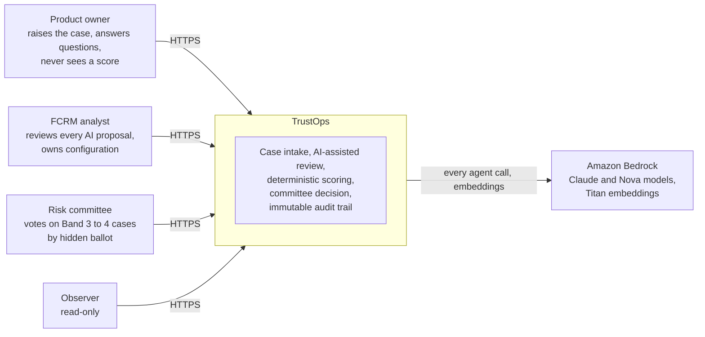

## 4. Containers and runtime topology

The default stack is **eight containers**. The design planned one container per service and worker (24 in all). The code kept those units as separate packages but runs them as two Python processes from one image (ADR-26).

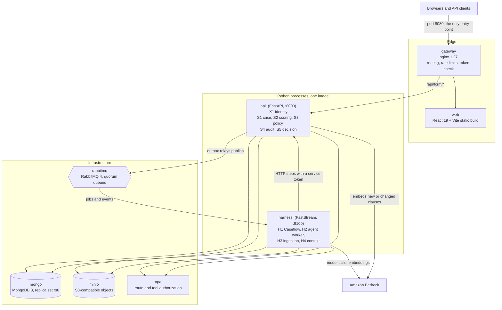

| Container | Runs | Notes |
|---|---|---|
| `gateway` | nginx | The only published port (8080). Routes by prefix, verifies the token with X1, applies rate limits and size limits, hides `/internal/` routes, maps the SSE `access_token`. |
| `web` | static React build | Role-aware UI for every persona and the harness monitor. |
| `api` | `fcrm_api.main:app` | Hosts X1 and S1 to S5 as sub-apps mounted by URL prefix. S3 loads the policy clause vectors at start-up, reusing the embeddings stored in Mongo and calling Bedrock only for new or changed clauses (`SKIP_EMBED_IF_PRESENT`, default true). A full re-embed took about 85 seconds. |
| `harness` | `python -m fcrm_harness` | Hosts H1 to H4 as workers on one broker and one Mongo client. |
| `mongo` | MongoDB 8 | One database per service and per harness; separate users, including an insert-only user for audit. |
| `rabbitmq` | RabbitMQ 4 | Four topic exchanges; a work queue, retry queue and dead-letter queue per consumer. |
| `minio` | MinIO | Buckets for uploads, canonical Markdown, committee packs (versioned), vectors and large job payloads. |
| `opa` | Open Policy Agent | Route authorization and agent tool permits. Default deny, fail closed. |

Optional profiles: `obs` adds an OpenTelemetry collector and OpenObserve (traces, metrics, logs and dashboards); `cache` adds Redis, which nothing reads today. Overlay files add dev mode (`compose.dev.yaml`, Vite dev server and hot reload), debug ports (`compose.debug.yaml`) and a test stack (`compose.test.yaml`).

## 5. Logical architecture

The components are named by ID throughout the code, the decision log and commit messages.

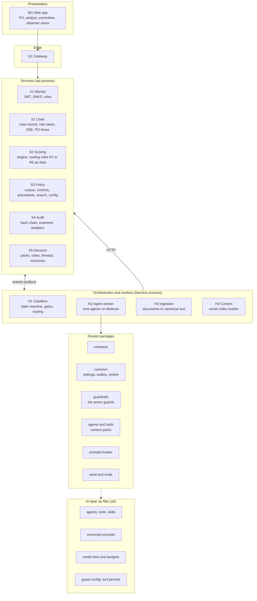

Boundaries that keep the structure honest:

- **Services never read each other's databases.** They link by ids (`case_id`, `pack_id`, a version string) and call each other over HTTP. S1 keeps view copies written by H1 so it can answer each role's reads alone.
- **Each service is self-contained.** It can run standalone (`create_app(standalone=True)`) for tests, and mount into the composite `api` app through a lifespan hook that never reads the environment or opens clients itself.
- **The AI layer is files, not code.** Agents, tools, skills, prompts, model tiers, guard configuration and tool permits live under `ai/`, are locked by checksum (`registry.lock`), and are mounted read-only into the harness. Model ids appear only in `ai/models/tiers.yaml`; prompts are versioned and never edited once committed.

## 6. How a request and a case flow

### A single request

Every request outside login is authenticated by the gateway (it asks X1) and authorized by the receiving service (it asks OPA about the route template). Both fail closed.

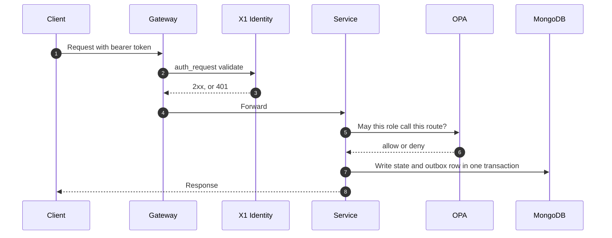

### A case from raise to close

Caseflow (H1) owns the case state as a pure reducer: a state plus a trigger gives the next state. Triggers come from people (through S1 and S5) and from agent results.

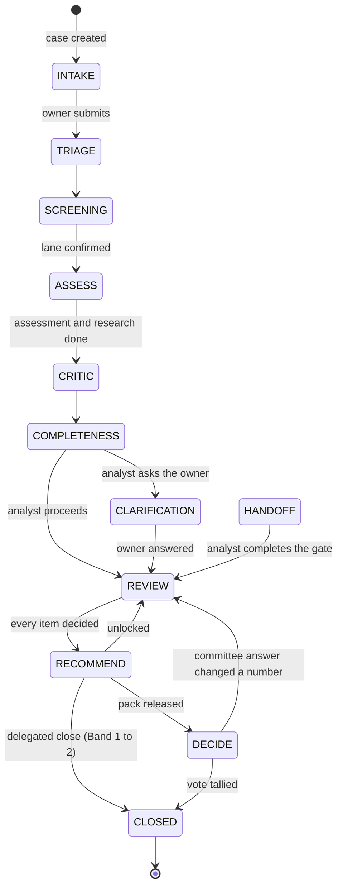

An agent job that fails twice opens a **handoff** gate that carries what the job was given, and the run moves to `HANDOFF`. Sub-states such as fast lane, clarification round, locked recommendation, pack version and vote round are flags on the run, not separate states.

### One call, end to end

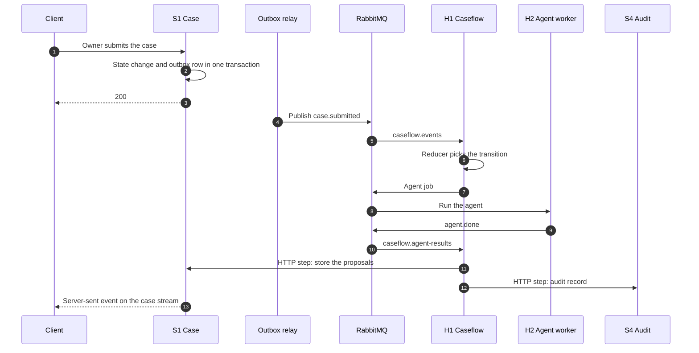

## 7. Messaging and the outbox

**The rule.** A service never publishes to RabbitMQ inside a request. It writes its state and an outbox row in one MongoDB transaction. A relay then publishes the row, at least once. If the relay crashes after publishing but before marking the row sent, the message goes out again, so every consumer tolerates duplicates.

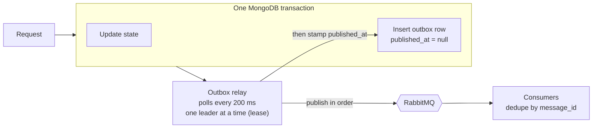

Why this over the alternatives: saving then publishing can lose the event on a crash between the two; publishing then saving can announce something that never happened; a distributed transaction across Mongo and RabbitMQ is slow and not well supported. The outbox turns it into one atomic write plus a retryable send. A relay that is stuck or far behind makes its service report not ready, so the lag is visible.

**Topology.** The broker layout is owned by ops (`ops/rabbitmq/definitions.json`); code connects passively.

| Exchange | Carries |
|---|---|
| `case.events` | Case lifecycle events from S1, S3, S4, S5 and the harness, consumed by H1 (and S1) |
| `agent.jobs` | `agent.run` from H1 to H2; `agent.done` and `agent.failed` back to H1 |
| `ingestion.jobs` | `ingest.run` and results between H1 and H3 |
| `context.jobs` | `index.build` and results between H1 or S3 and H4 |

H1 consumes three queues: `caseflow.events` (everything on `case.events`), `caseflow.agent-results`, and `caseflow.steps` (its own `harness.step` work). Each queue has a retry queue and a dead-letter queue. A poison message goes straight to the dead-letter queue; other failures are retried (steps get eight attempts, about four minutes) before parking. `make dlq`, `dlq-inspect`, `dlq-replay` and `dlq-purge` manage them.

**Steps outside the transaction.** Work that needs an HTTP call is enqueued as a `harness.step` in the same transaction as the transition and runs afterwards (ADR-28). No HTTP call ever sits inside a database transaction. Every step is idempotent by step id, and writes to S4 and S5 carry an `Idempotency-Key`.

The catalogue holds **75 event types** (`fcrm_contracts.events.catalogue`), each travelling in a strict envelope with event id, type, version, case id, run id, correlation id and W3C trace ids.

## 8. The AI layer

### Nine agents, four model tiers

Each agent is one Pydantic AI call per job, run by H2. Agents never write a score, never write to a service, and are never given a scoring tool.

| Agent | Tier | What it proposes | Human gate |
|---|---|---|---|
| `intake` | cheap | Change types and field values from each uploaded document, each with a page and line source | Owner confirms each value and type |
| `screening` | cheap | Fast lane or full assessment | Analyst confirms the lane |
| `watchlist` | cheap | Open cases to re-flag when a jurisdiction list is published | Analyst acknowledges each |
| `research` | strong | Policy clauses quoted verbatim, and declared gaps | Analyst accepts each clause |
| `assessment` | strong | Likelihood, impact and control ratings with evidence | Analyst confirms or overrides with a reason |
| `critic` | judge | Findings against precedents, evidence dates and the eight rules | Analyst reviews each finding |
| `narrative` | mid | The completeness report, clarification questions, the recommendation and the owner's plain-language summary | Analyst sends the round and locks the recommendation |
| `examiner` | mid | Answers from the verified audit chain only | None: it changes nothing |
| `policy_gap` | mid | Coverage suggestions, off the decision path | Analyst |

Tiers and fallbacks live only in `ai/models/tiers.yaml`:

| Tier | Primary | Fallbacks | Per-attempt budget |
|---|---|---|---|
| cheap | Claude Haiku 4.5 | Nova Lite | 60k tokens |
| mid | Claude Sonnet 5.5 | Haiku 4.5 | 60k tokens |
| strong | Claude Sonnet 5.5 | Sonnet 5.5, then Nova Pro | 56k tokens |
| judge | Nova Pro (a different model family from the assessor it checks, ADR-04) | Haiku 4.5 | 56k tokens |

No Opus appears in any chain (ADR-62, ADR-65); a unit test fails if one returns. A per-case ledger in H1 caps the total tokens across all of a case's jobs: **250,000 enforced, 120,000 as the efficiency target** (ADR-81). A dispatch that would pass the cap opens a human handoff instead.

### One agent job

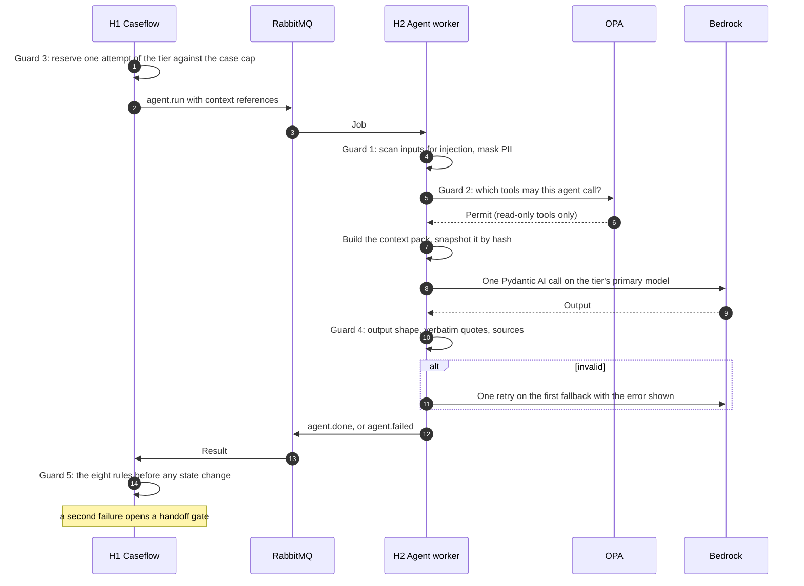

### The seven guards

Guards run in a fixed order, defined in `ai/guards/guards.yaml`. The first three run before the model call, the fourth after it, and the last three are scheduled by Caseflow as state steps.

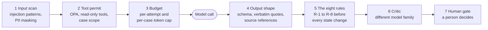

Failure behaviour differs by guard: an injection above the threshold blocks and flags the analyst, PII is masked and the agent only ever sees masked text, a denied tool call is refused for that call, an invalid output gets one retry on a fallback and then a handoff, and a human gate makes the case wait.

### Context engineering

- **Context packs** are built in code per agent and snapshotted by hash, so a proposal can be traced to exactly what the agent saw. System prompts hold no case data (they are the cached prefix); case data arrives in the pack.
- **Policy corpus**: 197 synthetic clauses over nine sources, searched by hybrid retrieval: Titan embeddings held in memory fused with keyword ranking. Precedents and controls use keyword search.
- **Citations**: every claim-bearing field carries a source reference, a verbatim quote and a confidence; every absence carries a record of what was searched.
- **Tools**: 13 read-only tool specs (document reader, case record, policy search, precedent search, control inventory, rules check and others), each permitted per agent through OPA.

### Evals

Nine datasets, 27 deterministic metrics and a judge model, with one promotion gate per agent. A prompt or model change carries its live eval run in the commit trailer. Evals call Bedrock and cost money, so they run only with operator approval (ADR-59).

## 9. The deterministic core

Everything that decides a number or an outcome is plain code, tested with golden figures.

| Piece | Where | What it does |
|---|---|---|
| **Scoring engine** | S2 | Inherent risk = likelihood x impact; residual = inherent x control retention; composite = weighted over the in-scope categories. Models are versioned data. |
| **Routing rules R1 to R6** | S2 serves them as pinned data; H1 evaluates them as pure functions | Decide the lane and the next step, for example a delegated close for Band 1 to 2 (R1), committee for higher bands (R2), acknowledgement of a boundary flag or band change (R3), the fast lane (R4), re-vote after a split (R6). |
| **Vote tally** | S5 (`fcrm_contracts.voting.tally`) | Two identical votes win. A 1-1-1 split is `no_majority` and opens the next round. Options stay hidden until the round is revealed. |
| **Release checks** | S5 | A committee pack is released only when all four checks pass. |
| **Audit chain** | S4 | Each record carries the previous record's hash; `verify` recomputes the chain. |

The golden figures for the demo case (a composite of 9.8, Band 2 with a boundary flag; override of vendor due diligence from 7.6 to 4.5 giving 10.4, Band 3; approved with conditions by 2 to 1; 67 audit records) are unit tests.

The committee has four possible outcomes: `approve`, `approve_with_conditions`, `defer` and `reject`. There is no fifth value.

## 10. Data architecture

**One MongoDB database per service** (and one for the harness). No service reads another's database. Links between them are ids resolved by an API call. S1's view collections (score snapshots, critic views, handoff views) are copies written by H1 so S1 can answer each role's reads alone; the record of truth for a score is S2, for a proposal S4's ledger, for a vote S5.

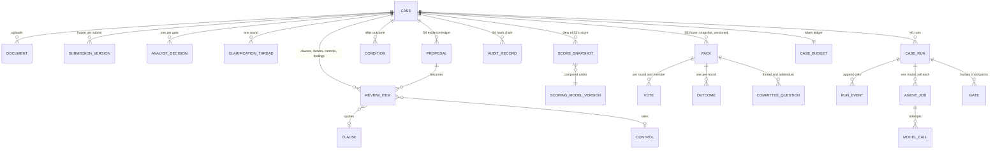

Which service owns which data:

| Owner | Holds |
|---|---|
| S1 Case | Case record, field values, documents, submission versions, review items, analyst decisions, clarification threads, conditions, activity log, role views |
| S2 Scoring | Scoring model versions and routing rules versions |
| S3 Policy | Policy clauses and sources, controls, precedents, jurisdiction lists, field sets, the config sections and their drafts |
| S4 Audit | The audit chain, proposals ledger, examiner questions and answers |
| S5 Decision | Packs, votes, committee questions, outcomes |
| H1 and the harness | Case runs, run events, agent jobs, model calls, gates, token ledger, outbox |
| MinIO | Uploaded files, canonical Markdown, committee packs (versioned), vectors, large job payloads |

Reference data (scoring model, corpus, controls, field sets, routing rules, jurisdiction list) is **versioned and immutable**. A case records the versions it was assessed under (field set, corpus, controls, scoring model), so a later publish is a new version rather than an edit. `known-gaps.md` notes where S1 still reads its pinned versions from the seed instead of from S3's pins.

## 11. Security and trust boundaries

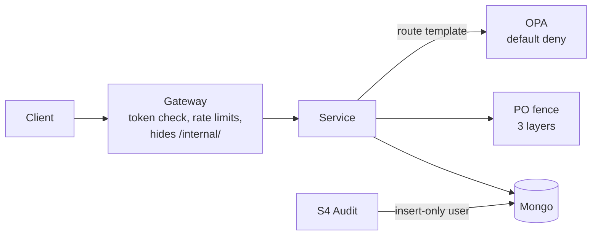

- **Authentication**: JWTs from X1. The access token is a bearer header; the refresh token is an `httpOnly` cookie. The gateway validates every request through X1. Login is rate limited per IP.
- **Authorization**: OPA, data-driven (`ops/opa/data/permissions.json`), default deny, any match allows, deny overrides. Five roles: PO, analyst, committee, observer and service. The service account inherits the human roles so Caseflow can call the services, but explicit deny rules stop it from releasing a pack, voting or asking the examiner.
- **The PO fence**: the PO role never receives score, band, rating, critic, vote, pack or harness data. Three layers that trust none of the others: PO response models contain no such fields, S1 filters by role and event-type prefix, and a text scan checks the output. A new PO-visible field is treated as a fence change and gets a failing test first.
- **Hidden ballot**: vote events never carry the option or rationale until the round is revealed.
- **Audit integrity**: S4 writes through an insert-only MongoDB user, so records cannot be updated or deleted. Examiner answers must cite records the chain actually holds.
- **Input safety**: injection patterns are scanned on every pack section and owner free text, and PII is masked before an agent sees it. Matched PII is never logged.
- **Internal routes**: any path containing `/internal/` returns 404 at the gateway. Only the harness reaches them.
- **Secrets**: generated into an untracked `.env` by `make env`; JWT keys by `make keys`; compose has no blanket `env_file`.

## 12. Resilience

The twelve resilience drills inject real failures into the running stack and check the property each is meant to prove (`make resilience`; the disruptive and AWS ones are opt-in).

| Failure | Designed behaviour | Mechanism |
|---|---|---|
| Harness restarted or killed mid-job | Nothing lost, nothing repeated | At-least-once delivery, idempotent steps, a second `agent.done` for a finished job is ignored |
| RabbitMQ down | Writes still succeed; events flow on recovery | Outbox rows wait; relay backs off up to 5 s |
| MongoDB down | Requests fail clean (502 to 504 within 40 s) and heal | No hung requests; the failed write rolls back with its outbox row |
| API restarted under an open stream | Stream resumes without loss | `Last-Event-ID` replay from the activity log |
| Poison or invalid message | Parked, not dropped, other work continues | Retry queue then dead-letter queue; replay with a fresh retry budget |
| Agent job cannot run, or token cap spent | Ends in a human handoff that carries the job's inputs | Guard 3 and the handoff gate |
| Identity service down | Fails closed, heals without re-login, never fails open | Gateway returns 502 to 504; a forged token never gets 200 |
| After all of the above | Every audit chain still verifies | Append-only, hash-chained records |

Not covered by the drills: a failure of Bedrock itself, a network partition, a full disk, and more than one container failing at once.

## 13. Observability and operations

- **Health**: `/healthz` on the gateway, `/readyz` on `api` and `harness`. A service reports not ready when its outbox relay stops or falls more than 60 seconds behind.
- **Telemetry**: OpenTelemetry from `api` and `harness` to a collector that writes traces, metrics and logs to OpenObserve, which also holds three dashboards (`make up-obs`). Trace context is saved in each outbox row so a later publish continues the original request's trace. Jaeger, Prometheus and Grafana were removed (ADR-72).
- **Token reporting**: `make token-report` summarizes tokens and cost per agent and model from OpenObserve.
- **Runbooks** under `ops/runbooks/`: start, replay, restart a worker, outage, secrets, backup, audit chain, incident, release.
- **Evals dashboard**: a single-page HTML per run under `evals/results/<date>/`.
- **Build-time discipline**: the commit gate `make check` (lint, types, OPA tests, AI registry and model-id guards, unit tests, web tests) is enforced by git hooks; commits carry decision, stage and gate trailers.

## 14. Key decisions

The full list is in `trustops/docs/governance/decision-log.md`. The ones that shape the architecture:

| ADR | Decision | Why it matters |
|---|---|---|
| ADR-02 | Events through RabbitMQ with a transactional outbox | State and event never diverge |
| ADR-03 | Amazon Bedrock only | One provider, no direct vendor keys |
| ADR-04 | The critic runs on a different model family from the assessor | An independent check, not self-review |
| ADR-07 | No agent has a scoring tool | Scores come only from the deterministic engine |
| ADR-14 | One retry on the first fallback with the error shown, then a handoff | Failure ends with a person, bounded cost |
| ADR-26 | Two processes from one image instead of one container per unit | Eight containers, units still separable |
| ADR-27 | Live models only, no replay or mock mode | What you see is what runs |
| ADR-28 | HTTP work runs as idempotent steps outside the transaction | No HTTP call inside a database transaction |
| ADR-32 | The PO fence has three independent layers | The PO can never see a score |
| ADR-49 | Policy vectors held in memory; S3 Vectors optional | Simple default, no extra dependency |
| ADR-59 | A live model call is a human gate | Cost control during development |
| ADR-62, ADR-65 | No Opus in any chain | Cost and a tested invariant |
| ADR-72 | OpenObserve as the one observability store | One place for traces, metrics, logs |
| ADR-81 | Per-case cap of 250,000 tokens enforced, 120,000 target | Sized to what a retried case actually needs |

## 15. Limits and what is not built

`trustops/docs/governance/known-gaps.md` is the authoritative list; it is dated and should be read for the current state. The structural limits worth knowing:

- **Out of scope by decision**: OCR (a scanned PDF fails ingestion and the owner is asked for another copy), SharePoint, Temporal, GitHub Actions, Trivy, mobile layout, multi-language documents.
- **Redis** is an optional profile that nothing reads.
- **S3 Vectors** is a backend that exists but is not in the shipped image; vectors are in memory.
- **Not wired** `make` targets print "not yet wired": `nightly`, `contracts`, `api-gen`, `locks`, `build-usage`, `backup`, `restore`. The web's API types are hand-written and ratcheted against the OpenAPI export by a test.
- **AWS deployment** is a documented design (`ops/aws/README.md`), not something this run built.
- **Synthetic data**: the policy corpus and seed are synthetic; a "verbatim quote" is verbatim from that store.
- **No Bedrock circuit breaker**, and all model fallbacks stay inside one region (per `known-gaps.md`).

## 16. Where to read next

| If you want | Read |
|---|---|
| Every endpoint, role and schema | [07-api-reference.md](07-api-reference.md) |
| The system on one page, as C4 | `trustops/docs/architecture/c4-context.md`, `c4-container.md` |
| One sequence per stage of the flow | `trustops/docs/architecture/sequences/` |
| Every collection and its contract | `trustops/docs/architecture/data-model.md` |
| Events and routing detail | `trustops/docs/architecture/event-catalogue.md` |
| Failure drills and findings | `trustops/docs/architecture/resilience.md` |
| The full design (backend, AI layer, web and ops) | `trustops/docs/architecture/design/A-backend.md`, `B-ai-layer.md`, `C-web-tests-ops-sdlc.md` |
| Where the code lives | `trustops/docs/architecture/folder-structure.md` |
| How to run it | `trustops/RUNNING.md` |
| Every decision and gate | `trustops/docs/governance/decision-log.md`, `gates-register.md` |
