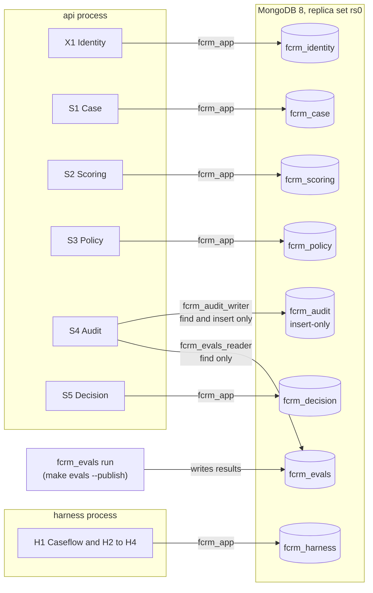
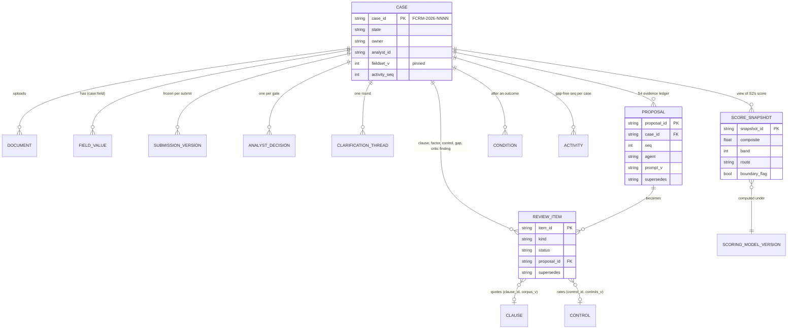
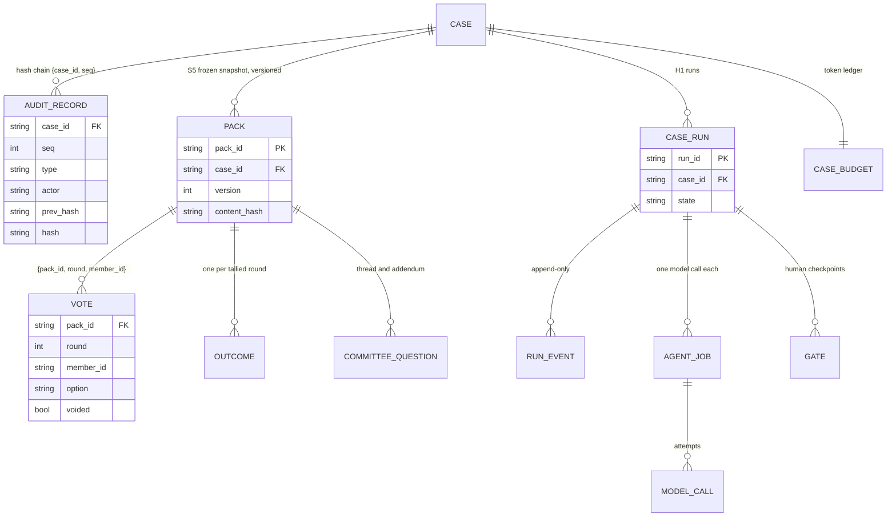
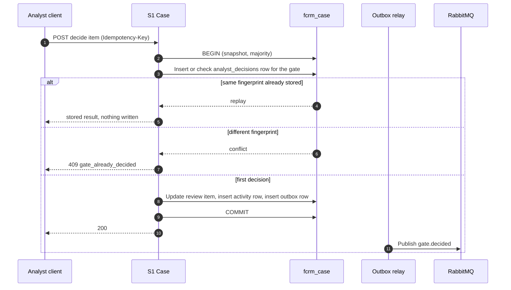
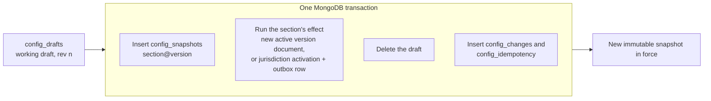
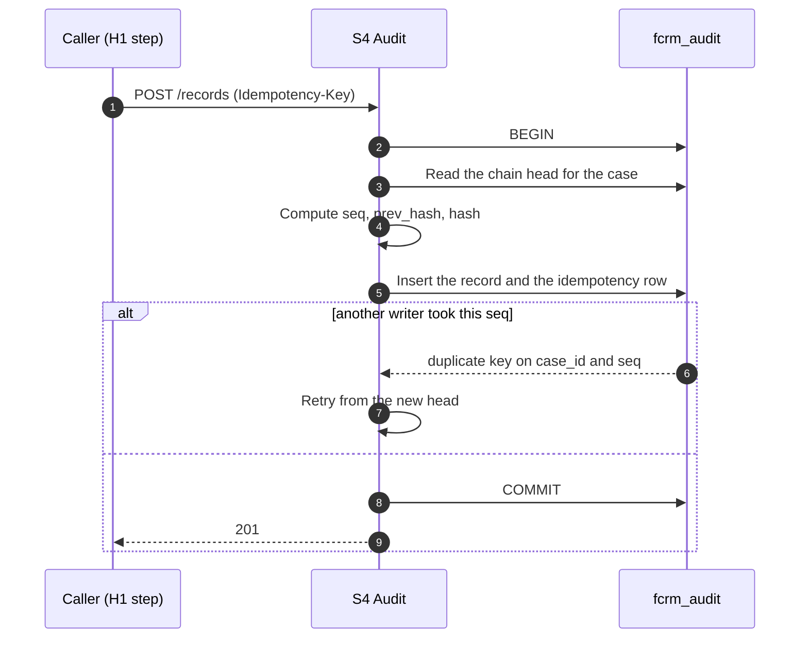

# TrustOps Database Design

How TrustOps stores its data: which databases exist and who owns them, what each collection holds, the keys and indexes that carry correctness, how consistency and idempotency are achieved without joins across services, and how the audit trail is protected. Written from the code, the Mongo init scripts and the data-model document, as built in October 2026.

| | |
|---|---|
| Primary store | MongoDB 8.0, single-node replica set `rs0` (needed for transactions), one database per service |
| Other stores | MinIO (S3 API) for files and committee packs; policy vectors held in memory; RabbitMQ carries events but stores no system of record |
| Source of truth | Pydantic contracts in `src/backend/packages/contracts` and each service's row models; the init scripts in `trustops/ops/mongo/init/`; `trustops/docs/architecture/data-model.md` |
| Companions | [08-architecture-overview.md](08-architecture-overview.md), [07-api-reference.md](07-api-reference.md) |

> **Reading note.** Where this document and the code disagree, the code wins. Shapes quoted here are the stored shapes; the HTTP shapes are in the API reference. The collection catalogue follows `data-model.md` and was spot-checked against the index definitions in code and the init scripts, but it is not generated, so check the row model when a field matters.

## Contents

1. [Design at a glance](#1-design-at-a-glance)
2. [Database topology and ownership](#2-database-topology-and-ownership)
3. [Design principles](#3-design-principles)
4. [Conceptual model](#4-conceptual-model)
5. [Collection catalogue](#5-collection-catalogue)
6. [Document designs](#6-document-designs)
7. [Indexes and constraints](#7-indexes-and-constraints)
8. [Consistency, transactions and idempotency](#8-consistency-transactions-and-idempotency)
9. [The audit chain](#9-the-audit-chain)
10. [Access control and data protection](#10-access-control-and-data-protection)
11. [Lifecycle, retention and TTLs](#11-lifecycle-retention-and-ttls)
12. [Object storage and vectors](#12-object-storage-and-vectors)
13. [Initialisation, seeding and schema evolution](#13-initialisation-seeding-and-schema-evolution)
14. [Operations](#14-operations)
15. [Limits and open points](#15-limits-and-open-points)

---

## 1. Design at a glance

- **Document database, because the data is case-shaped.** A case accumulates proposals, review items, score snapshots, gate decisions and packs. Each is a document keyed by case id and version, mostly written once.
- **One database per service.** No service reads another's database. Links between databases are ids (`case_id`, `pack_id`, a version string) resolved by an API call, never a join.
- **History is never rewritten.** Ledgers, snapshots, packs and published configuration are appended to. A correction is a new row that names what it supersedes; a voided vote keeps its seat.
- **State and event commit together.** Every state change that must be announced writes an outbox row in the same transaction. A relay publishes it afterwards.
- **Uniqueness is the concurrency control.** Unique indexes on `{case_id, seq}`, `{pack_id, round, member_id}`, `{case_id, version}` and similar turn a race into a duplicate-key error that the code handles, instead of silent corruption.
- **The audit trail is protected twice:** by a hash chain (tampering is detectable) and by a database user that can only insert and read (tampering is refused).

## 2. Database topology and ownership

Eight MongoDB databases. The application user reaches six of them; audit and evals have their own credentials.



| Database | Owner | Holds | Credential |
|---|---|---|---|
| `fcrm_identity` | X1 | Users, refresh tokens | `fcrm_app` (readWrite) |
| `fcrm_case` | S1 | The case and everything people do to it, role views, activity log, outbox | `fcrm_app` |
| `fcrm_scoring` | S2 | Scoring model versions, routing rules versions | `fcrm_app` |
| `fcrm_policy` | S3 | Policy clauses, controls, precedents, jurisdiction lists, field sets, configuration history and drafts | `fcrm_app` |
| `fcrm_decision` | S5 | Packs, votes, outcomes, committee threads, outbox | `fcrm_app` |
| `fcrm_harness` | H1 to H4 | Case runs, run events, agent jobs, gates, token ledger, model calls, outbox, consumed messages | `fcrm_app` |
| `fcrm_audit` | S4 | Audit chain, proposals ledger, examiner questions and answers, verification runs | `fcrm_audit_writer` (find and insert only) |
| `fcrm_evals` | the eval runner, read by S4 | One document per eval run and agent, and the rendered dashboard | writer: the eval runner; reader: `fcrm_evals_reader` (find only) |

`fcrm_app` has **no privilege at all on `fcrm_audit`**, so no service except S4 can read or touch the audit trail.

## 3. Design principles

| Principle | How it shows up in the schema |
|---|---|
| **Database per service** | Eight databases; cross-service references are ids; S1 keeps its own view copies (score snapshots, critic views, handoff views) written by H1, so each role's reads are answered from one database. The record of truth for a score is S2's computation, for a proposal S4's ledger, for a vote S5. |
| **Immutable history** | `submission_versions`, `packs`, `config_snapshots` and `audit_records` are written once. A later proposal or review item carries `supersedes`; `superseded_by` is derived on read. A decided review item is never edited: a re-run proposes a new item and expires the old gate. |
| **Deterministic ids** | Many `_id`s are derived from content, for example `case:field`, `<section>@<version>`, `<pack_id>:<round>`, `thr_` plus a digest of case, round and question. A repeated write hits the same `_id`, so replays create nothing new. |
| **Store before emit** | A decision, its ledger row, its activity row and its outbox event commit in one transaction. If enqueueing the event fails, nothing is decided. |
| **Idempotency keys** | Writes to S1 views, S3 publishes, S4 and S5 carry an `Idempotency-Key`. The key is stored in the same transaction as the change; the same body replays the stored result, a different body is a 409. |
| **Versioned reference data** | Scoring models, routing rules, corpus, controls, field sets and jurisdiction lists are versioned. A partial unique index on `active: true` guarantees at most one active version. A case records the versions it was assessed under (`pinned_versions`). |
| **Roles cut at the data layer** | The product owner's reads use projections that never fetch score, band, rating, vote or pack fields; the PO response models cannot carry them. |
| **Nothing is deleted to make room** | Rows leave only by TTL (idempotency keys, consumed-message markers, published outbox rows, sessions). Everything else is kept. |

## 4. Conceptual model

### Case, review and score

One case and what each service keeps about it.



### Decision, harness and audit



Cross-database arrows in the two diagrams are **logical**: they are ids, not references the database enforces.

## 5. Collection catalogue

Mutability key: **append** = inserted, never updated; **upsert** = replaced or updated by the owning writer; **versioned** = a new document per version, one active.

### `fcrm_case` (S1)

| Collection | `_id` | Purpose | Mutability |
|---|---|---|---|
| `cases` | `case_id` | The case: state, owner, analyst, pinned versions, required fields, timestamps, `activity_seq`. A discarded draft carries `discarded_at` and reads as missing | upsert |
| `field_values` | `case:field` | One row per case field with `origin`, `source` and a `history[]` that keeps the extracted original when the owner corrects it | upsert |
| `documents` | doc id | Uploaded files (object in MinIO) and what ingestion made of them; inserted with its outbox row | append |
| `submission_versions` | per `{case_id, version}` | A frozen snapshot per submit; diffs are computed, not stored | append |
| `po_decisions` | one per gate | The owner's gate ledger; the first decision emits `gate.decided`, a later identical one does not | append |
| `intake_views` | `case_id` | Intake agent output for the owner to confirm | upsert |
| `review_items` | item id | One per clause, factor, control, gap or critic finding; carries `proposed`, `decided`, `gate_id`, `supersedes` | upsert (decision), new row on re-run |
| `analyst_decisions` | `gate_id` | Ledger of gates the analyst decided: `{case_id, gate_type, decision, fingerprint, decided_by, decided_at}` | append |
| `clarification_threads` | `thr_` + digest | One row per question of the one clarification round, with status and the owner's answer | upsert |
| `planned_controls` | digest of content | Controls the analyst plans; never a review item, so never scored | append |
| `gaps` | digest of text | Policy gaps the analyst recorded | append |
| `clause_removals` | `item_id` | Makes the removal of an analyst-added clause once-only | append |
| `rerun_requests` | digest of scope and reason | A re-run request; the same reason and scope twice is one request | append |
| `conditions` | condition id | Conditions activated on `outcome.set`; reminders are computed from `due`, not stored | upsert |
| `outcomes` | case id | The case's recorded outcome for owner and analyst reads | append |
| `reflags` | `rf_` + digest of list version, case and jurisdiction | A watchlist re-flag: reason, cited list entry, harness run and gate, and the acknowledgement | upsert (acknowledge) |
| `integrations` | user id | One owner's choice per integration | upsert |
| `counters` | per year | The `FCRM-YYYY-NNNN` sequence | upsert |
| `activity` | per `{case_id, seq}` | Per-case activity log, gap-free; feeds the owner timeline, analyst feed and SSE replay | append |
| `outbox`, `consumed_messages`, `idempotency_keys`, `leases` | see section 8 | Messaging and idempotency plumbing | see section 11 |

**S1's assessment views**, written only by H1 through service-only routes and read by the analyst routes. Each is analyst-only; the PO shapes have no field to carry them.

| Collection | `_id` | Holds |
|---|---|---|
| `screening_views` | `case_id` | Fast-lane proposal, reasons with source and quote, the confirmation gate id |
| `score_snapshots` | `snapshot_id` | One row per score of record: composite, band, route, boundary flag and distance, per-domain L, I, inherent, control effect, retention, residual, weight, contribution, `scoring_v`, previous composite and band, the S2 request and response. The latest by `computed_at` is the score shown |
| `critic_views` | `case_id` | Critic findings with severity, record references, text, quote, confidence, and counts |
| `completeness_views` | `case_id` | Missing, stale and contradictory report, drafted and kept questions, the gate id |
| `recommendations` | `case_id` | The agent's `draft` (written by H1) beside the analyst's `edits` and lock fields (written by the analyst surface). H1 never writes `edits` or the lock |
| `handoff_views` | `case_id` | The pack, its four release checks as Caseflow stored them, the audit head the pack was built against |
| `harness_views` | `case_id` | The harness monitor snapshot, replaced after every step. The owner never receives it |

### `fcrm_scoring` (S2)

| Collection | Purpose | Mutability |
|---|---|---|
| `scoring_model_versions` | Scoring model; one active | versioned |
| `routing_rules_versions` | R1 to R6 as data, with the parameter table and committee quorum | versioned |

Both carry a unique `version` index and a partial unique index `single_active` on `active: true`. A new version arrives only through S3's configuration publish (service account only): one transaction deactivates the old version and inserts the next, guarded by `base_version`.

### `fcrm_policy` (S3)

| Collection | Purpose | Mutability |
|---|---|---|
| `corpus_versions`, `clauses` | The policy corpus (197 clauses across 9 sources in the seed) | versioned |
| `control_inventory_versions` | Control inventory (24 controls in the seed) | versioned |
| `jurisdiction_list_versions` | Jurisdiction lists; a fixture version exists for the watchlist demo | versioned |
| `field_set_versions` | Required-field sets per change type | versioned |
| `precedents` | Closed-case summaries for precedent matching | upsert |
| `config_snapshots` | One document per published version of each of the eight configuration sections, `_id = "<section>@<version>"`. Unique `(section, version)` and `(section, seq desc)`. Accessed through a collection wrapper that refuses every write except insert | append |
| `config_drafts` | At most one working draft per section, `_id` = section, updated by compare-and-swap on `rev` | upsert |
| `config_changes` | One insert-only record per publish: who, when, why, the changes, which effect ran | append |
| `config_idempotency` | The `Idempotency-Key` of a publish with its fingerprint (no TTL index found in the code) | append |

### `fcrm_audit` (S4), insert-only

| Collection | Purpose |
|---|---|
| `audit_records` | The hash chain, one record per `{case_id, seq}`. Validated by a `$jsonSchema` (section 9) |
| `proposals` | The evidence ledger: every agent proposal, `seq` monotonic per case, `supersedes` links |
| `verify_runs` | Results of chain verification |
| `idempotency_keys` | `Idempotency-Key` rows, 24 h TTL |
| `examiner_questions` | An examiner question about one case (`exq_` + ULID) |
| `examiner_answers` | The answer H1 posted; `_id` is the question's id, so the unique `_id` is the "one answer per question" guarantee |

### `fcrm_decision` (S5)

| Collection | Purpose |
|---|---|
| `packs` | A frozen, hashed `PackContent` snapshot with its four release checks, `released_at` and `released_to`, `superseded_at`, `current_round`. Unique `{case_id, version}` and `{pack_id}` |
| `votes` | Unique `{pack_id, round, member_id}`; voided votes are kept |
| `outcomes` | `_id = <pack_id>:<round>`; one row per tallied round, so a `no_majority` round stays beside the next. Delegated closes use `delegated:<case_id>` as the pack id |
| `questions` | One committee thread with its answer (the pack addendum) embedded |
| `outbox`, `idempotency_keys` | Events S5 publishes; keys with 24 h TTL |

### `fcrm_harness` (H1 to H4)

| Collection | Purpose |
|---|---|
| `case_runs` | One run snapshot per case: `state` plus flags (fast lane, round open, locked, pack version, vote round). Oversight runs and watchlist runs also live here with `closed` state |
| `run_events` | Append-only recorded transitions; `rebuild` folds them back to a state that must equal the snapshot. Unique `(run_id, seq)` |
| `agent_jobs` | One per dispatched job. Idempotency key `sha256(case_id, run_id, agent, step_key, input_hash)`, unique |
| `gates` | One per open or decided gate |
| `case_budgets` | The per-case token ledger: `{cap, spent, reserved, jobs{job_id: {agent, reserved, spent, status}}, last_refusal}` |
| `model_calls` | One row per Bedrock call attempt: model, prompt version, tokens, cost, latency |
| `outbox`, `consumed_messages` | Messaging plumbing |

### `fcrm_identity` (X1)

| Collection | Purpose |
|---|---|
| `users` | 11 seeded users (5 product owners, 3 analysts, 3 committee members) |
| `refresh_tokens` | One per active session; a distinct `typ` stops a refresh token being accepted as an access token. TTL on `exp` |

### `fcrm_evals`

| Collection | Purpose |
|---|---|
| `eval_runs` | One document per run and agent, `_id = "<run_id>:<agent>"`, written with upsert so publishing twice leaves one document. Holds the gate result, per-metric scores, token usage and cost, and per-row results. Model entries are labels from the tiers file, never model ids |
| `eval_dashboards` | The self-contained dashboard HTML, as `latest` and as `run:<run_id>` |

## 6. Document designs

### The case document (`fcrm_case.cases`)

Fields of the stored `CaseRecord` (the wire shapes for each role are built from it by role-specific modules, never by stripping a shared shape):

| Group | Fields |
|---|---|
| Identity | `case_id`, `title`, `unit`, `owner`, `created_by`, `analyst_id`, `owner_name`, `analyst_name` |
| Lifecycle | `state`, `handoff_from`, `run_id`, `run_requested`, `intake_mode` (`ai_assisted` or `manual`), `stage_flags` (fast lane, round open, locked, pack version, vote round) |
| Scope | `change_types`, `domains`, `geographies` |
| Pinning | `fieldset_v`, `completion_threshold`, `pinned_versions` (`scoring_v`, `corpus_v`, `controls_v`, `fieldset_v`, `jurisdictions_v`, `routing_v`, `prompts_v`), `required_fields` |
| Outcome | `outcome_summary`, `outcome_ref` |
| Timestamps | `created_at`, `submitted_at`, `decided_at`, `closed_at`, `discarded_at`, `discard_reason`, `current_submission_v`, `review_started_at`, `review_started_by` |
| Sequencing | `activity_seq`: the highest `activity.seq` allocated, bumped in the same write that inserts the activity row, so activity sequence numbers are gap-free per case |

The record also declares embedded `fields`, `documents` and `submission_versions`. The live owner path reads the dedicated collections, and store reads project those embedded arrays away. Treat the embedded copies as a legacy and seed shape, and confirm in `fcrm_case.store` before relying on them.

### Review items

`review_items` is one collection with a `kind` discriminator:

| `kind` | `subject` | `proposed` | `decided.value` |
|---|---|---|---|
| `clause` | clause id, domain, corpus version | quote, applicability, confidence | none (accept is `confirmed`, remove is `removed`) |
| `factor` (the analyst's rating) | domain | likelihood, impact, justification, quote, confidence | likelihood and impact on override or adjust |
| `control` | control id, domain, planned flag, name, catalogue weight, controls version | rating (null exactly when planned), rationale, evidence artifact and date, quote, confidence | rating on override or adjust |
| `gap` | origin, domain, description, searched query, indexes and hits | none | none: an absence is shown, not decided |
| `critic_finding` | finding type, severity, record references, text, confidence, quote | none | none (`explained` or `adjusted`) |

`catalogue_weight` is stamped by H1 from S3's inventory at the case's pinned controls version; an agent never supplies it, and an item without one cannot be scored (S1 answers 409 naming the item, never a zero).

### Outbox row

Every outbox collection uses the same row (`fcrm_common.outbox`):

```json
{
  "_id": "ObjectId",
  "event_id": "evt_...",
  "type": "case.submitted",
  "case_id": "FCRM-2026-0151",
  "exchange": "case.events",
  "routing_key": "case.submitted",
  "body": "<encoded envelope bytes>",
  "headers": { "traceparent": "..." },
  "created_at": "ISODate",
  "published_at": null,
  "attempts": 0,
  "last_error": null
}
```

### Idempotency key row

```json
{
  "_id": "<case_id>|<Idempotency-Key>",
  "view": "score",
  "case_id": "FCRM-2026-0151",
  "fingerprint": "<hash of the request body>",
  "result": { "...": "the stored response" },
  "at": "ISODate"
}
```

The shape differs slightly per service (`kind`, `seq`, `result_id` in S4), but the contract is the same: inserted in the same transaction as the change, TTL on `at`, same fingerprint replays, different fingerprint is a 409.

### Lease and consumed-message rows

```json
{ "_id": "outbox-relay:case", "holder": "relay_...", "lease_until": "server time + 10 s" }
{ "message_id": "evt_...", "consumer": "caseflow.events", "consumed_at": "ISODate" }
```

## 7. Indexes and constraints

Indexes that carry correctness guarantees are created by the init script (the audit ones, because the audit writer cannot create indexes) or by the owning service at startup. Index names matter: creating the same keys under a different name raises `IndexOptionsConflict`, which once failed the harness's first composed boot, so code and init use identical names.

| Database.collection | Index | Guarantee |
|---|---|---|
| `fcrm_audit.audit_records` | unique `{case_id, seq}` | One record per position; a concurrent append is a duplicate-key error and S4 retries |
| `fcrm_audit.audit_records` | `{case_id, type}`, `{type, created_at desc}` | Reads by type; the override list and "newest workflow.started" |
| `fcrm_audit.proposals` | unique `{case_id, seq}`; `{case_id, run_id, agent, kind}`; sparse `{case_id, supersedes}`; `{agent}` | Monotonic seq per case; filtered reads; `superseded_by` lookup; agent rates |
| `fcrm_audit.examiner_questions` | `{case_id, asked_at desc}` | Questions per case |
| `fcrm_audit.verify_runs` | `{case_id, at desc}` | Latest verification |
| `fcrm_audit.idempotency_keys` | `{at}` TTL 86,400 s | 24 h replay window |
| `fcrm_harness.run_events` | unique `run_id_seq_unique` `{run_id, seq}` | A replayable event store |
| `fcrm_harness.agent_jobs` | unique `{idempotency_key}`; `{status, lease_until}`; TTL on `finished_at` | Re-dispatching the same step with the same inputs is a no-op |
| every `outbox` | `unpublished_scan` `{published_at, _id}`; unique `event_id_unique`; TTL `published_ttl` (7 days) | Relay scan in order; no duplicate events; cleanup |
| `consumed_messages` in `fcrm_harness`, `fcrm_case`, `fcrm_policy` | unique `message_id_consumer_unique` `{message_id, consumer}`; TTL `consumed_at_ttl` (7 days) | Per-consumer dedupe; a single-key unique on `message_id` would wrongly reject a second consumer |
| `fcrm_case.activity` | unique `case_seq_unique` `{case_id, seq}` | Gap-free per-case activity |
| `fcrm_case.cases` | `owner_idx`, `analyst_idx`, `state_idx`, `owner_created_idx`, `analyst_state_idx`, `state_submitted_idx` | Lists by owner, analyst, state; the analyst queue |
| `fcrm_case.submission_versions` | unique `case_version_unique` `{case_id, version}` | Versions written once |
| `fcrm_case.review_items` | unique partial `case_proposal_unique` on `proposal_id` (where a string); `{case_id, gate_id}` | One item per proposal; gate lookup |
| `fcrm_case.score_snapshots` | `{case_id, computed_at desc}` | Latest score of record |
| `fcrm_case.conditions` | `{due_date, status}` | Reminder scans |
| `fcrm_scoring.*_versions`, `fcrm_policy.*_versions` | unique `version_unique`; partial unique `single_active` on `active: true` | At most one active version |
| `fcrm_policy.config_snapshots` | unique `section_version_unique`, unique `section_seq_unique` | Immutable per-section history |
| `fcrm_policy.clauses` | `clause_by_version`, `version_id_order`; text index on `search_text` | Corpus reads and keyword search |
| `fcrm_decision.packs` | unique `pack_id_unique`, unique `case_id_version_unique`, `released_queue` `{released_at desc}`, `pack_created` | One pack per version; the committee queue |
| `fcrm_decision.votes` | unique `{pack_id, round, member_id}` | One vote per member per round |
| `fcrm_decision.outcomes` | `outcome_pack_round`, `outcome_case_round` | Outcome lookups |
| `fcrm_decision` and `fcrm_audit` `idempotency_keys` | TTL `key_ttl` on `at` | 24 h replay window |
| `fcrm_identity.refresh_tokens` | TTL `exp_ttl` (expire at `exp`) | Expired sessions disappear |
| `fcrm_evals.eval_runs` | `agent_ts` `{agent, ts desc}` | Latest run per agent |

This is the set the code and init scripts declare as guarantees, not every secondary index in every service.

## 8. Consistency, transactions and idempotency

MongoDB runs as a one-member replica set purely so multi-document **transactions** are available. Every state change that must be announced runs through one helper, `with_transaction`: read concern `snapshot`, write concern `majority`. PyMongo retries the whole callback on a transient transaction error and retries the commit when its result is unknown, so the callback must be safe to re-run: every write goes through the session, and nothing other than Mongo writes (publishing, HTTP) happens inside it. That is what the outbox is for. On a standalone server the helper raises a clear deployment error instead of an opaque failure.

### Store before emit

An analyst decision shows the pattern: the decision, its ledger row, its activity row and the outbox event commit together, because Caseflow reads the decided value from the item when the event arrives.



### The techniques, in one table

| Technique | Where | What it prevents |
|---|---|---|
| Unique index as a lock | `{case_id, seq}` on audit, proposals, activity; `{pack_id, round, member_id}` on votes; `{case_id, version}` on packs and submissions | Lost updates and double votes: the loser gets a duplicate-key error and retries or is refused |
| Conditional update | Recommendation lock and unlock; `review_started_at` is set only where it is `null` | Two simultaneous requests flipping a state twice |
| Compare-and-swap | `config_drafts.rev` with an ETag `W/"<section>:<base_version>:<rev>"` | Two analysts overwriting each other's draft |
| Optimistic version guard | A config publish into S2 is guarded by `base_version` | Publishing over a version someone else published first |
| Idempotency key | S1 assessment views, S3 publish, S4, S5 | A retried call writing twice |
| Deterministic `_id` | Gate ids, thread ids, re-flag ids, pack outcome ids | A second post creating a second row |
| Consumed-message dedupe | `message_id_consumer_unique` | A redelivered event applying twice |
| First-result-wins | Agent results keep the first `agent.done` per job (`$setOnInsert`) | A second `agent.done` for a finished job re-firing the transition |
| Lease | `leases` documents `{_id, holder, lease_until}`, time taken from the **server clock** (`$$NOW`) | Two relay replicas both publishing, even with skewed clocks |

### Configuration publish, one transaction



The scoring model and routing rules are put into force in S2 first (a separate database, guarded by `base_version`); S3's transaction then records the publish.

## 9. The audit chain

Each record in `fcrm_audit.audit_records` carries the hash of the one before it.

```
hash = sha256( prev_hash + "\n" + canonical_body )
canonical_body = JSON of {case_id, seq, type, actor, summary, data, created_at}
                 with sorted keys and no incidental whitespace
prev_hash of the first record = 64 zeros
```



Defences, in layers:

| Layer | What it does |
|---|---|
| Chain | Any later change to a stored record's content or position is detectable: `GET /audit/verify/{case_id}` recomputes every hash and reports the first break. The examiner agent reads only from a chain that currently verifies. |
| Database role | S4's only credential, `fcrm_audit_writer`, has `find` and `insert` on six collections and nothing else: no `update`, no `remove`, no `createIndex`, no `collMod`. The init script verifies this and fails if the role carries any other action. S4's startup self-test attempts an update and must get `Unauthorized`, or S4 refuses to become ready. |
| Validator | A `$jsonSchema` with `validationLevel: strict` and `validationAction: error` requires `case_id`, `seq`, `type`, `actor`, `summary`, `prev_hash`, `hash` and `created_at`, with both hashes matching `^[0-9a-f]{64}$`. |
| Separation | `fcrm_app` has no privilege on `fcrm_audit`; the evals reader cannot read it either. |

The chain is **tamper-evident, not tamper-proof against a privileged database user**: someone with root access could rewrite history, and verification would then show a break. There is no external anchoring by decision; the brief asks for an immutable trail inside the system. The demo case's real 67-record trail is replayed through the chain code in a unit test.

## 10. Access control and data protection

| User | Granted | Used by |
|---|---|---|
| root (`MONGO_INITDB_ROOT_*`) | Everything | Container init only |
| `fcrm_app` | `readWrite` on `fcrm_case`, `fcrm_scoring`, `fcrm_policy`, `fcrm_decision`, `fcrm_harness`, `fcrm_identity`; nothing on `fcrm_audit` | X1, S1, S2, S3, S5, the harness |
| `fcrm_audit_writer` | Role `fcrmAuditInsertOnly`: `find`, `insert` on the six audit collections | S4 only |
| `fcrm_evals_reader` | Role `fcrmEvalsReadOnly`: `find` on `eval_runs` and `eval_dashboards` | S4's agent-quality routes (503 if the credential is missing) |

- **Authentication to Mongo.** Authorization is on and a random keyfile is generated at each container start (a replica set requires one even with a single member). Passwords come from the untracked `.env` generated by `make env`; rotating one is editing `.env` and running `make up`, because the init script re-applies users on every start.
- **The product-owner fence at the data layer.** Owner reads use projections: the plain outcome reads `outcomes` with only `outcome`, `plain_summary` and `decided_at`; conditions are read without `source`, `pack_id` and `note`. Score, band, rating, vote and pack fields never reach an owner module. Vote events never carry the chosen option until a round is revealed.
- **PII.** Agents only ever see masked canonical text (`<PII:TYPE:n>` tokens). The guard that masks it logs counts, never the matched value. All case data in the shipped seed is synthetic.
- **Network.** Mongo is reached inside the compose network as `mongo:27017`. From the host, clients need `directConnection=true` because they cannot resolve the member name.

## 11. Lifecycle, retention and TTLs

Business data is kept. Only plumbing expires.

| Data | Retention | Mechanism |
|---|---|---|
| Idempotency keys (S1 views, S4, S5) | 24 hours | TTL index on `at` |
| S3 `config_idempotency` keys | Kept (no TTL index found) | None |
| Consumed-message markers | 7 days | TTL on `consumed_at` |
| Published outbox rows | 7 days; unpublished rows never expire | TTL on `published_at` (null does not expire) |
| Refresh tokens | Until `exp` | TTL on `exp` |
| Finished agent jobs | A fixed period after `finished_at` | TTL on `finished_at` |
| Audit records, proposals, packs, votes, outcomes, config snapshots, run events | Kept | Append-only; never deleted |
| Scratch cases from resilience drills | Their audit chain stays | The chain is append-only; the draft is discarded so it leaves lists |
| Discarded drafts | The case id stays reserved | `discarded_at` is set; the case reads as missing |

## 12. Object storage and vectors

| Store | Contents | Notes |
|---|---|---|
| MinIO `uploads` | Files as submitted, keyed `uploads/{case}/{doc}/{name}` | Written by S1; inserted with the `documents` row and its outbox event in one Mongo transaction |
| MinIO `canonical` | Post-ingestion Markdown from H3 | What agents read, after PII masking |
| MinIO `packs` | Committee packs, versioned | A pack is built unreleased; the analyst's release opens it |
| MinIO `vectors` | Local fixture mode only | Not the default |
| MinIO `jobs` | Scratch space and large job payloads | Short-lived |
| In-memory index (S3, H4) | Titan Text Embeddings V2 vectors (1,024 dimensions) for the 197 policy clauses | Loaded into memory at start-up from the embeddings stored in Mongo; only new or changed clauses are sent to Bedrock (`SKIP_EMBED_IF_PRESENT`, default true; a full re-embed took about 85 seconds). `VECTOR_BACKEND=memory` by default; an S3 Vectors backend exists but is not in the shipped image (ADR-49) |

Keyword search for precedents and controls uses MongoDB itself (a text index on `search_text`); clause search fuses the vector leg with keyword ranking by reciprocal rank fusion.

## 13. Initialisation, seeding and schema evolution

**Initialisation** runs inside the `mongo` container every start, in order, and every step is idempotent. The container reports healthy only after it finishes, so dependants need no separate init container.

| Script | Does |
|---|---|
| `01-replset.js` | Initiates `rs0` with the member `mongo:27017` and waits for a writable primary |
| `02-users.js` | Creates or updates the two custom roles and three users, then self-checks that the audit role holds only `find` and `insert` and the evals role only `find` |
| `03-schemas.js` | Creates `fcrm_audit.audit_records` with its `$jsonSchema` validator, or re-applies it with `collMod` |
| `04-indexes.js` | Audit indexes, harness indexes and per-database consumed-message dedupe; drops two obsolete proposal indexes if present |

**Seeding.** `make gen-seed` generates `fcrm_seed/seed.json` (never edited by hand) and `make seed` reloads the 80-case seed and stages the demo PDFs. Reference collections load only when empty (`SEED_ON_EMPTY`), per collection. The seed holds 80 cases, 11 users, and the first versions of every reference set (corpus v14, controls v9, field set v6, jurisdiction list `v2026-06`).

**Schema evolution.** There is no migration framework. Row shapes are Pydantic models (`extra="forbid"` for DTOs) enforced at the repository layer; the database itself declares a validator only for `audit_records`. Other lanes add their own validators at startup or in a new numbered init script. Changes to reference data are new versions, never edits. A breaking event payload change bumps the event's version and consumers parse on `(type, version)`.

## 14. Operations

| Task | How |
|---|---|
| Start the database with the stack | `make up` (the `mongo` service is healthy once init has run) |
| Reload seed data | `make seed`; `make demo-reset` re-runs only case 0151 |
| Verify one case's audit chain | `make verify case=FCRM-2026-0118` |
| Test against a real Mongo without touching the stack | Start a throwaway replica set on a spare port and set `FCRM_TEST_MONGO_URI`; tests create and drop their own databases (never run tests on the operator's own Mongo) |
| Connect from the host | `mongodb://...:27017/?directConnection=true` with the generated credentials |
| Backup and restore | `make backup` and `make restore` are not wired; `ops/runbooks/backup-restore.md` gives manual `mongodump` and MinIO mirror commands, verified only against throwaway containers |
| Dead letters | `make dlq`, `dlq-inspect`, `dlq-replay`, `dlq-purge` |
| Outage behaviour | Resilience drill D3 stops Mongo: requests fail in under 40 seconds with 502 to 504, the failed write leaves no case and no outbox row, and the stack heals on restart |

## 15. Limits and open points

- **Single node.** One-member replica set: transactions work, but there is no high availability or failover. Production sizing and a multi-node set are not designed here.
- **No backup automation.** Backups are a manual runbook (see section 14).
- **Validators only on audit.** Other collections rely on application-level Pydantic validation, so a writer outside the services could store a malformed document.
- **Embedded legacy arrays on `cases`.** The case record still declares embedded fields, documents and submission versions beside the dedicated collections. Confirm which a given read uses before depending on either.
- **Tamper-evident, not tamper-proof.** A root database user could rewrite the audit chain; verification would reveal it, and the insert-only role prevents it for every application path.
- **Configuration pins.** `known-gaps.md` records that S1 still reads its pinned versions from the seed rather than from S3's published pins; a configuration publish goes live in S2 and S3 before S1 reflects it. That file is dated, so check it for the current state.
- **Vectors are in memory** and reloaded at each start from the embeddings stored in Mongo; there is no dedicated vector store in the shipped image.
- **Synthetic data.** The corpus (197 clauses, of which only four carry original text) and every case are synthetic.
- **Catalogue not generated.** Unlike the API reference, the collection catalogue in section 5 is maintained by hand from `data-model.md` and the code. When a row model changes, update both.
