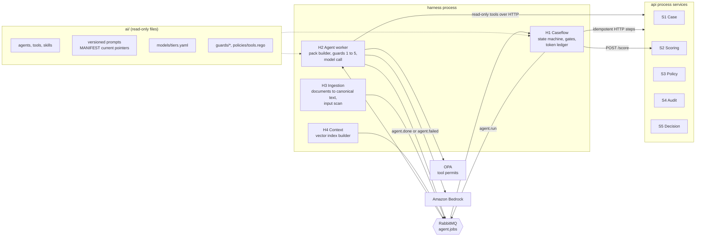
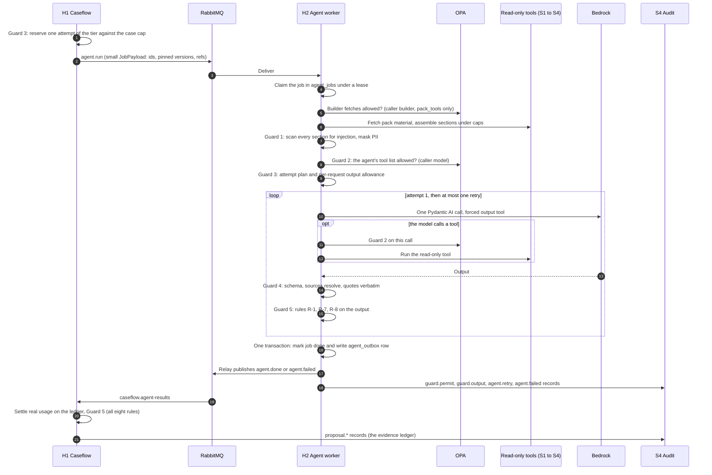
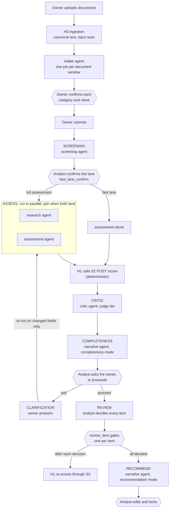
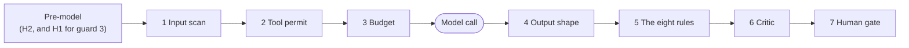
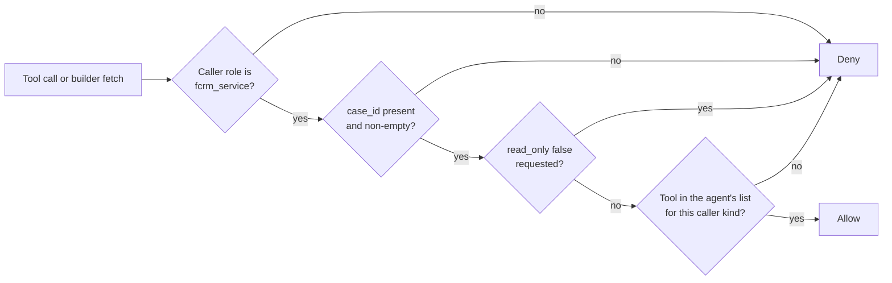
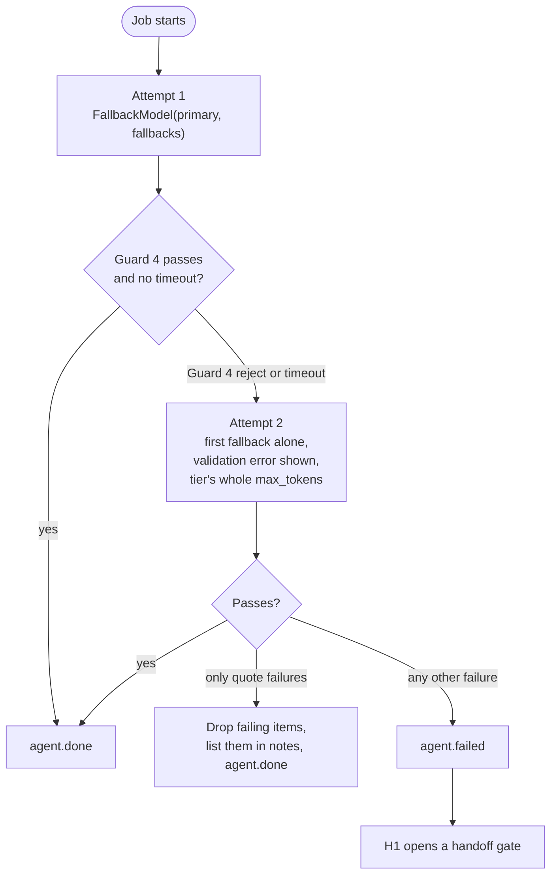
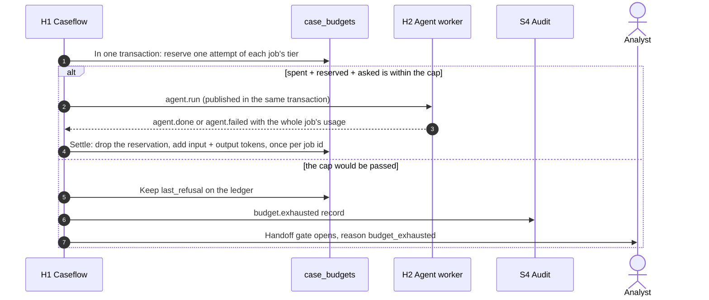
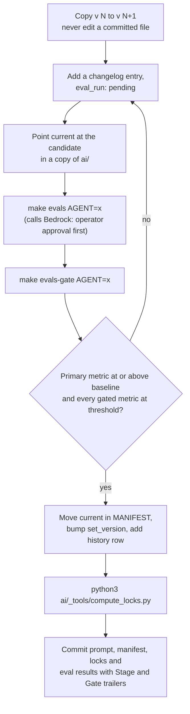
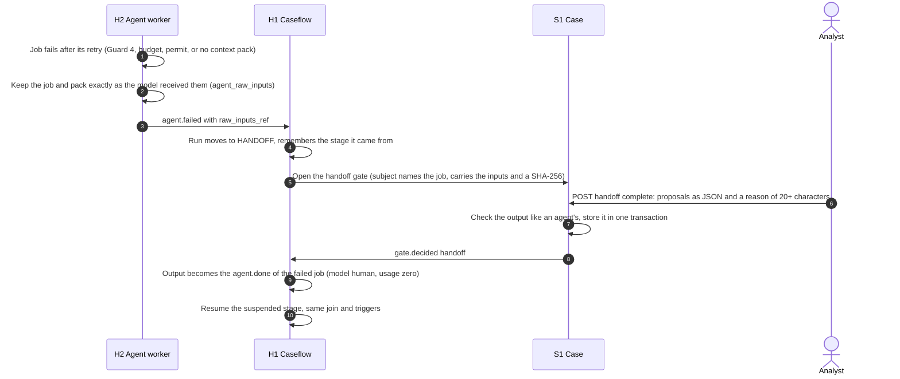

# TrustOps AI Harness and Agent Design

How TrustOps runs its nine AI agents: what each one is allowed to see and do, how the harness schedules and constrains it, which models it runs on, how tokens are budgeted, and what happens when an agent fails. Written from the agent specs, the model tiers, the guard configuration and the runtime code, as built in October 2026.

| | |
|---|---|
| Status | As built. Where this document and the 3 October design (`trustops/docs/architecture/design/B-ai-layer.md`) differ, the code and the YAML under `trustops/ai/` win |
| Source of truth | `trustops/ai/` (agent specs, tools, skills, prompts, model tiers, guards, OPA tool permits), the runtime in `src/backend/packages/{agents,guardrails,tools}` and `workers/{agent-worker,caseflow}`, and the ADR rows in `trustops/docs/governance/decision-log.md` |
| How the agent tables were made | Generated from `ai/agents/*.agent.yaml`, `ai/models/tiers.yaml`, `ai/policies/tool_permits.json` and `ai/tools/*.tool.yaml`, so they follow the files. The prose around them is hand-written |
| Companions | [08-architecture-overview.md](08-architecture-overview.md), [09-database-design.md](09-database-design.md), [07-api-reference.md](07-api-reference.md) |

> **Cost note.** Nothing in this document needs a live model call. Anything that does call Bedrock (`make evals`, `make demo`, `make e2e`, a resilience drill that runs an agent) needs the operator's approval first (ADR-59).

## Contents

1. [The harness in one page](#1-the-harness-in-one-page)
2. [Where the harness sits](#2-where-the-harness-sits)
3. [The nine agents](#3-the-nine-agents)
4. [One agent job, end to end](#4-one-agent-job-end-to-end)
5. [Orchestration by Caseflow](#5-orchestration-by-caseflow)
6. [The seven guards](#6-the-seven-guards)
7. [Tools and permits](#7-tools-and-permits)
8. [Models, tiers and the retry rule](#8-models-tiers-and-the-retry-rule)
9. [Token budgets](#9-token-budgets)
10. [Context engineering](#10-context-engineering)
11. [Prompts and the registry](#11-prompts-and-the-registry)
12. [Failure, handoff and recovery](#12-failure-handoff-and-recovery)
13. [What an agent may never do](#13-what-an-agent-may-never-do)
14. [Limits and open points](#14-limits-and-open-points)

---

## 1. The harness in one page

The "harness" is everything around the model: the code that decides when an agent runs, builds what it sees, limits what it can do, checks what it returns, and puts a person between the output and any consequence.

- **One agent, one call.** Each agent is a single Pydantic AI call per job. Agents never orchestrate other agents and never call a service that writes. Orchestration is a deterministic state machine (Caseflow, H1).
- **Agents propose, people decide.** Every output is a typed proposal with citations. It reaches a named human gate before it changes anything (Guard 7). The service account can never decide a gate.
- **Scores come from code.** No agent has a scoring tool, and none can reach the scoring engine. After proposals land, H1 sends the confirmed inputs to S2 (ADR-07).
- **The AI layer is files.** Agents, tools, skills, prompts, model tiers, guards and tool permits live under `trustops/ai/`, mounted read-only into the harness. Model ids appear in exactly one file, `ai/models/tiers.yaml`.
- **Seven guards in a fixed order** wrap every job. Three run before the model, one after it, and three are state-level checks run by Caseflow.
- **Bounded cost and bounded failure.** A token budget limits each attempt and each case. A job gets one retry; a second failure becomes a human handoff, never a silent skip.
- **Live models only.** Amazon Bedrock only, no replay or mock mode (ADR-03, ADR-27).

## 2. Where the harness sits

| Component | Role in the AI layer |
|---|---|
| **H1 Caseflow** | Decides which agent runs in which state, reserves tokens before dispatch, applies guards 5, 6 and 7, opens gates and handoffs, and calls S2 for scores. Never calls a model. |
| **H2 Agent worker** | Claims a job, builds the context pack, runs guards 1 to 4 and the attempt loop, calls Bedrock, applies the rules guard to the output, and publishes the one terminal event. Never touches case state directly. |
| **H3 Ingestion** | Turns uploads into canonical Markdown with `page:line` anchors and runs the input scan on each extracted document. |
| **H4 Context** | Builds the vector index for policy search. |
| **S1 to S5** | The read-only tool backends, and the services H1 writes results to. |

## 3. The nine agents

Every table in this section is generated from `ai/agents/*.agent.yaml` and `ai/models/tiers.yaml`.

| Agent | Tier | Model tools | Gate | Output |
|---|---|---|---|---|
| `intake` | cheap | `document_reader`, `field_rules`, `jurisdiction_list`, `precedent_search` | `po_confirm_value` (also `po_confirm_category`, `po_answer_gaps`) | `IntakeOutput` |
| `screening` | cheap | `field_rules`, `precedent_search` | `fast_lane_confirm` | `ScreeningProposal` |
| `research` | strong | `policy_search`, `precedent_search`, `jurisdiction_list` | `review_item` | `ResearchOutput` |
| `assessment` | strong | `control_inventory`, `evidence_store`, `precedent_search` | `review_item` (also `ack`) | `AssessmentOutput` |
| `critic` | judge | `evidence_ledger`, `precedent_search`, `rules_check` | `review_item` | `CriticOutput` |
| `narrative` | mid | `case_record`, `evidence_ledger` | `completeness` (analyst asks or proceeds), then `lock` and `pack_release` | completeness: `CompletenessOutput`; recommendation: `RecommendationOutput` |
| `examiner` | mid | `audit_log` | none | `ExaminerOutput` |
| `watchlist` | cheap | `jurisdiction_list`, `case_search` | `reflag_ack` | `WatchlistOutput` |
| `policy_gap` | mid | `policy_search`, `case_search` | none | `PolicyGapOutput` |

Four tiers carry the agents: **cheap** for the high-volume reads (intake, screening, watchlist), **mid** for writing (narrative, examiner, policy gap), **strong** for the judgement work (research, assessment), and **judge** for the critic, which runs on a different model family from the assessor it checks (ADR-04).

### Agent cards

#### `intake` (spec v3)

| | |
|---|---|
| **Purpose** | Read one window of pages of one uploaded document (canonical Markdown with page:line anchors) and propose field values with sources, change types with sources, and gap questions for required fields still empty. H1 shards the work: one job per document, plus continuation jobs when the ranked pages do not fit the cheap budget (payload.page_window). Code merges shards by field_id and keeps the highest-confidence value; the others become candidates (the walkthrough's "2 candidates" on F05). |
| **Trigger** | case.document_stored -> ingest.done (H3) -> H1 dispatches one job per document window; re-run in clarification on new documents and changed fields only |
| **Tier and chain** | `cheap`: Haiku 4.5 then Nova Lite |
| **Attempt budget** | 60,000 tokens, 60 s, 1 retry |
| **Model tools** | `document_reader` (max 2), `field_rules` (max 1), `jurisdiction_list` (max 1), `precedent_search` (max 1); total tool-call cap 0 |
| **Pack tools (builder only)** | `case_record`, `document_reader`, `field_rules`, `jurisdiction_list` |
| **Skills** | `cite_verbatim`, `declare_gap` |
| **Context pack** | `intake` |
| **Output contract** | `IntakeOutput` |
| **Guards that apply** | input scan, permit, budget, output shape, rules and the critic, human gate |
| **Human gate** | `po_confirm_value` (also `po_confirm_category`, `po_answer_gaps`) |
| **Re-runs on** | `new_doc_ids`, `changed_fields` |
| **Promotion metric** | `field_extraction_accuracy` |
| **Notes** | One job per document window; continuation jobs when the ranked pages do not fit. Code merges shards by `field_id` and keeps the highest-confidence value. Owner-facing: the PO confirms each value on Review and submit. |

#### `screening` (spec v4)

| | |
|---|---|
| **Purpose** | After triage, propose whether the case qualifies for the fast lane, routing rule R4: the vendor case (the only change type is vendor_onboarding) or the feature case (the only change type is new_feature, no new geography, segment or product, and F05 under $5M). H1's fast_lane_confirm gate opens on the proposal as given, so the agent applies the whole predicate (fcrm_caseflow.routing.is_fast_lane_candidate) from the identity line and F05, and a description that names a new corridor, segment or product vetoes both cases (stricter than the code); the analyst confirms. Design B §2.1 has H1 add the volume test in code; that call is not made yet (evals/README.md). |
| **Trigger** | H1 enters CaseState.SCREENING after triage |
| **Tier and chain** | `cheap`: Haiku 4.5 then Nova Lite |
| **Attempt budget** | 60,000 tokens, 60 s, 1 retry |
| **Model tools** | `field_rules` (max 1), `precedent_search` (max 1); total tool-call cap 0 |
| **Pack tools (builder only)** | `case_record`, `field_rules`, `precedent_search` |
| **Skills** | none |
| **Context pack** | `screening` |
| **Output contract** | `ScreeningProposal` |
| **Guards that apply** | input scan, permit, budget, output shape, rules, human gate |
| **Human gate** | `fast_lane_confirm` |
| **Re-runs on** | none |
| **Promotion metric** | `fast_lane_precision` |
| **Notes** | Applies the whole R4 predicate itself; H1's `fast_lane_confirm` gate opens on the proposal as given. |

#### `research` (spec v4)

| | |
|---|---|
| **Purpose** | Find the policy clauses that apply to the submitted change and quote them verbatim from the pinned corpus version, find the closest closed cases, report the jurisdiction-list status of each destination country, and declare gaps where the corpus has no clause. Runs in parallel with assessment; re-runs on changed fields in the clarification round. |
| **Trigger** | H1 enters CaseState.ASSESS (parallel with assessment); CaseState.CLARIFICATION re-run with payload.changed_fields; watchlist re-flag acknowledgement |
| **Tier and chain** | `strong`: Sonnet 5.5 then Sonnet 5.5 then Nova Pro |
| **Attempt budget** | 56,000 tokens, 180 s, 1 retry |
| **Model tools** | `policy_search` (max 3), `precedent_search` (max 1), `jurisdiction_list` (max 1); total tool-call cap 1 |
| **Pack tools (builder only)** | `case_record`, `submission_diff`, `policy_search`, `precedent_search`, `jurisdiction_list`, `control_inventory` |
| **Skills** | `cite_verbatim`, `declare_gap` |
| **Context pack** | `research` |
| **Output contract** | `ResearchOutput` |
| **Guards that apply** | input scan, permit, budget, output shape, rules and the critic, human gate |
| **Human gate** | `review_item` |
| **Re-runs on** | `changed_fields`, `new_doc_ids`, `jurisdiction_list_published` |
| **Promotion metric** | `clause_recall_at_k` |
| **Notes** | Runs in parallel with assessment and joins with it. A declared gap is a correct result. |

#### `assessment` (spec v2)

| | |
|---|---|
| **Purpose** | Propose likelihood and impact (1-5) per in-scope domain with a justification, and a strength rating (0-10) with evidence for each applicable control in those domains, or mark a control planned with no rating. Never computes a score: after these proposals land, H1 sends the confirmed inputs to S2 (POST /score). The agent has no route to the scoring engine (ADR-07). |
| **Trigger** | H1 enters CaseState.ASSESS (parallel with research); CaseState.CLARIFICATION re-run with payload.changed_fields and new_doc_ids; watchlist re-flag acknowledgement when a geography control depends on list status |
| **Tier and chain** | `strong`: Sonnet 5.5 then Sonnet 5.5 then Nova Pro |
| **Attempt budget** | 56,000 tokens, 180 s, 1 retry |
| **Model tools** | `control_inventory` (max 1), `evidence_store` (max 2), `precedent_search` (max 1); total tool-call cap 1 |
| **Pack tools (builder only)** | `case_record`, `submission_diff`, `control_inventory`, `evidence_store`, `precedent_search`, `evidence_ledger` |
| **Skills** | `cite_verbatim`, `compare_precedent` |
| **Context pack** | `assessment` |
| **Output contract** | `AssessmentOutput` |
| **Guards that apply** | input scan, permit, budget, output shape, rules and the critic, human gate |
| **Human gate** | `review_item` (also `ack`) |
| **Re-runs on** | `changed_fields`, `new_doc_ids` |
| **Promotion metric** | `li_within_one` |
| **Notes** | Never computes a score. After its proposals land, H1 sends the confirmed inputs to S2. A planned control carries no rating. |

#### `critic` (spec v3)

| | |
|---|---|
| **Purpose** | After S2 has computed the first score and before anyone reviews (D-22), read the ledger for the run and check four things: every claim sourced, ratings against precedents, the eight rules (as computed by code), and evidence recency and scope. Flags only; never changes a value. |
| **Trigger** | H1 after score.returned for the run; the state machine cannot enter completeness until the critic's agent.done lands or the job hands off |
| **Tier and chain** | `judge`: Nova Pro then Haiku 4.5 |
| **Attempt budget** | 56,000 tokens, 180 s, 1 retry |
| **Model tools** | `evidence_ledger` (max 1), `precedent_search` (max 1), `rules_check` (max 1); total tool-call cap 1 |
| **Pack tools (builder only)** | `case_record`, `evidence_ledger`, `precedent_search`, `rules_check`, `evidence_store` |
| **Skills** | `compare_precedent` |
| **Context pack** | `critic` |
| **Output contract** | `CriticOutput` |
| **Guards that apply** | input scan, permit, budget, output shape, rules, human gate |
| **Human gate** | `review_item` |
| **Re-runs on** | `score_recomputed_after_rerun` |
| **Promotion metric** | `planted_error_detection` |
| **Notes** | Runs after S2 returns the first score. A failed critic job holds the case (`case_waits`): completeness cannot start until it lands or is handed off. |

#### `narrative` (spec v2)

| | |
|---|---|
| **Purpose** | Write for people from confirmed inputs. Completeness mode (before review, D-16/D-17) lists missing, stale and contradictory items and drafts the one clarification round. Recommendation mode (after review and the final S2 result) drafts the recommendation, the conditions and the plain-language summary for the owner. Numbers are read-only inputs in both modes. |
| **Trigger** | completeness: H1 after the critic's agent.done; recommendation: H1 when every review item is decided and the final score is returned |
| **Tier and chain** | `mid`: Sonnet 5.5 then Haiku 4.5 |
| **Attempt budget** | 60,000 tokens, 120 s, 1 retry |
| **Model tools** | `case_record` (max 1), `evidence_ledger` (max 1); total tool-call cap 1 |
| **Pack tools (builder only)** | `case_record`, `evidence_ledger`, `field_rules`, `evidence_store`, `submission_diff` |
| **Skills** | `draft_for_business_reader`, `batch_questions` |
| **Context pack** | `narrative` |
| **Output contract** | completeness: `CompletenessOutput`; recommendation: `RecommendationOutput` |
| **Guards that apply** | input scan, permit, budget, output shape, rules, human gate |
| **Human gate** | `completeness` (analyst asks or proceeds), then `lock` and `pack_release` |
| **Re-runs on** | `unlock_with_reason` |
| **Promotion metric** | completeness: `question_grounding`; recommendation: `narrative_faithfulness` |
| **Notes** | Two modes. Completeness drafts at most one clarification round; recommendation drafts the recommendation, conditions and the owner's plain-language summary. Numbers are read-only inputs. A split recommendation is merged by one call on the reduce prompt (`narrative.reduce`). |

#### `examiner` (spec v3)

| | |
|---|---|
| **Purpose** | Answer an examiner's or auditor's question about one case from its hash-chained audit records only. Every sentence cites records; the agent refuses when the records do not hold the answer (D-23). Read-only: the answer is shown to the asker and logged as an `examiner.answered` record. |
| **Trigger** | on demand from Assurance > Ask (analyst, committee, observer); after GET /verify/{case} returns ok |
| **Tier and chain** | `mid`: Sonnet 5.5 then Haiku 4.5 |
| **Attempt budget** | 60,000 tokens, 120 s, 1 retry |
| **Model tools** | `audit_log` (max 2); total tool-call cap 0 |
| **Pack tools (builder only)** | `case_record`, `audit_log` |
| **Skills** | none |
| **Context pack** | `examiner` |
| **Output contract** | `ExaminerOutput` |
| **Guards that apply** | input scan, permit, budget, output shape, rules |
| **Human gate** | none |
| **Re-runs on** | none |
| **Promotion metric** | `sentence_record_grounding` |
| **Notes** | Answers only from the audit chain and refuses when the records do not hold the answer. Oversight agent: not metered against the case cap and has no run to hand off. |

#### `watchlist` (spec v3)

| | |
|---|---|
| **Purpose** | When a new jurisdiction list version is published, write one re-flag proposal per candidate case that code selected (open cases whose geographies intersect the countries added or moved): why, which list line, which agents to re-run. The intersection is deterministic; the agent writes the explanation with provenance so the analyst acknowledgement is uniform. |
| **Trigger** | jurisdiction.list_published (S3 /jurisdictions/versions/{v}/activate) -> H1 computes candidates -> one watchlist job |
| **Tier and chain** | `cheap`: Haiku 4.5 then Nova Lite |
| **Attempt budget** | 60,000 tokens, 60 s, 1 retry |
| **Model tools** | `jurisdiction_list` (max 1), `case_search` (max 1); total tool-call cap 0 |
| **Pack tools (builder only)** | `jurisdiction_list`, `case_search`, `policy_search` |
| **Skills** | `cite_verbatim` |
| **Context pack** | `watchlist` |
| **Output contract** | `WatchlistOutput` |
| **Guards that apply** | input scan, permit, budget, output shape, rules, human gate |
| **Human gate** | `reflag_ack` |
| **Re-runs on** | none |
| **Promotion metric** | `reflag_recall` |
| **Notes** | The candidate cases are chosen by code; the agent writes the explanation. Oversight agent, not metered. |

#### `policy_gap` (spec v3)

| | |
|---|---|
| **Purpose** | Group the policy gaps analysts recorded across cases, confirm with a fresh search that the corpus still lacks coverage, and draft a suggestion for the policy owner: topic, affected cases, nearest existing clauses, suggested home standard and a one-sentence scope suggestion labelled as not policy. Never writes policy text. Never on the decision path. |
| **Trigger** | case.gap_recorded, and weekly |
| **Tier and chain** | `mid`: Sonnet 5.5 then Haiku 4.5 |
| **Attempt budget** | 60,000 tokens, 120 s, 1 retry |
| **Model tools** | `policy_search` (max 3), `case_search` (max 1); total tool-call cap 1 |
| **Pack tools (builder only)** | `policy_search`, `case_search`, `evidence_ledger` |
| **Skills** | `declare_gap`, `cite_verbatim` |
| **Context pack** | `policy_gap` |
| **Output contract** | `PolicyGapOutput` |
| **Guards that apply** | input scan, permit, budget, output shape, rules |
| **Human gate** | none |
| **Re-runs on** | none |
| **Promotion metric** | `coverage_check_correctness` |
| **Notes** | Off the decision path; never writes policy text. Oversight agent, not metered. |

## 4. One agent job, end to end

H1 reserves tokens and enqueues the job in one transaction. H2 claims it, builds the pack, guards it, calls the model and reports exactly one terminal event.

Properties worth knowing:

- **No transaction around the model call** (ADR-79). A strong-tier job outlives Mongo's 60 s transaction limit, and an aborted transaction used to re-run the job and pay Bedrock twice. The job is claimed first, with a lease sized to its worst case. A redelivery of a finished job is acknowledged with nothing sent; a redelivery of a running job is retried later through the broker's retry path.
- **Exactly one terminal event.** Either `agent.done` or `agent.failed`, never both and never neither. A guard `BLOCKED` verdict is not a bug: it is reported faithfully as `agent.failed` so H1 can open the handoff gate.
- **No `agent.done` audit record.** What an agent proposed is recorded by H1 as `proposal.*` when it consumes `agent.done`.
- **A repeat result is ignored.** H1 keeps the first result per job (`$setOnInsert`), so a second `agent.done` for a finished job changes nothing.
- **Parts instead of cuts** (ADR-77, ADR-78). When a job's input does not fit its tier's pack total, the builder splits the agent's main sections into several whole packs, each with its own reservation. H2 runs them one after another and merges the answers in code. For the narrative recommendation only, one call on the reduce prompt (`narrative.reduce`) merges the parts. A blocked part stops the job.

## 5. Orchestration by Caseflow

H1 owns the case state as a pure reducer (`fcrm_caseflow/transitions.py`): a state plus a trigger gives the next state, and the dispatch table (`fcrm_caseflow/dispatch.py`) says which agent job each trigger publishes.

Three things sit outside that chain and never block a case: the **examiner** (on demand, over the verified audit chain), the **watchlist** agent (when a jurisdiction list is published, over candidate cases chosen by code) and the **policy gap** agent (after a gap is recorded, and weekly).

| Trigger | Dispatch |
|---|---|
| Triage done | `screening` |
| Fast lane declined, or no fast lane | `research` and `assessment` together; the join waits for both |
| Fast lane confirmed | `assessment` alone |
| First score returned | `critic` |
| Critic done | `narrative` (completeness scope) |
| Owner answers (clarification) | `research` and `assessment` again, only for the changed fields |
| All review items decided and final score returned | `narrative` (recommendation scope) |
| Owner uploads a document | `intake`, one job per document window |
| Jurisdiction list published | `watchlist` |

The first score is computed by H1 calling S2, never by an agent. The critic runs after that score and before anyone reviews, and the state machine cannot enter completeness until the critic's result lands or the job is handed off.

## 6. The seven guards

Defined in `ai/guards/guards.yaml` (order and failure behaviour) and implemented in `src/backend/packages/guardrails`. Changing the order or a failure behaviour needs a decision-log row. The same five guards are listed for every agent spec; guards 6 and 7 are applied by H1.

| # | Guard | Stage and where | What it checks | On failure |
|---|---|---|---|---|
| 1 | **Input scan** | Pre. H3 on each extracted document; H2 on every pack section and owner free text | Injection patterns (weighted); PII entities | Score at or above 0.8: block and flag the analyst. Amber (0.4 to 0.8): annotate and pass (the cheap-tier second opinion is not built). PII: mask, so agents only ever see masked canonical text. Logs counts, never the matched value |
| 2 | **Tool permit** | Pre. H2, once for the agent's whole allow-list at job start, then before each tool call | OPA `data.tools.allow`; Python allow-list fallback; case scope; read-only backing | Job-start denial: block, H1 is told. Tool-call denial: that call is refused and the model receives "not permitted". OPA unreachable: block (fail closed) |
| 3 | **Budget** | Pre. H1 reserves against the case cap and settles; H2 wraps the call | Case reservation, usage limits, wall clock | Case budget exhausted: the case waits, a human handoff with the raw inputs, never a silent truncation. Timeout on attempt 1: retry on the fallback. Timeout on attempt 2 or a usage limit hit: block |
| 4 | **Output shape** | Post. H2 | Schema valid with extra fields forbidden; every `source_ref` resolves; quotes are verbatim (12 to 600 characters, up to 2 lines of tolerance); confidence in range; agent invariants (a similarity equals the tool result, a planned control has no rating); restricted terms in owner-facing text; number grounding for the narrative | Attempt 1: retry on the first fallback with each failing item and its rule shown. Attempt 2: if only quotes failed, drop those items and list them in the notes for the analyst; any other failure blocks and hands off |
| 5 | **The eight rules** | State. H2 on outputs for R-1, R-7, R-8; H1 before every state change for all eight | R-1 no agent wrote a score; R-2 no bulk accept; R-3 PO view has no restricted fields; R-4 analyst never edited the submission; R-5 closed case untouched; R-6 override has a reason; R-7 planned control not scored; R-8 policy quoted, not generated | The state change is refused with the rule id |
| 6 | **Critic** | State. H1 dispatches the critic job after the first score | Reviews the intake, research and assessment proposals against precedents, evidence dates and the rules | Findings are annotated; each must be explained or adjusted before review completes. A failed critic job makes the case wait (handoff) |
| 7 | **Human gate** | State. H1 | A person decides each gate item; a changed value needs a reason (at least 20 characters) | Undecided: the case waits. Changed value without a reason: blocked (rule 6) |

The eight rules here (R-1 to R-8) are product rules. They are not the routing rules R1 to R6 served by S2.

Guard 7 applies to every agent except the examiner and the policy gap agent, which feed no case gate. The thresholds (quote length, confidence floor of 0.5, stale-evidence months of 24, injection scores, override reason length) are in `ai/guards/thresholds.yaml`; changing one needs a decision-log row and an eval run because it changes what every agent is told.

## 7. Tools and permits

**Thirteen tools, all read-only.** A tool spec (`ai/tools/<name>.tool.yaml`) names the backing route, the permit key, the cache scope and the description the model sees.

| Tool | Backed by | Read-only |
|---|---|---|
| `audit_log` | `audit-service GET /records/{case_id}/{seq}` | yes |
| `case_record` | `case-service GET /internal/cases/{case_id}/record` | yes |
| `case_search` | `case-service GET /cases/search` | yes |
| `control_inventory` | `policy-service GET /controls` | yes |
| `document_reader` | `case-service GET /internal/cases/{case_id}/documents/{doc_id}/pages` | yes |
| `evidence_ledger` | `audit-service GET /proposals` | yes |
| `evidence_store` | `policy-service GET /controls/{control_id}/evidence; case-service GET /internal/cases/{case_id}/documents?kind=evidence` | yes |
| `field_rules` | `policy-service GET /field-sets/{fieldset_v}/resolve` | yes |
| `jurisdiction_list` | `policy-service GET /jurisdictions` | yes |
| `policy_search` | `policy-service POST /policy/search` | yes |
| `precedent_search` | `policy-service POST /precedents/search` | yes |
| `rules_check` | `in-process  fcrm_guardrails.rules.check_all` | yes |
| `submission_diff` | `case-service GET /cases/{case_id}/submissions/diff` | yes |

**Two ways to call a tool, two permit lists.** A tool the *model* may call is listed in the agent's `tools`; a tool the deterministic *context-pack builder* may fetch is listed in `pack_tools` and is never exposed to the model. OPA keys the decision on `caller`.

| Agent | May call as the model (`tools`) | Builder may fetch (`pack_tools`) |
|---|---|---|
| `intake` | `document_reader`, `field_rules`, `jurisdiction_list`, `precedent_search` | `case_record`, `document_reader`, `field_rules`, `jurisdiction_list` |
| `screening` | `field_rules`, `precedent_search` | `case_record`, `field_rules`, `precedent_search` |
| `research` | `policy_search`, `precedent_search`, `jurisdiction_list` | `case_record`, `submission_diff`, `policy_search`, `precedent_search`, `jurisdiction_list`, `control_inventory` |
| `assessment` | `control_inventory`, `evidence_store`, `precedent_search` | `case_record`, `submission_diff`, `control_inventory`, `evidence_store`, `precedent_search`, `evidence_ledger` |
| `critic` | `evidence_ledger`, `precedent_search`, `rules_check` | `case_record`, `evidence_ledger`, `precedent_search`, `rules_check`, `evidence_store` |
| `narrative` | `case_record`, `evidence_ledger` | `case_record`, `evidence_ledger`, `field_rules`, `evidence_store`, `submission_diff` |
| `examiner` | `audit_log` | `case_record`, `audit_log` |
| `watchlist` | `jurisdiction_list`, `case_search` | `jurisdiction_list`, `case_search`, `policy_search` |
| `policy_gap` | `policy_search`, `case_search` | `policy_search`, `case_search`, `evidence_ledger` |

**The permit rule** (`ai/policies/tools.rego`) is default deny. A call is allowed only when all four hold:

- Only the agent worker's service identity may call a tool; a person's token can never invoke one.
- Every call is scoped to one case (the watchlist and policy gap jobs use an `oversight` scope).
- No tool may be asked to write, and no agent, model or builder, is permitted a scoring tool (ADR-07).
- The permit table `tool_permits.json` is generated from the agent specs and copied to `ops/opa`; `validate_ai.py` and `opa test ai/policies` both check that they agree.

Each agent also has per-tool call caps and a total tool-call cap (`tool_call_cap` is 0 or 1 in the specs. The runtime limits an attempt to `1 + tool_call_cap` model requests, so 0 means one request and no tool round trip, and the listed tools are then the permit ceiling rather than a promise they are used. The pack already holds what a tool would fetch, and every extra round trip re-sends the whole request). A tool error or denial is returned to the model as an error, not raised.

## 8. Models, tiers and the retry rule

Models, fallbacks, budgets and request settings live only in `ai/models/tiers.yaml`. Everything else names a tier.

| Tier | Primary | Then | Per-attempt budget | Output cap | Wall clock | Used by |
|---|---|---|---|---|---|---|
| cheap | Haiku 4.5 | Nova Lite | 60,000 | 4,000 | 60 s | `screening`, `intake`, `watchlist` |
| mid | Sonnet 5.5 | Haiku 4.5 | 60,000 | 4,000 | 120 s | `narrative`, `examiner`, `policy_gap` |
| strong | Sonnet 5.5 | Sonnet 5.5, Nova Pro | 56,000 | 8,000 | 180 s | `research`, `assessment` |
| judge | Nova Pro | Haiku 4.5 | 56,000 | 8,000 | 180 s | `critic`, `eval judges` |

- **Fallback chain.** Attempt 1 runs `FallbackModel(primary, fallbacks)`: a transport, 4xx or 5xx error falls through to the next model. Strong lists Sonnet 5.5 as its own first fallback on purpose: a Guard 4 retry on Haiku or Nova failed both research and assessment schemas in the live runs of 6 October, so a retry stays on a model that can do the work (ADR-62, ADR-65). Nova Pro is the last resort.
- **A different family checks the work.** The judge tier's primary is Nova Pro, not an Anthropic model, so the critic never reviews its own family's output (ADR-04).
- **No Opus anywhere.** A unit test fails if an Opus model or price row returns (ADR-62, ADR-65).
- **Per-model request settings** (`models:` in the tiers file): Sonnet 5.5 is sent no temperature and rejects a forced tool choice, so the runtime uses automatic tool choice plus a prompt line, and Guard 4 rejects a missing output. Models that take `output_config.effort` (Sonnet 5.5) are asked for `low` on the mid and strong tiers; Haiku and Nova are not sent it.
- **Prompt caching.** Models marked `prompt_cache` (Haiku 4.5, Sonnet 5.5) get a cache point after the system prompt and after the tool definitions. A prefix under the model's cache minimum is simply not cached. This is why system prompts hold no case data: they are the cached prefix.

There is exactly one retry per job (ADR-14, ADR-48), and transport redelivery (three tries, then the dead-letter queue) is a separate mechanism. A guard `BLOCKED` verdict is never retried by H2.

## 9. Token budgets

Two limits, enforced in two places.

| Limit | Value | Enforced by |
|---|---|---|
| **Per attempt** | `budget.tokens` plus the tier's `max_tokens`, which is 64,000 for every tier: cheap and mid 60,000 + 4,000; strong and judge 56,000 + 8,000 (ADR-81, ADR-83) | H2, through Pydantic AI usage limits |
| **Per request output** | `min(tier cap, attempt budget - spent - estimated input)`, never below 1,024 tokens. A valid final answer that tips over the budget is kept and recorded as an overrun instead of being thrown away (ADR-80) | `OutputAllowanceModel` in H2 |
| **Wall clock** | 60 s cheap; 120 s mid; 180 s strong and judge | Guard 3 |
| **Per case, enforced** | **250,000 tokens** across all of a case's jobs (ADR-81) | H1's ledger |
| **Per case, target** | **120,000 tokens**, what a clean run fits in. Over the target and under the cap is not an error; the harness monitor reports against both | Reported, not enforced |

Budgets come from measured usage, not estimates: the first design (cheap 6k, mid 12k, strong 20k, judge 20k) could not hold a real run. Raising a budget, cap or threshold needs a decision-log row.

### The per-case ledger

One document per case in `fcrm_harness.case_budgets`. It belongs to the case, not the run, so a re-run after the clarification round draws on the same ledger.

- **Reserve one attempt, not the retry.** Reserving `tokens x (1 + retries)` would hold far more than a research and assessment pair really spends and would block the critic that follows. A retry only matters when its result arrives.
- **A pair is reserved whole.** Research and assessment run in parallel and join, so if both cannot be paid for, neither is published.
- **A job may overshoot once.** The tokens were really spent, so settling never clamps: `spent` may pass the cap, the overrun is logged, and the next reservation is refused. A second retry in one case stops the case instead of being silently paid for.
- **Cache reads and writes are billed apart** and do not count toward the cap; input plus output tokens do.
- **Atomic and idempotent.** Reserve, settle and the outbox rows are one transaction; two dispatches racing for the last tokens conflict on the one document and the later one is retried against the new state. A job id already reserved reserves nothing again; one already settled settles nothing again.
- **Unmetered agents.** The examiner, watchlist and policy gap agents run on demand and have no run to hand off. They are not reserved or refused, but their usage is settled into the ledger so the monitor shows it.

## 10. Context engineering

An agent sees only what its **context pack** contains.

- **Built in code, never by a model.** A `ContextPackBuilder` turns the small job payload (case id, run id, pinned versions, a few H1 references) into named sections by calling the agent's `pack_tools`, in a fixed order: identity, versions, re-run marker, then the agent's own sections (case fields first, then primary evidence, then secondary).
- **Caps per section and per tier.** Section caps are in `ai/guards/thresholds.yaml` (`pack_section_caps`); pack totals are 4,600 tokens for cheap, 7,500 for mid and 9,000 for strong and judge. The token estimate is the larger of a word count (x 1.35) and a character count (/ 3.6). Ranked lists are cut at whole items with a visible "showing k of n" line. The `fields` and `controls` sections are never truncated: an overflow splits the job into parts (ADR-77).
- **Snapshotted by hash.** Each pack records a SHA-256 of its canonical identity and sections, so a proposal can be traced to exactly what the agent saw. The real `input_tokens` from the call is recorded afterwards for calibration.
- **Masked text only.** Agents read PII-masked canonical text produced at ingestion and masked again by Guard 1.
- **Pinned versions.** A job carries the case's pinned versions (corpus, controls, field set, scoring, routing, jurisdictions, prompts), and every builder call is checked against them.
- **Hybrid retrieval for policy.** Policy search fuses Titan embeddings (held in memory) with keyword ranking by reciprocal rank fusion over the 197-clause synthetic corpus. Precedents and controls use keyword search only.
- **Evidence you can check.** Every claim-bearing field carries a `source_ref`, a verbatim `quote` and a `confidence`; every absence carries a record of what was searched. Policy text is quoted from the stored clause, never generated (rule R-8).
- **Skills** are five instruction packs included into system prompts by `{{ skill("id") }}`:

| Skill | Used by | What it teaches |
|---|---|---|
| `cite_verbatim` | intake, research, assessment, watchlist, policy gap | Every fact carries a `source_ref` and an exact quote; says which handle each kind of source uses |
| `declare_gap` | intake, research, policy gap | "The sources shown do not cover this" is a correct result; report it where the contract has a place for it |
| `compare_precedent` | assessment, critic | Precedents tell you what was rated before, not what to rate now |
| `draft_for_business_reader` | narrative | The owner-facing summary: plain language, no score, band or rating |
| `batch_questions` | narrative | One short clarification round, each question earning its place |

- **Prompts carry no case data.** System prompts may use only versions, thresholds, `skill()`, `schema()`, `config()` and the load-time mode. Ids, dates and case text arrive in the pack, which keeps the system prompt a stable cached prefix.
- **The model is not trusted with handles.** A prompt says which `source_ref` each kind of claim carries, and the pack prints the ids the model must copy (list handle, gap id, document id).

## 11. Prompts and the registry

Everything an agent is lives as data under `ai/`, loaded and validated at start by `fcrm_prompts` against the contract models.

| Path | What it is |
|---|---|
| `agents/<name>.agent.yaml` | One spec per agent: tier, budget, tools, pack tools, skills, output schema, prompts, guards, gate, eval datasets |
| `tools/`, `skills/` | Thirteen tool specs, five skills |
| `prompts/MANIFEST.yaml` | The prompt set version (the case pin `prompts_v`) and the `current` version of each prompt id |
| `prompts/<agent>/<id>.v<N>.md` | Versioned Markdown and Jinja2 templates; a committed file never changes |
| `prompts/CHANGELOG.md` | One row per prompt version: reason, eval run, delta |
| `registry.lock/*.lock` | `name`, `version`, `sha256` per agent, tool, skill and prompt file |
| `_tools/validate_ai.py`, `compute_locks.py` | Consistency checks and lock generation, both run by `make ai-check` inside `make check` |

**Contract-first output.** An agent's `output_schema` names a class in `fcrm_contracts`. The loader refuses to start an agent whose output has a part marked `pending_contract`, so a prompt never asks for a field the schema would reject. A prompt names only the item types and fields that exist, and does not paste the schema, because the output tool already sends it (the copy cost 0.5 to 1.5k tokens a request in the first live run).

**Changing a prompt** follows one path, and it needs live eval evidence:

**Rules the checks enforce.**
- Model ids appear only in `ai/models/tiers.yaml`; `validate_ai.py` scans `ai/`, `src/`, `evals/` and `ops/` for model-id shapes and fails on any other hit.
- `agents/*.agent.yaml` `tools` and `pack_tools` must equal `tool_permits.json`.
- To add a tool, change four things in one commit: the tool YAML, the agent's lists, the matching permit row (and the registry list), and one contract test.
- Never hand-write `ai/registry.lock/` or `ai/schemas/`.

**Evals.** Each agent has a promotion gate: a primary metric at or above its threshold and every gated metric at its own (`ai/evals-index.md`). There are nine datasets and 27 deterministic metrics plus a judge model, and two deterministic guardrail sets (`redteam/injection-50` and `redteam/pii-20`) run on every push gate. The committed baseline describes only the model chain it was measured on.

## 12. Failure, handoff and recovery

An agent that fails after its one retry never leaves the case stuck and never lets it proceed without a decision.

| Failure | What happens |
|---|---|
| Guard 4 rejects the output twice | `agent.failed`, handoff gate, the analyst completes the step by hand |
| Guard 2 denies at job start, or OPA is unreachable | The job is blocked and H1 is told; fail closed |
| Context pack cannot be built | `agent.failed` at once, no model call; handoff |
| Case budget would be passed | The job is not published; `budget.exhausted` is recorded; handoff with reason `budget_exhausted` |
| Injection score at or above 0.8 | Input blocked, quarantined, the analyst flagged |
| Critic job fails | The case waits; completeness cannot start |
| Bedrock model error on attempt 1 | `FallbackModel` falls through to the next model in the chain |
| Worker killed mid-job | The job is redelivered; the claim lease and idempotent terminal event mean nothing is lost or repeated |
| Poison or invalid message | Retry queue, then dead-letter queue, replayable with a fresh retry budget |

**Why a manual output is trusted less, and the record says so.** A handoff output is checked against the same proposal contracts and the source-free part of Guard 4 (each item exactly one of the agent's proposal models, quotes at least 12 characters, restricted terms in the summary). Sources are not resolved and quotes are not matched against cited text, because the pack is built live by H2. The `human.handoff` audit record carries `claims_matched_to_sources: 0`, and every item still goes to a human review gate and the critic.

**What the audit chain holds.** `agent.failed` from H2; `human.handoff` with phase `opened` and a digest of the inputs shown, never the text; `human.handoff` with phase `completed`, the analyst as actor and the reason; then the resumed step's own records.

**The oversight agents** (examiner, watchlist, policy gap) do not go through this path: they have no run to suspend.

## 13. What an agent may never do

These are enforced by code, OPA, validators or tests, not by the prompt alone.

| Never | Enforced by |
|---|---|
| Write a score, band or rating decision | No scoring tool exists; Guard 5 rule R-1; H1 calls S2 (ADR-07) |
| Call a tool that writes | Tool specs are read-only; OPA denies `read_only: false` |
| Call a tool outside its list, or for another case | Guard 2: per-agent permits, case scope, fail closed |
| Reach a human decision | Guard 7; the service account is denied on gate routes |
| Generate policy text | Quotes are verified verbatim against the stored clause (Guard 4, R-8) |
| Rate a planned control | Agent invariant in Guard 4; rule R-7 |
| Show the product owner a restricted term | Guard 4 on the business summary; the PO fence in S1 |
| Run unbounded | Per-attempt and per-case token limits, wall clock, one retry |
| Process an injected instruction unnoticed | Guard 1 scan and block; masked text only |
| Use a model not in `tiers.yaml`, or an Opus | `validate_ai.py` and a unit test |
| Put case data in a system prompt | Prompt loader rules; keeps the cached prefix stable |

## 14. Limits and open points

- **Stale figures in some docs.** `ai/guards/guards.yaml` (a comment on the budget guard), `docs/architecture/sequences/token-ledger.md` and `Documents/00-README.md` still quote a 160,000-token per-case cap and older per-attempt budgets (15k, 24k and similar). The code and `ai/models/tiers.yaml` say 250,000 enforced, 120,000 target, and 60k, 60k, 56k, 56k per attempt (ADR-81, ADR-83). This document follows the code. `docs/governance/known-gaps.md` is also dated 6 October; for example it says a handoff run cannot be resumed, but the completion route and the resume transition exist in the code.
- **Superseded model decisions.** ADR-04 originally included Opus 5.5 in the strong and judge chains and ADR-62 chose Sonnet 4.5; both are superseded by ADR-65 (Sonnet 5.5 on mid and strong, Nova Pro on judge, no Opus).
- **Prompt pinning is recorded, not enforced.** A case stores the prompt set it pinned (`prompts_v`) and every proposal records the prompt id, version and rendered hash, but H2 renders the MANIFEST's `current` version, so a running case picks up a promoted prompt on its next job. Registry locks are checked by `make check`, not at H2 start.
- **Guard 1's amber path** (a cheap-tier second opinion on borderline injection scores) is designed but not built; amber scores are annotated and passed.
- **The policy gap review screen.** The agent's suggestions are reviewed by an analyst under Assurance (ADR-18); `Documents/00-README.md` lists the review screen as not built.
- **Evals are on demand.** The live promotion gate runs through `make evals` and `make evals-gate`, which call Bedrock and need operator approval (ADR-59). No hook blocks a prompt change that lowers a score. The committed baseline predates the current chain.
- **No Bedrock circuit breaker**, and every model fallback stays within one region (per `known-gaps.md`).
- **A manual handoff output is less machine-verified** than an agent's, by design (see section 12).
- **Synthetic corpus.** The 197-clause policy corpus is synthetic, so "verbatim" means verbatim from that store.
- **Generated tables.** Sections 3, 7 (tools and permits) and 8 (tiers) are generated from the YAML on the day this document was written. If the YAML changes, regenerate them rather than editing by hand.
