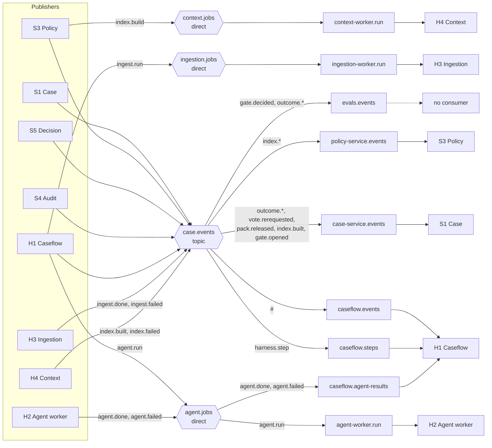
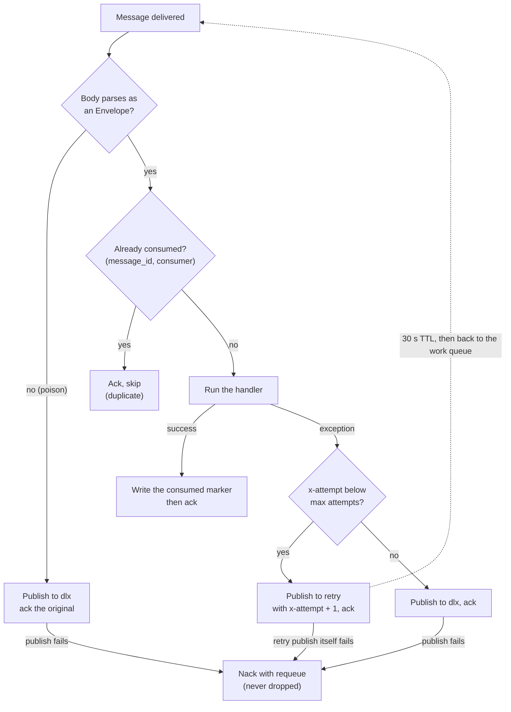
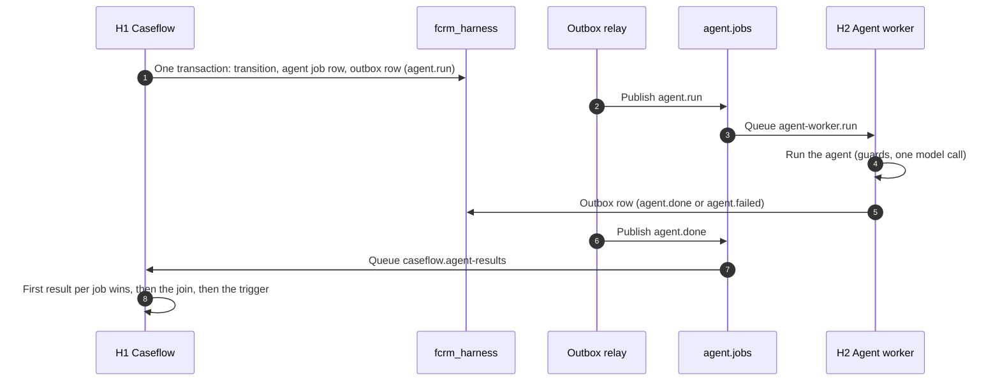
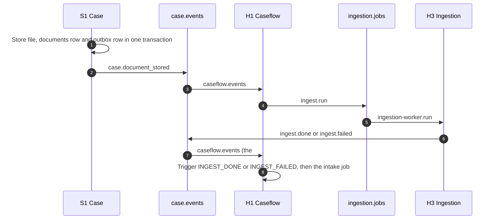
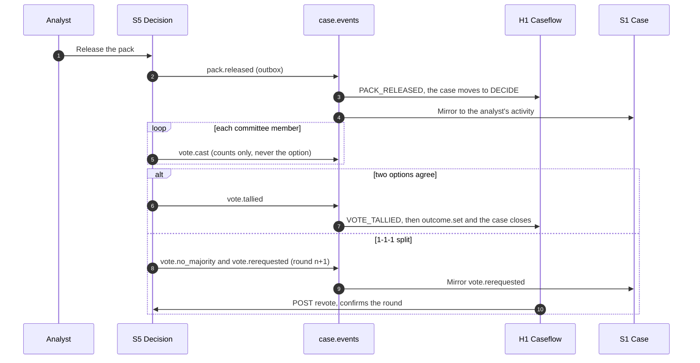

# TrustOps Events and Messaging Reference

How components talk to each other in TrustOps: the RabbitMQ topology, the event envelope, how events are published (outbox) and consumed (dedupe, retry, dead letter), what every event type is for, and how Caseflow turns events into state changes. Written from the committed code and the broker definitions, as built in October 2026.

| | |
|---|---|
| Broker | RabbitMQ 4, one virtual host, **quorum queues**, topology imported at boot from `ops/rabbitmq/definitions.json` |
| Client library | FastStream (RabbitMQ), wrapped by `fcrm_common.broker` and `fcrm_common.events` |
| Event vocabulary | **77 event types** in `fcrm_contracts.events.catalogue.EVENT_TYPES` (the set is authoritative, and a test pins its size) |
| Delivery guarantee | At least once; consumers are idempotent |
| Companions | [08-architecture-overview.md](08-architecture-overview.md) (section 7), [09-database-design.md](09-database-design.md) (outbox and dedupe collections), `trustops/docs/architecture/event-catalogue.md` |

> **Reading note.** Where this document and the code disagree, the code wins. The older `event-catalogue.md` says "75 event types"; the committed catalogue now holds 77, which is the figure used here.

## Contents

1. [The model in one page](#1-the-model-in-one-page)
2. [Topology: exchanges, queues, bindings](#2-topology-exchanges-queues-bindings)
3. [The envelope and message headers](#3-the-envelope-and-message-headers)
4. [Publishing: the outbox](#4-publishing-the-outbox)
5. [Consuming: dedupe, retry, dead letter](#5-consuming-dedupe-retry-dead-letter)
6. [Event catalogue by phase](#6-event-catalogue-by-phase)
7. [How events drive Caseflow](#7-how-events-drive-caseflow)
8. [Message flows](#8-message-flows)
9. [Guarantees and what they cost](#9-guarantees-and-what-they-cost)
10. [Operating the queues](#10-operating-the-queues)
11. [Extending the system](#11-extending-the-system)
12. [Limits and open points](#12-limits-and-open-points)

---

## 1. The model in one page

- **Services announce, workers react.** S1 (case), S3 (policy), S5 (decision) and the harness write an event to their own outbox in the same MongoDB transaction as the state change. A relay publishes it to RabbitMQ later. S4 (audit) publishes one event directly (section 4).
- **One firehose, many filtered queues.** Almost every event goes to the topic exchange `case.events`. Consumers bind with routing keys: Caseflow binds with `#` (everything), the others bind to the few types they care about.
- **Jobs are separate.** Agent, ingestion and index-build jobs use their own direct exchanges so a job has exactly one worker queue.
- **Every consumer queue has a retry queue and a dead-letter queue.** A failing message is retried through a 30-second delay queue, then parked. Nothing is dropped.
- **Ops owns the topology.** Code connects to queues and exchanges **passively**; a new queue or binding goes into `definitions.json` first, then into the worker's `topology.py`.

## 2. Topology: exchanges, queues, bindings

### Exchanges

| Exchange | Type | Carries |
|---|---|---|
| `case.events` | topic | Every case-lifecycle, gate, pack, vote, committee, outcome, condition, ingest-result and index-result event, plus `harness.step`. Routing key is the event type. |
| `agent.jobs` | direct | `agent.run` (H1 to H2); `agent.done` and `agent.failed` (H2 to H1) |
| `ingestion.jobs` | direct | `ingest.run` (H1 to H3) |
| `context.jobs` | direct | `index.build` (S3 or H1 to H4) |
| `retry` | direct | Delay hop: a failed message is republished here with `x-attempt + 1` |
| `dlx` | direct | Dead-letter hop: poison messages and exhausted retries |

The exchange for an event type is chosen by `fcrm_common.events.default_exchange`: `agent.run`, `agent.done` and `agent.failed` go to `agent.jobs`, `ingest.run` to `ingestion.jobs`, `index.build` to `context.jobs`, and everything else to `case.events`.

### Work queues

Nine work queues, each with a `.retry` queue and a `.dlq` queue (27 queues in all).

| Queue | Bound to | Routing keys | Consumer | Purpose |
|---|---|---|---|---|
| `caseflow.events` | `case.events` | `#` | H1 Caseflow | Everything on the case topic. Unmapped types are acknowledged as no-ops; much of it is Caseflow's own output echoing back |
| `caseflow.agent-results` | `agent.jobs` | `agent.done`, `agent.failed` | H1 | The terminal event of every dispatched agent job |
| `caseflow.steps` | `case.events` | `harness.step` | H1 | H1's own HTTP-side work, run outside any transaction |
| `agent-worker.run` | `agent.jobs` | `agent.run` | H2 | One agent job per message |
| `ingestion-worker.run` | `ingestion.jobs` | `ingest.run` | H3 | Document ingestion |
| `context-worker.run` | `context.jobs` | `index.build` | H4 | Vector index build |
| `case-service.events` | `case.events` | `outcome.*`, `vote.rerequested`, `pack.released`, `index.built`, `gate.opened` | S1 | Mirrors committee and harness events into the case activity log and stream; records handoff gates |
| `policy-service.events` | `case.events` | `index.*` | S3 | Records index results and reloads the in-memory vector store |
| `evals.events` | `case.events` | `gate.decided`, `outcome.*` | none | Declared and bounded, but nothing consumes it today |

### Queue policies

| Policy | Applies to | Setting |
|---|---|---|
| `fcrm-quorum-safety` | every work, retry and dlq queue | at-least-once dead-lettering, `overflow: reject-publish`, `delivery-limit: 5` |
| `fcrm-dlq-keep` | `*.dlq` (priority 10) | `delivery-limit: -1`, so a parked message survives any number of inspections (a limit of 5 once dropped a message that was merely looked at six times) |
| `fcrm-evals-bounded` | `evals.events` | 24 h message TTL, at most 10,000 messages and 64 MB, `drop-head` |
| `fcrm-evals-bounded-parked` | `evals.events.retry` and `.dlq` | at most 1,000 messages, `drop-head` |

Each retry queue has a 30-second message TTL and dead-letters back to its work queue, which is what makes the delay.

## 3. The envelope and message headers

Every message body is one `Envelope` (`fcrm_contracts.events.envelope`), strict (`extra="forbid"`), serialized as UTF-8 JSON.

| Field | Type | Meaning |
|---|---|---|
| `event_id` | string | `evt_` plus a ULID. Also the AMQP `message_id`, and the key consumers dedupe on |
| `type` | string | One of the 77 catalogued types, for example `case.submitted` |
| `version` | int | Per type, starting at 1. A breaking payload change bumps it |
| `case_id` | string or null | The case the event is about; `null` for oversight events that name no case |
| `run_id` | string or null | The Caseflow run |
| `correlation_id` | string or null | Defaults to the run id: shared across one run's events |
| `trace_id`, `span_id` | string or null | W3C trace context, taken from the current span at publish time |
| `occurred_at` | datetime (UTC) | When the event was made |
| `payload` | object | Type-specific. Some types have strict typed models (`fcrm_contracts.events.payloads`); a type with no model is still valid and carries a plain object |

Headers set by `message_headers`:

| Header | Meaning |
|---|---|
| `message_id`, `type`, `correlation_id` | Lifted into the AMQP properties of the same name |
| `content_type` | `application/json`, delivery mode 2 (persistent) |
| `x-attempt` | Delivery attempt counter, starting at 0 |
| `x-schema` | `fcrm.events/<type>@<version>` |
| `x-last-error` | Set on a retry or dead-letter hop: the exception class name |
| `traceparent`, `tracestate` | W3C trace propagation, so a consumer continues the request's trace |

Typed payloads exist first for the job messages (`JobPayload`, `AgentDone`, `AgentFailed`, `GateOpened`) and for the live-wiring events added with ADR-28 (`HarnessStep`, `PackReleased`, `VoteTallied`, `CommitteeQuestionAsked`, `CommitteeAnswered`, `CaseClarificationSent`, `CaseClarificationResolved`, `CaseControlPlanned`, `JurisdictionListPublished`, `ExaminerAsked`, and others). Those derive from a base that ignores unknown fields, so adding an optional field is not a breaking change. The vote payloads never carry the chosen option or rationale before a round is revealed.

## 4. Publishing: the outbox

A service never publishes inside a request. It writes the envelope with `Outbox.enqueue` in the same MongoDB transaction as its state change; a relay publishes the row afterwards. The full mechanism is in [08-architecture-overview.md](08-architecture-overview.md) section 7 and the row shape is in [09-database-design.md](09-database-design.md) section 6; the points that matter for messaging are these.

| Aspect | Behaviour |
|---|---|
| Ordering | The relay publishes unpublished rows in `_id` order and **stops the batch at the first failure**, so a later event never overtakes an earlier one from the same relay |
| Polling | Every 200 ms when healthy; doubles up to 5 s while the broker or Mongo is failing; resets on the first success |
| Leadership | One relay replica publishes at a time, through a 10 s Mongo lease renewed every 3 s, using the server clock |
| Delivery | At least once: if the broker confirms but the `published_at` stamp fails, the row is published again |
| Trace | Trace context is captured into the row when it is written, so the publish continues the original request's trace |
| Shutdown | A bounded drain (10 s) publishes what is pending; leftovers stay for the next leader |
| Health | The service reports not ready if its relay stops or the oldest unpublished row is more than 60 s old; the lag is a metric (`fcrm_outbox_lag_seconds`) |

Who publishes what, and how:

| Publisher | Through | Notes |
|---|---|---|
| S1 Case | its own outbox | Case lifecycle, clarification, question, control, clause and condition events |
| S3 Policy | its own outbox | `jurisdiction.list_published`, and index requests |
| S5 Decision | its own outbox (relay lease `outbox-relay:decision`) | `pack.released`, `vote.*`, `committee.*`, `outcome.set`, `pack.superseded` |
| H1 Caseflow | the harness outbox | `harness.step`, `agent.run`, gate and workflow events |
| H2 Agent worker | the harness outbox | `agent.done`, `agent.failed` |
| H3 Ingestion, H4 Context | the host's publisher | `ingest.done`, `ingest.failed`, `index.built`, `index.failed` |
| S4 Audit | **directly**, after the question is stored | `examiner.asked` only. The audit role is insert-only and cannot update, so it has no outbox relay |

## 5. Consuming: dedupe, retry, dead letter

All consumers share one pipeline (`fcrm_common.events.Consumer` and `deliver_with_retry`). A delivery goes through these steps.

Details:

- **Dedupe.** One row per `{message_id, consumer}` in `consumed_messages` (unique index, 7-day TTL), in each database that consumes events (`fcrm_harness`, `fcrm_case`, `fcrm_policy`). It is keyed per consumer, not per message, so two consumers of the same message do not block each other. The S1 consumer is transactional: the dedupe marker and the activity row it writes commit together, so a redelivery after a crash neither loses nor duplicates the row, and the per-case activity sequence stays gap-free. It publishes to open browser streams only after the commit.
- **Attempts.** The default is `max_attempts = 3`. `caseflow.steps` allows **8** (`STEP_MAX_ATTEMPTS`), roughly four minutes of retries at 30 s a hop, because steps are idempotent and an ordinary API restart (about 90 s) once exhausted three attempts and parked a step needlessly.
- **Poison.** A body that is not a valid envelope skips the retries and goes straight to the dead-letter queue. A body that is not JSON at all was once left unacknowledged and holding a prefetch slot; the broker adapter now settles it.
- **Properties survive retries.** The adapter passes `message_id`, `type` and `correlation_id` along under the names `message_headers` gives them, so a parked message can be found by the id it was published with.
- **Unknown events.** Caseflow acknowledges event types it has no trigger for as no-ops; S1 logs and acknowledges an event for a case it does not hold, since it can never succeed.
- **Replay.** `make dlq-replay` moves a parked message back onto its work queue with `x-attempt` reset to 0, so it gets a fresh retry budget, and removes it from the dead-letter queue only after the broker confirmed the republish.

## 6. Event catalogue by phase

The authoritative list is `fcrm_contracts.events.catalogue.EVENT_TYPES`; `trustops/docs/architecture/event-catalogue.md` adds payload detail per event. Publisher and consumer columns follow that document and the topology above. Types marked † are used mainly as Caseflow triggers or audit record types; check `fcrm_caseflow.audit_map` and `triggers.py` to see whether a given one is also a broker message in a particular path.

### Case lifecycle (S1 to H1)

| Event | Meaning | Consumed by |
|---|---|---|
| `case.created` | A case was raised; asks H1 to open a run | H1 |
| `case.document_stored` | A document was uploaded (written with its outbox row in one transaction) | H1 |
| `case.submitted` | The owner submitted; guard: four submit checks passed | H1 |
| `case.answered` | The owner answered a clarification | H1 |
| `case.retagged`, `case.types_changed` | The owner changed change types (ADR-75) | H1 |
| `case.rerun_requested` | The analyst asked for a re-run, with a reason | H1 |
| `case.gap_recorded` | The analyst recorded a policy gap | H1 |
| `case.locked`, `case.unlocked` | Recommendation locked or unlocked (unlock needs a reason) | H1 |
| `case.close_requested` | Analyst asked for a delegated close (Band 1 to 2) | H1 |
| `case.closed` | The case closed | H1 |
| `case.clarification_sent`, `case.clarification_resolved` | A clarification round was sent or its last answer resolved | H1 |
| `case.control_planned` | The analyst planned a control; never scored | H1 |
| `case.clause_added`, `case.clause_removed` | An analyst added or removed a clause from a corpus search (ADR-74) | H1 |
| `case.question_asked`, `case.question_answered` | An ad-hoc question to the owner and its answer (ADR-73) | H1 |
| `case.intake_recover` | Operator recovery of a run stuck in handoff from intake (`python -m fcrm_caseflow.recover_intake`) | H1 |

### Harness-internal and audit-facing †

| Event | Meaning |
|---|---|
| `workflow.started`, `agent.run`, `agent.done`, `agent.failed`, `agent.retry` | Run start and the agent job lifecycle |
| `gate.opened`, `gate.decided` | A human gate opened or was decided; S1 consumes `gate.opened` to hold handoff gates |
| `score.computed`, `score.recomputed`, `boundary.flagged` | S2 scoring results as Caseflow records them |
| `triage.assigned`, `screening.proposed`, `critic.findings`, `completeness.report`, `clarification.sent`, `fieldset.resolved`, `values.reused`, `gap.recorded` | Agent and step outputs recorded for the audit map and replay |
| `recommendation.locked`, `pack.assembled`, `pack.approved` | Recommendation and pack preparation |
| `human.override`, `human.handoff` | A person overrode a rating; a run moved to a human handoff |
| `clause.added`, `clause.removed`, `question.asked`, `question.answered` | The audit records written by the clause and question steps |
| `harness.step` | H1's own HTTP-side work (below) |

### Ingestion and context (H1, S3, H3, H4)

| Event | Publisher | Consumer |
|---|---|---|
| `ingest.run` | H1 | H3 |
| `ingest.done`, `ingest.failed` | H3 | H1 (through the `#` binding) |
| `index.build` | S3 or H1 | H4 |
| `index.built`, `index.failed` | H4 | S3 (records the answer and reloads vectors), S1 (`index.built`) |

### Decision (S5)

| Event | Written by | Notes |
|---|---|---|
| `pack.released` | `POST /packs/{p}/release`, only when all four checks pass | Consumed by H1 and S1 |
| `vote.cast` | every vote | Payload carries counts and quorum, **never the option or rationale** |
| `vote.tallied` | the third vote, when two options agree | Reveals and tallies together; `votes` is the first place options leave S5 |
| `vote.no_majority` | the third vote on a 1-1-1 split (ADR-31) | Counts only; never a tally, never an outcome |
| `vote.rerequested` | same transaction as `vote.no_majority` (round n+1); also `supersede` when members had voted | Lists the members asked to vote again; consumed by S1 |
| `vote.revealed` | legacy spelling | Tolerated by Caseflow as `vote.tallied` |
| `pack.superseded` | `POST /packs/{p}/supersede` | The pack's votes are voided, not deleted |
| `committee.question_asked` (and legacy `committee.question`) | a member's question | Consumed by H1 |
| `committee.answered` (and legacy `committee.answer`) | the analyst's answer | `numbers_changed` needs an `unlock_reason` of at least 20 characters and closes the pack to votes at once |
| `outcome.set` | `POST /outcomes` (`committee` or `delegated`) | H1 reacts only to `mode: delegated`; S1 mirrors `outcome.*` |
| `outcome.delivered` | the owner's plain-language outcome | The one outcome-related event a product owner sees (S1 mirrors it; the owner never sees `vote.*` or `pack.*`) |

`vote.tallied` and `vote.no_majority` are mutually exclusive for a round. S5 opens the next round itself in the transaction that tallies a split, so the later `POST /packs/{p}/revote` from H1 only confirms it.

### Oversight and post-close

| Event | Meaning |
|---|---|
| `condition.activated`, `condition.updated`, `condition.completed`, `condition.reminder_due` | Conditions on an approved case, including the 14-day reminder |
| `reflag.proposed`, `reflag.acknowledged` | The watchlist agent proposed re-flagging an open case; an analyst acknowledged it |
| `jurisdiction.list_published` | A jurisdiction list was published; H1 runs the watchlist agent over open cases |
| `examiner.asked` | An examiner question was stored (published by S4 directly); H1 dispatches the examiner agent |
| `chain.verified`, `eval.recorded` | A chain verification result; an eval run recorded |

## 7. How events drive Caseflow

Caseflow turns an incoming event into a **trigger** (`fcrm_caseflow.resolve`), and the pure reducer in `transitions.py` applies it to the run's current state.

| Event on the wire | Trigger |
|---|---|
| `case.submitted`, `case.answered`, `case.retagged`, `case.locked`, `case.unlocked`, `case.close_requested`, `pack.released`, `vote.cast`, `vote.no_majority` and most other literal types | The trigger of the same name |
| `agent.done` while the run is in INTAKE, SCREENING, CRITIC, COMPLETENESS or RECOMMEND | A single-agent trigger, matched by the payload's `agent` (for example `AGENT_DONE_SCREENING`) |
| `agent.done` while in ASSESS, CLARIFICATION or REVIEW | `AGENT_DONE_ASSESS_BOTH` or `AGENT_DONE_RERUN_BOTH`, once **both** research and assessment have reported (a join tracked in Mongo) |
| `agent.failed` after the retry | `AGENT_FAILED_AFTER_RETRY`, which moves the run to HANDOFF |
| `gate.decided` for `fast_lane_confirm`, `review_item` or `handoff` | The matching `GATE_DECIDED_*` trigger |
| `gate.decided` for `completeness` | `GATE_DECIDED_COMPLETENESS_ASK` or `_PROCEED`, chosen by the decision string |
| `gate.decided` for `ack`, `vote`, `lock`, `pack_release`, `unlock` | No trigger of its own: an ack is read later as a guard, and the others have dedicated lifecycle events |
| `committee.answered` | `COMMITTEE_ANSWERED_CHANGED` or `COMMITTEE_ANSWERED_NO_CHANGE`, by `numbers_changed` |
| `vote.tallied` (or the legacy `vote.revealed`) | `VOTE_TALLIED`, keyed by `vote_outcome` |
| `outcome.set` | `OUTCOME_SET_DELEGATED`, only for `mode: delegated` |

**Steps.** Work that needs an HTTP call is enqueued as a `harness.step` in the same transaction as the transition, and runs afterwards from `caseflow.steps`. Each step is idempotent by step id, and writes to S4 and S5 carry an `Idempotency-Key`. The step kinds (`StepKind`) include:

| Group | Steps |
|---|---|
| Intake | `intake.open`, `intake.document_stored`, `intake.ingested`, `intake.ingest_failed`, `intake.publish`, `intake.job_failed`, `intake.recover`, `intake.fieldset_resolved`, `intake.po_action`, `intake.types_changed` |
| Submit and triage | `submit.record`, `triage.assign`, `screening.publish` |
| Assessment | `assess.open`, `assess.publish`, `critic.publish`, `completeness.publish`, `narrative.publish` |
| Clarification and re-run | `clarification.record`, `rerun.record`, `rerun.publish`, `rerun.requested`, `retag.record` |
| Review | `review.item`, `review.ack`, `gap.record`, `control.planned`, `clause.record` |
| Lock and pack | `lock.build_pack`, `pack.approved`, `unlock.supersede` |
| Committee | `vote.record` |

The steps for the later phases (oversight, examiner, watchlist, ad-hoc questions) live in the same enum.

## 8. Message flows

### One agent job, over the broker

A worker killed after publishing `agent.done` but before acknowledging is redelivered the job and publishes a second `agent.done` under a new event id, which message-id dedupe cannot see. H1 therefore keeps the first result per job (`$setOnInsert`) and ignores later ones. Drill D1c checks this.

### Document ingestion

### Committee vote

### Examiner question

`POST /audit/examiner/ask` stores the question and publishes `examiner.asked` directly (S4 has no outbox), H1 dispatches the examiner agent on the case's run (or on an oversight run if H1 never ran the case), and H1 posts the answer back with `POST /audit/examiner/answers`. The ask call waits up to 60 s, then answers 202 with the question id.

### Configuration publish and the watchlist

Publishing a jurisdiction list writes `jurisdiction.list_published` to S3's outbox in the same transaction as the activation. The event names no case, so H1 gives it a harness run of its own (`case_id = WATCHLIST-<version>`), asks S1 for candidate cases, and dispatches the watchlist agent. Its proposals become `reflag.proposed` gates that an analyst acknowledges.

## 9. Guarantees and what they cost

| Property | How it is achieved | What you must handle |
|---|---|---|
| No lost event | State and outbox row commit together; unpublished rows never expire | Delay: up to about 200 ms normally, longer if the broker or Mongo is down |
| No phantom event | Nothing is published unless its transaction committed | None |
| At-least-once delivery | Publisher confirms, stamp after publish, manual acks, quorum queues | **Duplicates** are possible at two places: the relay and the consumer |
| Idempotent consumers | `consumed_messages` per `{message_id, consumer}`; deterministic ids; idempotent steps; first-result-wins for agent results | Handlers must still be safe to re-run |
| Order | In `_id` order from one relay, and a failed publish stops the batch | Order is per relay, not global across services. Handlers must not assume cross-service order |
| No silent drop | Retry then dead letter; if the retry publish fails the original is requeued; dead letters are never auto-expired | A parked message needs a person: inspect, fix the cause, replay |
| Bounded waste | `evals.events` is capped by age and size; published outbox rows and consumed markers expire after 7 days | A very old duplicate beyond 7 days would not be deduped |

## 10. Operating the queues

| Task | Command or place |
|---|---|
| See dead-letter depths | `make dlq` (RabbitMQ statistics can lag by up to 5 s) |
| Inspect parked messages | `make dlq-inspect q=caseflow.steps` |
| Replay after fixing the cause | `make dlq-replay q=caseflow.steps [id=<message id>]` (fresh retry budget) |
| Delete a parked message | `make dlq-purge q=caseflow.steps CONFIRM=1 [id=<id>]` (without `CONFIRM=1` it only says what it would delete) |
| Is publishing healthy? | `/readyz` on `api` and `harness` includes an outbox check; the gauge `fcrm_outbox_lag_seconds` shows the age of the oldest unpublished row |
| Management UI and metrics | RabbitMQ management plugin; Prometheus-format metrics on the broker's metrics port, scraped by the collector under `make up-obs` |
| Failure drills | `make resilience` (D1 worker restart mid-job, D2 broker stop, D5a and D5b dead-letter replay and poison messages) |

Resilience drills show the expected behaviour: with RabbitMQ stopped, writes still return 201 and each event is published exactly once after the broker returns; a poison message parks without blocking other work; a replayed parked step finishes without changing the audit chain.

## 11. Extending the system

To add an event type or a consumer:

1. **Catalogue it.** Add the type to `EVENT_TYPES` in `fcrm_contracts.events.catalogue`; an uncatalogued type is refused at publish time. Update the size lock in `tests/unit/packages/contracts/test_event_payloads.py`.
2. **Give it a payload model** in `fcrm_contracts.events.payloads` if it carries guard keys or is consumed by typed code. Guard keys that H1 reads must be top-level payload keys (a test fails if one is missing).
3. **Choose the exchange.** Case-owned events go to `case.events` with the type as routing key. A job with a single worker gets a direct exchange and queue.
4. **Edit `ops/rabbitmq/definitions.json` first** for any new queue or binding (work queue, `.retry`, `.dlq`, and the retry and dlx bindings). Code never declares topology.
5. **Repeat the names in the worker's `topology.py`** with `declare=False`.
6. **Publish through the outbox** if the producer also changes state; never publish inside a request.
7. **Make the consumer idempotent** and decide its `max_attempts`.
8. **Treat visibility as a fence change** if a product owner could see the event: S1's type-prefix blocklist and the PO fence tests apply first (`harness.` events must never reach a product owner's stream).

## 12. Limits and open points

- **`evals.events` has no consumer.** The queue, its retry and dead-letter queues and its bounding policy exist, and it receives `gate.decided` and `outcome.*`, but nothing reads it. It is bounded so it cannot grow without limit.
- **`caseflow.events` is a firehose.** Binding with `#` means Caseflow also receives its own output and ignores it. This is deliberate (no topology change is needed to add a trigger) but costs a little throughput.
- **Older notes disagree with the code in places.** `trustops/CLAUDE.md` says H3 and H4 results (`ingest.done`, `index.built`) are not published yet, while the H3 consumer and the H4 app publish them, and S1 and S3 consume `index.built`. `event-catalogue.md` says 75 event types and its "built versus pending" section is out of date. Trust the code.
- **Duplicate legacy spellings.** `vote.revealed` and `committee.question` and `committee.answer` remain in the catalogue beside `vote.tallied`, `committee.question_asked` and `committee.answered`; Caseflow tolerates both.
- **Ordering is per relay.** Events from different services can arrive in any relative order; consumers key on ids and versions, not on arrival order.
- **Single broker node.** The stack runs one RabbitMQ node; quorum queues give the semantics but there is no cluster in the shipped compose file.
- **Dedupe window is 7 days.** A redelivery older than that is not recognised as a duplicate; in practice retries finish in minutes.
- **No broker-level replay.** There is no event log to rewind. Recovery comes from the outbox (unpublished rows), the dead-letter tools and Caseflow's run events, not from re-reading the broker.
