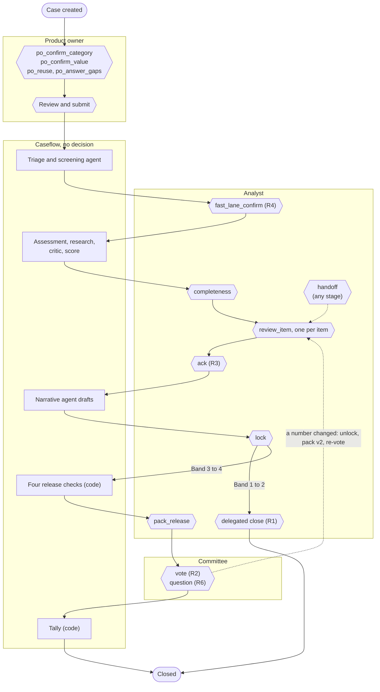
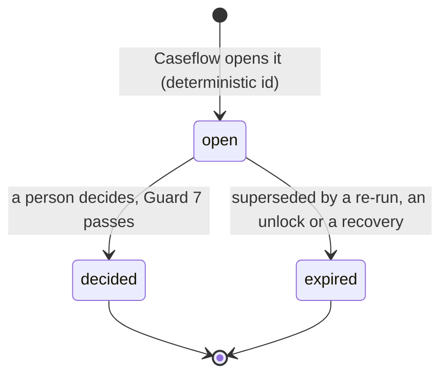
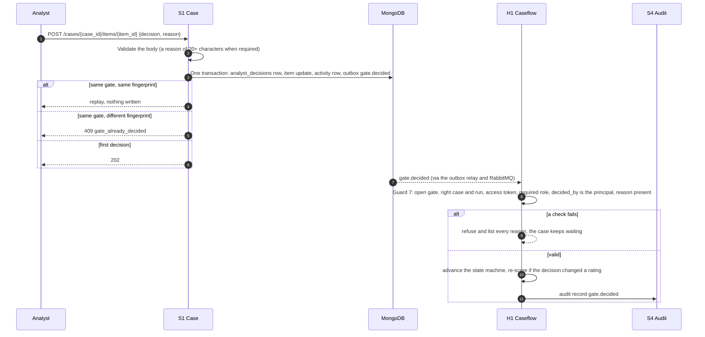
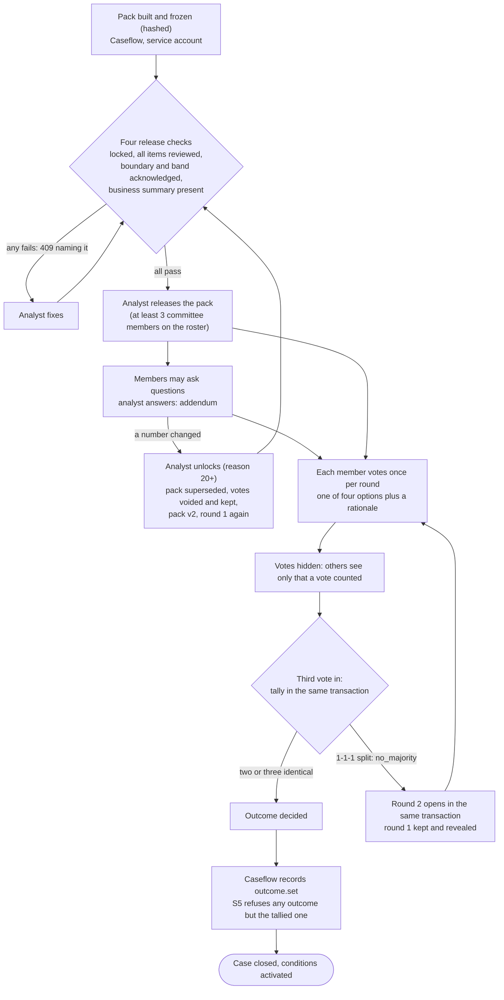
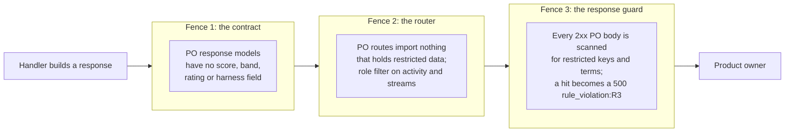
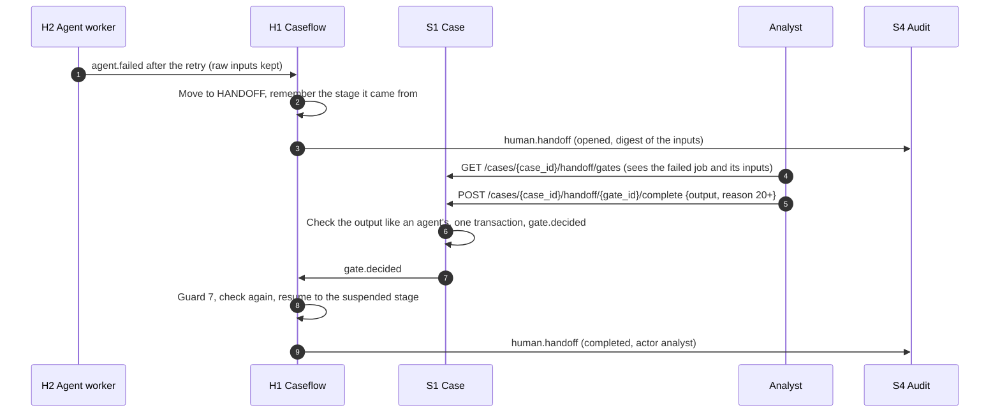

# TrustOps Human Gates and Governance

Every point in TrustOps where a person decides, what each gate controls, how a decision is validated and recorded, and the rules, roles and records that make the decisions defensible. It also summarises the build-time governance: the gates and conventions that applied while the system was built. Written from the code, the governance tables and the sequence documents, as built in October 2026.

| | |
|---|---|
| Status | As built; checked against the code on the date of writing |
| Source of truth | `src/backend/packages/contracts` (`GateType`, `Outcome`, `voting.tally`), `packages/guardrails` (Guard 5 rules, Guard 7), `workers/caseflow` (`gates.py`, `dispatch.py`, `transitions.py`), `ops/opa/data/permissions.json`, then `trustops/docs/governance/` |
| Companions | [07-api-reference.md](07-api-reference.md) for every route named here, [08-architecture-overview.md](08-architecture-overview.md), [09-database-design.md](09-database-design.md) |
| If a document and the code disagree | The code wins. Places where the governance prose lags the code are listed in [section 14](#14-limits-and-open-points) |

## Contents

1. [Governance at a glance](#1-governance-at-a-glance)
2. [Who decides: roles and segregation of duties](#2-who-decides-roles-and-segregation-of-duties)
3. [The gate register](#3-the-gate-register)
4. [Gates across the case lifecycle](#4-gates-across-the-case-lifecycle)
5. [How a gate works](#5-how-a-gate-works)
6. [The rules: R-1 to R-8 and R1 to R6](#6-the-rules-r-1-to-r-8-and-r1-to-r6)
7. [The committee decision](#7-the-committee-decision)
8. [Visibility and the PO fence](#8-visibility-and-the-po-fence)
9. [Reasons and overrides](#9-reasons-and-overrides)
10. [When automation fails: the handoff gate](#10-when-automation-fails-the-handoff-gate)
11. [The audit trail as governance evidence](#11-the-audit-trail-as-governance-evidence)
12. [Build-time governance](#12-build-time-governance)
13. [Rubric to evidence](#13-rubric-to-evidence)
14. [Limits and open points](#14-limits-and-open-points)

---

## 1. Governance at a glance

| Principle | What enforces it |
|---|---|
| **Nothing is approved or rejected automatically.** | `Outcome` has exactly four values and "no fifth value, ever". An outcome is recorded only from a person's vote or an analyst's delegated close. A split vote is `no_majority`, never a default. |
| **Agents propose, people decide.** | Nine agents, each a single model call per job. Every proposal reaches a named gate (Guard 7). The service account is denied by name on every gate route. |
| **Scores come from code.** | `fcrm_scoring` alone computes a composite and band. The agents' output models have no score field, and no agent has a scoring tool (ADR-07, rule R-1). |
| **Policy is quoted, not generated.** | Every claim carries a source reference and a verbatim quote that Guard 4 matches against the cited text (R-8). |
| **Every change of mind carries a reason.** | Overrides, removals, unlocks, handoffs, vote rationales and delegated closes need a written reason of at least 20 characters ([section 9](#9-reasons-and-overrides)). |
| **Every state change is audited, tamper-evidently.** | A hash-chained, append-only audit trail written through an insert-only database user ([section 11](#11-the-audit-trail-as-governance-evidence)). |
| **The product owner never sees a score.** | Three independent fences ([section 8](#8-visibility-and-the-po-fence)). |
| **Live model calls and decisions about the build are gated too.** | ADR-59, and the SDLC gates in [section 12](#12-build-time-governance). |

## 2. Who decides: roles and segregation of duties

| Role | Decides |
|---|---|
| Product owner (`fcrm_po`) | Change types, extracted values, value reuse, answers to gaps, the review-and-submit step, answers to the analyst's questions, evidence for conditions |
| Analyst (`fcrm_analyst`) | The fast lane, completeness, every review item, acknowledgements, the recommendation lock and unlock, pack release, delegated close, re-flags, handoffs, committee answers, configuration |
| Committee member (`fcrm_committee`) | Questions on a pack and one vote per round |
| Observer (`fcrm_observer`) | Nothing; read-only |
| Service account (`fcrm_service`) | Nothing that is a human decision. It runs Caseflow's steps and records outcomes people decided |

**Segregation of duties is enforced in OPA, not by convention.** The service account inherits the PO, analyst and committee grants so that Caseflow can read what it needs, but `ops/opa/data/permissions.json` carries deny rules that match the service account's own role on every decision route. Deny overrides allow, and a deny rule matches the caller's own roles, not inherited ones.

The deny rules cover, with the reason the rule file gives:

- every PO gate and write: raise a case, upload, validate, submit, discard, the four intake gates, the owner's answers, integrations, and condition evidence ("human decisions are made by people");
- every analyst gate: screening, completeness, item decisions, acknowledge, lock and unlock, recommendation edits, close, re-run, re-tag, clarifications and questions, clauses, planned controls, gaps, handoff completion, re-flag acknowledgement, and condition status changes;
- committee and decision routes: release a pack, cast a vote, ask a committee question, answer a thread;
- `POST /audit/examiner/ask` ("a question is a person's");
- activating a jurisdiction list, all of `/policy/config/*`, and `POST /scoring/simulate`.

What the service account can still do near a decision is **record** one: after a tally it posts the outcome the committee reached. S5 refuses an outcome other than the tallied one, so recording cannot change the decision ([section 7](#7-the-committee-decision)).

## 3. The gate register

The code defines 14 gate types (`fcrm_contracts.enums.GateType`), each with a required role (`REQUIRED_ROLE` in `fcrm_caseflow/dispatch.py`). The register in `docs/governance/gates-register.md` lists 18 product rows: 13 of them correspond to gate types (`lock` and `unlock` share a row), and five are decision points that are not modelled as gates (the owner's review-and-submit step, a committee question, the delegated close, the `policy_gap` suggestion and the examiner).

Routes are in [07-api-reference.md](07-api-reference.md). Gate types below are the enum values.

### Product owner gates

| Gate | Decision | When it opens | Risk it controls | API |
|---|---|---|---|---|
| `po_confirm_category` | Confirm or remove each proposed change type (removal needs a reason) | Intake, after the intake agent proposes types | A wrong type resolves the wrong field set and risk domains | `POST /cases/{case_id}/intake/categories/{change_type}` |
| `po_confirm_value` | Confirm or correct each extracted value, one at a time with its source | Intake, per value | An extraction error becomes a submitted fact | `POST /cases/{case_id}/intake/values/{field_id}` |
| `po_reuse` | Accept values from a precedent case, with provenance | Intake | Stale values copied from an old case | `POST /cases/{case_id}/intake/reuse` |
| `po_answer_gaps` | Answer the blocking gaps | Intake | An incomplete case enters assessment (completion must reach the threshold and every always-required field) | `POST /cases/{case_id}/intake/answers` |
| Review-and-submit (not a gate type) | Correct, then submit after the four checks | Before submission | The owner submits values they did not read; the original is kept | `POST /cases/{case_id}/validate`, `POST /cases/{case_id}/submit` |

### Analyst gates

| Gate | Decision | When it opens | Risk it controls | API |
|---|---|---|---|---|
| `fast_lane_confirm` (R4) | Confirm the fast lane or decline with a reason | After screening proposes it | A non-trivial change takes the short path | `POST /cases/{case_id}/screening` |
| `completeness` (D-16) | Ask the owner one batched round, or proceed | Before Policy and Controls review | Reviewing on missing, stale or contradictory inputs | `POST /cases/{case_id}/completeness`, `POST /cases/{case_id}/clarifications` |
| `review_item` (Gate A) | Accept, override, adjust, remove or explain one item: clause, rating, control or critic finding | Review, one gate per item | Accepting an AI proposal unread. There is no bulk-accept route (R-2) | `POST /cases/{case_id}/items/{item_id}` |
| `ack` (R3) | Acknowledge a band change or boundary flag | After a score changes band or sits at a boundary | A routing change goes unnoticed; release is blocked until acknowledged | `POST /cases/{case_id}/acknowledge` |
| `lock` | Freeze the recommendation | After review | Numbers change after the narrative is written | `POST /cases/{case_id}/recommendation/lock` |
| `unlock` | Reopen the numbers, with a reason | Recommendation locked | A silent change to a locked case; unlocking supersedes the pack | `POST /cases/{case_id}/recommendation/unlock` |
| `pack_release` | Release the pack to the committee | After the four release checks pass | An incomplete pack reaches the committee | `POST /decision/packs/{pack_id}/release` |
| `reflag_ack` | Acknowledge each re-flagged open case | Oversight, when a jurisdiction list is published | A changed list is missed on open cases | `POST /reflags/{reflag_id}/acknowledge` |
| `handoff` | Complete a failed step by hand, with a reason | An agent job failed after its one retry | A stuck case ([section 10](#10-when-automation-fails-the-handoff-gate)) | `POST /cases/{case_id}/handoff/{gate_id}/complete` |
| Delegated close (R1, not a gate type) | Close a Band 1 to 2 case with an outcome and a reason | After the recommendation is locked | An analyst closing above their authority; the route refuses anything but Band 1 to 2 | `POST /cases/{case_id}/close` |

### Committee decision points

| Gate | Decision | When it opens | Risk it controls | API |
|---|---|---|---|---|
| `vote` (R2) | One of four options, with a rationale, once per round | The pack is released (Band 3 to 4) | Anchoring on colleagues' votes: votes stay hidden until all three are in | `POST /decision/packs/{pack_id}/votes` |
| Committee question (R6, not a gate type) | A member asks; the analyst answers. The answer becomes an addendum; a changed number unlocks and supersedes the pack | While the pack is open | Deciding on a misread pack | `POST /decision/packs/{pack_id}/threads`, `POST /decision/threads/{thread_id}/answer` |

### Decision points with no gate

- **`policy_gap` suggestion.** The agent runs off the decision path after the analyst notes a gap. The design has the analyst accept or reject it with a reason, but the review screen is not built (`known-gaps.md` section U).
- **Examiner.** It answers only from the verified audit chain through a read-only tool, so nothing it says changes a case and it feeds no gate.

### What is audited at each decision

Each gate decision writes a `gate.decided` record (Guard 7's audit type), one per item (R-2), through S4. Decisions that change numbers add more: an override writes `human.override` and the recomputation writes `score.recomputed`; a lock writes `recommendation.locked`; a release writes `pack.approved`; votes write `vote.cast` (never the option), then `vote.revealed` and `outcome.set`; a handoff writes `human.handoff` twice (opened and completed). The record names come from the gates register and the sequence documents.

## 4. Gates across the case lifecycle

The flow follows the transition table in `fcrm_caseflow/transitions.py`. Between gates, agents and code do the work. At every gate, the case waits until a person decides (Guard 7, `on_fail: undecided: case_waits`).

## 5. How a gate works

### Lifecycle

A gate is a document in `fcrm_harness.gates` with a status of `open`, `decided` or `expired`. Caseflow opens it; the owning service decides it through its route; Caseflow validates the decision and advances.

- **Deterministic ids.** A gate's id is derived from the run, the gate type and a subject key (`deterministic_gate_id`), so a step that runs twice opens nothing twice.
- **Expired means superseded, not ignored.** A re-run that replaces a proposal expires the old item's gate (`decision: superseded`, reason "a re-run replaced this proposal"). An unlock supersedes the pack and expires the `pack_release` gate with the unlock reason. An operator intake recovery expires open handoff gates.
- **Decided gates are never edited.** A re-run proposes a new item with its own gate.

### One decision, end to end

The decision, its ledger row, its activity row and its outbox event commit in one transaction ("store before emit"), so a failure while the event is enqueued leaves nothing decided.

### What Guard 7 refuses

`fcrm_guardrails.human_gate.validate_gate_decision` runs on every `gate.decided` and lists all failures at once:

- a gate that is not `open` (already decided, or expired);
- a decision for another gate, gate type, case or run;
- a token that is not an access token (a second line of defence for a refresh-token bug in the cloned identity service);
- a principal without the gate's required role, or a `decided_by` that is not the principal;
- a decision that needs a reason and has none: every vote, unlock and handoff, every `override`, `remove`, `adjust` or `explain`, and any decision whose `after` differs from its `before`;
- a vote whose option is not one of the four outcomes.

Nothing in the guard approves anything: a valid decision only lets Caseflow **record** the person's choice.

## 6. The rules: R-1 to R-8 and R1 to R6

Two numbering schemes exist, and they are different things.

### The eight rules (R-1 to R-8): invariants checked by Guard 5

Each rule has a module under `fcrm_guardrails/rules/`. Caseflow checks all eight before every state change, and the agent worker checks R-1, R-7 and R-8 on outputs. A failing rule blocks the state change and names the rule id.

| Rule | Statement | Enforced by |
|---|---|---|
| R-1 | No agent wrote a score | Agent output models have no score field; the assessment agent has no scoring tool; only `fcrm_scoring.engine` computes a composite (ADR-07) |
| R-2 | No bulk accept | Item decisions take exactly one item; no route accepts a list of item ids; a unit test covers the rule |
| R-3 | The PO view has no restricted fields | PO models have no such fields, plus the response guard ([section 8](#8-visibility-and-the-po-fence)) |
| R-4 | The analyst never edits the submission | The analyst contracts have no "edit field value" request |
| R-5 | A closed case is untouched | `CLOSED` has one outgoing transition (itself idempotent); every other trigger raises `IllegalTransition` |
| R-6 | An override has a reason | `reason` is required on override, remove, adjust and explain |
| R-7 | A planned control is not scored | Planned controls are filtered before a score request is built; the engine's input model has no `planned` field |
| R-8 | Policy is quoted, not generated | Every claim carries a verbatim quote and source reference; Guard 4 matches quotes |

### The six routing rules (R1 to R6): where a case goes (ADR-19)

| Rule | What it decides | Enforced by |
|---|---|---|
| R1 | Band 1 to 2: the analyst closes under delegated authority | `route_for_band`; the close transition's guard (`band in (1, 2)`); the close route refuses otherwise |
| R2 | Band 3 to 4: the committee decides, quorum of three, hidden votes, a rationale on each | `fcrm_contracts.voting.tally`, `QUORUM = 3`; the vote model requires a rationale |
| R3 | A boundary flag or band change needs acknowledgement before release | `boundary_flag` in the scoring engine (ADR-13); the `ack` gate; the `boundary_and_band_acknowledged` release check |
| R4 | Fast lane for a low-risk change, confirmed by the analyst | The `fast_lane_confirm` gate: a proposal always opens a gate, never skips to confirmed |
| R5 | Auto-triage to the analyst with the fewest open cases | `pick_auto_triage_analyst` |
| R6 | A committee question becomes an addendum; a changed number unlocks, builds pack v2 and re-requests every vote | The `COMMITTEE_ANSWERED_CHANGED` transition and S5's supersede |

The routing rules are served by S2 as versioned data; the rule functions live in Caseflow.

## 7. The committee decision

Only Band 3 to 4 cases reach the committee. Votes are cast through S5, and the tally is one pure function used by both S5 and Caseflow so they cannot diverge.

Key rules, with their sources:

- **Four outcomes only:** `approve`, `approve_with_conditions`, `defer`, `reject`. A vote option mirrors an outcome, so there is no mapping step to get wrong.
- **Tally** (`fcrm_contracts/voting.py`, ADR-08, ADR-31, ADR-36): a round is tallied only when exactly three votes are in; any other count fails closed to `no_majority`. Two or three identical votes win. Within the approve family, `approve, approve, approve_with_conditions` resolves to `approve_with_conditions`, so a member who asked for conditions is never outvoted into an unconditional approval. The family never merges across a defer or a reject. All 1-1-1 combinations are `no_majority`. The result depends only on the multiset of options, not the arrival order.
- **No automatic deferral** (ADR-31): a split opens a new round and a system thread; it never maps to `defer`.
- **Hidden ballot:** the `vote.cast` event never carries the option or rationale (the model refuses them). Each member sees only their own choice until all three are cast; the reveal and the tally happen together in the third vote's transaction. Black-box test `test_bb_05_votes_hidden_until_all_cast.py` covers it.
- **The pack is frozen:** its content is stored and hashed as sent and never changed (`test_bb_06_pack_frozen.py`). A committee answer that changes a number closes voting at once; the pack is superseded and its votes voided but kept (ADR-37). A second pack for a live case is a 409 until the first is superseded.
- **Recording the outcome:** `outcome.set` is emitted only by `POST /decision/outcomes` (committee or delegated), which is service-account-only. The tally emits `vote.tallied` alone, and S5 refuses an outcome other than the tallied one, so no vote can decide a case without being recorded, and the recorder cannot change it (ADR-37).
- **Delegated close:** the analyst alone closes a Band 1 to 2 case, never over an open committee pack or an existing outcome, with a reason of at least 20 characters and a plain-language summary that names no score, band or rating.

## 8. Visibility and the PO fence

The product owner is the one role that is deliberately blind to the risk analysis. "Never" in the matrix below means the response shape cannot carry the field, not that a view hides it.

| Data | PO | Analyst | Committee | Observer |
|---|---|---|---|---|
| Case fields, documents, own submission | Read and write, own cases | Read-only | Read-only | Read-only |
| Composite, band, boundary flag; likelihood, impact and control ratings | **Never** | Yes | Yes, through the pack | Yes |
| Agent proposals and provenance; review items | **Never** (sees only confirmed values) | Yes, decides each | Pack only | Yes |
| Recommendation draft | No (plain-language outcome summary after the decision) | Drafts and locks | In the pack | Yes |
| Conditions | Yes, once activated | Yes | In the pack | Yes |
| Committee votes | No | After reveal | Own vote before reveal; all after | After reveal |
| Harness monitor | **403** (ADR-19) | Yes | Yes | Yes |
| Audit chain and examiner | No | Yes | Yes | Yes |
| Configuration | No | Owns it | No | Read-only |

The table is the matrix in `docs/governance/visibility-matrix.md`. The API allows more to the observer than the web exposes: the observer's web is the harness monitor only (ADR-64), and tightening the OPA rules to match is left to the operator.

### Three fences that trust none of the others

Two documents describe the layers slightly differently. `fcrm_case/po_guard.py` names them contract, router imports and response guard; ADR-32 names them role filter, type-prefix blocklist and text scan for the activity feed and streams. Both are in the code, and the list below keeps both.

- **Fence 1, the contract.** `fcrm_contracts.api.case_po` has no field that could carry a score, band, rating or harness identifier. Unit test `test_po_models_forbidden_fields.py` guards it.
- **Fence 2, the router and the feeds.** The PO routes reach nothing that holds restricted data. For activity and live streams a PO sees only `po` and `all` entries, and a type-prefix blocklist (`score.`, `harness.`, `audit.`, `agent.`, `guard.`, `critic.`, `proposal.`, `pack.`, `vote.` and similar) plus a restricted payload-key list apply (ADR-32). A unit test fails if the key list drifts from the guardrails package.
- **Fence 3, the response guard.** `fcrm_case/po_guard.py` wraps every PO route and scans the JSON about to be sent with the R-3 check. A restricted key or term turns the answer into a 500 `rule_violation:R3` (fail closed, nothing of the body sent), logged with the case id, route and the path of each hit but never the value, and counted in `fcrm_rule_violations_total`. Only successful JSON bodies are scanned, so a refusal that names a reserved word stays readable.
- **Terms.** `ai/guards/restricted_terms.txt` lists the words that may never appear in PO-facing text. Guard 4 rejects a narrative business summary on any hit, and the PO response guard re-scans with the same list. Matching normalises text first (NFKC, zero-width characters removed, Cyrillic homoglyphs folded) so `Band2` or `score:9.8` do not slip through while `bandwidth` stays clean.
- **Route authorization.** OPA denies the PO role on analyst and committee routes (403, not a redirect), and the harness event stream is closed to the PO.
- **Black-box proof.** `tests/integration/blackbox/test_bb_02_po_no_restricted_fields.py` drives the real API as a PO and asserts no restricted field or string reaches any response. A new PO-visible field counts as a fence change and gets a failing test first.

## 9. Reasons and overrides

A decision that changes the machine's proposal, or that is hard to reverse, needs a written reason, enforced at the contract (422), again by Guard 7, and recorded in the chain.

| Decision | Minimum reason | Enforced in |
|---|---|---|
| Override, remove, adjust or explain a review item | 20 characters | `ItemDecisionBody` (`case_analyst_write.py`); Guard 7 also requires one |
| Decline the fast lane | 20 | `FastLaneBody` |
| Unlock a recommendation | 20 | `UnlockBody`; unlock is a reason-required gate |
| Re-run, re-tag change types, add a clause | 20 | `case_analyst_write.py`, ADR-74 |
| Handoff completion | 20 | `analyst_handoff_service`; handoff is a reason-required gate |
| Committee vote rationale | 20 | `VoteIn` |
| Delegated close | 20 | `CloseCaseRequest` |
| Re-flag acknowledgement | 20 | `ACK_REASON_MIN_CHARS` |
| Condition status change | 20 | `STATUS_REASON_MIN_CHARS` |
| Discard a draft | 20 | `DISCARD_REASON_MIN_CHARS` |
| A committee answer that changes numbers | 20 (`unlock_reason`) | S5 |
| Publish a configuration section | 20 (version note) | S3 |

Guard 7's own floor is 10 characters (`OVERRIDE_REASON_MIN_CHARS`); the API's 20 is the binding one in practice.

An override also recomputes the score: S2 returns a new snapshot and the change is acknowledged through the `ack` gate if it moves the band. In the demo, overriding vendor due diligence from 7.6 to 4.5 moves the composite from 9.8 (Band 2, boundary flag) to 10.4 (Band 3), and the case goes to the committee.

## 10. When automation fails: the handoff gate

If an agent job fails after its one retry (a rejected output, a spent budget, a denied tool or no context pack), the run does not stall and does not skip. It moves to `HANDOFF` and opens a gate that carries what the job was given.

- **A person decides.** The route is the analyst's alone, for a case they hold; the service account is denied.
- **Manual output is held to the agent's schema** (a stray score is rejected), but sources and quotes cannot be matched against the context pack, so the record says so (`claims_matched_to_sources: 0`). Every item from a manual output still goes to a review gate and the critic.
- **Nothing is skipped, scored from a missing proposal, or approved.** Safe to run twice: the gate id derives from the run and the job.

## 11. The audit trail as governance evidence

Every state change writes an audit record through S4. The trail is a per-case hash chain, `hash = sha256(prev_hash + "\n" + canonical_body)`, with `fcrm_audit_writer` holding only `find` and `insert`, so even a bug in S4 cannot rewrite history. [09-database-design.md](09-database-design.md) section 9 has the format, the validator and the defences.

What it holds for governance:

- every gate decision, with who decided, when and the reason (`gate.decided`, `human.override`, `human.handoff`);
- every score computation and recomputation, with the versions pinned;
- every guard outcome (`guard.input`, `guard.permit`, `guard.budget`, `guard.output`, `guard.rules`, `critic.findings`);
- every vote event (without the option until reveal), the tally, the outcome and the delivery;
- the evidence ledger of agent proposals, each with its prompt version and what it supersedes.

How a reviewer uses it:

- `GET /audit/verify/{case_id}` recomputes the chain and reports the first break; `make verify case=<id>` runs it from the command line. A verification result is itself recorded (`chain.verified`).
- The **examiner** answers an analyst's question about a case only from a chain that currently verifies, cites the records it used, and says so when the records do not hold the answer. It changes nothing, and the service account cannot ask it.
- The demo case's real 67-record trail, including the override and the recomputation, is replayed through the chain code in a unit test; `test_bb_04_audit_chain_tamper_anywhere.py` checks that tampering anywhere is detected.

The chain is tamper-evident, not tamper-proof against a privileged database user, and there is no external anchoring by decision.

## 12. Build-time governance

The same principle applied to how the system was built: AI did the work, people gated it, and the evidence is in the repository. This section summarises `docs/governance/gates-register.md` and `docs/governance/sdlc-evidence.md`.

### SDLC gates

| Gate | Decided by | Stage | Risk controlled |
|---|---|---|---|
| G-R1 spec sign-off | Operator | Requirements | A wrong assumption multiplies through every later stage |
| G-D1 architecture review | Operator | Design | Service boundaries, contracts and the deterministic/LLM split are the costliest things to change; each ADR row is accepted before its lane starts |
| G-D2 contract freeze | Operator | Design to Development | Lanes building against moving shapes; the OpenAPI and event schemas are committed and changed only with fixtures |
| G-C1 commit gate | Hooks | Development | Mechanical faults reaching history: `make check` runs lint, types, OPA, unit tests |
| G-C2 review | Operator | Development | A change that moves a product rule or widens scope |
| G-T1 eval gate | Hooks | Testing | A prompt or model change silently degrading an agent |
| G-T2 release gate | Operator | Testing to Deployment | Residual defects at release |
| G-P1 clean-clone proof | Operator | Deployment | "Works on my machine" |
| G-O1 nightly review | Operator | Operations | Many automated signals need a person to prioritise |

During the single continuous build run, operator gates were recorded rather than blocking: the run noted the evidence and continued, and the operator reviewed asynchronously, objecting through an ADR or defect row. Hook gates block. The evidence page says plainly where a gate was enforced by hook and where by discipline.

### Mechanisms

| Mechanism | Where | What it enforces |
|---|---|---|
| Commit convention | `ai/guidance/commit-convention.md` | `type(scope): summary [D-xx, ADR-nn]`, a `Stage:` trailer (one of six) and a `Gate:` trailer with the evidence (for example `G-C1 make check`, plus `G-T1 evals ...` when a prompt or model changed) |
| `commit-msg` lint | `ops/scripts/commit_msg_lint.py`, `.pre-commit-config.yaml` | A decision reference and a valid stage; a missing `Gate:` warns |
| Commit guard hook | `ai/guidance/hooks/commit_guard.py` | Blocks `git commit` unless `.cache/check.ok` is newer than every changed file and the message follows the convention |
| Pre-commit hooks | `.pre-commit-config.yaml` | ruff, mypy and unit tests on what changed |
| Append-only governance tables | `ops/scripts/governance_append_only.py` (pre-commit) | No edit or deletion of an existing table row under `docs/governance/` |
| Live model call gate (ADR-59) | CLAUDE.md, every lane brief | Nothing that calls Bedrock runs without the operator's approval, asked first with what it is, how many calls and an estimate |
| Model and prompt discipline | `ai/CLAUDE.md`, `ai/_tools/validate_ai.py` | Model ids only in the tiers file; prompts versioned, never edited; a prompt or model change carries its live eval evidence |
| Worktree and brief protocol | `ai/guidance/worktree-protocol.md`, `subagent-brief-template.md` | One worktree and branch per lane; the lead alone merges; every brief names the decisions not to reopen and ends with Changed, Failed, Decided |
| Review checklist | `ai/guidance/review-checklist.md` | The eight rules, the visibility matrix, idempotency and audit checked at G-C2 |

The Claude Code hook scripts are committed, but their registration lives in the operator's untracked `.claude/settings.json` (an example is in `ai/guidance/hooks/settings.example.json`), so whether they ran in a given session cannot be proved from the repository. The git hooks installed by `make bootstrap` are the enforced layer.

The decision log is append-only and each ADR row says which design row it adds to or amends. The sdlc-evidence page lists `git log` queries a reviewer can run to count commits by stage, `Gate:` trailers and co-authored commits.

## 13. Rubric to evidence

The brief grades human-in-the-loop gates with rationale at 15%.

| Expectation | Evidence |
|---|---|
| A person decides at every consequential point | The 14 gate types and their required roles (`dispatch.py`); the transition table; Guard 7 (`human_gate.py`, `test_human_gate.py`) |
| The rationale for each gate is stated | `docs/governance/gates-register.md`: risk controlled and why each gate sits where it does; [section 3](#3-the-gate-register) |
| Machines cannot decide for a person | OPA deny rules on the service account for every gate route (`permissions.json`); the tally and outcome rules (ADR-31, ADR-36, ADR-37) |
| Nothing is decided automatically | `Outcome` has four values and no default; a split is `no_majority`; `test_bb_01_nothing_auto_approved.py` |
| Humans must justify changes | Reason minimums in [section 9](#9-reasons-and-overrides); rule R-6 |
| No rubber-stamping | One gate per item and no bulk-accept route (R-2); `test_r2_no_bulk_accept.py` |
| Committee independence | Hidden ballot, quorum of three, rationale required, no auto-deferral; `test_bb_05_votes_hidden_until_all_cast.py` |
| The product owner is fenced | Three fences; `test_bb_02_po_no_restricted_fields.py`; `test_po_models_forbidden_fields.py` |
| Failure ends with a person | The handoff gate (ADR-51); resilience drills D6 and D6b |
| Decisions are provable afterwards | Hash-chained audit trail, `verify`, the examiner; `test_bb_04_audit_chain_tamper_anywhere.py` |
| Humans gated the build as well | [Section 12](#12-build-time-governance); `docs/governance/sdlc-evidence.md` |

## 14. Limits and open points

- **Two numbering schemes.** The eight invariant rules are written R-1 to R-8 and the routing rules R1 to R6. Older documents sometimes call both "rules"; the guard config and code use the hyphenated form for the invariants.
- **Governance prose that lags the code.** `docs/governance/rules.md` and `visibility-matrix.md` still carry status text from before the HTTP layer landed ("pending `fcrm_common`", "Still to build"); several rows that read "pending" are now enforced, and the known-gaps file says so. `known-gaps.md` section C also still says a run in `handoff` cannot be resumed, which ADR-51 and the shipped route supersede.
- **Counts differ by source.** The register text says 16 product gates; its table has 18 rows, 13 of which map onto the 14 `GateType` values, as explained in [section 3](#3-the-gate-register). Prefer the enum.
- **Black-box coverage.** The blackbox folder has no file for BB-03 (override reasons) or BB-08 (no bulk accept). Those rules are covered by unit and contract tests (for example `test_r2_no_bulk_accept.py`), but I did not confirm that every named black-box scenario has a test elsewhere.
- **The `policy_gap` suggestion has no review screen** (`known-gaps.md` section U). The agent runs and stores a proposal, but nothing yet lets the analyst accept or reject it, so this gate exists in the design only.
- **Observer permissions are wider than the screens** (ADR-64): the API lets the observer and committee read agent quality; no screen uses it. Tightening is left to the operator.
- **The vote tally's approve-family rule** is marked "(proposed)" in the module docstring but is implemented and recorded in ADR-36; confirm the intended status before presenting it as settled policy.
- **The audit chain is tamper-evident, not tamper-proof** against a database superuser, and has no external anchor.
- **SDLC gates were recorded, not blocking,** for operator decisions during the single continuous build run. Only the hook gates blocked, and the Claude Code hook registration is not in the repository.
- **Reason minimums are not one constant.** Guard 7 uses 10 characters and the API contracts 20. The API is stricter, so the effective bar is 20, but a decision entering only through Guard 7 would be held to 10.
- **Dated sources.** The gates register and sdlc-evidence snapshot predate later ADRs (for example ADR-73 to ADR-75); where a later ADR changes a gate, this document follows the code and the ADR.
