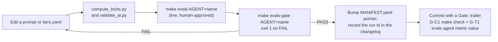
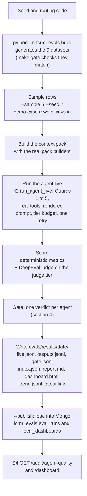
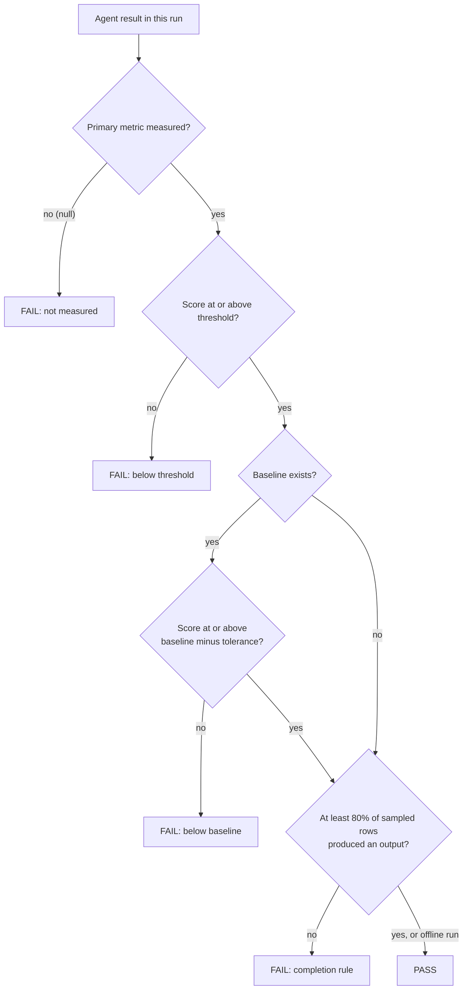
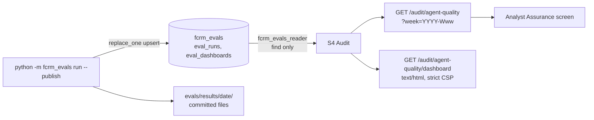
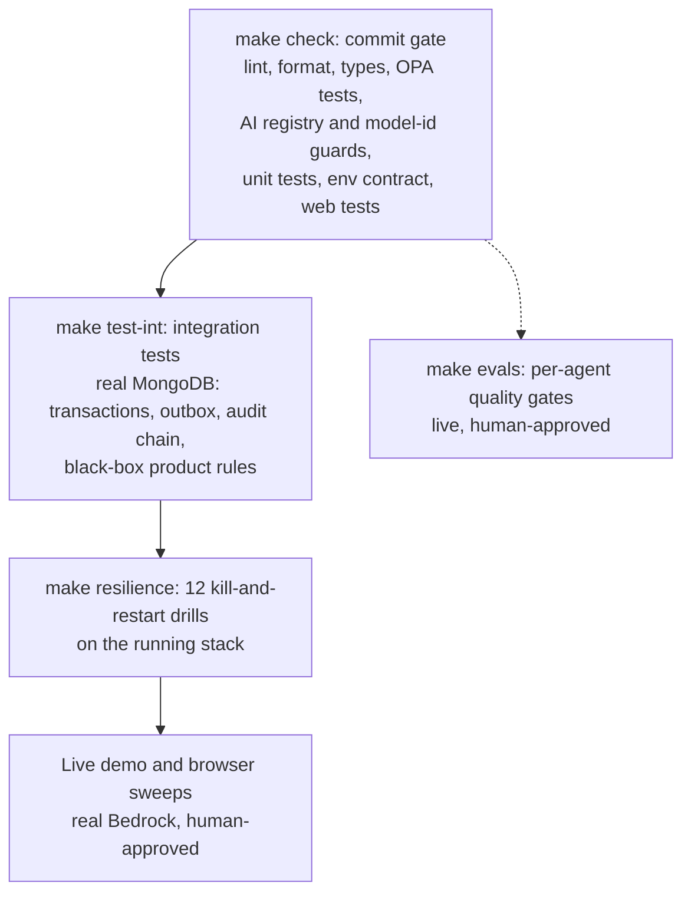

# TrustOps Evals and Quality Report

What TrustOps measures about its nine agents, how a measurement becomes a gate, what the committed results say (including the gate that fails), what the agents cost in tokens and dollars, and how the wider test strategy backs the product. Written from the eval package, the committed result files under `evals/results/`, `tiers.yaml`, the token and test reports and the decision log, as of 26 October 2026. The last eval run on record is from **6 October 2026**.

| | |
|---|---|
| Status | Evals last run 6 Oct 2026 on a model chain that is **no longer the committed one**; no baseline exists on the committed chain (section 5.1) |
| Source of truth | `trustops/evals/README.md`, `evals/results/` (`index.json`, `gate.json`, `report.md`, `baseline.json`, `trend.jsonl`), `src/backend/packages/evals/`, `ai/models/tiers.yaml`, `ops/reports/token-analysis.md`, `docs/governance/test-report.md`, `docs/governance/decision-log.md` |
| Companions | [08-architecture-overview.md](08-architecture-overview.md) (AI layer, guards), [07-api-reference.md](07-api-reference.md) (`GET /audit/agent-quality`), [09-database-design.md](09-database-design.md) (`fcrm_evals`) |
| If sources disagree | Code and committed result files win over prose. Disagreements found while writing this are listed in section 10 |

> **Do not run live evals casually.** `make evals`, `make evals-full`, `make demo`, `make e2e` and any drill that runs an agent call Amazon Bedrock and cost money. ADR-59 makes a live model call a human gate: ask the operator first, say what it is, how many calls, and an estimate. This document was written without running any of them; every number below was read from a file.

## Contents

1. [Why the project runs evals](#1-why-the-project-runs-evals)
2. [What is measured](#2-what-is-measured)
3. [How a run works](#3-how-a-run-works)
4. [The promotion gate](#4-the-promotion-gate)
5. [Results](#5-results)
6. [Token usage and cost](#6-token-usage-and-cost)
7. [How eval data is stored and served](#7-how-eval-data-is-stored-and-served)
8. [The wider quality strategy](#8-the-wider-quality-strategy)
9. [How to run](#9-how-to-run)
10. [Limits and open points](#10-limits-and-open-points)

---

## 1. Why the project runs evals

Agents propose, people decide, and code scores. That only holds if the proposals are good enough to review. Evals answer a narrow question per agent: **does the agent still produce what its contract and a labelled dataset say it should?** They protect three things:

- **Prompt changes.** A prompt is a versioned file under `ai/prompts`. Before `prompts/MANIFEST.yaml` moves a `current:` pointer to a new version, the agent's eval gate must pass, and the run id goes into the new prompt's changelog (`ai/CLAUDE.md`).
- **Model changes.** A model or tier change needs a verified price row, an ADR row and live eval evidence (`CLAUDE.md`). The committed baseline describes only the chain it was measured on.
- **Budgets.** Token budgets were set from measured usage after the first live run showed the design's budgets could not hold a real run (section 6).

The change process, as the commit convention describes it:



The trailer format is in `ai/guidance/commit-convention.md` (for example `G-T1 evals research clause_recall_at_k 0.87 (baseline 0.85)`). The gates register (`docs/governance/gates-register.md`) calls G-T1 a hook gate that "always blocks". `docs/governance/known-gaps.md` (dated 6 Oct) says no hook does: the live gate runs **on demand**, and `make gate` runs only the offline dataset check and the self-check. Treat G-T1 as a convention backed by a command, not an automatic block.

## 2. What is measured

Nine agents, nine datasets, one **primary metric** per agent that alone decides its gate. Row counts are the line counts of `src/backend/packages/evals/fcrm_evals/datasets/data/*.jsonl`; metrics and thresholds are from `fcrm_evals/metrics/__init__.py`. "design B" marks a threshold taken from the design; "proposed" marks one the eval lane set (`threshold_source` in code).

| Agent | Tier | Dataset | Rows | Primary metric (decides the gate) | Threshold | Threshold source |
|---|---|---|---|---|---|---|
| screening | cheap | `screening/fast-lane-100` | 100 | `fast_lane_precision` | 0.90 | design B |
| intake | cheap | `intake/extraction-80` | 80 | `field_extraction_accuracy` | 0.90 | design B |
| research | strong | `research/clauses-42` | 42 | `clause_recall` | 0.85 | design B |
| assessment | strong | `assessment/ratings-80` | 80 | `li_within_one` | 0.85 | design B |
| critic | judge | `critic/planted-61` | 61 | `planted_error_detection` | 0.85 | design B |
| narrative | mid | `narrative/recommendation-66` | 66 | `number_grounding` | 1.00 | design B |
| examiner | mid | `examiner/questions-5` | **5** | `examiner_grounding` | 1.00 | design B |
| watchlist | cheap | `watchlist/reflag-29` | 29 | `reflag_recall` | 1.00 | design B |
| policy_gap | mid | `policy_gap/suggestions-1` | **1** | `gap_targets_recorded_gap` | 1.00 | proposed |

Where the expected values come from (`evals/README.md`): assessment is fully seed-real (all 80 cases); screening labels come from the real routing code `is_fast_lane_candidate`; critic uses the demo's two real findings plus 20 closed cases with three planted errors each, on chains built with the real `fcrm_audit.chain`; the other datasets mix seed, demo and synthetic rows, and each row's `metadata.source` says which. The examiner (5 rows) and policy_gap (1 row) datasets are far smaller than the design's 120 and 14 because the seed holds one chain and one recorded gap.

**Secondary metrics** are reported but never decide a gate. The registry holds **26 distinct deterministic metric names** (`citation_validity` is shared by several agents), among them:

| Agent | Other deterministic metrics (threshold) |
|---|---|
| screening | `fast_lane_recall` (0.90), `citation_validity` (0.95) |
| intake | `source_span_accuracy`, `category_f1`, `gap_question_precision` (each 0.90), `citation_validity` |
| research | `clause_precision` (0.70), `precedent_top1` (0.90, proposed), `citation_validity` |
| assessment | `control_match_recall` (0.90), `control_match_precision` (0.90, proposed), `evidence_date_exact` (0.95, proposed), `citation_validity` |
| critic | `critic_finding_groundedness` (1.00, proposed), `citation_validity` |
| narrative | `narrative_restricted_terms`, `conditions_traceable` (each 1.00), `citation_validity` |
| examiner | `must_cite_coverage` (0.90, proposed), `refusal_rate` (0.95) |
| watchlist | `reflag_precision` (1.00, proposed), `citation_validity` |
| policy_gap | `suggestion_novelty` (1.00, proposed), `citation_validity` |

**LLM-judge metrics** (critic, narrative, examiner): DeepEval `faithfulness` (0.90), `answer_relevancy` (0.80) and `hallucination_free` (0.90), plus a rubric-based `narrative_faithfulness` (0.90, k votes) for the narrative. The judge runs on the `judge` tier, a different model family from the assessor it grades (ADR-04). A row the judge cannot grade is "not measured", never scored.

Several metrics reuse production code instead of re-implementing it: `citation_validity` and `number_grounding` run Guard 4's own `verify_outputs`; `narrative_restricted_terms` uses rule 3's restricted-terms check; critic and examiner grounding resolve references against audit chains that must pass `verify_chain` first, so a tampered chain grounds nothing.

## 3. How a run works



Details that decide what a run means (`evals/README.md`, "How a live run works"):

- **Sample versus full.** `make evals` draws 5 rows per agent with seed 7 (concurrency 3, Bedrock judge, 3 judge votes). Demo-case rows (FCRM-2026-0151) are always included; the rest are drawn round-robin across the label a metric needs, because precision is undefined on a slice with no positive. The same seed gives the same rows, and sampled runs are only comparable with the same seed. `make evals-full` runs every row of every dataset at several times the cost.
- **Live only.** The producer is Bedrock; there is no replay or mock mode (ADR-27). A blocked row returns no items and a `blocked` flag with the guard that stopped it, a row that cannot build its pack or raises is `failed`, and the metrics score the empty output. Nothing is fabricated.
- **What the agent sees.** The row is rendered into a `ContextPack` with the real builders' section names, order and caps. The prompt is rendered by `fcrm_prompts.InstructionRenderer`, the same class H2 uses (`--instructions rendered`, the default). `--instructions raw` and `--token-budget-factor` are diagnostics, marked on the dashboard, and never a baseline.
- **Cost is an estimate.** Tokens from each Bedrock response times the list prices in `tiers.yaml`, which are marked verified (AWS Price List API, us-east-1, retrieved 6 Oct 2026). Reconcile with the AWS bill.
- **Redaction.** Result files show model **labels** (`Haiku 4.5`, `Nova Pro`), never model ids, and every written file passes a redactor (ADR-04, ADR-43).
- **Offline modes.** `selfcheck` scores each dataset's own reference outputs ("echo") and deterministically broken ones ("degraded"); `rerender` rebuilds verdicts and reports from saved files with no model call; `rejudge` re-grades saved outputs with judge calls only.

## 4. The promotion gate

One verdict per agent per run (`fcrm_evals/results.py` `gate_all`, `runner.py` `gate_detail`; ADR-43, design B §6.4). The gate looks **only at the primary metric**.



- **Not measured is a FAIL**, never a pass. A primary metric averaged over the one row that completed would read as a pass for an agent refused on the other four; the first live run's narrative gate did exactly that, which is why the 80% completion rule exists (`MIN_COMPLETION = 0.80`).
- **Tolerance** against the baseline is 0 for deterministic metrics and 0.01 when the primary metric is judge-graded (`tolerance_for`). Today every primary metric is deterministic.
- **Judge metrics are reported on the dashboard but do not decide a gate.**
- **Baseline.** `evals/results/baseline.json` names the run the gate compares with: currently `2026-10-06T07-28Z-7249d2a`. `--baseline` promotes a run, and the CLI refuses to promote a run made with `--ai-root` or a token-budget diagnostic.

## 5. Results

### 5.1 What exists, and on which model chain

All live results are from **5 to 6 October 2026**. They were measured on the "6 October chain": Sonnet 5.5 on mid and strong, Haiku 4.5 on cheap, and **Opus 5.5** as the critic, the judge and the strong tier's first fallback. The committed chain since 7 October has **no Opus** (ADR-62, ADR-65): Nova Pro is the judge and the strong tier retries on Sonnet 5.5. `evals/README.md` states plainly that none of the committed measurements has been repeated on the committed chain, so **there is no committed eval baseline for it**, and `baseline.json` still points at the 6 October run. A one-row-per-agent check on a Sonnet 4.5 chain (7 of 9 gates, about USD 0.44) validated the runner and the Nova Pro judge, but it describes a chain that is no longer committed and its files are not committed.

| Folder under `evals/results/` | Run | What it is |
|---|---|---|
| `2026-10-04-selfcheck/` | offline | Echo against degraded outputs: proves the machinery measures something. Not an agent result |
| `2026-10-05/` | `4c715bb`, 5 Oct | First live run, shipped system. **1 of 9 gates PASS** |
| `2026-10-05-diagnostic-rendered-x5/` | `4c715bb`, 5 Oct | Diagnostic: rendered prompts, budget lifted 5x, stand-in judge. 2 of 9. Not a baseline |
| `2026-10-06-run1/` | `ac4b7d3`, 6 Oct | Intermediate run, 8 of 9 |
| `2026-10-06/` | `7249d2a`, 6 Oct | **The committed baseline: 8 of 9 gates PASS** (`latest` points here) |
| `2026-10-06-screening-full-v2`, `-v3`, `-v3-code-exact`, `2026-10-06-watchlist-full` | `ac4b7d3`, 6 Oct | Whole-dataset runs of one agent |

### 5.2 The committed baseline (run `7249d2a`, 6 Oct 2026)

Source: `evals/results/2026-10-06/` (`gate.json`, `index.json`, `report.md`). 5 rows per agent (1 for policy_gap), seed 7, Bedrock judge, rendered prompts, shipped budgets. All 41 rows completed, none blocked or failed, one retry.

| Agent | Primary metric | Score | Threshold | Rows | Gate | Notable secondary results |
|---|---|---|---|---|---|---|
| screening | `fast_lane_precision` | 1.000 | 0.90 | 5/5 | **PASS** | recall 1.000 (only 2 positives in the sample); citation validity 1.000 |
| intake | `field_extraction_accuracy` | 1.000 | 0.90 | 5/5 | **PASS** | `category_f1` 0.667 (below 0.90) |
| research | `clause_recall` | 1.000 | 0.85 | 5/5 | **PASS** | clause precision 1.000; `precedent_top1` 0.000 (below 0.90) |
| assessment | `li_within_one` | **0.700** | 0.85 | 5/5 | **FAIL** | control-match precision 0.789 and recall 0.600 (both below 0.90); evidence-date exact 1.000 |
| critic | `planted_error_detection` | 1.000 | 0.85 | 5/5 | **PASS** | groundedness 1.000; judge faithfulness 0.983 |
| narrative | `number_grounding` | 1.000 | 1.00 | 5/5 | **PASS** | `narrative_faithfulness` 0.200 (judge, below 0.90) |
| examiner | `examiner_grounding` | 1.000 | 1.00 | 5/5 | **PASS** | `must_cite_coverage` 0.889 (below 0.90); refusal rate 1.000 |
| watchlist | `reflag_recall` | 1.000 | 1.00 | 5/5 | **PASS** | precision 1.000 on the 5-row sample |
| policy_gap | `gap_targets_recorded_gap` | 1.000 | 1.00 | 1/1 | **PASS** | suggestion novelty 1.000 |

**Which gate fails and why.** Assessment fails: 0.700 against 0.85. `evals/README.md` (finding 5) argues the cause is the dataset rather than the agent: the likelihood and impact labels come from the seed's per-domain factors, which a row cannot reproduce. Over the 136 labelled domains a constant guess of L 3, I 3 earns 0.610 and the best constant per domain 0.676, and the same title and domain carries more than one (L, I) pair in 37 of 77 groups. The agent scored 0.60 in the first 6 Oct run (`ac4b7d3`) and 0.70 in the baseline on the same five rows, which the README reads as chance. The README reports the gate as failing and leaves the threshold, rows and metric untouched. Whether assessment passes on the committed chain is **not known**.

**Secondary metrics under their lines** (the gate does not read them): `category_f1`, `precedent_top1` (0.00 by construction: the eval pack cannot print the similarity and outcome a `PrecedentMatch` requires), `control_match_*`, `narrative_faithfulness` (0.20: the judge scored four recommendation rows whose packs hold only a composite, a band and a driver at 0.60 to 0.70; the reasoning is not stored, so the cause is unverified) and `must_cite_coverage`.

**How good is a 5-row pass?** It shows the agent runs end to end, passes Guard 4 and meets its contract on rows that include the demo case. It does not estimate a population rate. The examiner dataset has 5 rows in total and policy_gap has 1, so those two gates say very little. The whole-dataset runs below are the better signal where they exist.

### 5.3 From 1 of 9 to 8 of 9

The first live run (5 Oct, `evals/results/2026-10-05/`) passed one gate, and only the examiner completed all five rows. The README records what stopped the others, and each cause became a fix.

| Finding in the first run | What changed |
|---|---|
| Tier token budgets could not hold a run (screening used 6.7 to 7.1k tokens against 6k; research 22 to 26k against 20k), so 21 of 25 cheap and strong rows were blocked and their answers thrown away | Budgets set from measured p90 plus about 30%; compact output schema; cheap tier offered no tool; prompt-cache points |
| H2 sent the system prompt unrendered (the Jinja template reached the model as text) | `fcrm_prompts.InstructionRenderer` shared by H2 and the evals |
| Guard 4 failed closed on a correct empty answer (watchlist "no re-flag") | `may_be_empty` is a property of the agent's contract |
| Agents could not cite handles they were not shown, or what a tool returned | Handles are printed and stated in the pack and prompts; tool results are citable for the attempt that received them |
| The critic mixed control ids into `record_refs` | `record_refs` are audit sequence numbers only |
| A retry halved `max_tokens` and starved the thinking models | A retry keeps the tier's whole allowance; thinking effort `low` on models that take it |
| The examiner prompt and its output contract disagreed | Prompt rewritten to the contract |

| | First run (5 Oct) | Baseline (6 Oct) |
|---|---|---|
| Gates passing | 1 of 9 | 8 of 9 |
| Rows completed | 7 of 41 | 41 of 41 |
| Agent tokens | 608,534 | 289,550 |
| Total tokens | 730,715 | 525,250 |

(Run figures from `evals/README.md` and `ops/reports/token-analysis.md`, recomputed there at verified prices.)

### 5.4 Whole-dataset runs

The 5-row sample cannot show what these show. All were `--sample 0 --judge fake` (agent cost only), at `ac4b7d3`, and their `index.json` files confirm the figures.

| Folder | Agent, rows | Prompt | Precision | Recall | Citation validity |
|---|---|---|---|---|---|
| `2026-10-06-screening-full-v2` | screening, 100 | `screening.system` v2 | 0.583 | 0.389 | 1.000 |
| `2026-10-06-screening-full-v3` | screening, 100 | v3 as shipped | 1.000 | 0.833 | 1.000 |
| `2026-10-06-screening-full-v3-code-exact` | screening, 100 | an intermediate v3 not shipped | 1.000 | 1.000 | 1.000 |
| `2026-10-06-watchlist-full` | watchlist, 29 | `watchlist.system` v2 | 0.800 | 1.000 | 1.000 |

Screening v2 told the model that code had already applied R4's volume and change-type tests, but no code path does (`is_fast_lane_candidate` is called only by the dataset generator). Prompt v3 applies R4 itself and fixed precision; recall of 0.833 is below its 0.90 line and is left there. The code-exact variant scored 1.00 and 1.00 and was not shipped, because it proposed a fast lane for a case whose own reason said "new geography: yes". Watchlist precision of 0.80 comes from one pair of removals the pack lists as candidates but the label says need no re-flag (README finding 8).

### 5.5 Self-check

`evals/results/2026-10-04-selfcheck/`: echo (reference outputs) scores 1.000 on every metric for all nine agents; degraded outputs fail the gate for all nine. Run the other way round, all nine pass. This proves the datasets and metrics can tell good from bad. It is not an agent baseline, and `make gate` runs it offline.

## 6. Token usage and cost

### 6.1 Budgets: committed values versus what was measured

The committed budgets are in `ai/models/tiers.yaml` (the only file naming a model). `budget.tokens` is what one **attempt** may spend, every request of it included; each tier also has an output cap per request.

| Tier | Primary, then fallbacks | Per-attempt budget | Output cap | Agents |
|---|---|---|---|---|
| cheap | Haiku 4.5, Nova Lite | 60,000 | 4,000 | screening, intake, watchlist |
| mid | Sonnet 5.5, Haiku 4.5 | 60,000 | 4,000 | narrative, examiner, policy_gap |
| strong | Sonnet 5.5, Sonnet 5.5, Nova Pro | 56,000 | 8,000 | research, assessment |
| judge | Nova Pro, Haiku 4.5 | 56,000 | 8,000 | critic, eval judges |

Every tier lets one attempt spend at most 64,000 tokens (ADR-83). The enforced **per-case cap is 250,000 tokens** with **120,000 as the efficiency target** (`per_case_budget_tokens`, `per_case_target_tokens`; ADR-81). H1 keeps a per-case ledger: it reserves one attempt of a job's tier budget before publishing the job and settles the real usage when the job answers; a dispatch that would pass the cap opens a human handoff instead (ADR-50). A run that needs more than its attempt budget is blocked (`agent.failed`, the handoff gate), never silently cut.

These are much larger than what the evals measured. The p90 below came from the 6 Oct runs, when budgets were derived as roughly p90 times 1.3 (ADR-48). Later live observations pushed them up: a live research run on FCRM-2026-0153 spent 39,824 tokens in one attempt because one policy search returned about 15,000 tokens of clause text, which blocked the 24,000 budget (ADR-81, quoted in `tiers.yaml`). The measured table below is therefore a floor from small samples, not the current need.

Measured attempt size, input plus output, over the attempts of the two 6 Oct gate runs (`evals/README.md`; the "attempts" counts are as reported there):

| Agent | Tier | Attempts | p50 | p90 | Max | Demo-case job |
|---|---|---|---|---|---|---|
| screening | cheap | 14 | 3,219 | 3,570 | 3,598 | 4,212 |
| intake | cheap | 10 | 5,615 | 6,723 | 6,723 | 12,240 and 9,638 |
| watchlist | cheap | 10 | 3,211 | 3,426 | 3,426 | 3,615 |
| narrative | mid | 10 | 4,880 | 8,386 | 8,386 | 5,744 and 6,638 |
| examiner | mid | 10 | 4,366 | 8,728 | 8,728 | 4,575 |
| policy_gap | mid | 2 | 6,537 | 6,537 | 6,537 | 6,885 |
| research | strong | 11 | 17,085 | 17,891 | 18,110 | 11,666 (retry 23,609) |
| assessment | strong | 10 | 10,074 | 17,639 | 17,639 | 14,887 |
| critic | judge | 10 | 6,027 | 11,695 | 11,695 | 10,917 |

The critic's figures are Opus 5.5 figures. On the committed judge (Nova Pro) one live run used 21,851 tokens, so the p90 above says nothing about it (D-95).

### 6.2 What the baseline run cost

From `ops/reports/token-analysis.md` section 2 (run `7249d2a`; dollars recomputed at the verified list prices):

| | Calls | Tokens | USD |
|---|---|---|---|
| Nine agents, 41 rows | 48 | 289,550 (about 7,060 per row) | 0.62 |
| Judge, Opus 5.5 (grades narrative, examiner, critic) | 132 | 235,700 | 2.53 |
| **Run total** | | **525,250** | **3.14** |

Cache reads were 150,546 tokens and cache writes 8,826 for the agents. By agent, per-row tokens range from about 3,200 (watchlist) and 3,600 (screening) to about 17,300 (research). **The judge was about 80% of the run's cost** because it was Opus 5.5. Nova Pro is much cheaper per token (0.80 and 3.20 USD per million tokens, against 4.40 and 22.00 for Opus 5.5), so a run on the committed chain is projected at about USD 1, which has **not been measured**.

Dollar figures differ between files: `evals/results/2026-10-06/index.json` shows USD 2.859 because it was written at the earlier placeholder prices (`price_status` in the file), and every Anthropic rate is exactly 1.10 times its placeholder. `trend.jsonl` carries the same placeholder-rate values.

Efficiency gain between the two live runs (same command, same seed): agent tokens down 52%, agent cost down 71%, and 41 of 41 rows completed against 7 of 41. The agents got cheaper because they stopped being blocked and retried.

### 6.3 One case against the cap

`ops/scripts/demo_case_tokens.py` ran every agent once on FCRM-2026-0151 (live, about USD 0.50, at `7249d2a` on the 6 Oct chain). The eleven jobs summed to **114,626 tokens** (input plus output, what H1 sums), including one research retry; with every job answering first time the sum was **91,000**. Counting cache reads and writes the same run was 160,350. The case's own chain (everything except the three on-demand oversight agents) was 99,600 with the retry and 75,900 without. `ops/reports/token-analysis.md` also records that the last complete live 21-scene demo (6 Oct) used 157,345 tokens against the then-enforced 160,000 cap. Those figures pre-date the 250,000 cap and the larger attempt budgets and have not been re-measured on the committed chain.

### 6.4 What an eval run costs

| Run | Tokens | USD | Source |
|---|---|---|---|
| `make evals`, baseline | 525,250 | 3.14 | `ops/reports/token-analysis.md` |
| `make evals`, first run | 730,715 | 3.46 | same |
| Diagnostic: budget 5x, stand-in judge | about 1.4M | about 4.7 (index.json: 4.26 at placeholder) | README, `index.json` |
| Screening over 100 rows, no judge | | 0.59 to 0.68 | README |
| Watchlist over 29 rows, no judge | | 0.11 | README |

Use `EVALS_ARGS="--judge fake"` while iterating on a prompt: no judge calls are made and every output says FAKE.

## 7. How eval data is stored and served



- **`eval_runs`**: one document per run and agent, `_id = "<run_id>:<agent>"`, written with an upsert so publishing twice leaves one document each. It holds the gate result, per-metric scores, usage and per-row results.
- **`eval_dashboards`**: the self-contained dashboard HTML as `latest` and as `run:<run_id>`.
- **Access.** S4 reads through its own read-only credential (`fcrm_evals_reader`, `find` on those two collections only). Nothing here is case data and no service reads it for a decision.
- **What the screen shows.** `GET /audit/agent-quality` returns each agent's primary metric for the week's latest run; an agent whose primary metric was not measured is left out rather than shown as 0%. `404` means nothing was published for the week, the screen's empty state. The dashboard is one page with inline CSS and SVG, no script, and it says PASS or FAIL in words and icons as well as colour.
- **Seed targets.** The seed once carried "targets" for agent quality (intake 96.4%, research 99.1% and so on). `evals/README.md` notes the system as shipped did not meet them; the live numbers replace them. The walkthrough's weekly figures are the seed's targets, not measurements.

## 8. The wider quality strategy

Evals cover the AI's quality. The rest of the product is covered by layers of ordinary tests, each aimed at a different risk.



| Level | What it proves | Latest result on record |
|---|---|---|
| Commit gate (`make check`), every commit | Mechanical faults do not reach history; the model-id and no-Opus guards hold; the PO fence key list matches the guardrails | 7 Oct, final code `53a1476`: 7,707 code tests (4 skipped), 239 web tests, 121 access-rule (Rego) tests, 813 AI-layer checks (`docs/governance/test-report.md`) |
| Integration tests on real MongoDB | Transactions, outbox, unique-index behaviour, audit chain, product rules as black-box scenarios | 6 Oct: 525 passed, 14 skipped; not repeated in full on the final code (same report) |
| Black-box product rules | Nothing auto-approved, the PO never sees restricted fields, audit-chain tamper detection anywhere, votes hidden until all cast, pack frozen, closed means closed, planned control never scored, auth hygiene, policy quoted not generated, case versions pinned | Files `tests/integration/blackbox/test_bb_*.py`; `known-gaps.md` (6 Oct) lists some scenarios as named skips, check it for the current state |
| Resilience drills (12) | At-least-once delivery, outbox as durability boundary, clean failure and healing, replay of parked messages, handoff on failed jobs, audit chain survives | 12 of 12 passed on the live stack (6 to 7 Oct); no single session had all twelve green, each last passing result is from a different run (below) |
| Live demo (21 scenes) and browser scenes | The whole product, with real AI | 21 of 21 on the earlier model set; two runs on a later (Sonnet 4.5) set stopped at scene 8 and scene 9 and the chain has since changed again; not repeated. The 43-test browser sweep passed 32 on 7 Oct, with seven defects since fixed in code but not re-confirmed on a rebuilt app |
| Evals | Each agent meets its primary metric | Section 5: 8 of 9 gates, on the earlier chain |

**Static test counts** (`def test_` occurrences, which understate parametrised tests; not collected by pytest): `tests/unit` 5,778, `tests/integration` 266, `tests/resilience` 12, `tests/e2e` 27, and 219 in the evals unit and integration packages. The reported pytest totals above are the authoritative ones.

**Golden figures.** The demo case FCRM-2026-0151 is the system's fixed reference. These values are unit-test goldens and the walkthrough's figures; a live run prints its own numbers (ADR-27):

| Step | Value |
|---|---|
| Composite at first score | 9.8, Band 2, with a boundary flag |
| After the analyst overrides vendor due diligence (CTL-T01) | 7.6 to 4.5, composite 10.4, Band 3 |
| Committee outcome | Approve with conditions, 2 votes to 1 |
| Audit records for the case | 67 |

`uv run --project src/backend --package fcrm-scoring-service pytest tests/unit/services/scoring -k golden` runs the scoring goldens (`CLAUDE.md`).

**Resilience drills.** Source: `trustops/docs/architecture/resilience.md` and `ops/reports/resilience/*.json`.

| Drill | Property | Last passing run (seconds) |
|---|---|---|
| D1a, D1b | A harness SIGTERM or SIGKILL mid-job loses nothing and repeats nothing | 121.3, 90.7 |
| D1c | A repeat `agent.done` for a finished job changes nothing | 60.0 |
| D2 | RabbitMQ down: writes still succeed, events flow on recovery | 39.3 |
| D3 | MongoDB down: requests fail clean in under 40 s and heal; the failed write leaves nothing | 68.1 |
| D4 | An API restart under an open stream resumes without loss | 139.3 |
| D5a, D5b | Parked messages replay safely; poison messages park and other work continues | 38.6, 279.2 |
| D6, D6b | A failed job or a spent token cap ends in a handoff gate | 32.5, 32.1 |
| D7 | Identity down: fails closed, heals without re-login, never fails open | 95.9 |
| D8 | Every audit chain verifies and no dead-letter queue is left parked | 1.3 |

Those drills found two real product defects, both fixed (an OPA instance that did not pick up a new rule, and a harness step parked by an ordinary API restart), plus some drill-side assumptions that were corrected. The drills did not cover a failure of Bedrock itself, a network partition, a full disk or several containers failing at once.

## 9. How to run

> **Ask first.** Every command marked "live" calls Bedrock and costs money (ADR-59). Say what it is, how many calls and an estimate, and wait for approval.

```bash
# Offline, free, no AWS
make gate                                            # check + test-int + eval dataset check and self-check (needs Docker or FCRM_TEST_MONGO_URI for the integration part)
python -m fcrm_evals build --check                   # datasets equal a fresh build from the seed
python -m fcrm_evals selfcheck --out <dir>           # echo passes, degraded fails
python -m fcrm_evals rerender [--results DIR]        # rebuild verdicts, report, dashboard from files
uv run --project src/backend --all-packages pytest tests/unit/packages/evals

# Live, human-approved (Bedrock)
make evals                                           # 5 rows per agent, seed 7, Bedrock judge
make evals AGENT=research                            # one agent
make evals EVALS_ARGS="--judge fake"                 # no judge calls
make evals EVALS_ARGS="--baseline --publish"         # also make it the baseline and load it into Mongo
make evals-full                                      # every row of every dataset, several times the cost
make evals-gate AGENT=research                       # promotion gate on the newest run; exit 1 on FAIL
make evals EVALS_ARGS="--ai-root <copy of ai/> --results-root <folder>"   # try a variant; never a baseline
```

The `Makefile` comment gives "about USD 4 and 10 minutes" for `make evals`, the README "about 7 minutes and USD 3.14" on the 6 Oct chain, and run 1 took 11 minutes. Plan for the higher figure until a run on the committed chain is measured.

## 10. Limits and open points

**What the evals can and cannot claim**

- **No baseline on the committed chain.** Every measured result is from the 6 Oct chain with Opus 5.5 as the critic and judge. The committed chain (Sonnet 5.5, Nova Pro judge) has had no full-sample run. A fresh `make evals --baseline` is the first thing to schedule, with operator approval.
- **Assessment fails its gate (0.70 against 0.85)** and the evidence points at the dataset, but this is a reading in the README, not a proof. Better rows that carry the facts the factors were derived from are needed before the number means anything.
- **Small samples.** 5 rows per agent in the gate, 5 rows in the whole examiner dataset and 1 in policy_gap. Passes there show the agent runs, not a population rate.
- **Judge metrics can fail without failing the gate.** `narrative_faithfulness` was 0.20 in the baseline while `number_grounding` passed. The judge's reasoning is not stored, so the cause is unverified.
- **Cost projections on the committed chain are estimates**, not measurements.
- **Not built** (per `evals/README.md`): red-team sets, override harvesting, a judge cache (a re-grade pays the judge again), `pydantic_evals` integration, and the metrics `gap_honesty`, `planned_never_rated`, `stale_evidence_detection`, `question_grounding` and `question_dedupe`.
- **G-T1 is not mechanically enforced** (section 1).

**Discrepancies between sources, found while writing this document** (the code and result files were trusted over the prose):

1. **Budgets and cap.** `evals/README.md` and `ops/reports/token-analysis.md` still describe per-attempt budgets of 15k, 15k, 24k and 28k tokens and a 160,000-token case cap. `ai/models/tiers.yaml` now says 60k, 60k, 56k and 56k with a 250,000 cap (ADR-81, ADR-83). Section 6 uses `tiers.yaml`.
2. **Metric count.** The README says 27 deterministic metrics. The registry in `fcrm_evals/metrics/__init__.py` and the baseline's `report.md` show **26 distinct names** (33 rows across agents because `citation_validity` repeats), plus 10 judge rows.
3. **S4 routes.** The README's "Not built yet" list includes the S4 routes that serve `eval_runs`. They exist: `fcrm_audit/routes_analytics.py`, `quality.py` and the OpenAPI export all carry `GET /audit/agent-quality` and its dashboard.
4. **`ai/evals-index.md` is stale.** It names datasets `intake/extraction-20`, `research/clauses-40`, `critic/planted-60`, `narrative/recommendation-40`, `examiner/questions-120` and others, and says "Nothing here is measured yet". The code and results use the names and sizes in section 2.
5. **Test totals.** `CLAUDE.md` quotes 7,689 unit tests and 164 web tests, the earlier 7 Oct snapshot. `docs/governance/test-report.md` has the later 7,707 and 239 (final code, 7 Oct). Neither was re-run for this document.
6. **Dollar figures.** `index.json` and `trend.jsonl` show USD 2.859 for the baseline (placeholder prices), the README and token analysis USD 3.14 (verified prices). The gap is the 1.10x Anthropic rate difference.
7. **`baseline.json`** points at the 6 Oct baseline run, while that run's own `gate.json` compares against the 5 Oct first run (`index.json` `baseline_run_id`), so its baseline column reads 0.000 for several agents.
