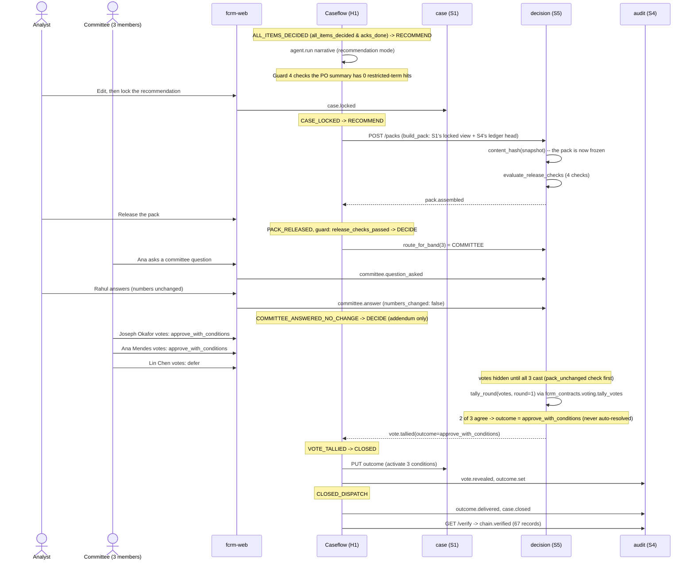

# Sequence: recommendation, pack release, and the committee vote

Ends with the demo's real outcome: two votes for approve-with-conditions, one defer, tallied to `approve_with_conditions` (never resolved any other way — ADR-08).



## The no-majority path (not in the demo, but a required path)

```mermaid
sequenceDiagram
    participant S5 as decision (S5)
    participant H1 as Caseflow (H1)

    Note over S5: tally_round(["approve", "defer", "reject"], round=1)
    S5-->>H1: no_majority=true
    Note over H1: VOTE_NO_MAJORITY -> DECIDE (same state, new round)
    H1->>S5: POST /packs/{id}/revote
    Note over S5: round=2; no outcome is ever assumed from the split
```
