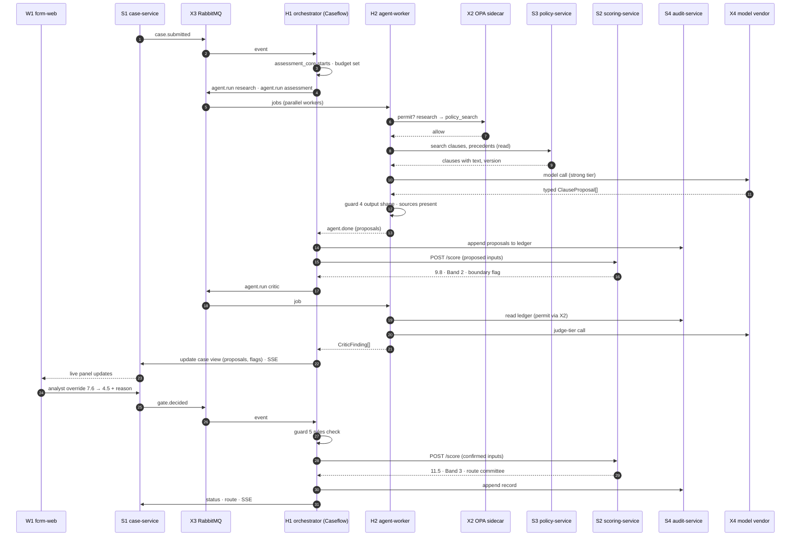
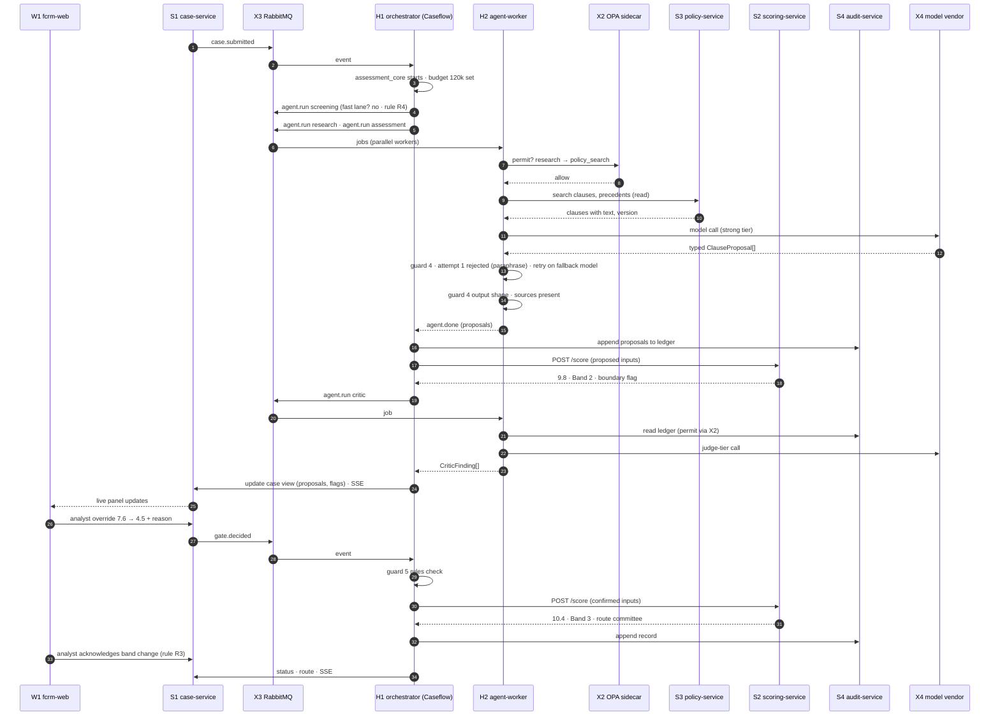

# C · Blueprint, Flow Map and Walkthrough — structured build notes

Sources (all read completely: static HTML text and every `<script>` block):
- `/Users/apahuja/Downloads/Hackathon/Documents/02-blueprint.html` (title "Workbench Blueprint" / "Risk Assessment Workbench · Blueprint"). Two tabs, **Architecture** and **Flow map**. Picking a component on either tab filters the other ("Pick a component on either tab; the other tab follows it").
- `/Users/apahuja/Downloads/Hackathon/Documents/06-flow-map.html` (title "Workbench Flow Map"). A standalone version of the Flow map tab. The Mermaid BODY is **byte-identical** to the blueprint's Flow map tab. The glossary is identical except for one entry (see Inconsistencies).
- `/Users/apahuja/Downloads/Hackathon/Documents/04-walkthrough.html` (title "Workbench Walkthrough"). A scripted 20-scene animated demo of a mocked "TrustOps · Risk Assessment Workbench" UI with a docked "Harness monitor · H1".

Legend used in the flow maps: **"a person acts (W1)"**, **"an agent runs (H2, from P1)"**, **"plain code (H1 / S1–S5)"**, **"guard (P5 / X2)"**, **"human gate · pipeline waits"**, **"record written (S4)"**, **"decision"**, **"web / gateway"**, **"→ HAND TO HUMAN = retries and fallbacks exhausted"**. Mermaid node classes: `person, agent, code, guard, gate, rec, dec, term, ext`.

---

## 1. Architecture summary (blueprint, Architecture tab)

**Architecture type:** event-driven microservices with an orchestrated agent harness.

**Patterns used (verbatim list):** API gateway (G1) · database-per-service (D1, MongoDB) · event-driven integration over a broker (X3) · orchestrator state machine (H1) · competing-consumer workers (H2–H4) · shared versioned libraries (P1–P6) · policy sidecar (X2) · routes → services → repository inside every service.

**Board layers (top to bottom), with the connector labels between them:**
1. *Users and screens*: W1 fcrm-web (React · PO, Analyst, Committee screens · live agent panel (SSE)); G1 nginx gateway (`/api/fcrm/*` · token check with X1 · route permit with X2).
   - ↓ "REST + SSE · every call carries a validated token and an OPA decision"
2. *HTTP services*: "FastAPI · system of record · one Mongo database each · one repo each": S1–S5.
   - ↓↑ "events and jobs via X3 RabbitMQ · workers write back only through service APIs"
3. *Harness* ("workers · scale by count"): H1–H4.
   - ↓ "library calls · packages are versioned and pinned per repo"
4. *Shared packages*: P1–P6.
   - ↓ "MongoDB and object storage · no service reads another's database"
5. *Data*: D1, D2.
   - ↓ "platform · cloned sidecars and external services"
6. *Platform*: X1, X2, X3, X4, X5, X7, X6.

Board colour key: Web · HTTP services (own repo each) · Harness workers · Shared packages · "Cloned from AEO into our repos" (blue) · Data · External / platform. Note on board: "Blue boxes are AEO code cloned into our own repositories and modified there. **The running AEO platform is never called.**"

**Board one-liners (from the cards):**
- W1 · fcrm-web — React · PO, Analyst, Committee screens · live agent panel (SSE)
- G1 · nginx gateway — /api/fcrm/* · token check with X1 · route permit with X2
- S1 · case-service — cases · versions · fields · documents · clarifications · conditions · SSE · emits events
- S2 · scoring-service — pure engine · bands · routing · model versions
- S3 · policy-service — corpus · clauses · controls · jurisdictions · vector search
- S4 · audit-service — evidence ledger · hash chain · verify · examiner read
- S5 · decision-service — packs · hidden votes · tally · outcome
- H1 · orchestrator (Caseflow) — original · state machine per case · intake, assessment, decision, oversight cores · gates · budgets · outbox
- H2 · agent-worker ×N — runs one agent job · guards in, guards out · Pydantic AI adapter
- H3 · ingestion-worker — clone of evoq_ingestion · docs → Markdown with page:line
- H4 · context-worker — clone of evoq_context · chunk · embed · index into S3's database
- P1 · fcrm-agents — registry · 9 agents
- P2 · fcrm-tools — registry · read-only clients to S1–S4
- P3 · fcrm-skills — skill catalogue
- P4 · fcrm-prompts — prompt library · versions
- P5 · fcrm-guardrails — 7 guards · 8 rules · OPA client
- P6 · fcrm-contracts — schemas · events · fixtures
- D1 · MongoDB 8 — databases: case · scoring · policy · audit · decision · harness · insert-only user on audit
- D2 · MinIO + S3 Vectors — MinIO: uploads · canonical Markdown · packs · S3 Vectors (AWS): clause, precedent and control indexes
- X1 · identity — clone of evoqidentityservice · tokens · 3 roles
- X2 · OPA sidecar — clone · route authz + agent→tool permits
- X3 · RabbitMQ — case events · agent jobs
- X4 · model vendors — Anthropic · OpenAI · Bedrock · direct via Pydantic AI providers · FallbackModel
- X5 · Logfire — OpenTelemetry from every box
- X7 · Redis — token and permit cache · SSE fan-out · rate limits · never case state
- X6 · evals runner — golden sets · judge adapters · reports

---

## 2. Full components table (26 components)

Columns: ID · name · **type** (derived from the board layer; the docs group them as Web, Services, Harness, Packages, Data, Platform) · repo · Does · Never does · Origin · Technology · Contains (from the click-detail panel JS `M`) · Talks to / connections · Sits under it (agents/screens).

### Web / gateway

**W1 · fcrm-web** — type: web front end
- Repo: `fcrm-web`
- Does: All screens for the three roles; live agent panel via SSE from S1
- Never: Call agents or models
- Origin: BA React code, service layer swapped
- Tech: React; SSE client
- Contains: PO screens: Dashboard · New case · Case detail · Templates · Integrations | Analyst screens: Dashboard · Queue · Workbench (8 tabs) · Assurance · Config (8 sections) | Committee screens: Queue · Case (Pack · Inbox · Vote) | Live agent panel component · SSE client · UI kit (from BA)
- Talks to: G1 for every API call; S1 SSE stream for live updates

**G1 · nginx gateway** — type: gateway
- Repo: `fcrm-platform` (image built by root compose)
- Does: Routes `/api/fcrm/*`; validates token with X1; asks X2 for route permission
- Never: Business logic
- Origin: Pattern from AEO nginx-compose
- Tech: nginx
- Contains: nginx config · /api/fcrm/* routes · token validation call to X1 · route permission call to X2
- Talks to: S1 S2 S3 S4 S5

### HTTP services (FastAPI, one Mongo DB each, one repo each)

**S1 · case-service** — type: service (system of record)
- Repo: `fcrm-case-service`
- Does: Case lifecycle, submission versions, fields, documents, clarifications, conditions; publishes case events; streams SSE
- Never: Score; call a model
- Origin: GenericService template clone (FastAPI + Mongo repo)
- Contains: Collections `cases · submission_versions · field_values · documents · clarification_threads · conditions` | Role-based response models (PO gets no score fields) | SSE endpoint · event publisher
- Talks to: publishes `case.created · case.submitted · case.answered · gate.decided` to X3; files to D2; database `fcrm_case` in D1
- Under it: Screens: all PO case screens · analyst Submission and Inbox tabs

**S2 · scoring-service** — type: service (pure engine)
- Repo: `fcrm-scoring-service`
- Does: Pure scoring, bands, routing, versioned models, boundary flag
- Never: Store case data; call a model
- Origin: BA engine ported
- Contains: Pure scoring engine (ported from BA) | band table · routing rules · `scoring_model_versions` | boundary flag · rounding rules
- Talks to: called by H1 and by P2 `scoring_engine` tool; database `fcrm_scoring` in D1
- Under it: Screens: analyst Risk & Controls score panel · Config → Scoring model, Rules & Routing
- API seen in sequence: `POST /score` (proposed inputs → "9.8 · Band 2 · boundary flag"; confirmed inputs → "11.5 · Band 3 · route committee")

**S3 · policy-service** — type: service
- Repo: `fcrm-policy-service`
- Does: Policy corpus versions, clauses, controls, jurisdictions, precedent index; search over S3 Vectors with metadata filters
- Never: Decide applicability
- Origin: Template clone; indexes built by H4
- Contains: `corpus_versions · clauses (+embedding) · controls · jurisdiction_list_versions · field_set_versions · precedent_index` | search API over S3 Vectors
- Talks to: read by P2 tools `policy_search · precedent_search · control_inventory · jurisdiction_list · field_rules`; indexes written by H4; database `fcrm_policy` in D1
- Under it: Agents served: research · assessment · intake · watchlist · policy_gap | Screens: analyst Policy tab · Config → Policy corpus, Control inventory, Jurisdictions, Categories & Fields

**S4 · audit-service** — type: service (evidence ledger)
- Repo: `fcrm-audit-service`
- Does: Evidence ledger, append-only hash-chained records, verify, examiner read API
- Never: Update or delete anything
- Origin: Template clone
- Contains: `proposals` (evidence ledger) · `audit_records` with `prev_hash` · verify endpoint · examiner read API | insert-only database user · collection schema validation
- Talks to: written by H1 only · read by P2 `evidence_ledger` and `audit_log` tools; database `fcrm_audit` in D1
- Under it: Agents served: critic · examiner | Screens: Activity Log tabs · Assurance → Ask

**S5 · decision-service** — type: service
- Repo: `fcrm-decision-service`
- Does: Pack assembly from locked numbers, hidden votes, tally, outcome, condition activation
- Never: Reveal a vote early; call a model
- Origin: Template clone
- Contains: `packs · votes (hidden until N) · tally · outcomes · condition activation`
- Talks to: written by H1 · read by W1 committee screens via G1; database `fcrm_decision` in D1
- Under it: Screens: analyst Handoff tab · committee Pack and Vote · PO Conditions tab

### Harness (workers; scale by count)

**H1 · orchestrator (Caseflow)** — type: orchestrator / worker (plain code)
- Repo: `fcrm-orchestrator`
- Does: Original state machine per case; intake, assessment, decision, oversight cores; gates; retries; fallbacks; token budgets; event store; outbox
- Never: Reason; it is plain code
- Origin: Original
- Contains: Caseflow: `CaseState · Step protocol · Gate · Budget · event store · outbox` | Cores: `intake_core · assessment_core · decision_core · oversight_core · gate_manager` | Retry and fallback policy · token budgets
- Talks to: consumes case events from X3 · publishes `agent.run` jobs | writes via APIs to S1 S4 S5 · reads S2 | uses P5 guards (rules, budget) · database `fcrm_harness` in D1 (flow map E4 names the event store `case_runs`)
- Under it: All 9 agents are scheduled from here · all human gates wait here

**H2 · agent-worker** (×N) — type: worker (runs agents)
- Repo: `fcrm-agent-worker`
- Does: Consumes `agent.run`; loads agent from P1; runs guards from P5; calls tools from P2; returns typed proposals
- Never: Write to S1/S4 directly; only via H1
- Origin: Job-worker pattern, original code
- Tech: FastStream consumer; Pydantic AI adapter
- Contains: FastStream consumer for agent.run | Pydantic AI adapter (one agent call) | guards in: input, permit, budget · guards out: output shape
- Talks to: loads P1 agents, P4 prompts, P3 skills · calls P2 tools · asks X2 permits · model via X4 | returns `agent.done` to H1 via X3
- Under it: Agents run here: screening · intake · research · assessment · critic · narrative · examiner · watchlist · policy_gap

**H3 · ingestion-worker** — type: worker
- Repo: `fcrm-ingestion-worker`
- Does: Documents → canonical Markdown with page:line references; policy corpus ingestion
- Never: Interpret content
- Origin: Clone of evoq_ingestion, Jira/Confluence removed
- Contains: extractors pdf · docx · xlsx · pptx · csv · text | canonical Markdown with page:line refs · `UPSTREAM.md`
- Talks to: jobs from X3 · reads/writes D2 | output consumed by P2 `document_reader` and by H4
- Under it: Agents served: intake (documents) · research (policy corpus ingestion)

**H4 · context-worker** — type: worker
- Repo: `fcrm-context-worker`
- Does: Chunk by clause, embed (Bedrock Titan v2), write S3 Vectors indexes owned by S3
- Never: Serve queries (S3 does)
- Origin: Clone of evoq_context, S3 Vectors backend as is
- Contains: segmenters · enrichers · "model vendor (Pydantic AI) embeddings" · VectorStore protocol | S3 Vectors backend used as is · `UPSTREAM.md`
- Talks to: jobs from X3 · embeddings via Bedrock Titan v2 · writes S3 Vectors indexes (D2) owned by S3
- Under it: Indexes: `policy_clauses · precedent_cases · controls`

### Shared packages (versioned, pinned per repo)

**P1 · fcrm-agents** — type: library (agent registry)
- Does: Agent registry and 9 agent folders: spec, schema, tool allow-list, model tier, eval set. Never: Orchestrate. Origin: Original.
- Contains: `registry.py · AgentSpec` · 9 agent folders: `spec · schema.py · tools allow-list · tier · evals/` | lock file `expected_agents.txt`
- Talks to: used by H2 · tested by X6
- Agents: screening · intake · research · assessment · critic · narrative · examiner · watchlist · policy_gap

**P2 · fcrm-tools** — type: library (tools)
- Does: Tool registry; thin read-only clients to S1–S4; `document_reader` over H3 output. Never: Write. Origin: Original.
- Contains: `registry.py · ToolSpec` · read-only clients | tools: `document_reader · case_record · case_search · field_rules · policy_search · precedent_search · control_inventory · evidence_store · jurisdiction_list · scoring_engine · rules_check · evidence_ledger · audit_log` (13 tools)
- Talks to: reads S1 S2 S3 S4 · H3 output

**P3 · fcrm-skills** — type: library
- Does: Reusable instruction packs: `cite_verbatim, declare_gap, compare_precedent, draft_for_business_reader, batch_questions`. Origin: Original.
- Talks to: loaded by P1 agent specs

**P4 · fcrm-prompts** — type: library
- Does: Versioned prompt files with front-matter; rendered per run; version pinned on every proposal. Origin: Original.
- Contains: one folder per agent · versioned Markdown with front-matter · Jinja render · version pinned on every proposal
- Talks to: rendered by H2 · gated by X6 evals

**P5 · fcrm-guardrails** — type: guard library
- Does: Seven guards and the eight rules as pure functions; OPA client for permits. Never: Network service (it is a library). Origin: Original.
- Contains: `input/ · permit/ (OPA client) · budget/ · output/ · rules/ (8 functions) · critic hook · gate check` · one test module per guard
- Talks to: called by H1 and H2 · asks X2
- Note: "Guards 1 2 3 4 5 7 live here; guard 6 is the critic agent"

**P6 · fcrm-contracts** — type: library (schemas)
- Does: Proposal schema, event names, API schemas, golden fixtures shared by all repos. Never: Code. Origin: Pattern from AEO contracts/.
- Contains: Proposal schema · event names · API schemas · golden fixtures · canonical Markdown contract (from AEO contracts/)
- Talks to: imported by every repo

### Data

**D1 · MongoDB 8** — type: store
- Repo: `fcrm-platform`. Does: One database per service plus harness; insert-only user on audit. Never: Cross-database reads. Origin: Our own instance (FARM), not AEO's.
- Databases: `fcrm_case · fcrm_scoring · fcrm_policy · fcrm_audit · fcrm_decision · fcrm_harness`; insert-only user on `fcrm_audit.audit_records`
- Rule: each service reads only its own database

**D2 · MinIO + S3 Vectors** — type: store
- Repo: `fcrm-platform`. Does: MinIO: uploads, canonical Markdown, packs. S3 Vectors (AWS): the three vector indexes. Origin: MinIO container; S3 Vectors via cloned evoq_context backend.
- MinIO buckets: `uploads · canonical · packs`; S3 Vectors indexes: `policy_clauses · precedent_cases · controls`
- Files written by S1 and H3, read by P2 document_reader; vectors written by H4, queried by S3

### Platform / external

**X1 · identity** — type: platform service (cloned)
- Repo: `fcrm-identity`. Does: Tokens and three roles; validate endpoint. Never: Authorisation (X2 does). Origin: Clone of evoqidentityservice.
- Contains: token issue · `/core/validate` · MSAL route | roles `fcrm_po · fcrm_analyst · fcrm_committee` · 3 demo users
- Called by G1

**X2 · OPA sidecar** — type: guard / platform (policy sidecar)
- Repo: `fcrm-platform`. Does: Default-deny: route permissions and agent→tool permits. Origin: Clone of aeo-opaserver-dcsetup, new tools.rego.
- Contains: `authz.rego + permissions.json` (routes) | new `tools.rego + tool_permits.json` (agent → tool)
- Asked by G1 and by P5

**X3 · RabbitMQ** — type: broker
- Repo: `fcrm-platform`. Does: Case events and agent jobs. Never: Hold state. Origin: Standard.
- Exchanges: `case.events · agent.jobs · ingestion.jobs · context.jobs`
- Used by S1 H1 H2 H3 H4

**X4 · model vendors** — type: external
- Repo: —. Does: Anthropic, OpenAI and Bedrock called directly by Pydantic AI providers with our keys; FallbackModel per tier; usage per run. Origin: **No gateway service**.
- Contains: Pydantic AI providers `anthropic:* · openai:* · bedrock:*` | tiers `cheap · mid · strong · judge` as model string + fallback string | usage per run → X5
- Called by H2

**X5 · Logfire** — type: external (SaaS via OTLP)
- Does: Receives OpenTelemetry from every service and worker.
- Contains: OpenTelemetry via OTLP · one trace per case · spans per agent step · tokens · cost · latency | dashboards: cost per case · override rate · gate waits · eval scores

**X7 · Redis** — type: platform cache/bus
- Repo: `fcrm-platform`. Does: Token-validation and OPA decision cache, SSE pub/sub across S1 replicas, rate limits, "model vendor (Pydantic AI) eval cache". Never: Hold case state, proposals or audit records. Origin: Already present via the identity clone; optional until S1 has two replicas.
- Contains: Token-validation cache (60 s) in front of X1 · OPA decision cache for route and tool permits · SSE pub/sub so any S1 replica can push to any browser · Rate limits · idempotency keys · eval cache
- Talks to: G1 S1 P5 X4. Never: case state, proposals, gates, audit records, agent memory

**X6 · evals runner** — type: tooling (offline)
- Repo: `fcrm-evals`. Does: Golden sets per agent, judge adapters, committed reports; gate on prompt change. Never: Run in production path. Origin: Pattern + adapters from evoq_evals.
- Contains: datasets per agent · runner (pydantic-evals + pytest) · DeepEval/Ragas adapters (cloned pattern) · `reports/` | gate on prompt change via `make check`
- Tests P1 P4

### Repos
"one per service, worker and package (about 18), plus `fcrm-platform` (compose, nginx, OPA, Mongo init, Logfire) and `fcrm-submission`, the umbrella repo the judges open: it pulls every repo in as a submodule, holds `/docs /ai /evals /ops README` at the top level, and carries the single root `docker-compose.yaml` that builds each image from its repo's own `dockerfiles/Dockerfile`. More repos can be added at any time."

Distinct repos named: fcrm-web, fcrm-case-service, fcrm-scoring-service, fcrm-policy-service, fcrm-audit-service, fcrm-decision-service, fcrm-orchestrator, fcrm-agent-worker, fcrm-ingestion-worker, fcrm-context-worker, fcrm-agents, fcrm-tools, fcrm-skills, fcrm-prompts, fcrm-guardrails, fcrm-contracts, fcrm-identity, fcrm-evals, fcrm-platform, fcrm-submission (20).

### Short IDs used by the component filter strip (both flow pages)
W1 web · G1 gateway · S1 case · S2 scoring · S3 policy · S4 audit · S5 decision · H1 orchestrator · H2 agent-worker · H3 ingestion · H4 context · P1 agents · P2 tools · P3 skills · P4 prompts · P5 guardrails · P6 contracts · D1 mongodb · D2 minio (06: "minio+s3vectors") · X1 identity · X2 opa · X3 rabbitmq · X4 models · X5 logfire · X6 evals · X7 redis. Groups: Web [W1,G1] · Services [S1–S5] · Harness [H1–H4] · Packages [P1–P6] · Data [D1,D2] · Platform [X1–X7]. Node→component indexing rule in JS: regex `\b[WGSHPDX]\d\b` in node text; any "Guard n" node also tagged P5; any agent-class node also tagged H2.

---

## 3. Naming standard (blueprint §02b, "used in every document")

"One name per thing. IDs are stable; display names may be shortened only to the form shown."

| Kind | Canonical names | Do not use |
|---|---|---|
| Components | W1 fcrm-web · G1 nginx gateway · S1 case-service · S2 scoring-service · S3 policy-service · S4 audit-service · S5 decision-service · H1 orchestrator (Caseflow) · H2 agent-worker · H3 ingestion-worker · H4 context-worker · P1 fcrm-agents · P2 fcrm-tools · P3 fcrm-skills · P4 fcrm-prompts · P5 fcrm-guardrails · P6 fcrm-contracts · D1 MongoDB · D2 MinIO + S3 Vectors · X1 identity · X2 OPA sidecar · X3 RabbitMQ · X4 model vendors · X5 Logfire · X6 evals runner · X7 Redis (cache and bus, never memory) | "backend", "the API", "harness service", "vector DB", "the queue" without its ID |
| Harness cores | intake core · assessment core · decision core · oversight core (all modules of H1) · gate manager | "stage service", "pipeline" |
| Agents | screening · intake · research · assessment · critic · narrative · examiner · watchlist · policy_gap (always lower-case, always "… agent", run on H2, defined in P1) | BA names: Policy Mapping, Risk Drafting, Control Matching, Precedent, Clarification, Extraction, Classification, Submission Validation |
| Tools (P2) | document_reader · case_record · case_search · field_rules · policy_search · precedent_search · control_inventory · evidence_store · jurisdiction_list · scoring_engine · rules_check · evidence_ledger · audit_log | "the search", "lookup" |
| Guards (P5) | Guard 1 input scan · Guard 2 permit · Guard 3 budget · Guard 4 output shape · Guard 5 rules as code · Guard 6 critic · Guard 7 human gate | "validation", "safety layer" |
| Records | proposal (in the evidence ledger, S4) · audit record (hash-chained, S4) · submission version (S1) · pack · vote · outcome (S5) · condition (S1) | "log entry", "history" |
| Data | D1 databases: fcrm_case · fcrm_scoring · fcrm_policy · fcrm_audit · fcrm_decision · fcrm_harness · D2 S3 Vectors indexes: policy_clauses · precedent_cases · controls | "the database" without its name |
| Roles | Product Owner (PO) · FCRM Analyst · Risk Committee · identity roles fcrm_po · fcrm_analyst · fcrm_committee | "business user", "reviewer" |

Footnote: "The walkthrough's backend monitor, the stack page, the scope page and the build plan all use these names. The prototype analysis page keeps the BA's original names because it describes the BA's code."

Other naming conventions evident in the docs:
- **Repos**: `fcrm-<name>`; services `fcrm-<x>-service`; workers `fcrm-<x>-worker`; Dockerfile at `dockerfiles/Dockerfile` in each repo.
- **Events** (dot-separated): `case.created`, `case.submitted`, `case.answered`, `gate.decided` (published by S1); `agent.run` (H1 → H2 jobs), `agent.done` (H2 → H1). **Exchanges**: `case.events`, `agent.jobs`, `ingestion.jobs`, `context.jobs`.
- **Collections**: S1 `cases, submission_versions, field_values, documents, clarification_threads, conditions`; S2 `scoring_model_versions` (+ band table, routing rules); S3 `corpus_versions, clauses, controls, jurisdiction_list_versions, field_set_versions, precedent_index`; S4 `proposals, audit_records` (field `prev_hash`); S5 `packs, votes, tally, outcomes`; H1 event store `case_runs` (in `fcrm_harness`).
- **IDs**: case ID format `FCRM-2026-0151` (FCRM-YYYY-NNNN); audit records numbered `#1…#53` with hash e.g. `8f3a…c21e` and `prev #30`; control ID example `CTL-VDD`; version labels `corpus v14`, `controls v9`, `scoring v3`/`scoring model v3`, `routing rules v4`, `field set v6`, `jurisdiction list v2026-06` / `v2026-10`, `Policy 4.2 §3.1 · v2026-03`, agent prompts `2026-09-28`; pack `pack v1`; submission `v1`, `v2`.
- **Python code names**: `registry.py`, `AgentSpec`, `ToolSpec`, `schema.py`, `expected_agents.txt`, `CaseState`, `Step` protocol, `Gate`, `Budget`, `intake_core`, `assessment_core`, `decision_core`, `oversight_core`, `gate_manager`; typed outputs `ClauseProposal[]`, `CriticFinding[]`.
- **OPA**: `authz.rego`, `permissions.json`, `tools.rego`, `tool_permits.json`.
- **Model tiers**: `cheap · mid · strong · judge`; provider strings `anthropic:*`, `openai:*`, `bedrock:*`.
- **Identity endpoint**: `/core/validate`. Gateway route prefix `/api/fcrm/*`.

---

## 4. Assessment sequence (blueprint §03, Mermaid `sequenceDiagram`, "Condensed to the assessment stage")

Participants: W1 fcrm-web, S1 case-service, X3 RabbitMQ, H1 orchestrator (Caseflow), H2 agent-worker, X2 OPA sidecar, S3 policy-service, S2 scoring-service, S4 audit-service, X4 model vendor. (G1, X1, H3, H4, P* not drawn.)

Arrow semantics in Mermaid: `->>` = request/message, `-->>` = reply. Async = via X3.

| # | From → To | Message | Sync/async | Data written / notes |
|---|---|---|---|---|
| 1 | S1 → X3 | `case.submitted` | async event publish | |
| 2 | X3 → H1 | event | async delivery | |
| 3 | H1 → H1 | assessment_core starts · budget set | internal | Guard 3 budget set; state in fcrm_harness |
| 4 | H1 → X3 | `agent.run` research · `agent.run` assessment | async jobs | two parallel jobs |
| 5 | X3 → H2 | jobs (parallel workers) | async | competing consumers |
| 6 | H2 → X2 | permit? research → policy_search | sync | Guard 2 |
| 7 | X2 → H2 | allow | sync reply | |
| 8 | H2 → S3 | search clauses, precedents (read) | sync HTTP (via P2 tools) | |
| 9 | S3 → H2 | clauses with text, version | reply | |
| 10 | H2 → X4 | model call (strong tier) | sync | |
| 11 | X4 → H2 | typed `ClauseProposal[]` | reply | |
| 12 | H2 → H2 | guard 4 output shape · sources present | internal | Guard 4 |
| 13 | H2 → H1 | `agent.done` (proposals) | reply (via X3 per H2 description) | |
| 14 | H1 → S4 | append proposals to ledger | sync API write | S4 `proposals` |
| 15 | H1 → S2 | `POST /score` (proposed inputs) | sync | |
| 16 | S2 → H1 | 9.8 · Band 2 · boundary flag | reply | |
| 17 | H1 → X3 | `agent.run` critic | async job | |
| 18 | X3 → H2 | job | async | |
| 19 | H2 → S4 | read ledger (permit via X2) | sync read | P2 evidence_ledger |
| 20 | H2 → X4 | judge-tier call | sync | |
| 21 | H2 → H1 | `CriticFinding[]` | reply | |
| 22 | H1 → S1 | update case view (proposals, flags) · SSE | sync API write | S1 case view |
| 23 | S1 → W1 | live panel updates | SSE push | |
| 24 | W1 → S1 | analyst override 7.6 → 4.5 + reason | sync HTTP | |
| 25 | S1 → X3 | `gate.decided` | async event | |
| 26 | X3 → H1 | event | async | |
| 27 | H1 → H1 | guard 5 rules check | internal | |
| 28 | H1 → S2 | `POST /score` (confirmed inputs) | sync | |
| 29 | S2 → H1 | 11.5 · Band 3 · route committee | reply | |
| 30 | H1 → S4 | append record #31 (prev_hash → #30) | sync API write | S4 `audit_records` |
| 31 | H1 → S1 | status · route · SSE | sync API write | S1 status/route, SSE to W1 |

Mermaid source (verbatim):



Diagram viewer features: Zoom out / Zoom in / Fit / Full screen buttons.

---

## 5. Full flow map (case cycle) — blueprint Flow tab and 06-flow-map.html (identical)

Header (06): "Every step, agent run, guard, yes / no decision and human gate · IDs match the Architecture page". Layout modes: **Landscape · columns** (`flowchart LR`, inner `TB`, default), **Wide · rows** (`TB`, inner `LR`), **Portrait · tall** (`TB`/`TB`); stored in localStorage key `fcrm_flow_mode`. Controls: + / − / 100% / Fit, Glossary (key `g`), Focus, Full screen (Shift+F), Legend toggle, drag to pan, wheel/pinch zoom, click a phase box to zoom to it, keyboard 0/f/+/−/arrows/Esc. Glossary terms are auto-underlined in node text (hover = tooltip; click = open glossary panel at term; panel has search). Clicking a node shows "Components in this step" popover; component chip strip filters nodes ("N of M steps touch X").

Note: the user asked for phases "intake, triage, analyst review, completeness check and clarification, analysis run, scoring, recommendation, committee, decision, audit, learning". The source actually uses **7 phases + a failure cluster**: 1 ENTRY, 2 INTAKE, 3 ASSESSMENT, 4 ANALYST REVIEW, 5 COMMITTEE DECISION, 6 OUTCOME AND CLOSE, 7 OVERSIGHT, plus WHEN A STEP FAILS. Mapping of the requested phases: triage = I15 (auto-triage); analysis run + scoring = phase 3 (A1–A10) and R4; completeness check and clarification = R0/R0D, R7–R11; recommendation = R12–R16; committee + decision = phase 5; audit = records throughout (S4) plus C4 and O1–O2; learning = I16, O6–O9.

### Phase 1 · ENTRY — "a product owner signs in and opens a case"
- E1 [ext] The product owner signs in with the bank login — *W1 → G1 · X1 validates token · X2 allows route*
- E2 [person] She lands on her dashboard: her cases, stage, next action — *W1 · S1 role model · no score fields*
- E3 [code] She clicks New case. A case ID exists before any content — *S1 creates case · emits case.created → X3*
- E4 [code] The intake core opens a workflow for this case — *H1 intake core · case_runs event store*
- Edges: E1 → E2 → E3 → E4

### Phase 2 · INTAKE — "documents first, questions second"
- I1 [person] She uploads what she already has: business case, partner contract — *W1 → S1 · files to D2*
- I2 [guard] Guard 1: scan each file for hidden instructions, mask personal data — *P5 input scan · presidio*
- I3 [code] Turn the documents into text with page and line numbers — *H3 ingestion-worker · evoq_ingestion clone*
- I4 [guard] Guard 2: may the intake agent use these tools? — *P5 permit → X2 tool_permits*
- I5 [agent] The intake agent reads the text and proposes: values found, change types, questions for the gaps — *H2 · P1 intake · P2 document_reader, precedent_search*
- I6 [guard] Guard 4: does every value point to a page and line? — *P5 output shape · no source, no claim*
- I6D [dec] All values sourced? — **no — retry once, then drop the value** → I5; **yes** → I7
- I7 [rec] Proposals written to the evidence ledger; screen updates live — *S4 proposals · S1 SSE → W1*
- I8 [person] She confirms each change type (removing one needs a reason) — *W1 → S1 · gate.decided*
- I9 [code] Required field list is now known (union of the confirmed types) — *H1 · P2 field_rules*
- I10 [dec] A similar closed case? (*precedent_search*) — **yes** → I11; **no** → I12
- I11 [person] She ticks which past answers to reuse; each keeps a label naming its source case — *W1 → S1 · provenance* → I12
- I12 [agent] The intake agent asks only for what is still missing — *H2 · P1 intake · P3 batch_questions*
- I13 [person] She answers the gaps; new facts are flagged, not blocked — *W1 → S1*
- I14 [dec] 80% filled and every always-required field? (*H1 · P5 rules*) — **no — asks only for what is missing** → I12; **yes** → I15
- I15 [code] Four visible checks pass; status Submitted; analyst assigned by workload — *H1 gate · auto-triage · S1*
- I16 [rec] Intake agent graded on this case — *X6 · values kept, types confirmed*
- Edges: I1→I2→I3→I4→I5→I6→I6D; I6D(no)→I5; I6D(yes)→I7→I8→I9→I10; I10(yes)→I11→I12; I10(no)→I12→I13→I14; I14(no)→I12; I14(yes)→I15→I16

### Phase 3 · ASSESSMENT — "two agents work before the analyst looks"
- A1 [code] The assessment core starts; token budget set — *H1 assessment core · Guard 3 budget*
- A2 [code] Two agent jobs go out in parallel — *H1 → X3 agent.run research · assessment*
- A3 [agent] The research agent finds applicable policy clauses and the five closest past cases. Quotes word for word. Says nothing found when nothing is found — *H2 · P1 research · P2 policy_search, precedent_search → S3*
- A4 [agent] The assessment agent proposes likelihood, impact and a strength rating for each existing control, with evidence dates — *H2 · P1 assessment · P2 control_inventory → S3*
- A5 [guard] Guard 4 on both: sources present, shape valid — *P5 output shape*
- A6 [code] Plain arithmetic turns the proposed inputs into a score and a band — *S2 scoring-service · composite 9.8 · Band 2*
- A7 [dec] Within 0.5 of a band edge? (*boundary flag*) — **yes** → A8; **no** → A9
- A8 [rec] Flag it; the analyst must acknowledge later — *H1 · S4 record* → A9
- A9 [agent] The critic agent checks the work: every claim sourced? ratings in line with the five precedents? eight rules kept? evidence recent? — *H2 · P1 critic · Guard 6 · P2 evidence_ledger, rules_check*
- A10 [rec] Findings and proposals written to the ledger — *S4 proposals*
- Edges: A1→A2; A2→A3; A2→A4; A3→A5; A4→A5; A5→A6→A7; A7(yes)→A8→A9; A7(no)→A9→A10

### Phase 4 · ANALYST REVIEW — "check completeness first, then accept or override item by item (Gate A)"
- R1 [person] The analyst opens the case from his queue. He sees facts, flags and critic findings. No score yet — *W1 → S1 · score withheld*
- R0 [agent] Completeness check first: the narrative agent lists what is missing, stale or contradictory, and drafts the questions — *H2 · P1 narrative · Guard 6 findings · P2 case_record*
- R0D [dec] Enough to assess without asking? — **no — ask now, before any review** → R8; **yes** → R2
- R2 [gate] **GATE A** · the analyst accepts or removes each policy clause, confirms or overrides each control rating, with a reason on every override — *W1 → S1 gate.decided · Guard 7*
- R3 [guard] Guard 5: the eight rules checked before any state change — *P5 rules as code*
- R4 [code] Score recomputed from the confirmed inputs — *S2 · 7.6 → 4.5 moves 9.8 → 11.5*
- R5 [dec] Did the band change? — **yes — route changes** → R6; **no** → R7
- R6 [rec] Before, after and cause written as one hash-chained record — *S4 audit record #31 · prev_hash → #30* → R7
- R7 [dec] A gap found during review? — **yes** → R8; **no** → R12
- R8 [person] The analyst edits the drafted questions, each tied to the field it concerns, and sends them as one round — *W1 → S1 clarification_threads · P3 batch_questions*
- R9 [code] Analyst clock pauses; total clock keeps running — *S1 two clocks*
- R10 [person] The product owner answers in her inbox; her answers become submission version 2 with a diff — *W1 → S1 submission_versions*
- R11 [agent] Research and assessment agents re-run on the changed fields only — *H1 → X3 · H2* → R1 (loop)
- R12 [agent] The narrative agent drafts the recommendation, the conditions and a plain-language summary for the business. Numbers are locked — *H2 · P1 narrative · P3 draft_for_business_reader*
- R13 [person] The analyst edits the words and locks the recommendation — *W1 → S1 · unlock later needs a reason*
- R14 [dec] Band 1 or 2? (*delegated authority*) — **yes — analyst decides** → R15; **no — band 3 or 4** → R16
- R15 [person] The analyst closes the case under delegated authority — *S5 outcome*
- R16 [code] Continue to the committee — *→ DECIDE*
- Edges: R1→R0→R0D; R0D(no)→R8; R0D(yes)→R2→R3→R4→R5; R5(yes)→R6→R7; R5(no)→R7; R7(yes)→R8→R9→R10→R11→R1; R7(no)→R12→R13→R14; R14(yes)→R15; R14(no)→R16

### Phase 5 · COMMITTEE DECISION — "three votes, hidden until all are in (Gate B)"
- D1 [code] Code assembles the pack from the locked numbers, clauses, override log and pinned versions — *S5 decision-service · no model involved*
- D2 [guard] Four release checks: locked · all items reviewed · boundary acknowledged · business summary present — *H1 decision core · P5 rules*
- D3 [person] The analyst approves the pack — *W1 → S5*
- D4 [gate] **GATE B** · three committee members read the pack and vote with a written rationale; nobody sees the others' votes — *W1 → S5 votes · Guard 7*
- D5 [dec] All three votes in? — **no — waits, days if needed** → D4; **yes** → D6
- D6 [code] Code counts the votes and reveals them together — *S5 tally · majority*
- D7 [dec] Outcome? — **approve** → D8; **approve with conditions** → D9; **defer** → D10; **reject** → D11
- D8 [code] Approved — *S5 outcome*
- D9 [code] Approved with conditions; each condition gets an owner, a date and a status — *S5 → S1 conditions*
- D10 [code] Deferred, with what is needed to return — *S5 outcome*
- D11 [code] Rejected, with the committee's reasons — *S5 outcome*
- Edges: D1→D2→D3→D4→D5; D5(no)→D4; D5(yes)→D6→D7; D7→D8/D9/D10/D11

### Phase 6 · OUTCOME AND CLOSE — "plain words back to the business"
- C1 [person] The product owner reads the decision and the reasons in business terms. Scores, bands, ratings and clauses are never sent to her role — *W1 ← S1 role model*
- C2 [code] Conditions tracked to done; reminders before due dates — *S1 conditions · H1 oversight core*
- C3 [code] Case closed for assessment. Nobody, including the signer, can re-run or edit it — *H1 · closed means closed*
- C4 [rec] Chain verified end to end — *S4 verify*
- DONE [term] Done. The next case starts again at step 1 — *H1 → IDLE · next case*
- Edges: C1→C2→C3→C4→DONE

### Phase 7 · OVERSIGHT — "months later, and all the time"
- O1 [person] An examiner asks why this case went to committee — *W1 Assurance → S4*
- O2 [agent] The examiner agent answers from the audit chain only, citing every record it uses; refuses if the records do not hold the answer — *H2 · P1 examiner · P2 audit_log · Guard 4 grounding*
- O3 [code] A new FATF country list is published — *S3 jurisdiction_list v2026-10*
- O4 [agent] The watchlist agent re-flags open cases with affected geographies — *H2 · P1 watchlist · P2 case_search*
- O5 [person] Analysts acknowledge the re-flag — *W1 → S1*
- O6 [rec] Every week, all agents are re-tested against the 80 reference cases; analyst override rates reviewed — *X6 evals runner · S4 override rate · X5 traces*
- O7 [dec] Any agent got worse? — **yes** → O8; **no** → O9
- O8 [code] Its prompt is fixed and must pass its eval set before release — *P4 prompt version · X6 gate*
- O9 [code] No change — *prompt set stays live*
- Edges: O1→O2; O3→O4→O5; O6→O7; O7(yes)→O8; O7(no)→O9

### WHEN A STEP FAILS — "retries, fallbacks, then a person"
- F1 [dec] Agent output failed Guard 4? — **retry once with the error shown** → F2
- F2 [agent] Same agent, same tier — *H1 retry policy* → F3
- F3 [dec] Still failing? — **yes** → F4; **no** → F7
- F4 [agent] Switch to the fallback model for this tier — *H1 · X4 fallback chain* → F5
- F5 [dec] Still failing, or budget exhausted? (*Guard 3*) — **yes** → F6; **no** → F7
- F6 [gate] Hand to a human: the analyst sees the raw inputs and does this step by hand; the case does not stall — *H1 → gate · S4 record*
- F7 [code] Continue — *back to the step*
- F8 [dec] Validation gate failed at submit? — **names the failing check** → F9
- F9 [code] Intake reopens asking only for what is missing — *H1 intake core*
- F10 [dec] Recommendation must change after lock? — **reason required** → F11
- F11 [rec] Unlock with reason; pack regenerated; both versions kept — *S1 · S5 · S4 record*

### Phase-to-phase edges
- ENTRY ==> INTAKE: "case ID issued"
- INTAKE ==> ASSESS: "submitted · analyst assigned"
- ASSESS ==> REVIEW: "proposals, score and critic findings ready"
- REVIEW ==> DECIDE: "band 3 or 4 · recommendation locked"
- REVIEW --> CLOSE: "band 1 or 2 · delegated close"
- DECIDE ==> CLOSE: "outcome set"
- CLOSE ==> OVERSEE: "case in the record"
- REVIEW -.-> FAIL: "any guard or budget failure"

Counts: 85 nodes (E 4; I 17 incl. 3 decisions; A 10 incl. 1 decision; R 18 incl. 4 decisions and Gate A; D 11 incl. 2 decisions and Gate B; C 4 + DONE; O 9 incl. 1 decision; F 11 incl. 5 decisions), plus 8 phase-level edges.

### Mermaid flowchart source (verbatim BODY, rendered in default "Landscape · columns" mode: `__IN__` → `TB`, plus the generated classDefs/styles)

```mermaid
flowchart LR
subgraph ENTRY["1 · ENTRY — a product owner signs in and opens a case"]
  direction TB
  E1["The product owner signs in with the bank login<br><small>W1 → G1 · X1 validates token · X2 allows route</small>"]:::ext --> E2["She lands on her dashboard: her cases, stage, next action<br><small>W1 · S1 role model · no score fields</small>"]:::person --> E3["She clicks New case. A case ID exists before any content<br><small>S1 creates case · emits case.created → X3</small>"]:::code --> E4["The intake core opens a workflow for this case<br><small>H1 intake core · case_runs event store</small>"]:::code
end

subgraph INTAKE["2 · INTAKE — documents first, questions second"]
  direction TB
  I1["She uploads what she already has:<br>business case, partner contract<br><small>W1 → S1 · files to D2</small>"]:::person --> I2["Guard 1: scan each file for hidden instructions,<br>mask personal data<br><small>P5 input scan · presidio</small>"]:::guard --> I3["Turn the documents into text with page and line numbers<br><small>H3 ingestion-worker · evoq_ingestion clone</small>"]:::code --> I4["Guard 2: may the intake agent use these tools?<br><small>P5 permit → X2 tool_permits</small>"]:::guard --> I5["The intake agent reads the text and proposes:<br>values found, change types, questions for the gaps<br><small>H2 · P1 intake · P2 document_reader, precedent_search</small>"]:::agent --> I6["Guard 4: does every value point to a page and line?<br><small>P5 output shape · no source, no claim</small>"]:::guard --> I6D{"All values<br>sourced?"}:::dec
  I6D -->|"no — retry once, then drop the value"| I5
  I6D -->|yes| I7["Proposals written to the evidence ledger;<br>screen updates live<br><small>S4 proposals · S1 SSE → W1</small>"]:::rec --> I8["She confirms each change type<br>(removing one needs a reason)<br><small>W1 → S1 · gate.decided</small>"]:::person --> I9["Required field list is now known<br>(union of the confirmed types)<br><small>H1 · P2 field_rules</small>"]:::code --> I10{"A similar<br>closed case?<br><small>precedent_search</small>"}:::dec
  I10 -->|yes| I11["She ticks which past answers to reuse;<br>each keeps a label naming its source case<br><small>W1 → S1 · provenance</small>"]:::person --> I12
  I10 -->|no| I12["The intake agent asks only for what is still missing<br><small>H2 · P1 intake · P3 batch_questions</small>"]:::agent --> I13["She answers the gaps; new facts are flagged,<br>not blocked<br><small>W1 → S1</small>"]:::person --> I14{"80% filled and every<br>always-required field?<br><small>H1 · P5 rules</small>"}:::dec
  I14 -->|"no — asks only for what is missing"| I12
  I14 -->|yes| I15["Four visible checks pass; status Submitted;<br>analyst assigned by workload<br><small>H1 gate · auto-triage · S1</small>"]:::code --> I16["Intake agent graded on this case<br><small>X6 · values kept, types confirmed</small>"]:::rec
end

subgraph ASSESS["3 · ASSESSMENT — two agents work before the analyst looks"]
  direction TB
  A1["The assessment core starts; token budget set<br><small>H1 assessment core · Guard 3 budget</small>"]:::code --> A2["Two agent jobs go out in parallel<br><small>H1 → X3 agent.run research · assessment</small>"]:::code
  A2 --> A3["The research agent finds applicable policy clauses and<br>the five closest past cases. Quotes word for word.<br>Says nothing found when nothing is found<br><small>H2 · P1 research · P2 policy_search, precedent_search → S3</small>"]:::agent
  A2 --> A4["The assessment agent proposes likelihood, impact and<br>a strength rating for each existing control, with evidence dates<br><small>H2 · P1 assessment · P2 control_inventory → S3</small>"]:::agent
  A3 --> A5["Guard 4 on both: sources present, shape valid<br><small>P5 output shape</small>"]:::guard
  A4 --> A5
  A5 --> A6["Plain arithmetic turns the proposed inputs into a score and a band<br><small>S2 scoring-service · composite 9.8 · Band 2</small>"]:::code --> A7{"Within 0.5 of<br>a band edge?<br><small>boundary flag</small>"}:::dec
  A7 -->|yes| A8["Flag it; the analyst must acknowledge later<br><small>H1 · S4 record</small>"]:::rec --> A9
  A7 -->|no| A9["The critic agent checks the work: every claim sourced?<br>ratings in line with the five precedents? eight rules kept?<br>evidence recent?<br><small>H2 · P1 critic · Guard 6 · P2 evidence_ledger, rules_check</small>"]:::agent --> A10["Findings and proposals written to the ledger<br><small>S4 proposals</small>"]:::rec
end

subgraph REVIEW["4 · ANALYST REVIEW — check completeness first, then accept or override item by item (Gate A)"]
  direction TB
  R1["The analyst opens the case from his queue.<br>He sees facts, flags and critic findings. No score yet<br><small>W1 → S1 · score withheld</small>"]:::person --> R0["Completeness check first: the narrative agent lists what is<br>missing, stale or contradictory, and drafts the questions<br><small>H2 · P1 narrative · Guard 6 findings · P2 case_record</small>"]:::agent --> R0D{"Enough to assess<br>without asking?"}:::dec
  R0D -->|"no — ask now, before any review"| R8
  R0D -->|yes| R2(["GATE A · the analyst accepts or removes each policy clause,<br>confirms or overrides each control rating, with a reason on every override<br><small>W1 → S1 gate.decided · Guard 7</small>"]):::gate --> R3["Guard 5: the eight rules checked before any state change<br><small>P5 rules as code</small>"]:::guard --> R4["Score recomputed from the confirmed inputs<br><small>S2 · 7.6 → 4.5 moves 9.8 → 11.5</small>"]:::code --> R5{"Did the band<br>change?"}:::dec
  R5 -->|"yes — route changes"| R6["Before, after and cause written as one hash-chained record<br><small>S4 audit record #31 · prev_hash → #30</small>"]:::rec --> R7
  R5 -->|no| R7{"A gap found<br>during review?"}:::dec
  R7 -->|yes| R8["The analyst edits the drafted questions, each tied to the field it concerns,<br>and sends them as one round<br><small>W1 → S1 clarification_threads · P3 batch_questions</small>"]:::person --> R9["Analyst clock pauses; total clock keeps running<br><small>S1 two clocks</small>"]:::code --> R10["The product owner answers in her inbox;<br>her answers become submission version 2 with a diff<br><small>W1 → S1 submission_versions</small>"]:::person --> R11["Research and assessment agents re-run on the changed fields only<br><small>H1 → X3 · H2</small>"]:::agent --> R1
  R7 -->|no| R12["The narrative agent drafts the recommendation, the conditions<br>and a plain-language summary for the business. Numbers are locked<br><small>H2 · P1 narrative · P3 draft_for_business_reader</small>"]:::agent --> R13["The analyst edits the words and locks the recommendation<br><small>W1 → S1 · unlock later needs a reason</small>"]:::person --> R14{"Band 1 or 2?<br><small>delegated authority</small>"}:::dec
  R14 -->|"yes — analyst decides"| R15["The analyst closes the case under delegated authority<br><small>S5 outcome</small>"]:::person
  R14 -->|"no — band 3 or 4"| R16["Continue to the committee<br><small>→ DECIDE</small>"]:::code
end

subgraph DECIDE["5 · COMMITTEE DECISION — three votes, hidden until all are in (Gate B)"]
  direction TB
  D1["Code assembles the pack from the locked numbers, clauses,<br>override log and pinned versions<br><small>S5 decision-service · no model involved</small>"]:::code --> D2["Four release checks: locked · all items reviewed ·<br>boundary acknowledged · business summary present<br><small>H1 decision core · P5 rules</small>"]:::guard --> D3["The analyst approves the pack<br><small>W1 → S5</small>"]:::person --> D4(["GATE B · three committee members read the pack and vote<br>with a written rationale; nobody sees the others' votes<br><small>W1 → S5 votes · Guard 7</small>"]):::gate --> D5{"All three<br>votes in?"}:::dec
  D5 -->|"no — waits, days if needed"| D4
  D5 -->|yes| D6["Code counts the votes and reveals them together<br><small>S5 tally · majority</small>"]:::code --> D7{"Outcome?"}:::dec
  D7 -->|approve| D8["Approved<br><small>S5 outcome</small>"]:::code
  D7 -->|"approve with conditions"| D9["Approved with conditions; each condition gets an owner, a date and a status<br><small>S5 → S1 conditions</small>"]:::code
  D7 -->|defer| D10["Deferred, with what is needed to return<br><small>S5 outcome</small>"]:::code
  D7 -->|reject| D11["Rejected, with the committee's reasons<br><small>S5 outcome</small>"]:::code
end

subgraph CLOSE["6 · OUTCOME AND CLOSE — plain words back to the business"]
  direction TB
  C1["The product owner reads the decision and the reasons in business terms.<br>Scores, bands, ratings and clauses are never sent to her role<br><small>W1 ← S1 role model</small>"]:::person --> C2["Conditions tracked to done; reminders before due dates<br><small>S1 conditions · H1 oversight core</small>"]:::code --> C3["Case closed for assessment. Nobody, including the signer, can re-run or edit it<br><small>H1 · closed means closed</small>"]:::code --> C4["Chain verified end to end<br><small>S4 verify</small>"]:::rec --> DONE["Done. The next case starts again at step 1<br><small>H1 → IDLE · next case</small>"]:::term
end

subgraph OVERSEE["7 · OVERSIGHT — months later, and all the time"]
  direction TB
  O1["An examiner asks why this case went to committee<br><small>W1 Assurance → S4</small>"]:::person --> O2["The examiner agent answers from the audit chain only,<br>citing every record it uses; refuses if the records do not hold the answer<br><small>H2 · P1 examiner · P2 audit_log · Guard 4 grounding</small>"]:::agent
  O3["A new FATF country list is published<br><small>S3 jurisdiction_list v2026-10</small>"]:::code --> O4["The watchlist agent re-flags open cases with affected geographies<br><small>H2 · P1 watchlist · P2 case_search</small>"]:::agent --> O5["Analysts acknowledge the re-flag<br><small>W1 → S1</small>"]:::person
  O6["Every week, all agents are re-tested against the 80 reference cases;<br>analyst override rates reviewed<br><small>X6 evals runner · S4 override rate · X5 traces</small>"]:::rec --> O7{"Any agent<br>got worse?"}:::dec
  O7 -->|yes| O8["Its prompt is fixed and must pass its eval set before release<br><small>P4 prompt version · X6 gate</small>"]:::code
  O7 -->|no| O9["No change<br><small>prompt set stays live</small>"]:::code
end

subgraph FAIL["WHEN A STEP FAILS — retries, fallbacks, then a person"]
  direction TB
  F1{"Agent output failed<br>Guard 4?"}:::dec -->|"retry once with the error shown"| F2["Same agent, same tier<br><small>H1 retry policy</small>"]:::agent --> F3{"Still<br>failing?"}:::dec
  F3 -->|yes| F4["Switch to the fallback model for this tier<br><small>H1 · X4 fallback chain</small>"]:::agent --> F5{"Still failing, or<br>budget exhausted?<br><small>Guard 3</small>"}:::dec
  F5 -->|yes| F6["Hand to a human: the analyst sees the raw inputs<br>and does this step by hand; the case does not stall<br><small>H1 → gate · S4 record</small>"]:::gate
  F5 -->|no| F7["Continue<br><small>back to the step</small>"]:::code
  F3 -->|no| F7
  F8{"Validation gate<br>failed at submit?"}:::dec -->|"names the failing check"| F9["Intake reopens asking only for what is missing<br><small>H1 intake core</small>"]:::code
  F10{"Recommendation must<br>change after lock?"}:::dec -->|"reason required"| F11["Unlock with reason; pack regenerated; both versions kept<br><small>S1 · S5 · S4 record</small>"]:::rec
end

%% ───── phase-to-phase edges (phase level so inner direction holds) ─────
ENTRY ==>|"case ID issued"| INTAKE
INTAKE ==>|"submitted · analyst assigned"| ASSESS
ASSESS ==>|"proposals, score and critic findings ready"| REVIEW
REVIEW ==>|"band 3 or 4 · recommendation locked"| DECIDE
REVIEW -->|"band 1 or 2 · delegated close"| CLOSE
DECIDE ==>|"outcome set"| CLOSE
CLOSE ==>|"case in the record"| OVERSEE
REVIEW -.->|"any guard or budget failure"| FAIL
classDef person fill:#FFFFFF,stroke:#194247,color:#194247,stroke-width:1.5px
classDef agent fill:#09A78D,stroke:#066E5D,color:#FFFFFF,stroke-width:1.5px
classDef code fill:#E9EEED,stroke:#337077,color:#194247,stroke-width:1px
classDef guard fill:#FBE9E5,stroke:#B03E39,color:#7A2A26,stroke-width:1.5px,stroke-dasharray:6 3
classDef gate fill:#F4FBCF,stroke:#8E9F26,color:#3D4A08,stroke-width:2px
classDef rec fill:#FBF1D9,stroke:#B98A1E,color:#5E4608,stroke-width:1.5px
classDef dec fill:#FFFFFF,stroke:#194247,color:#194247,stroke-width:1px
classDef term fill:#0C2226,stroke:#0C2226,color:#F6F3F0
classDef ext fill:#F6F3F0,stroke:#7F9A9C,color:#337077,stroke-dasharray:2 2
style ENTRY fill:#FCFBF9,stroke:#C3BDB6,color:#337077,stroke-dasharray:4 3
style INTAKE fill:#FBFAF8,stroke:#D8D2CB,color:#194247
style ASSESS fill:#F1FAF6,stroke:#A3DCC7,color:#0B6354
style REVIEW fill:#FCFDF1,stroke:#D0DE86,color:#3D4A08
style DECIDE fill:#FCFDF1,stroke:#D0DE86,color:#3D4A08
style CLOSE fill:#EBEFEE,stroke:#337077,color:#0C2226
style OVERSEE fill:#F1FAF6,stroke:#A3DCC7,color:#0B6354
style FAIL fill:#FFFFFF,stroke:#C84B47,color:#A8352F,stroke-dasharray:4 3
```



---

## 6. Glossary (37 terms; identical in both flow pages except "Model tier")

1. **Case** — One change request from the business: new product, feature, process change, vendor, geography or customer segment. Gets an ID (FCRM-2026-0151) before any content and is the key to every record afterwards.
2. **Change types** — The six kinds of change that trigger an assessment. A case can carry several; the required fields are the union of what each type needs.
3. **Always-required field** — A field that must be filled no matter what the completion percentage says, so the 80% slack never lands on a field that decides the assessment.
4. **80% gate** — Submission needs 80% of required fields plus every always-required field. Plain code. A failure names the check and reopens intake for only what is missing.
5. **Proposal** — What an agent returns: a claim, the source it came from, the exact quote, and a confidence. Stored in the evidence ledger (S4). A proposal with no source is rejected by Guard 4 before anyone sees it.
6. **Evidence ledger** — The table of every agent proposal and the human decision on it (accepted, overridden, reason). Lives in S4 audit-service. The Examiner reads from here.
7. **Audit record / hash chain** — Every state change is a record that stores the fingerprint (hash) of the record before it. Change one and the chain breaks. S4 exposes a verify endpoint.
8. **Guards 1–7** — The seven checks every agent call passes through, in order: 1 input scan · 2 permit · 3 budget · 4 output shape · 5 rules as code · 6 critic · 7 human gate. One package (P5), one test file each.
9. **Tool permit (OPA)** — Before an agent may call a tool, the harness asks the OPA sidecar (X2): may this agent use this tool on this case? Default deny. Same engine that authorises API routes.
10. **The eight rules** — From the BA's design, now code: AI proposes, humans decide · scoring is arithmetic · policy is quoted not generated · the PO cannot set her own gate · the analyst never edits the submission · overrides carry reasons · visibility is asymmetric · closed means closed.
11. **Critic agent** — A second agent whose only job is to challenge the first: is every claim sourced, is each rating within range of the five closest past cases, are the eight rules kept, is the evidence recent? It flags; it never decides.
12. **Precedents / five closest cases** — Closed cases most similar to this one by change types, geography and controls. Used for field reuse at intake and for the critic's consistency check.
13. **Band** — Where the composite residual score falls: 1 (0–5), 2 (5.1–10), 3 (10.1–17), 4 (17.1–25). Bands 1–2 close under the analyst's delegated authority; 3–4 go to the committee.
14. **Boundary flag** — When the composite lands within 0.5 of a band edge, the analyst must acknowledge it before proceeding, because a judgement-derived decimal is changing who decides.
15. **Retention floor (40%)** — Controls reduce risk, never to zero. Retention = 1 − 0.6 × effectiveness ÷ 10, so even perfect controls leave 40% of inherent risk. A real domain principle, kept in the arithmetic.
16. **Delegated authority** — The analyst's power to close a band 1 or 2 case without the committee.
17. **Override with reason** — The analyst may change any AI-proposed rating or remove any clause, but must write why. The reason becomes the permanent record and feeds the eval signal.
18. **Two clocks** — Total elapsed time and analyst-active time. The analyst clock pauses while the business answers, so the 2-day target is measured fairly for each side.
19. **Completeness check** — Before reviewing anything, the analyst checks whether the case can be assessed at all. The narrative agent lists what is missing, stale or contradictory and drafts the questions. If there is a gap, it is asked now, in one round, instead of being discovered halfway through the recommendation.
20. **Clarification round** — One batched set of questions from analyst to product owner, each tied to a field. Answers come back as a new submission version with the original kept and a diff shown.
21. **Submission version** — The business owner's answers are never overwritten. Each round of answers creates version N+1; FCRM sees exactly what changed.
22. **Planned control** — A control that does not exist yet. Recorded so the recommendation can reference it, excluded from the score because it cannot mitigate anything today.
23. **Conditions** — Requirements attached to an approval: each has an owner, a due date and a status, tracked until done with reminders. This is what makes "approved with conditions" real.
24. **Hidden votes** — Committee members vote with a mandatory rationale and cannot see each other's votes until all three are cast, so the last voter judges the case rather than the tally.
25. **Committee pack** — Assembled by code from locked numbers, quoted clauses, the override log and the versions in force. Only the narrative text is AI-drafted, and a human edited it.
26. **Role response model** — The server builds a different response shape per role. The product owner's shape has no score, band, rating or clause fields at all; nothing is hidden on screen because nothing is sent.
27. **Closed means closed** — Once an outcome is delivered, nobody, including the analyst who signed, can re-run or edit the assessment. A change means a new case.
28. **Examiner agent** — Answers "why was this rated so?" using only the audit chain, citing every record. Refuses when the records do not contain the answer.
29. **Watchlist agent** — When a reference list changes (FATF country list, policy version), re-checks open cases with affected attributes and flags them for the analyst.
30. **Evals (X6)** — Golden test sets per agent built from the 80 synthetic cases. Run weekly and on any prompt change; a prompt that scores lower than the last committed result cannot go live.
31. **Model tier** — cheap · mid · strong · judge. Set per agent in config: cheap for extraction, strong for assessment and research, judge for the critic. Routed through *model vendor (Pydantic AI) (X4)* [02-blueprint] / *LiteLLM (X4)* [06-flow-map].
32. **Fallback chain** — If a model call fails or times out, the harness retries once, then switches to the next model configured for that tier, then hands to a human. The case never stalls silently.
33. **Token budget (Guard 3)** — Each agent run and each case has a token and time ceiling. Exhausting it is a failure path, not a surprise bill.
34. **Provenance** — Every value remembers where it came from: a document page and line, a reused case, or a human answer. Reused values carry the ID of the case they came from.
35. **Caseflow (H1)** — Our own orchestrator: a state machine per case with four cores (intake, assessment, decision, oversight), idempotent steps, human gates, retries, budgets and an event store. No workflow framework.
36. **Human gate** — The pipeline stops and waits for a named person to act in the normal screens; the decision and reason are recorded. Gate A: analyst review. Gate B: committee vote. Plus per-item confirms at intake.
37. **Live screen (SSE)** — The case service streams events to the browser so proposals, flags and status appear as they happen, inside the normal screens, not in a chat window.


---

## 7. Walkthrough (04) — the 20-scene demo

### Frame / chrome
- Control bar: title "Risk Assessment Workbench · guided walkthrough", scene counter "k / 20", **Back**, **Play** (→ Pause / Replay), **Next** (→ Restart on last), **speed** 1× / 1.5× / 2×. Keyboard: → next, ← back, Space play/pause.
- Frame layout: left sidebar (brand "TrustOps · Risk Assessment Workbench", "+ New case" button for PO only, nav, "who" card with **Switch user ▾** demo menu), top bar (breadcrumb, title, right-side pill area `#topright`), main content, right docked **Harness monitor · H1**, animated cursor.
- **Harness monitor · H1**: status dot (running/idle), current core label (`idle`, `intake core`, `assessment core`, `decision core`, `oversight core`, transitions like `assessment core → decision core`), counters **agents**, **guardrails**, **audit records**, **tokens** (k-formatted), and a scrolling log (max 40 lines) of entries `who · text · small sub-line · optional progress bar`. Log "who" labels: `H1 core`, `P5 guard`, `S2 scoring`, `S4 audit`, `X6 evals`, `intake agent`, `research agent`, `assessment agent`, `critic agent`, `narrative agent`, `examiner agent`.
- Callouts: numbered anchored "notes" (front-end explanations) and "monNote" backend notes docked inside the monitor ("Backend: …"). Handover overlay cards (kicker, heading, paragraph, persona) between personas. Caption bar under the frame with "**n · Title.** text", plus a clickable scene timeline.
- Personas: **Priya Nair** — Product Owner · Payments; **Rahul Iyer** — FCRM Analyst; **Ana Mendes** — Risk Committee (other committee: J. Okafor, L. Chen).
- Nav per role: PO `Dashboard, My Queue, Templates, Settings` (+ New case); Analyst `Dashboard, Queue, Assurance, Config`; Committee `Queue`.
- PO case tabs: `Overview, Documents, Inbox, Activity` (+ `Conditions` after decision). Analyst case tabs (8): `Summary, Submission, Inbox, Policy, Risk & Controls, Recommendation, Handoff, Activity`. Committee case tabs: `Pack, Inbox`. Assurance tabs: `Ask, Cases, Overrides, Watchlist, Agent quality`.
- Demo case: **FCRM-2026-0151**, "Mexico remittances via payout partner", partner **Remesas del Norte S.A.**, corridor US → Mexico.

### Scene-by-scene

**1 · Sign in** (PO, login → Dashboard; 9.5 s; monitor idle)
- Screen: login card "One governed place for change risk assessments", button **Sign in with corporate SSO**; text "Your role and what you can see are set by the bank's directory, not by this app."
- Action: click SSO → PO Dashboard. KPIs: **4** my active cases · **1** awaiting my answer · **2.1 d** avg intake to decision · **3** open conditions. "My cases" table (Case · Change · Stage · Next action): FCRM-2026-0146 Merchant onboarding API · Under assessment · None; FCRM-2026-0139 Wealth referral partner · Awaiting you · 1 question; FCRM-2026-0121 SME lending, Texas · Approved w/ conditions · 2 conditions open. Banner: "Starting a new change? Upload what you already have first. You will only be asked for what is missing." Then cursor clicks **+ New case**.
- Monitor log: H1 core "Session opened · role = Product Owner (from SSO group)" / "Visibility rules loaded for this role: no scores, bands or ratings are ever sent to her screen". audit +1.
- Callouts: "Enterprise sign-in — Same corporate login as every other bank system. No new passwords, no separate user list." · "What she sees — Her cases, her waiting actions, her open conditions. No risk numbers: those belong to the risk team." · Backend: "What the backend did — It read her role from the directory and loaded the rule that her screens never receive scores or ratings. This is enforced on the server, not hidden in the page."
- Captions: "1 · Sign in. Priya … signs in with the bank's single sign-on. Her role decides what she can see." / "1 · Where she lands. A dashboard of her own cases in business language…"

**2 · New case** (PO, My Queue / New case, title "FCRM-2026-0151 · Draft", pill Intake; core: intake core)
- Screen: tab Documents. Documents box: drop zone "Drop files here, or Browse · Import from SharePoint". Required information box: ring 0%, "0 of ? fields — The field list depends on the type of change. We work that out from your documents." Assistant card: "Waiting for documents. Nothing to type yet."
- Log: "Workflow started for FCRM-2026-0151 — Durable: survives restarts, can wait days for a person without losing its place" (+1 audit); "Field set v6 loaded · 6 always-required fields · rest depends on change types".
- Callouts: "A case exists already — The ID is issued before Priya types anything…" · "No form yet — Traditional intake starts with a long form. Here the required fields are worked out from the documents…" · Backend: "Intake core — A 'core' is plain software that runs one stage of the process and pauses whenever a person must act. It is not AI. It decides order and gates."
- Action: click Browse.

**3 · Upload** (PO; guardrails: input scan → input scan · tool permits; agents: intake)
- Files: `business_case_remittance_MX.pdf` (14 pages, 2.1 MB) and `payout_partner_contract.pdf` (9 pages, 0.8 MB); progress bars, pills uploading → stored.
- Log: uploads received; P5 guard "Input scan · file 1 — No prompt-injection patterns · 3 personal-data fields masked before any agent reads it" (+2 audit); "Input scan · file 2 — Clean · contract signatures masked" (+1); intake agent "Called tool: document_reader on 2 files — Intake may only use: document_reader, precedent_search, jurisdiction_list"; "Found 11 candidate values in the business case — Each with page and line reference" (+1800 tokens); "Found 4 candidate values in the contract" (+900); P5 guard "Output shape check — 15 of 15 values carry a source · 0 rejected".
- Assistant card status line: "Reading … page 1 of 14" → "page 9 of 14" → "Reading payout_partner_contract.pdf · page 3 of 9" → "Done. 15 values found, 3 change types proposed. Review them on the Overview tab."
- Callouts: "On screen: a status line — Priya sees plain progress, not a chat…" · "Done in seconds — 15 facts found and 3 types of change proposed. In the old process this was a 40-field form filled from memory." · Backend: "safety check first — Before any AI reads a file, it is scanned for hidden instructions … personal data is masked…" · Backend: "the Intake agent — … It may only use three tools and cannot write anything to the case itself."
- Action: click Overview tab.

**4 · Proposals** (PO, Overview; guardrails: output shape · human gate)
- Proposed change types table with source chips and Confirm/Remove: Vendor onboarding (contract p.2 §1.1), New geography (case p.4 l.12), New product (case p.1 l.3). Note "Removing a type needs a reason. Confirming fixes the list of required fields."
- "Values found in your documents [15]" table (Field · Value · Source): Partner entity = Remesas del Norte S.A. (contract p.1); Corridor = US → Mexico (case p.4 l.12); Expected volume, year 1 = $48M (case p.6 tbl 2); Customer segment = Retail consumers (case p.2 l.8); Payout channels = Bank deposit (contract p.5); Settlement currency = MXN (contract p.3 §4); Go-live target = Q1 2027 (case p.1 l.9).
- Log: intake agent "Proposed 3 change types — confidence 0.94 vendor · 0.91 geography · 0.83 product"; after 3 confirms: H1 "Change types confirmed by PO → required field set = union of 3 types = 18 fields"; S4 "Records #4–#9 written — extraction · proposals · confirmations" (+6).
- Banner: "Change types confirmed. Required fields for this case: 18. You have 15."
- Callouts: "Every value shows its source — … Click one and the document opens there. If the AI cannot point to a source, the value is not shown at all." · Backend: "the 'no source, no claim' rule" · "She confirms, the AI does not — … Removing one needs a written reason, which is recorded." · "Now the form is known — Three types of change together need 18 fields. 15 are already filled…"
- Caption: "4 · The first human gate. … Plain rules do that arithmetic, not AI."

**5 · Reuse** (PO, Overview; human gate)
- Assistant: "A similar past case exists. Reuse some of its answers?" Box "Similar case · FCRM-2026-0118 [closed Jun 2026]" — "Payout partner onboarding, Guatemala corridor. Same business unit." Checkboxes: Sanctions screening approach = Fircosoft real-time, OFAC/UN/EU; Customer disclosure text = Standard remittance disclosure v3; Complaints handling process = Payments CX process 2.1; Partner licence number = "different partner, do not reuse". Button **Reuse selected** → "3 values reused".
- Completion ring 39% "7 of 18 fields" → 56% "10 of 18 fields"; "Threshold 80%. Reused values keep a label naming their source case."
- Log: intake agent "Called tool: precedent_search — 1 match above threshold: FCRM-2026-0118 (similarity 0.81)" (+600 tokens); H1 "3 values written with provenance = FCRM-2026-0118 — Source case retained on each value"; S4 "Records #10–#12 written" (+3).
- Callouts: "Why this saves days" · Backend "provenance travels" · "Progress in the open — The ring shows how close she is to the 80% threshold…"
- Note: the 39%/7-of-18 starting value conflicts with "You have 15" in scene 4 (see Inconsistencies).

**6 · Gaps** (PO; top pill "8 fields left"; human gate)
- Assistant: "I still need 8 things. Three are required for any assessment. Here they are, nothing else." Completion ring 56% "10 of 18 · Always-required: 3 of 6 filled"; Submit button disabled. "Only what is missing" form, three always-required fields: Partner licence number → "CNBV-TR-2041-88"; Estimated monthly transaction count → "About 62,000 per month by month 6"; Payout channels beyond bank deposit? → "Yes. Cash pickup at partner agents." Note "5 optional fields can wait. They do not block submission."
- Ring → 72% "13 of 18" → 83% "15 of 18"; submit unlocks.
- Log: intake agent "Gap analysis: 8 missing · 3 always-required · 5 optional — Questions generated only for the 3 blocking fields"; "New fact: cash pickup channel — Not in the business case. Flagged for the analyst as an inconsistency, not blocked."; H1 "Always-required now 6 of 6"; "Two optional fields auto-filled from the contract after the channel answer".
- Callouts: "Three questions instead of forty" · Backend "a new fact appears — … does not stop Priya; it flags the difference for the analyst…" · "Ready to submit — 83% is above the 80% threshold and all six must-have fields are in."

**7 · Submit** (PO; guardrails: rules as code)
- Validation modal, 4 checks: Completion 83% ≥ 80% · Always-required fields 6 of 6 · Change types confirmed by owner · No conflicting values across documents. Then: "Submitted. Assigned to Rahul Iyer, FCRM. Target: decision-ready in 2 business days." Top pill → Submitted.
- Log: H1 "Gate check 1…4 ✓" (check 4: "no conflicts ✓ (1 inconsistency flagged, not blocking)"); "Auto-triage: Rahul Iyer (4 open cases, lowest load) — Round-robin with workload balance. Every case has a named owner from arrival."; X6 "Intake eval recorded — 15 extracted values, 0 corrected by owner · 3 proposed types, 3 confirmed"; S4 "Records #13–#19 written · chain verified" (+7).
- Callouts: "Four plain checks, visible — If one fails, Priya is told which one and asked only for what is missing…" · Backend "assigned by workload" · Backend "the AI is being graded — Every case doubles as a test…"
- Caption: "7 · Handed over in about 20 minutes." Then demo Switch user → Rahul.

**8 · Analyst queue** (Analyst, Queue "My queue · 5 cases", pill "1 new"; core: assessment core; agents research · assessment; guardrails tool permits)
- Handover card: "Now on the analyst's screen".
- Queue table (Case · Change · Types · Arrived · SLA · Stage): FCRM-2026-0151 Mexico remittances via payout partner · Vendor · Geography · Product · just now · 2d 0h · New; FCRM-2026-0146 Merchant onboarding API · Feature · 1d ago · 1d 2h · Assessing; FCRM-2026-0143 Card controls in app · Feature · 2d ago · 0d 4h · Awaiting business; FCRM-2026-0140 KYC vendor renewal · Vendor · 3d ago · — · Fast lane; FCRM-2026-0138 Crypto custody pilot · Product · Segment · 4d ago · 0d 6h · Committee.
- Banner: "While the case sat in the queue, the Assessment core already started Research and Assessment. Proposals will be ready when you open it."
- Log: "Assessment core started — Research ∥ Assessment in parallel"; research "policy_search over corpus v14 — Filters: vendor, geography=MX, product=remittance" (+1200); assessment "control_inventory v9 → matching controls for 3 risk areas" (+1500); research "4 clauses found · 5 precedents found · 1 clause gap (cash pickup agents)"; assessment "7 controls matched · 1 evidence artefact past recency window" (+2000).
- Callouts: "A normal queue, nothing exotic" · Backend "two agents working in parallel".

**9 · Summary** (Analyst case, tab Summary; title "Under assessment", pill "proposals ready")
- Submission summary text (consumer remittances, $48M, ~62k/month, bank deposit and cash pickup, go-live Q1 2027) + type pills.
- "Flags before you start" (with sources): Cash pickup channel added at intake, not in business case (answer 6 · contract p.5); Partner audit dated Nov 2023, domestic scope (contract annex B); Mexico: not on FATF increased-monitoring list (jurisdiction list v2026-06); No policy clause found for cash-pickup agent networks (corpus v14).
- **Completeness check [enough to assess]**: Missing = None of the 18 required fields; Stale = Partner audit Nov 2023 · will be tested in review; Contradictory = Cash pickup vs business case · question drafted. Buttons **Ask now (1 drafted question)** / **Enough to assess · proceed** (clicked).
- Banner: "No score is shown yet. Review the proposals in Policy and Risk & Controls first."
- Log: assessment "Proposed likelihood and impact per risk area with written justification — Delivery/third party L4 I5 · Geography L4 I4 · Product L3 I4"; assessment "Called scoring_engine (plain code) with proposed inputs"; S2 "Composite residual 9.8 → Band 2 (delegated close) — Boundary flag: 0.3 below Band 3 threshold"; narrative "Completeness report: 0 missing · 1 stale evidence · 1 contradiction · 1 question drafted — Analyst decides: ask now, or proceed"; research "Clause gap declared honestly — 'No applicable clause for cash-pickup agent networks in corpus v14' rather than a plausible invention".
- Callouts: "Flags, each with a source" · "Completeness first" · "Why hide the score? — If an analyst sees '9.8' before reading anything, that number anchors the whole review…" · Backend "the score is arithmetic — … No AI ever writes a score…" · Backend "'nothing found' is an answer".

**10 · Policy** (Analyst, tab Policy; pill "4 clauses"; guardrails human gate · fixed output shape)
- "Applicable policy · quoted verbatim, accept or remove each": FFIEC BSA/AML Manual · Third-Party Payment Processors — "…banks should assess the risks of the processor's customer base, transaction volumes and geographic reach…" (FFIEC 2024 ed. · p.312); Internal FCRM Policy 4.2 · High-Risk Corridor Jurisdictions — "…new corridors require jurisdiction screening at onboarding and enhanced due diligence where the destination is rated High…" (Policy 4.2 §3.1 · v2026-03); Internal Third-Party AML Standard 7.1 · Payout Agents — "…the bank shall obtain an independent assessment of the agent network's AML controls covering the specific corridor…" (Standard 7.1 §2 · v2025-11); OFAC Sanctions Screening Standard (OFAC std §1 · v2026-01). Gap row: "no clause for cash-pickup agent networks in corpus v14. [Search corpus] or [Note gap]".
- Actions: Accept ×4 individually; Search corpus → "Searched: 0 results".
- Log: "4 clauses accepted individually · each acceptance is its own audit record" (+4); research "Manual search: 'cash pickup agent' · 0 clauses above threshold — Gap noted on case. Suggest policy owner adds coverage."; P5 guard "Rule: no bulk accept · per-item review enforced ✓".
- Callouts: "Word for word, with the source — … There is no 'accept all' button, on purpose…" · Backend "one record per decision" · "A gap becomes a to-do".

**11 · Controls** (Analyst, tab Risk & Controls; pill "critic: 2 flags"; agents critic)
- Box "Delivery channel & third party · L 4 · I 5 · inherent 20". Table (Control · Weight · Proposed rating · Evidence): Sanctions list screening 0.30 · 8.5 · test 2026-07 [Confirm]; Vendor due-diligence assessment 0.35 · 7.6 · audit 2023-11 · stale [Review]; Payout agent transaction monitoring 0.20 · 6.8 · rules v3 · 2026-05 [Confirm]; Third-party contract AML clauses 0.15 · 7.0 · contract §9 [Confirm].
- Critic banner: "the vendor due-diligence rating of 7.6 is well above the 4.9 average across the five closest payout-partner cases, and its only evidence is a 2023 audit of domestic operations. Explain or adjust before sign-off."
- Log (critic agent): "Source check — 23 of 23 claims carry a source ✓"; "Precedent check — Vendor DD 7.6 vs 5-case average 4.9 · deviation 2.7 ⚠"; "Evidence check — Audit dated 2023-11 · scope: domestic operations only · corridor not covered ⚠"; "Rules check — 8 of 8 kept · no agent wrote a score ✓"; H1 "3 control ratings confirmed by analyst".
- Callouts: "What is a control? — … strength rating 0 to 10 and must point to evidence with a date. Stale evidence is marked." · "A second opinion, before the analyst" · Backend "why a Critic? — … 'two analysts, two answers'… The Critic flags; it never decides."

**12 · Override** (Analyst; pill "override"; guardrails human gate · rules as code)
- Modal "Override control rating": label "Vendor due-diligence assessment · proposed 7.6 · evidence: audit 2023-11"; new value "4.5"; Reason (required): "Audit predates the corridor arrangement and covers domestic operations only. Corridor-specific due diligence is not yet evidenced." Save override.
- Score box: 9.8 Band 2 → 11.5 Band 3; sub "Delegated close · boundary flag: 0.3 from Band 3" → "Route: committee review". Red banner: "Band boundary crossed. Logged with before, after and cause. Oversight changes from delegated close to committee review."
- Log: H1 "Override received: CTL-VDD 7.6 → 4.5 by R. Iyer, reason recorded"; S2 "Recompute — retention 0.54 → 0.73 · residual 10.9 → 14.6 · composite 9.8 → 11.5"; P5 "Rule: override per item, by analyst, with reason ✓ · band change requires acknowledgement"; S4 "Record #31 · hash 8f3a…c21e · prev #30 — type human_override · before 7.6 · after 4.5 · cause: evidence scope" (+2); X6 "Override logged against Assessment agent · control-matching eval set updated".
- Callouts: "Disagreeing is built in" · "One change, recalculated instantly" · Backend "a tamper-evident record".

**13 · Clarify** (Analyst, tab Inbox; pill "clock: analyst 3h 10m"; agents narrative)
- "Clarification round 1 · drafted for your review" (Question · Anchored to): Q1 "Is a corridor-specific due-diligence review of Remesas del Norte planned or complete? Please attach the scope and date if available." → Vendor DD control [Keep]; Q2 "Please confirm the cash-pickup agent locations and whether agent onboarding follows the partner's KYC standard." → Payout channels [Keep]; "Suggested third question dropped by Narrative: already answered in contract §9." Button "Send round · 2 questions".
- Banner: "Sent to Priya Nair. Analyst clock paused; total clock keeps running. Answers will arrive as submission v2 with a diff."
- Log: narrative "Drafted 3 questions from critic flags + policy gap · removed 1 already answered — Each anchored to a field id" (+700); P5 "Batch rule: one round, no single questions ✓"; H1 "Analyst-active clock paused · total elapsed clock continues · PO notified"; S4 "Records #32–#35 written" (+4).
- Callouts: "Drafted, tied to fields, sent once" · "Two clocks" · Backend "the analyst never edits the submission".
- Then Switch user → Priya.

**14 · PO answers** (PO, case tab Inbox; title "Awaiting you", pill "2 questions"; human gate)
- Handover: "Back to the product owner — Priya gets a notification…"
- "Questions from FCRM · round 1": answer 1 "A corridor review is scheduled with the auditor for Nov 2026. Scope letter attached." + attachment `vendor_DD_scope_letter_2026.pdf`; answer 2 "38 agent locations in 6 states. Agents onboarded under the partner's KYC standard v4." Send answers. Banner: "Saved as submission v2. The original is kept. FCRM sees exactly what changed."
- Log: H1 "Submission v2 created · diff: 2 fields changed, 1 document added · v1 retained"; P5 "Input scan on new document ✓"; H1 "Re-run Research ∥ Assessment on changed fields only"; assessment "Corridor DD review is planned, not live → recorded as planned control · affects no score" (+5 audit, +1100 tokens).
- Callouts: "Answers become version 2 — … the analyst sees a side-by-side of what changed." · Backend "a plan is not a control".
- Caption: "14 · Planned is not done. … The rating stays at 4.5." Then Switch → Rahul.

**15 · Recommend** (Analyst, tab Recommendation; Band 3 pill; agents narrative)
- Recommendation box "numbers locked 🔒": "Approve with conditions" + narrative text (Band 3 driven by third-party channel; sanctions screening and TM effective; vendor DD not yet evidenced, review Nov 2026; recommend approval conditional on review before go-live and enhanced payout-agent monitoring for six months). "Drafted by Narrative · 2 edits by R. Iyer".
- Conditions box "drafted from weak and planned controls" (Condition · Owner · Due): Corridor-scope vendor DD review completed and filed · P. Nair · before go-live; Enhanced monitoring rules on payout agents live · FCRM Ops · go-live; Quarterly sample review of agent KYC files · P. Nair · 6 months. Buttons **Lock recommendation**, **Generate committee pack**.
- Banner: "Pack generated by code from locked numbers. Plain-language summary for the business owner: present (required before approval)."
- Log: narrative "Drafted recommendation from confirmed ratings, critic findings and clarification answers — Ratings and scores passed as read-only inputs" (+1400); narrative "Drafted 3 conditions from: 1 overridden control, 1 planned control, 1 policy gap"; P5 "PO-summary scan: 0 restricted terms (score, band, rating, clause) ✓"; H1 "Recommendation locked · unlock later requires a reason and regenerates the pack"; H1 "Committee pack assembled by code: scores, ratings, clauses, overrides, versions — No model involved in assembly"; S4 "Records #36–#41 written".
- Callouts: "AI writes the words only" · "Conditions with owners and dates" · Backend "the pack is assembled by code".

**16 · Handoff** (Analyst, tab Handoff; pill "pack v1"; core assessment core → decision core)
- Pack preview: Composite residual 11.5 · Band 3; Risk areas in scope 3; Controls · overrides 7 · 1; Policy clauses · gaps 4 · 1; Clarification rounds 1; Versions scoring v3 · corpus v14 · controls v9.
- Checks before release (all green): Recommendation locked · All proposals accepted or overridden with reason · Boundary flag acknowledged · Business-owner summary present. Button **Approve pack and send to committee**. Banner "Released to 3 committee members. Votes are hidden until all three are cast." Top pill → Committee review.
- Log: "Decision core started · pack v1 released to A. Mendes, J. Okafor, L. Chen"; P5 "Committee view is read-only · tallies hidden until vote 3 ✓"; S4 "Records #42–#43 written".
- Callouts: "Versions are pinned" · "Nothing leaves half-done" · Backend "a new core takes over — … Committee members can read everything and edit nothing. It will wait, for days if needed…"
- Then Switch → Ana Mendes.

**17 · Committee** (Committee, Queue / Case; tabs Pack, Inbox; pill "1 of 3 votes in"; decision core)
- Pack box: 11.5 · Band 3 of 4 · "3 risk areas · 7 controls · 1 override with reason · 1 clarification round · 1 policy gap noted · recommendation: approve with 3 conditions".
- Your vote: rationale field (mandatory) "Channel risk is real but the conditions address the evidence gap directly. Approve subject to DD review before go-live."; buttons Approve with conditions / Defer / Reject. Other voters: J. Okafor "voted · hidden ●●●", L. Chen "not yet voted".
- Sequence: vote → "2 of 3"; L. Chen votes → "3 of 3"; reveal: J. Okafor Approve w/ conditions, L. Chen Defer. Banner "All three votes in. Revealed together: Approve with conditions ×2 · Defer ×1. Majority: Approved with conditions."
- Log: "Vote 2 of 3 received · rationale 24 words · tally still hidden"; "Vote 3 of 3 received"; S2 scoring label "Tally (code): 2 approve with conditions · 1 defer → majority"; H1 "Outcome set: Approved with conditions · 3 conditions activated with owners and due dates"; S4 "Records #44–#50 written · votes · rationales · reveal · outcome" (+7).
- Callouts: "Hidden until all three are in" · "Revealed together, counted by code — … No AI touches the decision…"

**18 · Outcome** (PO, case tab Conditions; title "Approved with conditions", pill decided; core decision core → oversight core)
- Handover: "Priya is notified… In the old process this took 15 to 20 business days."
- Banner: decision in plain language. "Your conditions" (Condition · Owner · Due · Status): Corridor-scope vendor DD review completed and filed · You · before go-live · open; Enhanced payout-agent monitoring live · FCRM Ops · go-live · scheduled; Quarterly sample review of agent KYC files · You · 6 months · scheduled. Footnote: "Scores, bands, control ratings and policy clauses are not part of this view."
- Log: "Outcome delivered to PO"; P5 "Visibility rule: PO response contains no score, band, rating or clause — Not hidden fields. They are not returned at all."; "Condition tracker started · 3 items · reminders 14 days before due"; "Case closed for assessment · no analyst, including the signer, can re-run or edit it"; S4 "Records #51–#53 written · chain verified end to end ✓".
- Callouts: "No scores for the business — … the server simply never sends them to her role. Why: the business must not tune its case to a number." · "Followed up, not forgotten" · Backend "closed means closed".
- Then Switch → Rahul ("Six months on").

**19 · Examiner** (Analyst, Assurance "Examiner view", pill "chain verified"; tabs Ask · Cases · Overrides · Watchlist · Agent quality; core oversight core; agents examiner; guardrails tool permits · fixed output shape)
- Handover: "Six months later — An examiner asks a question… why did this case go to committee?"
- Ask box "Ask about any case. Answers come only from the audit chain." Question: "Why was FCRM-2026-0151 routed to committee instead of closed by the analyst?" Answer cites records: 9.8 Band 2 [#18]; critic flags 7.6 vs 4.9 and 2023 domestic audit [#21, #22]; override to 4.5 with reason [#31]; recompute 11.5 Band 3, routes to committee under routing rules v4 [#31]; band change flagged and acknowledged [#33]; committee approved with conditions 2 to 1 [#49]. Ref chips: #18 scoring · #21 critic · #22 critic · #31 override · #33 boundary ack · #49 outcome · routing v4 · scoring model v3.
- "Versions in force for FCRM-2026-0151": Scoring model v3; Policy corpus v14; Control inventory v9; Jurisdiction list 2026-06; Agent prompts 2026-09-28.
- "Oversight, this week": Override rate · Assessment agent 18%; Citation faithfulness · Research 99.1%; Extraction accuracy · Intake 96.4%; FATF list 2026-10 published → "2 open cases re-flagged".
- Log: examiner "Query received · reading audit chain only — Permitted tool: audit_log (read)"; "Retrieved 9 records for FCRM-2026-0151 · hash chain verified ✓" (+1600); P5 "Grounding rule: every sentence cites a record · nothing outside the chain ✓"; H1 "Watchlist v2026-10 detected → Research re-run on 2 open cases with affected geographies"; X6 "Weekly eval: 6 agents · 80 golden cases · 0 regressions".
- Callouts: "Answered in seconds, with receipts — … refuses to answer if the records do not contain the answer." · Backend "the same core keeps watch — A new FATF country list arrived; … Every week, all six agents are re-tested against 80 reference cases…" · "Quality is measured, not assumed".

**20 · Recap** ("What you just saw"; monitor reset)
- Six boxes: **The screens** (normal enterprise workbench; three roles; AI works inside screens, not a chat window) · **The backend** ("Four harness cores (plain software) ran the flow and paused at every human gate. Six AI agents did the reading, searching, proposing, checking and drafting. Tools were read-only. The scoring engine was never bypassed.") · **The proof** ("53 hash-linked audit records. Every AI claim with a source. Every override with a reason. Versions pinned. An examiner question answered from the log in seconds.") · **Slow → about 2 days** · **Inconsistent → checked** · **Untraceable → answerable**.
- Log: "Walkthrough complete · FCRM-2026-0151 · 53 audit records · 19.6k tokens across 6 agents".

### Scene timings (ms) for replay fidelity
1:9500 · 2:9000 · 3:14000 · 4:13500 · 5:11500 · 6:15000 · 7:15900 · 8:12500 · 9:13200 · 10:13500 · 11:13500 · 12:15500 · 13:15400 · 14:17400 · 15:13500 · 16:13400 · 17:18400 · 18:14900 · 19:15000 · 20:10000.

---

## 8. UI screens and features implied (per persona)

### All roles
- Corporate SSO sign-in (X1, MSAL route); role from directory group; Switch user (demo only, 3 demo users).
- Left nav + "who" card; breadcrumb top bar with status pills; tabbed case view; modals; source chips (click opens document at page/line); assistant status-line card (not a chat); live updates via SSE ("live agent panel").
- Server-side role response models (PO never receives score/band/rating/clause fields).

### Product Owner (Priya, `fcrm_po`)
- **Dashboard**: KPIs (active cases, awaiting my answer, avg intake-to-decision, open conditions); My cases table (case, change, stage, next action); intake banner.
- **+ New case**: case ID issued immediately (Draft, Intake pill).
- **My Queue**, **Templates**, **Settings** (nav; blueprint lists Templates, Integrations instead of Settings).
- **Case › Documents**: upload drop zone, Browse, Import from SharePoint, per-file progress/stored pills; required-information ring.
- **Case › Overview**: proposed change types with Confirm/Remove (remove needs reason); values found table with source chips; required-field banner; similar-case reuse panel with per-field checkboxes + Reuse selected (provenance labels); completion ring vs 80% threshold; "Only what is missing" gap form flagged always-required; Submit for assessment (disabled until gate); Validation modal (4 checks) and submitted/assigned banner.
- **Case › Inbox**: clarification questions per round, answer fields, attachments, Send answers → submission v2 banner.
- **Case › Conditions** (after decision): plain-language outcome banner; conditions table with owner/due/status.
- **Case › Activity**.

### FCRM Analyst (Rahul, `fcrm_analyst`)
- **Dashboard**; **Queue** (case, change, types, arrived, SLA countdown, stage pill: New, Assessing, Awaiting business, Fast lane, Committee); auto-assignment by workload.
- **Case workbench, 8 tabs**: Summary (submission summary, sourced flags, completeness check with Ask now / Proceed, score withheld banner) · Submission · Inbox (clarification round drafted by narrative agent, Keep per question, Send round, two clocks pill) · Policy (verbatim clauses with Accept/Remove per item, no bulk accept, gap row with Search corpus / Note gap) · Risk & Controls (risk area L/I/inherent, control table weight/proposed rating/evidence date with stale highlighting, Confirm/Review, critic banner, override modal with required reason, score panel before→after with band, band-crossed banner) · Recommendation (narrative draft with locked numbers, conditions with owner/due, Lock recommendation, Generate committee pack) · Handoff (pack preview with pinned versions, 4 release checks, Approve pack and send to committee) · Activity.
- **Assurance**: tabs Ask (examiner Q&A with record citations), Cases, Overrides, Watchlist, Agent quality; versions in force; weekly oversight metrics (override rate, citation faithfulness, extraction accuracy, watchlist re-flags).
- **Config (8 sections)**: named in blueprint: Scoring model, Rules & Routing, Policy corpus, Control inventory, Jurisdictions, Categories & Fields (only 6 of the 8 are named).
- Delegated close for Band 1–2 (flow R15; not demoed).

### Risk Committee (Ana Mendes, `fcrm_committee`)
- **Queue**; **Case**: tabs Pack, Inbox (blueprint also lists Vote). Read-only pack (score, band, summary, recommendation); Your vote with mandatory rationale; Approve with conditions / Defer / Reject (flow also has plain Approve); other members' status "voted · hidden" until all three in; reveal-together banner with majority outcome.

### Harness monitor (demo-only overlay, but implies telemetry)
- Current H1 core, active agents, active guardrails, audit-record count, token count, event log. Maps to X5 Logfire traces / SSE.

---

## 9. Inconsistencies and gaps between the three files

1. **X4 routing — LiteLLM vs Pydantic AI.** 06-flow-map glossary "Model tier" says "Routed through **LiteLLM** (X4)". 02-blueprint says X4 is "Anthropic, OpenAI and Bedrock called directly by Pydantic AI providers … **No gateway service**" and its glossary says "Routed through model vendor (Pydantic AI) (X4)". The 06 file is stale on this point.
2. **Odd "model vendor (Pydantic AI)" phrasing in 02.** It appears where a product name would be expected: H4 "model vendor (Pydantic AI) embeddings", X7 "model vendor (Pydantic AI) eval cache", glossary "Routed through model vendor (Pydantic AI) (X4)". This looks like a find-and-replace of "LiteLLM" (my inference). The H4 table entry says embeddings come from Bedrock Titan v2.
3. **Agent count: 9 vs 6.** The blueprint says P1 has 9 agents (screening, intake, research, assessment, critic, narrative, examiner, watchlist, policy_gap). The walkthrough recap says "Six AI agents"; the scene 19 notes say "all six agents are re-tested"; the logs say "6 agents · 80 golden cases" and "19.6k tokens across 6 agents". The **screening** and **policy_gap** agents appear in no node of the flow map and in no scene of the walkthrough.
4. **Watchlist re-check.** The flow map (O4) has the **watchlist agent** re-flag open cases. Walkthrough scene 19 logs "Watchlist v2026-10 detected → **Research** re-run on 2 open cases". The monitor has no watchlist-agent label.
5. **Who calls the scoring engine.** The sequence diagram has **H1 → S2 `POST /score`**. Walkthrough scene 9 has the **assessment agent** "Called scoring_engine (plain code) with proposed inputs". The blueprint permits both: S2 is "called by H1 and by P2 scoring_engine tool".
6. **When the critic runs.** In the flow map and the sequence, the critic runs in the ASSESSMENT phase, before the analyst opens the case (R1 already shows "critic findings"). In the walkthrough the critic logs appear in scene 11, while the analyst is on the Risk & Controls tab (monitor state "critic").
7. **Completeness check placement.** The flow map puts R0 *after* R1, and the analyst sees no score. In the walkthrough, the score (9.8) is computed and logged during scene 9, at the same moment as the completeness report. The score is computed but not shown, so this is consistent with "score withheld".
8. **Flow loop after clarification.** The flow map loops R11 → R1, so the analyst reviews again. The walkthrough jumps from v2 straight to the Recommendation tab (scene 15) with no visible re-review. It also does not show the boundary-flag acknowledgement step, although the examiner later cites "#33 boundary ack" and the Handoff check shows "Boundary flag acknowledged".
9. **Audit record numbering.**
   - Scene 7 writes "Records #13–#19" at submission, before assessment starts, yet the examiner cites **#18 as the scoring record**.
   - Scene 13 writes "Records #32–#35" for the clarification round, yet the examiner cites **#33 as the boundary acknowledgement**.
   - The running counter is also out of step with the stated numbers: after scene 4 it reads 11 while the log says "#4–#9".
   - Scenes 8 and 11 add critic/assessment records (#21, #22 implied) without stating their numbers.
   - The total of 53 is consistent with "#51–#53".
10. **Score arithmetic.**
    - The glossary formula is retention = 1 − 0.6 × effectiveness/10. With the weights shown (0.30, 0.35, 0.20, 0.15), effectiveness before the override is 7.62, giving retention 0.54 and residual 10.9 (matches). After the override (vendor DD 4.5) the weighted effectiveness is 6.54, giving retention ≈ 0.61 and residual ≈ 12.2.
    - The walkthrough instead shows **0.73 / 14.6**, which is what you get from effectiveness = 4.5 alone. So the published weights and the published recompute disagree (my calculation).
    - The composite-score formula across the 3 risk areas (20, 16, 12 inherent) is not defined in any of the three files.
    - The boundary note "0.3 below Band 3 threshold" uses 10.1 as the edge, while Band 2 is defined as 5.1–10.
11. **Intake completion counts.** Scene 4 banner: "Required fields for this case: 18. **You have 15**." Scene 5 then starts at **7 of 18 (39%)** and after reuse reaches 10 of 18. Scene 6 adds 3 answers to reach 13, then 2 auto-filled to reach 15 of 18 (83%). The "15 values found" and the "7 of 18" do not reconcile.
12. **PO screens.** The blueprint W1 lists PO screens as Dashboard · New case · Case detail · Templates · **Integrations**. The walkthrough PO nav is Dashboard · **My Queue** · Templates · **Settings**.
13. **Committee tabs.** The blueprint lists Committee Case as Pack · Inbox · **Vote**. The walkthrough has the tabs Pack and Inbox, with voting inside the Pack screen. The walkthrough offers Approve with conditions / Defer / Reject, with no plain "Approve" button. The flow map D7 has four outcomes, including approve.
14. **Intake tool allow-list.** The walkthrough says intake may use document_reader, precedent_search and jurisdiction_list. Flow map I5 lists only document_reader and precedent_search.
15. **Guard 6 location.** The glossary says the seven guards are "One package (P5), one test file each". The P5 detail says "Guards 1 2 3 4 5 7 live here; guard 6 is the critic agent", although P5 contains a "critic hook".
16. **Naming-standard violations in the walkthrough.** The standard says agents are "always lower-case, always '… agent'". Walkthrough prose capitalises them ("Research agent", "the Critic", "Narrative", "Intake agent", "Assessment core").
    - Minor rendering bug: `log('research',…)` uses a lower-case key that is not in `WHO_NAMES` (which has 'Research'), so those lines show "research" rather than "research agent".
    - The S2 label "S2 scoring" is used for the vote tally line. Per the blueprint, the tally belongs to S5.
17. **Sequence diagram omissions.** W1 talks to S1 directly in the sequence, which skips G1/X1/X2 route checks. `agent.done` appears as a direct H2→H1 reply, although the text says it goes via X3. The H3/H4 ingestion path is absent.
    - The event `agent.done` and the job `agent.run` are not in S1's published event list. That is correct, because H1 and H2 own them, but no full event catalogue exists in these files.
18. **"Fast lane" queue stage.** It appears in the analyst queue (FCRM-2026-0140), but no flow node or glossary entry defines it.
19. **Reminders.** The walkthrough says "reminders 14 days before due". The flow map and glossary say only "reminders before due dates".
20. **Change types.** The glossary says "six kinds of change"; the case definition lists new product, feature, process change, vendor, geography and customer segment. The walkthrough labels are "Vendor onboarding / New geography / New product", and the queue uses "Feature", "Vendor", "Product · Segment". The field set is "v6 · 6 always-required fields". The full field catalogue is not in these files.
21. **Config sections.** The blueprint says "Config (8 sections)" but names only 6.
22. **D2 short label.** The blueprint strip uses "minio" and 06 uses "minio+s3vectors" (cosmetic).


---

## v2 update (approved docs, 3 Oct)

**Method.**
- Old copies: `/Users/apahuja/Downloads/Hackathon/FCRM_v2/docs/hackathon/{02-blueprint,04-walkthrough,06-flow-map}.html`. They are byte-identical to the script extracts this file (sections 1–9) was built from.
- New copies: `/Users/apahuja/Downloads/Hackathon/Documents/`, same names.
- I diffed the HTML, rendered both Mermaid `BODY` arrays, extracted every `<script>` block, and parsed the walkthrough's embedded seed.
- I also read the new `00-README.md` and `03-decision-log.html` and grepped `01-build-plan.html`, but only for the conflict register.
- **Seed details:** `F-walkthrough-seed.md` in this folder.
- **Working files:** `v2/` in this folder (`new_flow.mmd`, `seed.clean.json`, `recompute.py`, `wt_script.txt`, `flowmap.diff`).

**File facts.**
- `04-walkthrough.html` (355,712 B, 809 lines) is byte-identical to `04-walkthrough-v2.html` (`cmp` returns 0).
- The new `02-blueprint.html` and `06-flow-map.html` carry the **same** Mermaid BODY (14,441 chars) and the **same** 42-term glossary.
- The old "Model tier" glossary difference between 02 and 06 is gone.

### V2.1 Component changes

- **Added: P7 · fcrm-seed.** It is the only new ID; no ID was removed or renamed. The total is now **27 components**.
  - Board card, in the Shared packages layer: "P7 · fcrm-seed — gen_seed.py · seed.json · 80 cases".
  - Components table row:
    - Repo: `fcrm-seed`.
    - Does: "One generated seed (gen_seed.py → seed.json): 80 cases with recomputed scores, the demo case with its 67 audit records, users, controls v9, corpus v14 catalogue, field set v6, routing v4, jurisdiction lists, weekly eval figures. Loaded by S1–S5 on startup, by X6, and embedded in the walkthrough".
    - Type column: **Data**. (The board places it with the packages.)
    - Origin: "New (from the BA and architect's walkthrough v2)".
  - Click detail (`M.P7`):
    - Contains: "gen_seed.py · seed.json · scoring_model v3 · controls v9 · corpus v14 catalogue · field_set v6 · routing v4 · jurisdiction lists (v2026-06 + fixture) · users · 80 cases with inputs and recomputed scores · demo case with 67 audit records · weekly eval figures", plus "every band recomputed from its inputs; any row checkable by hand".
    - Talks to: "loaded by S1–S5 masterdata loaders on startup · read by X6 evals · embedded in the walkthrough as FCRM_SEED".
  - Short ID `P7:'seed'`. It is in the `IDS` list and the Packages filter group of both flow pages.
  - Patterns lede now reads "shared versioned libraries (P1–P7)". The naming standard's Components row adds "P7 fcrm-seed".
- **Unchanged in the blueprint:** every other component row and card. That includes the wording behind open issues:
  - H4 "model vendor (Pydantic AI) embeddings" and X7 "model vendor (Pydantic AI) eval cache".
  - S3 "clauses (+embedding)".
  - W1 "Config (8 sections)".
  - P5 "Guards 1 2 3 4 5 7 live here; guard 6 is the critic agent".
  - The repos paragraph: "pulls every repo in as a submodule", "about 18".
- **Now concrete in the seed (P7)**, previously only in prose:
  - Per-agent model and fallback strings, tools, skills, output types, gates and eval sets.
  - Budgets per tier and per case (120k).
  - Routing rules R1–R6.
  - Control inventory: 24 controls with weights.
  - Corpus catalogue: 9 sources, 197 clauses.
  - Field set v6 with every field ID.
  - Jurisdiction lists.
  - Users: 5 PO, 3 analysts, 3 committee.
  - See F §2.

### V2.2 Sequence changes (blueprint §03)

The changes are 4 inserted lines and 3 edited lines; nothing was deleted except the old values.

| # (new numbering) | Change |
|---|---|
| 3 | `assessment_core starts · budget set` → `… · budget 120k set` |
| 4 (new) | `H1->>X3: agent.run screening (fast lane? no · rule R4)` |
| 13 (new) | `H2->>H2: guard 4 · attempt 1 rejected (paraphrase) · retry on fallback model` |
| 30 | `S2-->>H1: 11.5 · Band 3 · route committee` → `10.4 · Band 3 · route committee` |
| 31 | `append record #31 (prev_hash → #30)` → `append record #49 (prev_hash → #48)` |
| 32 (new) | `W1->>S1: analyst acknowledges band change (rule R3)` |

What did not change:
- W1→S1 is still direct (no G1/X1/X2).
- `agent.done` is still a direct H2→H1 reply.
- H3 and H4 are still not drawn.
- The scoring call is still drawn as H1→S2.
- The screening job has no H2 run or reply drawn.
- The override message still reads `analyst override 7.6 → 4.5 + reason`.

New Mermaid source (verbatim):



### V2.3 Flow map changes (blueprint Flow tab = 06-flow-map.html, identical)

**Node count:** 85 → **96** nodes. ENTRY and FAIL are unchanged.

**New nodes (11):**
- **I14R** [person] "Review and submit … a correction becomes 'owner declared' … *W1 → S1 submission v1 · owner corrections listed*".
- **AS** [agent] screening fast-lane check (*H2 · P1 screening · routing rule R4*).
- **ASD** [dec] "Fast lane?".
- **ASF** [code] "Short path … Band 1 expected, analyst closes under delegated authority".
- **R6A** [person] "acknowledges the band change and the boundary flag (*routing rule R3*)".
- **R1B** [person] "reads the v1 → v2 diff".
- **DQ** [dec] "A member has a question?".
- **DQ1** [person] "writes to the analyst from the pack … visible to all three (*rule R6*)".
- **DQ2** [person] "answers from the case record … addendum. No agent drafts here".
- **DQ3** [dec] "Did a number have to change?".
- **DQ4** [rec] "Pack v2 generated; every cast vote re-requested; both packs kept".

**Edges rewired:**
- I14(yes) → **I14R** → I15 (was I14 → I15).
- A1 → **AS → ASD**. ASD(yes) → ASF; ASD(no, "the demo case: 3 change types") → A2 (was A1 → A2).
- R6 → **R6A** → R7 (was R6 → R7).
- R11 → **R1B → R2** (was R11 → R1). The loop now goes back to Gate A, not to the queue, and does not repeat the completeness check.
- D4 → **DQ**. DQ(yes) → DQ1 → DQ2 → DQ3; DQ3(yes) → DQ4 → D4; DQ3(no) → D5; DQ(no) → D5 (was D4 → D5).

**Text changed on existing nodes:**
- **I15:** "assigned to the analyst with the fewest open cases" with "auto-triage rule R5" (was "by workload").
- **A1:** "Guard 3 budget 120k per case".
- **A5:** "A rejected output is retried once with the error shown, on the fallback model" with "H1 retry · X4 fallback".
- **R4:** "CTL-T01 7.6 → 4.5 (35% of the area) moves 9.8 → 10.4" (was "7.6 → 4.5 moves 9.8 → 11.5").
- **R6:** "#49 · prev_hash → #48" (was #31 / #30).
- **R10:** "her answers and any new document become submission version 2; version 1 is kept · Guard 1 on the new file".
- **R11:** "a planned control is recorded, not scored · S4".
- **R13:** "from here the numbers in the pack are read-only. Unlocking needs a reason and regenerates the pack · S5 pack v1".
- **D4:** "quorum 3, rule R2".
- **D6:** "all three rationales recorded · simple majority · 2 approve with conditions, 1 defer".
- **C2:** "each with owner, due date and status; reminders 14 days before due".
- **O2:** "seven sentences, each citing a record number".
- **O3:** "A new country list arrives · jurisdiction_list v2026-10 fixture · 2 open cases affected" (was "A new FATF country list is published · v2026-10").
- **O6:** "all nine agents".

**Phase titles and edges:**
- REVIEW title: "completeness first, one clarification round, then accept or override item by item (Gate A)".
- DECIDE title: "members may ask the analyst; three votes, hidden until all are in (Gate B)".
- Edge INTAKE ⇒ ASSESS: "reviewed by the owner · submitted · analyst assigned".

**Glossary (37 → 42):**
- **Model tier** now reads "Called directly through Pydantic AI providers (X4), each with a fallback model" in both files.
- **New:** Fast lane (rule R4) · Owner declared · Pack addendum (rule R6) · Routing rules v4 ("Six versioned rules (R1–R6) … Data in S2, evaluated by code in H1, pinned per case") · Seed (P7) ("Every number on a screen, in the monitor and in the examiner's answer comes from it").
- The other 36 entries are unchanged. "Case" still cites FCRM-2026-0151, "Band" keeps the same ranges, and "Conditions" still says only "with reminders".

**Mermaid source, changed parts verbatim** (`__IN__` is TB in the default mode; ENTRY, FAIL and classDefs are unchanged, see §5):

```mermaid
  %% INTAKE · only the I14 yes-branch changed
  I14 -->|yes| I14R["Review and submit: she sees the whole case with every value's origin<br>and corrects what she knows better; a correction becomes ‘owner declared’,<br>the extracted value and its page:line are kept for the analyst<br><small>W1 → S1 submission v1 · owner corrections listed</small>"]:::person --> I15["Four visible checks pass; status Submitted;<br>assigned to the analyst with the fewest open cases<br><small>H1 gate · auto-triage rule R5 · S1</small>"]:::code --> I16["Intake agent graded on this case<br><small>X6 · values kept, types confirmed</small>"]:::rec

subgraph ASSESS["3 · ASSESSMENT — two agents work before the analyst looks"]
  direction __IN__
  A1["The assessment core starts; token budget set<br><small>H1 assessment core · Guard 3 budget 120k per case</small>"]:::code --> AS["The screening agent checks the fast lane: a single low-risk change,<br>no new geography, segment or product, volume under $5M?<br><small>H2 · P1 screening · routing rule R4</small>"]:::agent --> ASD{"Fast lane?"}:::dec
  ASD -->|"yes — analyst confirms"| ASF["Short path: assessment only, Band 1 expected,<br>analyst closes under delegated authority<br><small>H1 · W1 confirm · S5 outcome</small>"]:::code
  ASD -->|"no — the demo case: 3 change types"| A2["Two agent jobs go out in parallel<br><small>H1 → X3 agent.run research · assessment</small>"]:::code
  A2 --> A3["The research agent finds applicable policy clauses and<br>the five closest past cases. Quotes word for word.<br>Says nothing found when nothing is found<br><small>H2 · P1 research · P2 policy_search, precedent_search → S3</small>"]:::agent
  A2 --> A4["The assessment agent proposes likelihood, impact and<br>a strength rating for each existing control, with evidence dates<br><small>H2 · P1 assessment · P2 control_inventory → S3</small>"]:::agent
  A3 --> A5["Guard 4 on both: sources present, shape valid. A rejected output is retried once<br>with the error shown, on the fallback model (see WHEN A STEP FAILS)<br><small>P5 output shape · H1 retry · X4 fallback</small>"]:::guard
  A4 --> A5
  A5 --> A6["Plain arithmetic turns the proposed inputs into a score and a band<br><small>S2 scoring-service · composite 9.8 · Band 2</small>"]:::code --> A7{"Within 0.5 of<br>a band edge?<br><small>boundary flag</small>"}:::dec
  A7 -->|yes| A8["Flag it; the analyst must acknowledge later<br><small>H1 · S4 record</small>"]:::rec --> A9
  A7 -->|no| A9["The critic agent checks the work: every claim sourced?<br>ratings in line with the five precedents? eight rules kept?<br>evidence recent?<br><small>H2 · P1 critic · Guard 6 · P2 evidence_ledger, rules_check</small>"]:::agent --> A10["Findings and proposals written to the ledger<br><small>S4 proposals</small>"]:::rec
end

subgraph REVIEW["4 · ANALYST REVIEW — completeness first, one clarification round, then accept or override item by item (Gate A)"]
  direction __IN__
  R1["The analyst opens the case from his queue.<br>He sees facts, flags and critic findings. No score yet<br><small>W1 → S1 · score withheld</small>"]:::person --> R0["Completeness check first: the narrative agent lists what is<br>missing, stale or contradictory, and drafts the questions<br><small>H2 · P1 narrative · Guard 6 findings · P2 case_record</small>"]:::agent --> R0D{"Enough to assess<br>without asking?"}:::dec
  R0D -->|"no — ask now, before any review"| R8
  R0D -->|yes| R2(["GATE A · the analyst accepts or removes each policy clause,<br>confirms or overrides each control rating, with a reason on every override<br><small>W1 → S1 gate.decided · Guard 7</small>"]):::gate --> R3["Guard 5: the eight rules checked before any state change<br><small>P5 rules as code</small>"]:::guard --> R4["Score recomputed from the confirmed inputs<br><small>S2 · CTL-T01 7.6 → 4.5 (35% of the area) moves 9.8 → 10.4</small>"]:::code --> R5{"Did the band<br>change?"}:::dec
  R5 -->|"yes — route changes"| R6["Before, after and cause written as one hash-chained record<br><small>S4 audit record #49 · prev_hash → #48</small>"]:::rec --> R6A["The analyst acknowledges the band change and the boundary flag<br><small>W1 → S1 gate.decided · routing rule R3</small>"]:::person --> R7
  R5 -->|no| R7{"A gap found<br>during review?"}:::dec
  R7 -->|yes| R8["The analyst edits the drafted questions, each tied to the field it concerns,<br>and sends them as one round<br><small>W1 → S1 clarification_threads · P3 batch_questions</small>"]:::person --> R9["Analyst clock pauses; total clock keeps running<br><small>S1 two clocks</small>"]:::code --> R10["The product owner answers in her inbox; her answers and any new document<br>become submission version 2; version 1 is kept<br><small>W1 → S1 submission_versions · Guard 1 on the new file</small>"]:::person --> R11["Research and assessment agents re-run on the changed fields only;<br>a planned control is recorded, not scored<br><small>H1 → X3 · H2 · S4</small>"]:::agent --> R1B["The analyst reads the v1 → v2 diff: changed fields, added document<br><small>W1 ← S1 · nothing overwritten</small>"]:::person --> R2
  R7 -->|no| R12["The narrative agent drafts the recommendation, the conditions<br>and a plain-language summary for the business. Numbers are locked<br><small>H2 · P1 narrative · P3 draft_for_business_reader</small>"]:::agent --> R13["The analyst edits the words and locks the recommendation; from here the numbers<br>in the pack are read-only. Unlocking needs a reason and regenerates the pack<br><small>W1 → S1 · S5 pack v1 from locked numbers</small>"]:::person --> R14{"Band 1 or 2?<br><small>delegated authority</small>"}:::dec
  R14 -->|"yes — analyst decides"| R15["The analyst closes the case under delegated authority<br><small>S5 outcome</small>"]:::person
  R14 -->|"no — band 3 or 4"| R16["Continue to the committee<br><small>→ DECIDE</small>"]:::code
end

subgraph DECIDE["5 · COMMITTEE DECISION — members may ask the analyst; three votes, hidden until all are in (Gate B)"]
  direction __IN__
  D1["Code assembles the pack from the locked numbers, clauses,<br>override log and pinned versions<br><small>S5 decision-service · no model involved</small>"]:::code --> D2["Four release checks: locked · all items reviewed ·<br>boundary acknowledged · business summary present<br><small>H1 decision core · P5 rules</small>"]:::guard --> D3["The analyst approves the pack<br><small>W1 → S5</small>"]:::person --> D4(["GATE B · three committee members read the pack and vote<br>with a written rationale; nobody sees the others' votes<br><small>W1 → S5 votes · Guard 7 · quorum 3, rule R2</small>"]):::gate --> DQ{"A member has<br>a question?"}:::dec
  DQ -->|yes| DQ1["She writes to the analyst from the pack;<br>the thread is visible to all three members<br><small>W1 → S5 pack inbox · rule R6</small>"]:::person --> DQ2["The analyst answers from the case record; the answer is attached<br>to pack v1 as an addendum. No agent drafts here<br><small>W1 → S5 addendum · S4 record</small>"]:::person --> DQ3{"Did a number<br>have to change?"}:::dec
  DQ3 -->|"yes — unlock with reason"| DQ4["Pack v2 generated; every cast vote re-requested;<br>both packs kept<br><small>S1 unlock · S5 pack v2 · S4 record</small>"]:::rec --> D4
  DQ3 -->|"no — no vote voided"| D5{"All three<br>votes in?"}:::dec
  DQ -->|no| D5
  D5 -->|"no — waits, days if needed"| D4
  D5 -->|yes| D6["Code counts the votes and reveals them together; all three rationales recorded<br><small>S5 tally · simple majority · 2 approve with conditions, 1 defer</small>"]:::code --> D7{"Outcome?"}:::dec
  D7 -->|approve| D8["Approved<br><small>S5 outcome</small>"]:::code
  D7 -->|"approve with conditions"| D9["Approved with conditions; each condition gets an owner, a date and a status<br><small>S5 → S1 conditions</small>"]:::code
  D7 -->|defer| D10["Deferred, with what is needed to return<br><small>S5 outcome</small>"]:::code
  D7 -->|reject| D11["Rejected, with the committee's reasons<br><small>S5 outcome</small>"]:::code
end

  %% CLOSE · only C2 changed
  C2["Conditions tracked to done, each with owner, due date and status;<br>reminders 14 days before due<br><small>S1 conditions · H1 oversight core</small>"]:::code

  %% OVERSEE · O2, O3, O6 changed
  O1["An examiner asks why this case went to committee<br><small>W1 Assurance → S4</small>"]:::person --> O2["The examiner agent answers from the audit chain only: seven sentences,<br>each citing a record number; refuses if the records do not hold the answer<br><small>H2 · P1 examiner · P2 audit_log · Guard 4 grounding</small>"]:::agent
  O3["A new country list arrives<br><small>S3 jurisdiction_list v2026-10 fixture · 2 open cases affected</small>"]:::code --> O4["The watchlist agent re-flags open cases with affected geographies<br><small>H2 · P1 watchlist · P2 case_search</small>"]:::agent --> O5["Analysts acknowledge the re-flag<br><small>W1 → S1</small>"]:::person
  O6["Every week, all nine agents are re-tested against the 80 reference cases;<br>analyst override rates reviewed<br><small>X6 evals runner · S4 override rate · X5 traces</small>"]:::rec --> O7{"Any agent<br>got worse?"}:::dec

INTAKE ==>|"reviewed by the owner · submitted · analyst assigned"| ASSESS
```

The full rendered BODY is in `v2/new_flow.mmd`.

### V2.4 Walkthrough v2: the 21 scenes

**Scene order source.**
- The README says the blueprint's Flow map tab carries the "21-scene order". I found no scene list in the blueprint or in 06: `scene` matches 0 times in either file. What the flow map does show is its nodes re-sequenced to match the v2 storyline.
- The order below is therefore the walkthrough's own `S[]` array (scene labels L339–L763). The "Flow nodes" column maps each scene onto the new flow map; that mapping is mine.

**Frame changes.** The counter now reads "k / 21". Personas, the persona switcher, the speed control and the keyboard shortcuts are unchanged. The monitor counter is relabelled "guards" (was "guardrails"), and the monitor shows a trace ID.

| # | Label | Persona | Screen / tab | Key numbers (all from the seed unless noted) | Audit # | Flow nodes |
|---|---|---|---|---|---|---|
| 1 | Sign in | Priya Nair (PO) | SSO login → PO Dashboard | KPIs 5 active · 1 awaiting · 3.3 d avg intake to decision · 3 open conditions; "My cases" 0150, 0146, 0139, 0121, 0109 | — | E1, E2 |
| 2 | New case | Priya | My Queue / New case · Documents · "FCRM-2026-0151 · Draft" | trace 0af3c1e9d7b24c6e · field set v6 · 6 always-required | #1–#2 | E3, E4 |
| 3 | Upload | Priya | Documents | business_case_remittance_MX.pdf 14 p / 2.1 MB; payout_partner_contract.pdf 9 p / 0.8 MB; 3 PII masked + signatures; intake permitted 4 tools; 11 + 4 = 15 candidates, 9 fields filled; tokens 2.7k | #3–#10 | I1–I7 |
| 4 | Proposals | Priya | Overview | 3 change types (vendor p.2 §1.1, geography p.4 l.12, product p.1 l.3; confidence 0.94/0.91/0.83); 9 extracted fields shown; required 18 | #11–#14 | I8, I9 |
| 5 | Reuse | Priya | Overview | FCRM-2026-0118 (Guatemala corridor, closed 2026-06, similarity 0.81); 3 reused (F31 limits, F33 disclosure v3, F34 rule set v3; licence not reused); 9 → 12 of 18 (50 → 67%) | #15–#16 | I10, I11 |
| 6 | Gaps | Priya | Overview · "6 fields open" | 6 open, 3 blocking: F10 CNBV-TR-2041-88, F32 ~62,000/month, F21 cash pickup. 3 can wait: F11, F22, F30. 12 → 15 of 18 (83%); new fact flagged | #17–#19 | I12–I14 |
| 7 | Review & submit | Priya | **Review & submit** tab (new) | Full case 15 of 18; correction F03 Q1 2027 → February 2027 ("owner declared", original kept); 4 checks; assigned Rahul (4 open vs Meera 5, Daniel 5) | #20–#24 | I14R, I15, I16 |
| 8 | Analyst queue | Rahul Iyer (Analyst) | Queue "My queue · 5 cases" | Screening: fast lane no (R4); 0140 is the fast-lane row; budget 120k; corpus 197 clauses; research attempt 1 rejected (1 of 5 clauses paraphrased) → retry on openai:gpt-4.1, 23% of budget, 41 s; 4 clauses · 5 precedents · 1 gap; 13 controls; tokens 6.4k | #25–#31 | A1, AS, ASD(no), A2–A5, F1–F4 |
| 9 | Summary | Rahul | Summary | 5 flags (adds the owner correction; "Mexico: not on FATF lists"); L/I channel 4/5, geo 4/4, product 3/4; 9.8 Band 2, boundary 0.3 (hidden); critic 2 findings; completeness 0/1/1, 3 drafted, 2 kept; clicks **Ask now** | #32–#35 | A6–A10, R1, R0, R0D(no) |
| 10 | Clarify | Rahul | Inbox · "clock: analyst 0h 25m" | 2 questions (CTL-T01 / F11; F21); 1 dropped (contract §9); clock paused | #36 | R8, R9 |
| 11 | PO answers | Priya | Case Inbox · "2 questions" | Nov 2026 corridor review + scope letter; 38 agent locations in 6 states, KYC standard v4; v2 = 2 fields + 1 doc; planned control not scored | #37–#40 | R10, R11 |
| 12 | Policy | Rahul | **Submission** (v1 → v2 diff) → Policy | v1 2026-10-01 09:40 / v2 14:05; 4 clauses accepted one by one (FFIEC-TPPP-04, FCRM42-3.1, TP71-2.3, OFAC-1.2); gap search 0 results → policy_gap | #41–#45 | R1B, R2 (clauses) |
| 13 | Controls | Rahul | Risk & Controls · "critic: 2 flags" | Channel L4 I5 = 20; "4 of 13 matched controls shown": T01 0.35 / 7.6 stale, T02 0.20 / 6.8, T03 0.15 / 7.0, T04 0.30 / 8.4; CE 7.6; geo CE 6.0, product CE 6.5; critic 7.6 vs 4.9 (precedents 0118, 0097, 0084, 0109, 0076); 3 confirmed | #46–#48 | R2 (controls), Guard 6 shown |
| 14 | Override | Rahul | Risk & Controls · override modal | CTL-T01 7.6 → 4.5 (weight 0.35) with reason; CE 7.6 → 6.5 · retention 0.54 → 0.61 · residual 10.9 → 12.2 · **9.8 → 10.4**, Band 2 → 3, committee; boundary stays (0.3 above); hash 8f3a…c21e prev #48; **Acknowledge** button | #49–#51 | R3, R4, R5, R6, R6A |
| 15 | Recommend | Rahul | Recommendation | Approve with conditions · 2 edits · CND-1..3 · PO-summary scan 0 restricted terms · locked · pack v1 by S5 | #52–#55 | R7(no), R12, R13, R14(no), R16, D1 |
| 16 | Handoff | Rahul | Handoff · "pack v1" | 10.4 · Band 3; 3 areas; controls · overrides · planned 13 · 1 · 1; clauses · gaps 4 · 1; 1 round; scoring v3 · corpus v14 · controls v9 · routing v4; 4 checks; released to A. Mendes, J. Okafor, L. Chen | #56–#57 | D2, D3 |
| 17 | Committee asks | Ana Mendes (Committee) | Case · **Inbox** (pack inbox) · "1 of 3 votes in" | Question on the scope letter; Rahul's answer attached as an addendum (cites CND-3); "no vote voided"; rule R6 | #58–#60 | D4, DQ, DQ1, DQ2, DQ3(no) |
| 18 | Vote | Ana | Case · **Vote** tab | Ana's rationale; 2 of 3 → 3 of 3; reveal Okafor approve with conditions, Chen defer; tally 2 · 1 → approved with conditions | #61–#64 | D5, D6, D7, D9 |
| 19 | Outcome | Priya | Case · Conditions | Plain-language banner; CND-1 You · before go-live · open; CND-2 FCRM Ops · go-live · scheduled; CND-3 You · 6 months · scheduled; reminders 14 days; closed; chain verified | #65–#67 | C1–C4 |
| 20 | Examiner | Rahul ("six months later") | Assurance: Ask · Overrides · Watchlist · Agent quality | 7 sentences citing #32, 33, 34, 49, 50, 51, 63, 64; 67 records retrieved; versions table adds routing v4; quality: assessment override 17.9%, research 99.1%, intake 96.4%, critic 91.7%; fixture v2026-10-fixture → 2 re-flags (0144 Algeria, 0147 Namibia), first one acknowledged; 9 agents · 80 golden · 0 regressions; tokens 2.1k | — | O1, O2, O3–O5, O6, O7(no), O9 |
| 21 | Recap | — | "What you just saw" | "67 hash-linked audit records"; "Nine AI agents … Seven guards"; tokens printed from the live counter (16.9k, my sum of the 17 `tokens()` calls); refers to a "screens catalogue (07)" | — | DONE |

**Old 20 → new 21:**
- Old 7 "Submit" became new 7 "Review & submit".
- Old 13–14 (Clarify, PO answers) moved ahead of Policy and Controls as new 10–11.
- Old 17 "Committee" split into new 17 "Committee asks" and new 18 "Vote".
- Everything else shifted by one or two.
- Total runtime 274.6 s → **324.1 s** (my sums of `dur`).
- Scene durations (ms): 9500 · 9000 · 15000 · 14500 · 11500 · 15000 · 19500 · 21500 · 15000 · 14400 · 17400 · 21000 · 14000 · 19000 · 14000 · 13400 · 17500 · 17000 · 14900 · 21000 · 10000.

**What disappeared:**
- "You have 15" against "7 of 18".
- "Two optional fields auto-filled".
- "Records #13–#19" at submit.
- "rationale 24 words".
- "Retrieved 9 records".
- "19.6k tokens across 6 agents".
- "6 agents · 80 golden cases".
- The old reused fields (sanctions approach, complaints process).
- "Mexico: not on FATF increased-monitoring list" (now "not on FATF lists").
- Dashboard 4 / 1 / 2.1 d / 3 (now 5 / 1 / 3.3 d / 3).
- Override rate 18% (now 17.9%).

### V2.5 UI scope changes

- **PO nav:** Dashboard · My Queue · Templates · **Integrations** (was Settings). This matches blueprint W1.
- **PO case tabs:** Overview · Documents · **Review & submit** · Inbox · Conditions · Activity. "Review & submit" is new; Conditions now always appears in the tab list.
- **New PO screen elements:**
  - The full-case table with each value's origin.
  - An Edit button and a "Correct a value" modal: the owner-declared source chip, with "was …" kept.
  - The validation modal, now opened from Review & submit.
  - The Gaps button is labelled "Review & submit" and is disabled until 80%.
- **Analyst:**
  - The Queue column "SLA" is now "Due". The fast-lane row carries a "Fast lane" pill and a screening-agent note.
  - Summary has a fifth flag ("Owner corrected 1 extracted value").
  - **Submission** tab now shows the v1 → v2 diff (changed rows highlighted).
  - Risk & Controls shows the "4 of 13 matched controls" caption and the weighted-mean CE.
  - The override modal shows the weight. An **Acknowledge band change and boundary flag** button is added.
  - The Handoff preview adds a "planned" count and the routing version.
- **Assurance tabs:** Ask · Overrides · Watchlist · Agent quality ("Cases" removed).
  - The Watchlist tab is now shown: re-flag table, "test fixture" pill, per-row "Acknowledge · re-run research".
  - Agent quality adds critic planted-error detection.
  - The versions table adds Routing rules.
- **Committee tabs:** Pack · Inbox · **Vote**. This matches blueprint W1.
  - New pack inbox thread: member to analyst, visible to all, answer attached as an addendum.
  - The Vote tab has the rationale field and the hidden-vote cards.
  - The buttons are still Approve with conditions / Defer / Reject, with no plain Approve.
- **Harness monitor:**
  - New "who" labels: X2 OPA, S5 decision, X5 Logfire, screening agent, watchlist agent, policy_gap agent. The tally is now logged under "S5 decision", not "S2 scoring".
  - The Guard 1–7 names are used in the state line.
  - Audit counter values come from the seed.
- **Prototype mode:** `window.FCRM_PROTO=true` hides the cursor and callouts. Scenes still auto-run (see F §0).
- **Unchanged or still not shown:** Config (blueprint "8 sections", 6 named), Templates, Integrations, Settings content, the delegated-close path (R15/ASF), plain Approve, Reject and Defer outcomes, the pack v2 re-vote, and the failure hand-off F6. The recap points to a "screens catalogue (07)" that is not in the document set (the README lists 01–06).

### V2.6 Status of the 00-synthesis §5 conflict register

| # | Item | Status | How / evidence |
|---|---|---|---|
| 1 | Repo shape (19 repos + umbrella vs one repo) | **CHANGED** | D-64 and the build plan: develop with submodules, then `make vendor` before the deadline makes "the umbrella one self-contained tree", carrying `/src/* /ai /docs /evals /tests /ops`. The blueprint repos paragraph still says "pulls every repo in as a submodule". Still open: the commit history would sit in the ~20 service repos, not in the judged repo (my inference). |
| 2 | Demo numbers (9.8→11.5 vs 9.6→10.2 vs ~12.2) | **RESOLVED** | 9.8 → **10.4** everywhere (sequence, R4, walkthrough, examiner, D-42 marked "changed", build plan). The composite formula is now defined (D-42 and the seed). My recompute reproduces 9.8 / Band 2 → 10.4 / Band 3 exactly, and all 80 seeded cases recompute (F §4). The prototype's 9.6 → 10.2 is not used. The synthesis §6 "golden tests 9.6 → 10.2" is superseded. |
| 3 | Demo cast | **RESOLVED** | The seed fixes 0151 / US→Mexico / Remesas del Norte S.A. / Priya Nair, Rahul Iyer, Ana Mendes, plus Joseph Okafor and Lin Chen. The prototype cast (Pinnacle, Mehta, Raman, Menon) is absent. Note: seed case **FCRM-2026-0147** is "Payroll partner (Namibia)", a different case from the prototype's 0147, and 0097 is a Philippines corridor case. |
| 4 | Bus (Redis vs RabbitMQ) | **STILL OPEN** | The blueprint is consistent: X3 RabbitMQ carries events and jobs, and X7 Redis is "cache and bus, never memory" (SSE fan-out). But no decision row names RabbitMQ, and D-28 and the README still say "Redis (X7) as cache and bus only". |
| 5 | Vectors (MongoVectorStore / Mongo embeddings vs S3 Vectors) | **STILL OPEN** | D-51 says S3 Vectors. But the build plan repo list still reads "fcrm-context-worker H4 clone of evoq_context + MongoVectorStore", and blueprint S3 still has "clauses (+embedding)". |
| 6 | LiteLLM | **CHANGED** (mostly resolved) | Both glossaries now say "Called directly through Pydantic AI providers". The README, D-26 and the build plan say no LiteLLM proxy. Leftovers: the build plan's AEO table lists evoq_context "LiteLLM embeddings"; blueprint H4 and X7 still say "model vendor (Pydantic AI) embeddings / eval cache"; H4 states Bedrock Titan v2. |
| 7 | Agent count (9 vs 6) | **RESOLVED** (one sub-gap) | All 9 agents are in the seed, the O6 node, the recap ("Nine AI agents") and the weekly eval (9). Screening now runs (scene 8, AS node) and watchlist runs (scene 20). policy_gap has an eval row and a monitor label but is only mentioned in scene 12 ("will suggest coverage"); it never runs and has no flow node. |
| 8 | Who calls scoring (H1→S2 vs agent tool) | **STILL OPEN** | The sequence still has H1→S2 `POST /score`. Walkthrough scene 9 still says "Assessment: Called scoring_engine (S2, plain code)", and the seed gives assessment the `scoring_engine` tool. |
| 9 | When critic and completeness run | **RESOLVED** | The critic writes #34 in scene 9, in the assessment core, before any review; scene 13 re-displays the findings. Completeness (#35) comes before review, and the walkthrough takes R0D "no — ask now" → R8. This matches D-16, D-22 and the flow. |
| 10 | Routing (bands 1–2 delegated vs brief "committee decision"; prototype bug) | **CHANGED** | Now codified as versioned data (routing v4 R1–R6, D-19): R1 delegated close for bands 1–2, plus fast lane R4. The design choice versus the brief's wording is unchanged, so alignment is still open. The prototype bug is not covered by these docs. |
| 11 | Votes (3 votes → 4 outcomes, tie-break) | **STILL OPEN** (partly resolved) | R2 now says quorum 3, simple majority, hidden until all are cast; R6 handles questions, pack v2 and re-votes. Still undefined: a three-way split (e.g. AwC / defer / reject) and the tie-break. The UI still has no plain Approve. |
| 12 | Decision-log hygiene | **RESOLVED** | 57 rows, matching the README's "57 decisions". D-42 is present (status "changed"). The D-50 reversal is logged: D-50 is "changed", and the changelog records v0.3 PostgreSQL then v1.0 back to MongoDB. Cosmetic: D-56 sits between D-51 and D-52, and D-92 is last. |
| 13 | Missing concrete values | **CHANGED** (partly resolved) | Now in the seed: model and fallback strings per agent (family aliases, not pinned IDs), budgets (6k/12k/20k per run, 120k per case, wall times, 1 retry), quorum 3, control count **24** (inventory v9), corpus 197 clauses, routing rules. Still missing: ports, queue names (only exchanges are named), event payloads, proposal schemas (type names only). Bucket names are unchanged (uploads, canonical, packs). |
| 14 | Scope creep (SharePoint, OCR) | **STILL OPEN** | OCR is still out (D-92). SharePoint is reinforced: the walkthrough keeps "Import from SharePoint" and adds "SharePoint import goes through the same ingestion worker (H3)"; the build plan has "Integrations (SharePoint via AEO ingestion)". |

### V2.7 Status of C §9 inconsistencies

| # | Item | Status | How |
|---|---|---|---|
| 1 | 06 glossary "LiteLLM (X4)" | **RESOLVED** | Both glossaries read "Called directly through Pydantic AI providers (X4), each with a fallback model". |
| 2 | "model vendor (Pydantic AI)" phrasing in 02 | **STILL OPEN** | Still 3 occurrences: H4 contains, X7 table, X7 contains. |
| 3 | Agent count 9 vs 6; screening and policy_gap unseen | **RESOLVED**, except policy_gap | See register #7. |
| 4 | Watchlist re-check done by research | **RESOLVED** | Scene 20 has the watchlist agent: jurisdiction_list + case_search → 2 re-flags → acknowledge → research re-run queued. |
| 5 | Who calls scoring | **STILL OPEN** | Register #8. |
| 6 | Critic timing | **RESOLVED** | Register #9. |
| 7 | Completeness placement | **RESOLVED** | Still score-withheld, and the ask-now path is now exercised. |
| 8 | Loop after clarification; boundary acknowledgement not shown | **RESOLVED** | The flow now goes R11 → R1B (diff) → R2, and scene 12 shows the diff before Policy. The acknowledgement is shown in scene 14 (#51, R6A). |
| 9 | Audit numbering | **RESOLVED** | Numbers come from `D.audit` (67 records). The examiner cites #32, 33, 34, 49, 50, 51, 63, 64, each matching its type. New small issues: the critic findings reference #30 (research) rather than #31 (assessment), and #60 (vote 1) is numbered after #58–59, although the scene opens with "1 of 3 votes in". |
| 10 | Score arithmetic; composite undefined; boundary edge | **RESOLVED** | Formula in D-42 and the seed. Exact reproduction (F §4). The edge convention is the lower bound of the higher band (10.1), applied in all 18 flagged seed cases. Wording nit: R3 says "next band edge", but after the override the 0.3 is to the edge just crossed. |
| 11 | Intake counts | **RESOLVED** | 9 → 12 → 15 of 18 (50 / 67 / 83%) is consistent across the banner, rings, audit #8, #22 and the seed. |
| 12 | PO nav Settings vs Integrations | **RESOLVED** | The walkthrough uses Integrations. |
| 13 | Committee tabs; no plain Approve | **RESOLVED** for tabs (Pack · Inbox · Vote); **STILL OPEN** for the missing Approve button. | |
| 14 | Intake tool allow-list | **CHANGED, still open** | The walkthrough (#7) and the seed now list 4 tools (adds field_rules). Flow I5 still lists document_reader and precedent_search only. |
| 15 | Guard 6 location | **STILL OPEN** | The P5 note and the glossary are unchanged. The seed's guard 6 is "critic: second model checks …". |
| 16 | Naming violations; `research` key bug; "S2 scoring" tally label | **RESOLVED** | Prose now uses "research agent", "the critic", "narrative agent". The log keys match `WHO_NAMES`. The tally is logged under S5 decision. |
| 17 | Sequence omissions (G1/X1/X2, agent.done via X3, H3/H4, event catalogue) | **STILL OPEN** | Unchanged (V2.2). |
| 18 | "Fast lane" undefined | **RESOLVED** | Glossary entry, R4, flow AS/ASD/ASF, seed case 0140, screening agent. |
| 19 | Reminders 14 days | **RESOLVED** | Flow C2 and D-19a. The glossary "Conditions" entry still just says "with reminders". |
| 20 | Change types and field catalogue | **RESOLVED** | The seed defines 6 types, the type → domain map and the full field set v6 (F §2). |
| 21 | Config "8 sections", 6 named | **STILL OPEN** | Unchanged. |
| 22 | D2 short label minio vs minio+s3vectors | **STILL OPEN** (cosmetic) | Unchanged. |

### V2.8 New inconsistencies introduced or exposed by v2 (my reading)

1. **Retry path.**
   - Flow A5, the walkthrough and the sequence: the retry goes "on the fallback model".
   - The FAIL cluster (unchanged): F2 "same agent, same tier" first, and F4 the fallback only if that also fails.
   - Seed budgets: `retries: 1`.
2. **Budget figure.** Scene 8 says "23% of the case budget used", which is about 27.6k of 120k. The monitor counter shows about 8.4k at that point, and the whole run is 16.9k (my calculation).
3. **Dashboard KPI and the 2-day claim.**
   - The KPI shows **3.3 d** average intake to decision (seed, 65 closed cases). The old dashboard showed 2.1 d.
   - The recap headline is "Slow → about 2 days" and the target is "decision-ready in 2 business days".
   - The measures differ ("to decision" vs "decision-ready"), but the screen invites the comparison.
4. **PO "active cases" definition.** The walkthrough filter gives 5 (it includes closed cases with open conditions). `derived.po_active_cases` lists 4 (0139, 0146, 0150, 0151).
5. **Planned control reuses the ID CTL-T01** in `score_after.areas.channel.controls` (`planned: true`, weight 0). Its condition CND-2 is "Enhanced monitoring rules on payout agents", sourced from "planned control". The planned item in the controls list, however, is the corridor DD review. The planned control's identity is muddled.
6. **The eight rules differ.** The seed `rules[]` and the glossary "The eight rules" are not the same set (F §2.7).
7. **Dangling references.**
   - The recap cites a "screens catalogue (07)" that is not in the document set; the README lists 01–06.
   - `05-prototype-teardown.html` is listed in the new README but is not in `Documents/`. It exists only in `FCRM_v2/docs/hackathon/`.
8. **The blueprint does not carry the "21-scene order"** that the README attributes to it (see V2.4).
9. **Seed domains vs type_domains.** 13 seeded cases have domains beyond what their change types imply (F §5).
10. **The demo row in `cases[]`** is stuck at draft / 9.8 / Band 2 with `geographies: []`.
