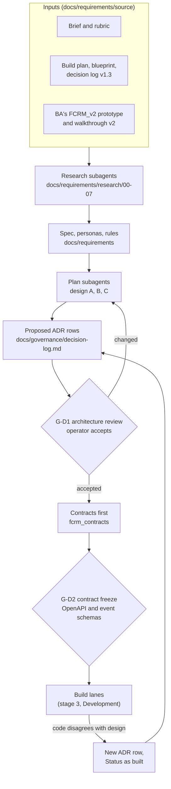

# Architecture: design decisions and diagrams

This folder is the brief's `/docs/architecture` and the evidence for stage 2, Design: "solution and technical architecture, data model design, user experience decisions and the tools used to reach them". Every diagram here is Mermaid and renders on GitHub. The decisions themselves are rows in `docs/governance/decision-log.md` (ADR-nn); the documents here explain them and point back to the rows.

## Start here

| If you want | Read |
|---|---|
| The system on one page | [c4-context.md](c4-context.md), then [c4-container.md](c4-container.md): eight containers as built (ADR-26) |
| How a case moves through it | [sequences/README.md](sequences/README.md): one sequence per stage of the flow, mapped to the 21 demo scenes |
| The data model | [data-model.md](data-model.md): an overview diagram, then every collection with its owning service and contract |
| The user experience and how it was decided | [ux-decisions.md](ux-decisions.md): 18 decisions, the tools behind them, screenshots of the key screens, what the prototype taught |
| Events between services | [event-catalogue.md](event-catalogue.md) |
| How it survives failure | [resilience.md](resilience.md): twelve kill-and-restart drills and what they found |
| The API contract | [openapi/api.json](openapi/api.json), generated by `make openapi`; the web's route test fails when it is stale |
| Where the code lives | [folder-structure.md](folder-structure.md) |
| The full design as written on 3 October | [design/A-backend.md](design/A-backend.md), [design/B-ai-layer.md](design/B-ai-layer.md), [design/C-web-tests-ops-sdlc.md](design/C-web-tests-ops-sdlc.md). Each opens with the departures the build made; `BUILD-PLAN.md` "Status as built" is the full list |

## The brief's design stage, item by item

| The brief asks for | Where it is answered |
|---|---|
| Solution architecture | [c4-context.md](c4-context.md); the README's "How it works"; the deterministic-versus-AI split in the root README, "What stays deterministic" |
| Technical architecture | [c4-container.md](c4-container.md), [sequences/](sequences/README.md), [event-catalogue.md](event-catalogue.md), [resilience.md](resilience.md); design A and B |
| Data model design | [data-model.md](data-model.md); `src/backend/packages/contracts` is authoritative where prose and code differ |
| User experience decisions | [ux-decisions.md](ux-decisions.md); design C sections 1 and 2; `docs/requirements/personas.md`; `docs/governance/visibility-matrix.md` |
| The tools used to reach them | "How the design was made" below; [ux-decisions.md](ux-decisions.md), "How the decisions were reached"; `docs/governance/sdlc-evidence.md`, stage 2 |

## How the design was made

AI drafted, a person accepted, and the contract came before the code. The team's documents (the BA's prototype and walkthrough, the build plan, blueprint and decision log v1.3) were read by Claude Code research subagents into `docs/requirements/research/`. Plan subagents wrote the three design documents from that research and proposed ADR rows. The operator accepted the rows that change the system's shape at gate G-D1 before the lane that builds them started, and the contracts (`fcrm_contracts`, then the OpenAPI export) were frozen at G-D2 so the web and every service lane built against the same shapes.

The last loop is the one that mattered: several design choices were wrong once code met them (the replay mode, ADR-27; one container per service, ADR-26; the route names, ADR-30; the vote mapping, ADR-31) and each reversal is a decision row rather than a silent edit. The gates and why each sits where it does are in `docs/governance/gates-register.md`; what AI did in this stage, and how to check it from the commit history, is in `docs/governance/sdlc-evidence.md`.

## Rules every document here follows

- The contract wins over prose: a shape is defined once in `fcrm_contracts`, and the documents name it rather than copy it.
- A document does not state a capability that does not run; a target that is not wired says so, and the gap goes in `docs/governance/known-gaps.md`.
- Generated files (`openapi/api.json`) are never edited by hand.
