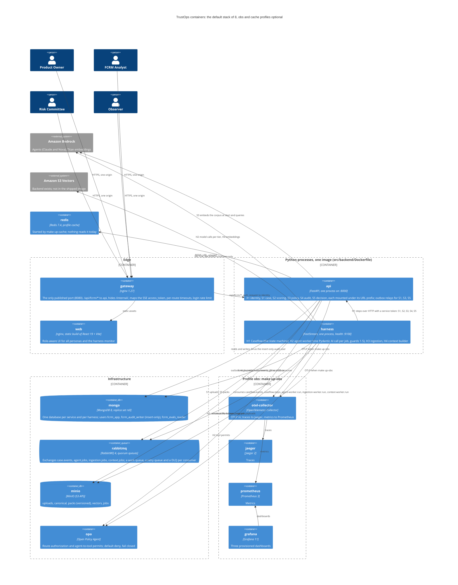

# C4: Containers

The system as built: **eight containers** in the default stack (ADR-26), four more under the `obs` profile and one under the `cache` profile. The design-time layout had one container per service and worker (24 in all); the code kept its units (S1-S5, X1, H1-H4 are still separate packages with their own app factories) but runs them as two Python processes from one image. Source of truth for the container list: `docker-compose.yaml`.

## The containers

| Container | Image and port | Holds | Health |
|---|---|---|---|
| `gateway` | `nginx:1.27-alpine`, host port 8080 (the only one published by default) | `ops/nginx/default.conf` | `GET /healthz` |
| `web` | `trustops/web:local` (`src/frontend/Dockerfile`), internal :80 | static build, MSW removed from the image | `GET /` |
| `api` | `trustops/backend:local`, internal :8000, command `uvicorn fcrm_api.main:app` | X1, S1 to S5 | `GET /readyz`; about 85 s to healthy (S3 embeds 197 clauses) |
| `harness` | `trustops/backend:local`, internal :9100, command `python -m fcrm_harness` | H1 to H4 | `GET /readyz` on 9100 |
| `mongo` | `mongo:8.0`, entrypoint `ops/mongo/entrypoint.sh` (replica set, users, validators, indexes) | state | initialised marker plus `rs.status()` |
| `rabbitmq` | `rabbitmq:4.0-management`, definitions imported at boot | queues | `rabbitmq-diagnostics ping` |
| `minio` | `bitnamilegacy/minio` pinned, buckets created at boot | objects | marker plus `mc ready` |
| `opa` | `openpolicyagent/opa:1.15.2-debug` | `ops/opa/policy`, `ops/opa/data` | `GET /health` |
| `otel-collector`, `jaeger`, `prometheus`, `grafana` | profile `obs` | observability | `grafana`, `jaeger`, `prometheus` have health checks |
| `redis` | profile `cache` | nothing | `redis-cli ping` |

`compose.debug.yaml` publishes the infrastructure ports and the harness health port; `compose.dev.yaml` swaps `web` for the Vite dev server; `compose.test.yaml` is the test overlay. No init containers exist: `mongo` and `minio` initialise themselves in their entrypoints and report healthy only when done.

## Where the original components went

| Original id | Now | Note |
|---|---|---|
| X1 identity, S1 case, S2 scoring, S3 policy, S4 audit, S5 decision | inside `api`, mounted as sub-apps by URL prefix (S1, whose prefix `/api/fcrm` prefixes the rest, last) | mounted, never `include_router(prefix=...)`, so OPA keeps authorizing the unprefixed route templates (ADR-26). Each unit still has `create_app(standalone=True)` |
| H1 Caseflow, H2 agent worker (was two replicas), H3 ingestion, H4 context | inside `harness`, as `WorkerUnit`s on one broker and one Mongo client | H2 runs `AGENT_PREFETCH` (4) jobs at once instead of two replicas |
| G1 gateway, W1 web | `gateway`, `web` | |
| X2 OPA, X3 RabbitMQ, D1 MongoDB, D2 MinIO | `opa`, `rabbitmq`, `mongo`, `minio` | |
| X7 Redis | `redis`, profile `cache` | the SSE fan-out it was for is not implemented (`fcrm_case/sse.py`) |
| Observability | profile `obs` | ADR-09 |
| S3 Vectors | not in the image | the backend sits behind an optional extra that conflicts with the agents' `boto3` pin; vectors are in memory (`VECTOR_BACKEND=memory`) |

## What is real

Every arrow above is a real call exercised by the sequences in [sequences/README.md](sequences/README.md) and by the integration tests, with the exceptions marked: the `redis` arrow does nothing, and the `s3v` arrow works only with a build that installs the optional extra, which the shipped image does not. The services still never read each other's databases: H1 reaches S1 to S5 over HTTP, and S4's insert-only credential is held only by S4.
