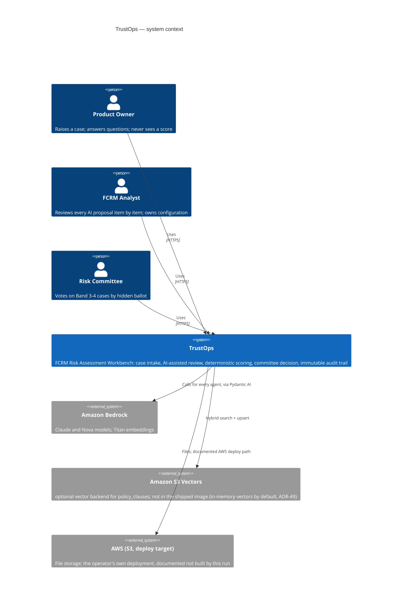

# C4: System context

TrustOps is the only system in scope. AEO/EVOQ components are cloned into this repository and modified here (ADR-05); the running AEO platform is never called at runtime, so it does not appear as an external system above.
