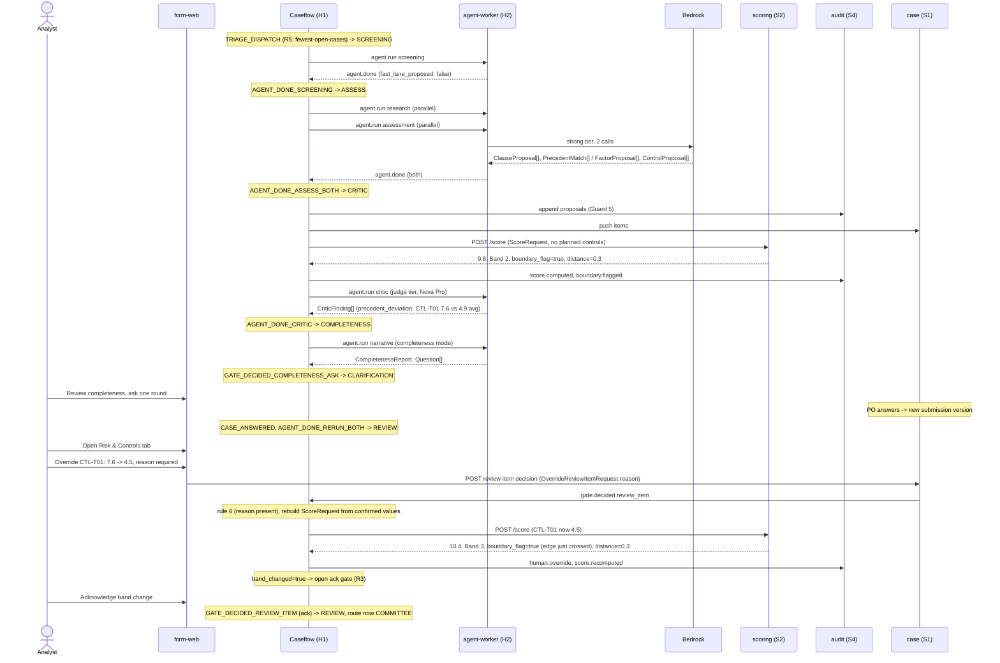

# Sequence: assessment, scoring, and the analyst's override

The demo's central moment: the score moves from 9.8 (Band 2) to 10.4 (Band 3) because the analyst overrides one control rating with a reason.

