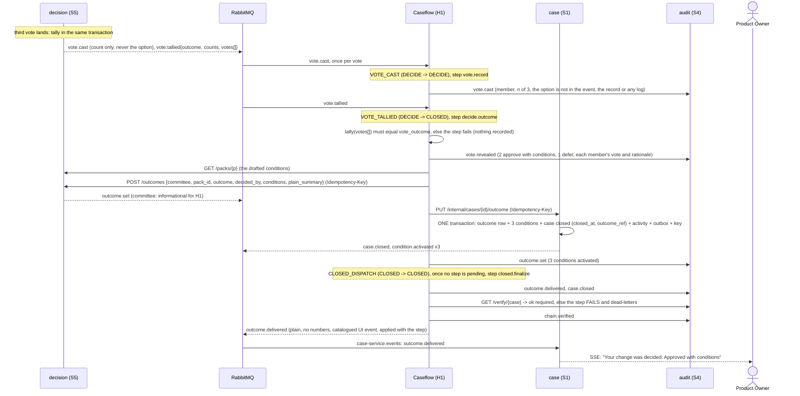
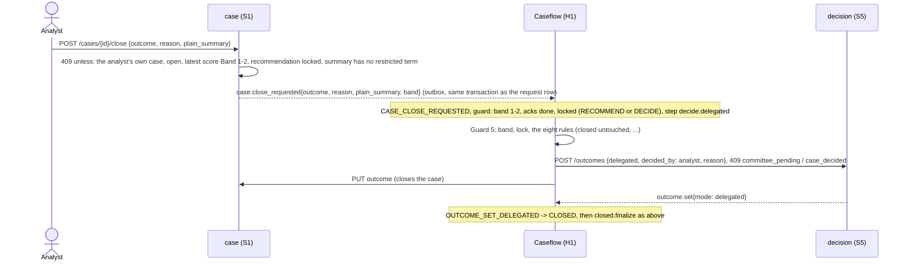

# Sequence: the tally, the outcome, the conditions and the close

From the third vote to a closed case with a verified chain (scenes 17-19). Every step names the real transition in `fcrm_caseflow.transitions` that fires it and the harness step (`fcrm_caseflow.cores.decision`, `fcrm_caseflow.cores.closing`) that does its HTTP-side work (ADR-28). The vote rules are ADR-08, ADR-31, ADR-36 and ADR-37; this page is what H1 and S1 add on top of S5's side in [committee-decide](committee-decide.md).

**Nothing here decides.** The outcome is whatever S5 tallied from three people's votes, or an analyst's delegated close with a written reason. H1 re-tallies the revealed votes with the same pure function (`fcrm_contracts.voting.tally`) and refuses to record anything the two disagree on; S5 refuses any committee outcome but the tallied one.

## The steps

| Trigger | Step | Does | Audit records |
|---|---|---|---|
| `vote.cast` | `vote.record` | records that a member voted; refuses a payload that names the option | `vote.cast` |
| `committee.question_asked` | `committee.question` | records the question; shows it to the analyst | `committee.question` |
| `committee.answered` (numbers unchanged) | `committee.answer` | records the addendum; shows it to the analyst | `committee.answer` |
| `committee.answered` (numbers changed, R6) | `committee.answer` | unlock in S1 (`PATCH state review, locked false`), `POST supersede {reason}` in S5, which voids the cast votes and re-requests them for the corrected pack | `committee.answer`, `case.unlocked`, `pack.superseded`, `vote.rerequested` |
| `vote.tallied` | `decide.outcome` | cross-checks the tally; records the outcome in S5, then in S1 (activates the conditions, closes the case) | `vote.revealed`, `outcome.set` |
| `vote.no_majority` | `decide.no_majority` | confirms the re-vote round S5 already opened; the run stays in DECIDE | `vote.no_majority`, `vote.rerequested` |
| `case.close_requested` | `decide.delegated` | Guard 5, then S5 records the delegated outcome and S1 closes the case | `outcome.set` |
| `internal.closed_dispatch` | `closed.finalize` | delivers the outcome, verifies the chain, announces it to the PO | `outcome.delivered`, `case.closed`, `chain.verified` |

`vote.rerequested` is **not** a trigger: S5 opened round *n+1* in the transaction that tallied the split, so H1's `POST revote` only confirms it. `outcome.set` is a trigger only for `mode: delegated`; a committee outcome already moved the run on `vote.tallied`.

## Conditions: from the pack to a tracked row

The conditions are the ones the narrative agent drafted and the committee approved: the frozen pack's `conditions[]`. Activation (`fcrm_caseflow.cores.closing_conditions`, pure code, no model) resolves their words to what S1 can track:

| Words in the pack | Becomes |
|---|---|
| owner `Priya Nair` (the case's owner or analyst) | `owner_id` = that user; a team (`FCRM Ops`) has none |
| due `before go-live` or `go-live` | the case's go-live date (field F03: `February 2027` -> 2027-02-01) |
| due `6 months`, `within 90 days`, `2 weeks` | the day of the decision plus that period |
| due `quarterly`, `monthly`, `annual` | one period after the decision (the first reminder) |
| anything else | no date: the condition is tracked but not on the reminder clock until an analyst dates it |

The demo's three: **CND-1** vendor DD review (Priya Nair, before go-live, open); **CND-2** enhanced payout-agent monitoring (FCRM Ops, go-live, scheduled); **CND-3** quarterly sample review of agent KYC files (Priya Nair, 6 months, scheduled). The S1 row id is `deterministic_id("cnd", case, ref)`, so activating twice yields the same rows.

## S1's PUT: one transaction

`PUT /internal/cases/{id}/outcome` writes the `outcomes` row, inserts the conditions, sets the case `closed` (with `closed_at`, `decided_at`, `outcome_ref`), stages the `case.stage_changed` activity row, enqueues `case.closed` and one `condition.activated` per condition, and stores the `Idempotency-Key`, in one Mongo transaction (`fcrm_case.outcome_store`). The body is the whole intended state: the same body again, or the same key with the same body, answers `replayed: true` and writes nothing; a different body for a decided case is 409 `outcome_already_set`; the same key with a different body is 409 `idempotency_key_reused`.

After the commit the route publishes the staged activity entries to the case stream; nothing reaches the stream for a transaction that rolled back.

## Delegated close (R1, Band 1-2)

A Band 1-2 case is never released to the committee (S5 refuses a delegated outcome over an open committee pack), so its run is still in RECOMMEND when the close is requested: `transitions.py` carries the RECOMMEND rows beside the DECIDE ones.

## Failure semantics

- **A refusal is permanent, a timeout is transient.** `DecisionVotesClient` reads S5's machine code (the last segment of the problem `type`) and raises `DecisionRefusedError` for a 409 (`not_tallied`, `outcome_mismatch`, `committee_pending`...): the step fails loudly, is logged with the code, the case and the pack, and is dead-lettered after the broker's retries rather than retried into success. An unreachable S5, a timeout or a 5xx is `UpstreamUnavailableError` / `UpstreamTimeoutError`: retried.
- **The chain must verify.** `closed.finalize` calls S4 `GET /verify/{case}` and raises `ChainBrokenError` when it does not: the step is not marked done, the message is retried and then parked in `caseflow.steps.dlq` (replay with `make dlq-replay q=caseflow.steps` once the chain is repaired), the PO is not told, and no `chain.verified` record exists to claim otherwise.
- **Every step is safe to run twice.** S5 writes carry an `Idempotency-Key` derived from the step id; S1's PUT is the whole intended state and keyed; audit records are keyed by `(step, type, ordinal)`; the PO's `outcome.delivered` is a step result applied in the same transaction as the step's completion, so it goes out once.

## What S1 shows, from the bus

S1's own consumer (`fcrm_case.consumer.CaseServiceEventsConsumer`, queue `case-service.events`, bound by ops to `outcome.*`, `vote.rerequested`, `pack.released` and `index.built`) mirrors these events into the `activity` log and the case stream. What each becomes, and who sees it, is one pure function (`fcrm_case.domain.mirror.mirror_for`):

| Event | Entry | Visible to |
|---|---|---|
| `pack.released` | "Pack v1 released to the committee (3 members)" | analyst |
| `vote.rerequested` | "Votes requested again: round 2 on pack v1" | analyst |
| `outcome.set` | "Outcome recorded: Approved with conditions (committee)" | analyst |
| `outcome.delivered` | "Your change was decided: Approved with conditions · 3 conditions apply" | PO and analyst, unless the PO fence refuses it (then analyst only, logged) |
| `index.built` | nothing | |

The consumer is transactional: the dedupe marker and the activity row (with its gap-free per-case `seq`) commit together, and the entry is published to the stream hub only after the commit. The composite `api` process starts its broker before it registers S1, so S1 registers its four subscriptions on the already-started broker and starts each one itself (`ServiceDeps.broker`; a standalone S1 has none and says so).

## The PO's side

The PO sees one plain event, `outcome.delivered` (`po` and `all` visibility, no score, band, vote or pack key; the fence refuses anything else), and later reads the outcome and its conditions through the PO routes, which are served in a later lane from the rows this page writes (`outcomes`, `conditions`). The PO never receives `vote.*`, `pack.*` or `committee.*` events.
