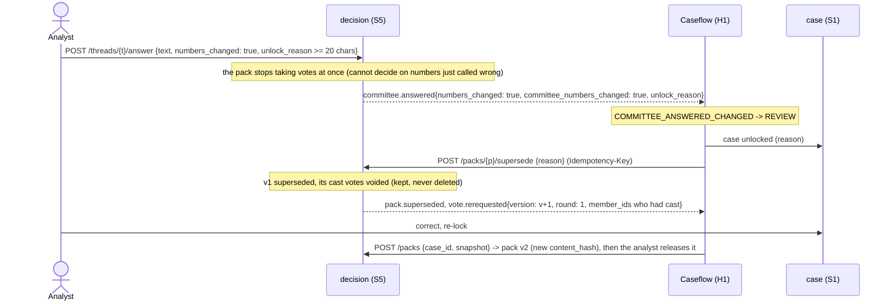

# Sequence: recommendation, pack release, and the committee vote

Ends with the demo's real outcome: two votes for approve-with-conditions, one defer, tallied to `approve_with_conditions` (never resolved any other way — ADR-08, ADR-31). Routes are the web's (ADR-30); every state change below commits with its event in one Mongo transaction through S5's outbox, and the relay publishes it to `case.events` under the lease `outbox-relay:decision`.

```mermaid
sequenceDiagram
    actor An as Analyst
    actor Cm as Committee (3 members)
    participant W1 as fcrm-web
    participant H1 as Caseflow (H1)
    participant S1 as case (S1)
    participant S5 as decision (S5)
    participant S4 as audit (S4)

    Note over H1: ALL_ITEMS_DECIDED (all_items_decided & acks_done) -> RECOMMEND
    H1->>H1: agent.run narrative (recommendation mode)
    Note over H1: Guard 4 checks the PO summary has 0 restricted-term hits
    An->>W1: Edit, then lock the recommendation
    W1->>S1: case.locked
    Note over H1: CASE_LOCKED -> RECOMMEND
    H1->>S5: POST /packs {case_id, snapshot} (PackView body + checks; Idempotency-Key)
    S5->>S5: validate PackContent, content_hash(snapshot) -- the pack is now frozen, NOT released
    S5-->>H1: PackView{status: built}
    H1-->>S4: pack.assembled
    An->>W1: Release the pack
    W1->>S5: POST /packs/{p}/release
    S5->>S5: four checks (locked, all_items_reviewed, boundary_and_band_acknowledged, business_summary_present); else 409 naming them
    S5->>S5: roster from X1 (GET /users?role=fcrm_committee), pack opens for voting
    S5-->>H1: pack.released{release_checks_passed, released_to[]}
    Note over H1: PACK_RELEASED, guard: release_checks_passed -> DECIDE
    H1->>H1: route_for_band(3) = COMMITTEE

    Cm->>W1: Ana asks a committee question
    W1->>S5: POST /packs/{p}/threads {text}
    S5-->>H1: committee.question_asked
    An->>W1: Rahul answers (numbers unchanged)
    W1->>S5: POST /threads/{t}/answer {text, numbers_changed: false}
    Note over S5: addendum no. n attached; the pack's content_hash is unchanged
    S5-->>H1: committee.answered{numbers_changed: false}
    Note over H1: COMMITTEE_ANSWERED_NO_CHANGE -> DECIDE (addendum only)

    Cm->>W1: Joseph Okafor votes: approve_with_conditions
    W1->>S5: POST /packs/{p}/votes {vote, rationale >= 20 chars} -> {vote_id, round, cast_n_of_3}
    S5-->>H1: vote.cast (member, count; never the option)
    Cm->>W1: Ana Mendes votes: approve_with_conditions
    Cm->>W1: Lin Chen votes: defer
    Note over S5: GET /packs/{p}/votes shows each member only their own choice until all 3 are cast
    S5->>S5: tally(votes) = fcrm_contracts.voting.tally, in the transaction of the third vote
    Note over S5: 2 of 3 agree -> outcome = approve_with_conditions (never auto-resolved); reveal and tally together
    S5-->>H1: vote.tallied{vote_outcome, counts, votes[]}
    Note over H1: VOTE_TALLIED -> CLOSED
    H1->>S5: POST /outcomes {mode: committee, pack_id, outcome, conditions[], plain_summary} (Idempotency-Key)
    S5-->>H1: outcome.set
    H1->>S1: PUT outcome (activate 3 conditions)
    H1->>S4: vote.revealed, outcome.set
    Note over H1: CLOSED_DISPATCH
    H1->>S4: outcome.delivered, case.closed
    H1->>S4: GET /verify -> chain.verified (67 records)
```

## What the third vote decides (the tally)

One pure function, `fcrm_contracts.voting.tally(votes)`, shared by S5 and H1:

| Ballot | Result |
|---|---|
| 3-0 | the option |
| 2-1 | the option two members agree on (ADR-08) |
| 2-1 inside the approve family (`approve` and `approve_with_conditions` only), e.g. `approve, approve, approve_with_conditions` | `approve_with_conditions` **(proposed)**: a member who asked for conditions is never outvoted into an unconditional approval. It never merges across a defer or a reject: `approve, approve, defer` is `approve` |
| 1-1-1, any three different options | `no_majority` (ADR-31): never `deferred`, never any outcome |
| any other number of votes | `no_majority` (fail closed) |

## The no-majority path (a required path, not in the demo)

The third vote's transaction concludes the round as `no_majority`, keeps it (revealed, readable with `GET /packs/{p}/votes?round=1`) and opens round two on the same pack in that same transaction (ADR-31). Nothing is decided and nothing is mapped to `defer`.

```mermaid
sequenceDiagram
    participant S5 as decision (S5)
    participant H1 as Caseflow (H1)
    participant Cm as Committee

    Note over S5: tally(["approve", "defer", "reject"]) -> no_majority, round 1 kept
    S5-->>H1: vote.no_majority{round: 1, counts}
    S5-->>H1: vote.rerequested{round: 2, member_ids, reason: no_majority}
    Note over S5: a system thread opens: "No majority: 1 approve / 1 defer / 1 reject. Discuss and re-vote (ADR-08)."
    Note over H1: VOTE_NO_MAJORITY -> DECIDE (same state, new round)
    H1->>S5: POST /packs/{p}/revote {reason: no_majority} (Idempotency-Key)
    S5-->>H1: {round: 2, member_ids}  (confirms; writes nothing)
    Cm->>S5: three new hidden votes, each with a rationale (round 2)
```

Round two starts empty and hidden; a member may vote in round two exactly once, and a vote carries no round (it lands in the pack's current round). Re-vote rounds are unbounded, each recorded; the analyst may also unlock (R6) if the discussion shows a number must change.

## R6: a committee answer changes a number



Both packs stay readable (`GET /cases/{id}/packs`). A pack that already has an outcome is closed for good: an answer that changes numbers, a supersede and a different pack for the case are all 409.

## Delegated close (R1, Band 1-2)

H1 (Guard 5: band 1-2, lock held, acknowledgements) calls `POST /outcomes {mode: delegated, outcome, decided_by, reason >= 10 chars}`; S5 records it (no pack), refuses it over an open committee pack or an existing outcome, and publishes `outcome.set{mode: delegated}`, which H1 reacts to (`OUTCOME_SET_DELEGATED`).
