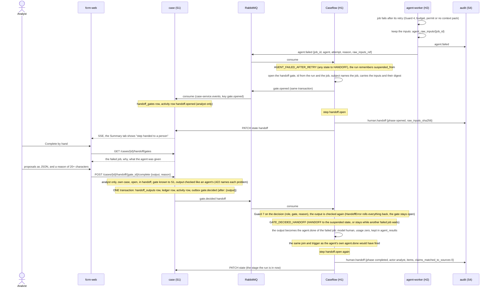

# Sequence: a failed agent and the human handoff

What happens when an agent fails after its one retry, and how the analyst finishes the step by hand so the run goes on (flow F-path; the retry rules are in `ops/runbooks/bedrock-outage-and-fallbacks.md`). Nothing is skipped, nothing is scored from a missing proposal, and nothing is approved or rejected: a person supplies the proposals the agent should have produced, and everything after that treats them like the agent's.

## The pieces

| Piece | Where | What it does |
|---|---|---|
| Raw inputs kept | `fcrm_agent_worker.raw_inputs` | before it reports `agent.failed`, H2 stores the job and the context pack as the model received it (`agent_raw_inputs`, `_id` = job id, cut at 200,000 characters) and names it in `raw_inputs_ref`. A store that is down costs the inputs, never the report |
| The gate | `CaseflowEngine._dispatch`, `fcrm_caseflow.handoff.handoff_subject` | `deterministic_gate_id(run, handoff, job_id)`, so a replayed failure opens the same gate. Its subject: `agent`, `job_id`, `attempt`, `reason`, `step`, `raw_inputs_ref`, the text (cut at 100,000 characters), its SHA-256 and size, and whether it was cut |
| Remembering where it was | `CaseRun.suspended_from`, `TransitionContext.resume_state` | set by the transition into `HANDOFF`, kept while a second failed job stays there, cleared by the one that leaves. The resume transition records `resume_state`, so a replay lands where the live run did. A run suspended before this existed resumes to `REVIEW` (the table's default) |
| S1 learns of the gate | `fcrm_case.consumer`, `fcrm_case.handoff_store` | `gate.opened` (bound to `case-service.events`) for a `handoff` gate that names its job becomes a `handoff_gates` row. Any other gate is ignored. S1 refuses a gate id it holds no row for |
| The route | `fcrm_case.routes_analyst_write`, `fcrm_case.analyst_handoff_service` | `GET /cases/{id}/handoff/gates` and `POST /cases/{id}/handoff/{gate_id}/complete`. OPA allows the analyst only and denies the service account by name. Contracts: `fcrm_contracts.api.case_analyst_handoff` |
| The checks | `fcrm_guardrails.manual_output` | the source-free part of Guard 4: each item is exactly one of the agent's proposal models (a stray `score` is an error), empty fails closed unless the agent may be empty, a quote is at least 12 characters, low confidence is noted, a clause cites itself, a business summary names no restricted term. Run by S1 first and again by H1 |
| The resume | `CaseflowEngine._handle_handoff_decided` | output checked before the gate is marked decided; `GATE_DECIDED_HANDOFF`; then the output is handled as an `agent.done` of the failed job. While another failed job's gate is open the run stays in `HANDOFF`; a late `agent.done` that arrives while it is there is kept and its join entry cleared, with no trigger until the run resumes |
| The step | `fcrm_caseflow.cores.handoff` | `handoff.open` at both ends (told apart by the trigger): writes `human.handoff` through `StepDeps.append_record` (an `Idempotency-Key` from the step id) and patches S1's stage |

## What the steps guarantee

- **A human decides.** The route is the analyst's alone, for the case they hold; the reason is at least 20 characters (Guard 7 asks for 10, `handoff` is now a reason-required gate). The service account is denied by an OPA row and by `require_roles`.
- **Store before emit.** The output, the ledger row and the event commit in one S1 transaction or not at all, and a refusal (422) leaves no trace. A repeat of the same output replays; a different output for a decided gate is a 409 `gate_already_decided`.
- **A manual output is less machine-verified than an agent's, and the record says so.** Sources are not resolved and quotes are not matched against the cited text, because the context pack is built by H2 from live tools. `guard_summary.claims_with_source` is 0, the note for the analyst says so, and the `human.handoff` record carries `claims_matched_to_sources: 0`. Every item still goes to a human review gate and the critic.
- **What the audit chain holds.** `agent.failed` (H2), `human.handoff` with `phase: opened` and the digest of the inputs shown (never the text), then `human.handoff` with `phase: completed`, the analyst as actor, and the reason in its summary, then the resumed step's own records. The raw inputs themselves are in `agent_raw_inputs` and on the gate, not in the chain.
- **Safe to run twice.** The gate id derives from the run and the job; the consumer records a gate once; the step's records are keyed by step id; the resume is idempotent by the engine's usual dedupe and step ids.
- **The PO sees the stage name only.** `handoff.*` is a blocked activity type for the PO, the gate list and the inputs are analyst routes, and the activity rows are analyst-visible.

## Not covered

- A replay of a `handoff` decision that arrives after the run has left `HANDOFF` for another reason has no transition and is dead-lettered like any illegal transition.
- If a join completes while the run is in `HANDOFF` because the failed job was not part of it, the trigger is not re-fired at the resume. No agent dispatch produces that today.
- The oversight agents (examiner, watchlist) do not go through this path: their failures have their own triggers and no run to suspend.
