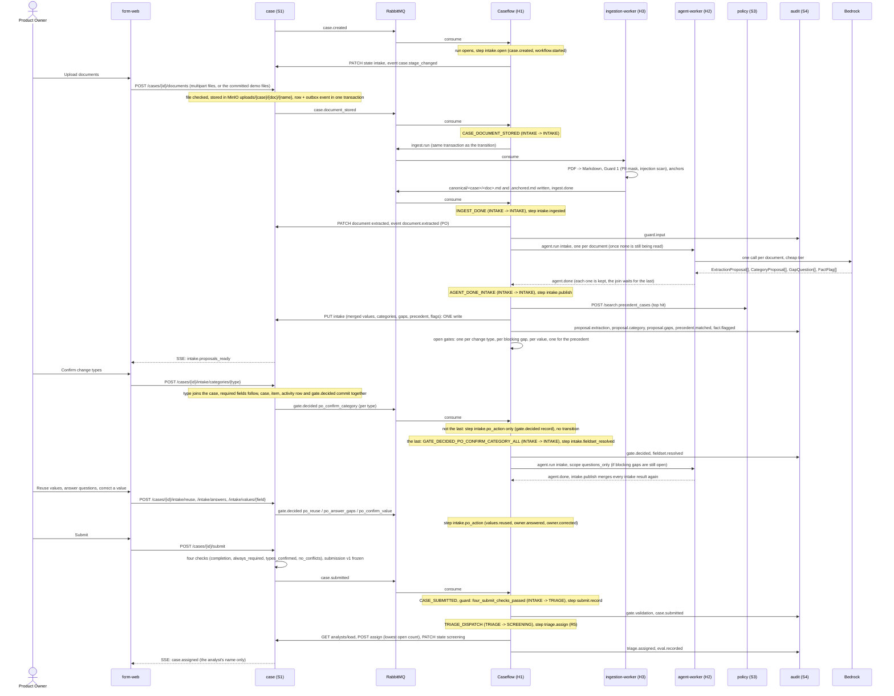

# Sequence: intake

From document upload through submission. Every step names the real transition in `fcrm_caseflow.transitions` that fires it (or the step-only trigger, where no transition exists) and the harness step (`fcrm_caseflow.cores.intake`) that does its HTTP-side work.

## What the steps guarantee

- **Idempotent.** A step may run again after a failure. S1 writes are PUT or PATCH of the whole intended state; every audit record and S1 event carries an `Idempotency-Key` derived from the step id; gate and job ids are deterministic (`deterministic_id("gate", run_id, gate_type, subject_key)`); the R5 pick looks for an analyst S1 already assigned before choosing.
- **One join for the fan-out.** The intake agent runs once per document. The engine stores every `agent.done` (`agent_results`, one row per job) and tracks the run's pending jobs by `"<agent>:<job_id>"`, so `AGENT_DONE_INTAKE` fires when the last one reports, and `intake.publish` merges all of them: one candidate per field (highest confidence, ties broken by document, page, line), one entry per change type and per question.
- **S1's side of a decision.** One PO action is one Mongo transaction: the case document, its field values, review items, documents, the frozen submission, the activity rows and the outbox events commit together or not at all. Caseflow decides a gate once, so S1 keeps a ledger (`po_decisions`, deterministic `_id` per gate): the first decision on a gate emits `gate.decided`; a later change to the same data updates it (the original stays in `history`) and is logged in the activity feed, without a second event. A repeat of the same request changes nothing.
- **The PO's gates.** `po_confirm_category` and `po_answer_gaps` move the case; `po_confirm_value` (one per proposed value) and `po_reuse` (one for the precedent) are opened so that S1's `gate.decided` for them meets a gate H1 opened (Guard 7) instead of being refused as unknown. A gate id is `deterministic_id("gate", run_id, <gate type>, <field id | change type | question id | precedent case id>)`.
- **What the PO sees.** Only `visibility: po | all` events, none with a score or band; `case.assigned` carries the analyst's name and nothing else.
- **A document that cannot be used** (a scan, an unsupported type, Guard 1's quarantine, a deadline overrun) is an `ingest.failed` with a code; H1 marks the document and tells the PO to upload another version, and still reads the case's other documents. A store or broker outage is retried, then dead-lettered, never answered.
