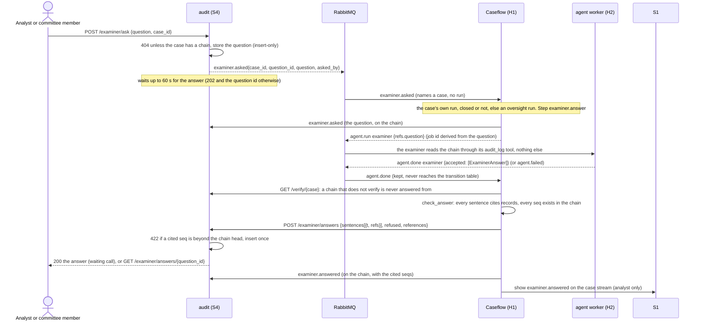
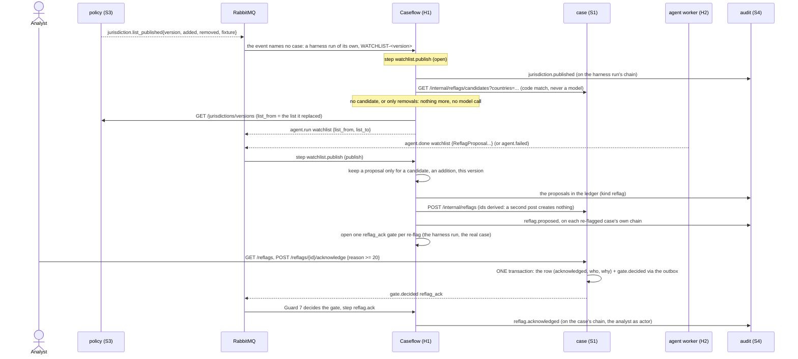

# Sequence: oversight, the examiner, the watchlist and the assurance reads

Scene 20 of the walkthrough and the OVERSEE steps of the flow map (O1 to O8). Three things happen after a case is decided, none of them a case stage, and **none of them decides anything**: an examiner asks a question and an agent answers from the audit chain only; a published jurisdiction list re-flags the open cases it touches for an analyst to acknowledge; and the Assurance screens read override rates, version pins and agent quality. H1's work is in `fcrm_caseflow.cores.oversight` and `oversight_watchlist`; the runs they hang on are `fcrm_caseflow.oversight_runs` (ADR-28 steps, ADR-07: a re-flag never changes a score or reopens a case).

## The examiner (O1, O2)

| Trigger | Step | Does | Audit records |
|---|---|---|---|
| `examiner.asked` | `examiner.answer` | records the question, dispatches one examiner job whose inputs are the question and the case | `examiner.asked` |
| `agent.done` examiner | `examiner.answer` | verifies the chain, checks the citations, posts the answer or a refusal to S4 | `examiner.answered` |
| `agent.failed` examiner | `examiner.answer` | posts a refusal that says the examiner could not answer | `examiner.answered` |

**A citation is a record that exists, or there is no citation.** `check_answer` turns the *whole* answer into a refusal when a sentence cites nothing, cites a `seq` outside `1..records`, or is too long to show unchanged, and when the agent produced no sentence at all. A refusal carries no sentence and no reference, so a dropped or unknown reference can never become a fabricated citation. S4 refuses (422) any answer citing a record beyond the chain head whoever posts it, so the store holds none even if H1 had a bug. The answer's `references` line states the chain it was read from (`audit chain of FCRM-2026-0151: 68 records, every hash intact`).

**A case H1 never ran** (one of the 65 seeded closed cases, whose trails S4 holds) gets an *oversight run*: a `case_runs` row in state `closed` with `closed_at` set and its closing dispatch marked done, so `get_by_case_id` never returns it and the engine never chains from it. The examiner job for such a run is pinned to the versions S1 holds for the case.

**An examiner that fails is a refusal, not a dead letter.** `agent.failed` from the examiner or the watchlist is recognised before the transition table (it would be an illegal transition from `closed`), so the asker is told rather than left waiting.

## The watchlist and the re-flags (O3 to O5)

| Trigger | Step | Does | Audit records |
|---|---|---|---|
| `jurisdiction.list_published` | `watchlist.publish` | records the list, asks S1 for the candidates, dispatches the watchlist agent when there are any | `jurisdiction.published` |
| `agent.done` / `agent.failed` watchlist | `watchlist.publish` | holds one re-flag per candidate in S1, opens its gate | `reflag.proposed` (per case), `agent.failed` |
| `gate.decided` `reflag_ack` | `reflag.ack` | records the acknowledgement | `reflag.acknowledged` |

**Code decides who is affected; the agent explains.** The candidates are the open cases whose geography or corridor names an added country (`fcrm_case.domain.reflags.countries_matched`, one query on `cases` and one on `field_values`). A removal never re-flags. The agent's proposal stands only for a `(case, country)` the candidate set holds, for an addition, in this list version, with an explanation of 10 to 600 characters. **A candidate is never dropped:** one the agent did not explain, and every candidate when the agent failed, is re-flagged with a reason code writes (`proposed_by: code`: the country, the list version, that the case names it), so an affected case cannot be missed because a model was.

**The agent reads the same cases.** The watchlist agent's context pack finds each country's open cases through its `case_search` tool, which S1 serves to the service account at `GET /internal/cases/search` (a service-only route, the same code match as the candidates; `closed_only=false` and an `outcome` of `null` mark the open cases). The agent therefore explains cases code already selected; it adds or removes none.

**The harness run.** `jurisdiction.list_published` names no case, so the list version gets one run, `run_<digest of the version>` on the pseudo case `WATCHLIST-<version>`, derived from the version so a redelivery finds it. It owns the watchlist job, the audit chain of the round and the re-flag gates. A gate belongs to the *re-flagged* case but is opened on the harness run (`GateSpec.case_id`): Guard 7 matches the decision's case and run to the gate's, and S1 puts both in `gate.decided`.

**Acknowledging is a human decision with a reason.** At least 20 characters (the web posts it as `note`; both names are accepted). The row's change and `gate.decided` commit together, so H1 never hears of an acknowledgement that was not stored. It works on a closed case (the re-flag is about the list), the service account is denied (Guard 7), and the same reason again is a replay. `rerun` is recorded with the acknowledgement; **nothing re-runs by itself, no score changes and no case reopens**: what the analyst does next goes through the ordinary routes (re-run, unlock) with their own reasons.

## The assurance reads (O6 to O8)

| Route (S4) | Who | Reads |
|---|---|---|
| `GET /overrides?agent=` | analyst | `human.override` records as rows (case, item, proposed, final, by, reason, agent, date) and, per agent, `overridden` of `proposals`: one aggregation over `audit_records` with `$unionWith` the ledger |
| `GET /versions/{case_id}` | analyst | the pins in the case's `workflow.started` record, beside what the newest `workflow.started` pinned (what a case opened now would pin) |
| `GET /agent-quality?week=` | analyst, committee, observer | each agent's primary eval metric in the week's latest run, regressions, drift against the previous week; 404 when nothing was published (the web's empty state) |
| `GET /agent-quality/dashboard` | analyst, committee, observer | the latest published self-contained dashboard, `text/html` under `default-src 'none'; style-src 'unsafe-inline'`, no script, no frame, no form |

The overrides and versions are case data: analysts only. The agent quality is not case data, so S4's OPA rows let the committee and the observer's tokens read it through the API; the screen is the analyst's alone (Assurance › Agent quality). ADR-19 gives the observer the harness monitor and nothing else, so the web offers the observer no page that calls these routes. The PO reads none of this, and no row carries a score, a band or a model id (the eval documents hold labels only). The eval results are in `fcrm_evals`, read through S4's **own read-only credential** (`MONGODB_URI_EVALS_READER`, role `fcrmEvalsReadOnly`: `find` on `eval_runs` and `eval_dashboards`); the insert-only audit role never reaches beyond `fcrm_audit`, and without the credential these two routes answer 503.

## Who sees what

| | PO | Analyst | Committee | Observer | Service |
|---|---|---|---|---|---|
| Ask the examiner, read an answer | no | yes | yes | no | answers only |
| Re-flags (list, acknowledge) | no | yes | no | no | creates, never acknowledges |
| Overrides, versions | no | yes | no | no | no |
| Agent quality and dashboard, by the API | no | yes | yes | yes | no |
| Agent quality screen (the web) | no | yes | no | no | no |

## Failure semantics

- **Every step is safe to run twice.** Audit records are keyed by `(step, type, ordinal)`; the examiner's job id and the harness run are derived; S4 replays an identical answer and S1 an identical re-flag; gates have deterministic ids.
- **A refusal is permanent, an outage is transient.** A 409 or 422 from S4 or S1 fails the step loudly and dead-letters it after the broker's retries; an unreachable peer is retried. Nothing is swallowed.
- **S4 has no outbox.** The audit role cannot update, so it cannot mark an outbox row published: `examiner.asked` is published directly after the question is stored, under a deadline. A failed publish is a 503 and the stored question stays unanswered (nothing was decided by it); the asker simply asks again.
