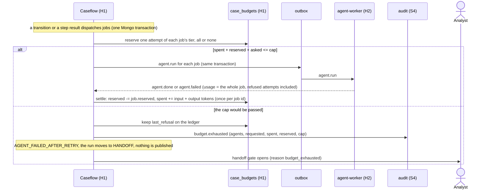

# Sequence: the per-case token ledger

A case may spend 160,000 tokens across all of its agent jobs (ADR-14, ADR-27, `ai/models/tiers.yaml` `per_case_budget_tokens`, `CASE_TOKEN_CAP`). That is the **enforced cap**: the worst case measured on the live demo case (115k with every job answering first time, 126k to 158k when Guard 4 forces a retry; measured on the 6 October chain, Sonnet 5.5 on mid and strong with an Opus 5.5 critic, and not re-measured on the committed chain, whose critic is Nova Pro and used 21,851 tokens on one live run, so a run there may use more; ADR-62, ADR-65) plus a small margin, so a run that needs one retry completes and a case that needs two stops for the analyst. **120,000 is the efficiency target** (`per_case_target_tokens`, `CASE_TOKEN_TARGET`) that the harness monitor reports against; a case over the target and under the cap is not an error. H1 keeps the count: it reserves before a job is published and settles when the job's result is applied. H2's Guard 3 is unchanged and still limits one job (its tier's tokens, its wall clock, its two attempts). The code is `fcrm_caseflow/budget.py` (the store) and `fcrm_caseflow/engine.py` (`_publish_jobs`, `_settle_result`, `_hand_off`).



## The ledger

One document per case, `case_budgets/<case_id>`, in `fcrm_harness`. It is per case and not per run: a re-run after the clarification round (`case.answered`, `rerun.record`) spends from the same ledger, and so does a re-run the analyst asks for in review.

```
{_id: case_id, case_id, run_id, cap, spent, reserved,
 jobs: {job_id: {agent, reserved, spent, status: reserved | settled}},
 last_refusal?: {at, agents, asked, spent, reserved, cap}, created_at, updated_at}
```

The cap comes from `CASE_TOKEN_CAP` (`CaseflowSettings.case_token_cap`, `HarnessSettings.case_token_cap`, default 160,000, `.env.example` and the harness block of `docker-compose.yaml`). A ledger takes the value when it is created and keeps it, so changing the variable leaves the cases already under way where they were. `spent` and `reserved` always equal the sum of the `jobs` lines.

## The rules

1. **Reserve one attempt, not the retry.** A dispatch holds one attempt of the job's tier budget: cheap 15,000, mid 15,000, strong 24,000, judge 28,000 (it was 20,000 until 7 October 2026: the critic on Nova Pro used 21,851 tokens and was blocked, ADR-62; `fcrm_guardrails.budget.TIER_BUDGETS`, kept equal to `tiers.yaml` by `test_budgets_agree.py`). The design's `tokens x (1 + retries)` would hold 96,000 for a research and assessment pair that spends about 30,000, and would block the critic after it (and the original 120,000 cap would have sent most runs with a Guard 4 retry, 126k to 158k, into handoff, which is why the enforced cap is 160,000). The retry only matters when the result arrives.
2. **Dispatch only if it fits.** `spent + reserved + asked <= cap`, checked and written in the same Mongo transaction that enqueues the `agent.run` (the transition path in `_dispatch` and the step path in `_dispatch_step_jobs`).
3. **A pair is reserved whole.** Research and assessment run in parallel and join; they are two lines of the ledger and are settled apart, but if the pair cannot both be paid for, neither is published (one half alone would leave the join waiting for a job that never ran).
4. **Settle when the result is applied.** `agent.done` and `agent.failed` both carry the whole job's `usage` (`AgentFailed.usage` was added for this: a job that fails after two attempts is charged for both). The tokens counted are `input_tokens + output_tokens`; cache reads and writes are billed apart and do not count (`evals/README.md`). Settling drops the job's reservation and adds what it used, once per job id: a redelivered or repeated result changes nothing.
5. **A job may overshoot its reservation once.** The tokens were really spent, so settling never clamps: `spent` may pass the cap, the overrun is logged (`agent job overran its reservation`), and the next reservation is refused. A second retry in the same case therefore stops the case instead of being silently paid for.
6. **Refusal is loud.** The job is not published. H1 writes the audit record `budget.exhausted` (`agent`, `agents`, `job_ids`, `requested`, `spent`, `reserved`, `cap`), keeps the same facts as `last_refusal` on the ledger (so a down audit service does not hide it), and applies `AGENT_FAILED_AFTER_RETRY` with an `agent.failed`-shaped payload naming the first refused job (`attempt` 0, `reason` `budget_exhausted: ...`). The run moves from any state but CLOSED to HANDOFF and the existing `handoff` gate opens, the same gate and shape any failed agent opens. Nothing already computed is deleted or superseded: the stored `agent_results`, the proposals in S4 and the items in S1 stay. The monitor shows the record on Guard 3 as blocked.
7. **The oversight agents are not metered.** The examiner, the watchlist and the policy-gap writer (`UNMETERED_AGENTS`) run on demand, over a closed case or a jurisdiction list or beside the review, not as a step of the case's chain, and a closed run has no handoff to refuse into. They are not reserved or refused, but their result is settled, so the ledger and the monitor show what they spent.
8. **The monitor reads the ledger.** `harness_snapshot` takes `tokens_used` from the ledger's `spent`, `tokens_budget` from its `cap` (the enforced 160,000) and `tokens_target` from `CASE_TOKEN_TARGET` (120,000) (`HarnessReporter` reads `case_budgets`); it no longer reads the run's `tokens_used` counter, which the steps bump and which missed jobs.

## Re-runs and the second pass

The ledger belongs to the case, so every later job draws on what is left: the clarification round's research and assessment re-run, an analyst's re-run, a re-tag, the recommendation narrative. On the live demo case a run was 115,000 tokens clean and 126,000 to 158,000 when Guard 4 forced a retry (on the 6 October chain, with an Opus 5.5 critic; not re-measured on the committed chain), so one retry fits under the 160,000 cap (over the 120,000 target, which is not an error), while a re-run late in the case, or a second retry, can reach the cap. That is the intended behaviour: the case waits for the analyst instead of spending past the limit.

## Why it is safe

- **Atomic.** Reserve, settle and the outbox rows are one transaction. A reservation whose transaction aborts leaves no ledger line and no job (`test_a_reservation_aborts_with_its_transaction`).
- **Concurrent dispatches.** The ledger is one document. Two transactions that both want the last tokens conflict on it, and `with_transaction` retries the later one against the new state: nine jobs of 24,000 racing for a 120,000 cap take exactly five (`test_concurrent_dispatches_never_take_more_than_the_cap`, against a real replica set).
- **Idempotent.** A job id already reserved reserves nothing again (a re-delivered dispatch); a settled job id settles nothing again; a job id the ledger never saw (dispatched before the ledger existed) is recorded with nothing reserved.
- **No HTTP in the transaction for the ledger itself.** The only call to another service on the refusal path is the best-effort audit write every transition already makes (`_write_audit_raw`).
