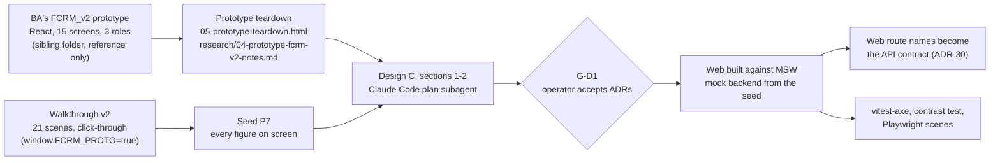

# User experience decisions

The brief's design stage asks for "user experience decisions and the tools used to reach them". This page collects them in one place. The screen-by-screen detail is design C (`design/C-web-tests-ops-sdlc.md`, sections 1 and 2, written 3 October); where the built web departs from it, the web in `src/frontend` and the decision log win. Who the users are is in `docs/requirements/personas.md`; who may see what is in `docs/governance/visibility-matrix.md`.

## How the decisions were reached

| Tool | What it was used for | Where it is |
|---|---|---|
| The BA's React prototype (FCRM_v2) | The information architecture: which screens each role has, the tabs inside a case, the Myridius design tokens, the domain components worth keeping | `../FCRM_v2` (outside this repo); its analysis in `docs/requirements/source/05-prototype-teardown.html` and `docs/requirements/research/04-prototype-fcrm-v2-notes.md` |
| Walkthrough v2 (the BA and architect, 1 October) | The 21-scene story every screen has to tell, with the users, cursor path and numbers. It also runs as a click-through prototype | `docs/requirements/source/04-walkthrough.html`; the scene list in `docs/requirements/research/06-walkthrough-seed-extraction.md` |
| Claude Code plan subagents | Turned the teardown, walkthrough and decision log into the routing table, component library, state rules, error states and accessibility baseline of design C | `design/C-web-tests-ops-sdlc.md` |
| MSW mock backend generated from the seed | A clickable web before any service existed (`npm run dev:msw`); case 0151 is a live state machine in the mock, so the whole story can be walked and tested | `src/frontend/src/mocks` |
| Mermaid | Every diagram in `docs/architecture` | this folder |
| vitest-axe, an accessibility pass in the live Playwright sweep, a contrast test | Checked the accessibility decisions instead of only stating them | `src/frontend/src/test/axe.ts`, `src/frontend/e2e/sweep-live/06-a11y.spec.ts`, `src/frontend/src/test/design/contrast.test.ts` |

Figma and Excalidraw, which the brief suggests, were not used: a working React prototype already existed, and a coded mock against the real seed was a better test of the screens than static frames.

## The decisions

| # | Decision | Why | Where it holds | Ref |
|---|---|---|---|---|
| UX-1 | **Three separate workspaces, one per role**, each with its own navigation and home: the owner (Dashboard, My Queue, a case with six tabs, Integrations), the analyst (Dashboard, Queue, an eight-tab workbench, Assurance, Config), the committee (a queue and a three-tab case). A role that opens another role's URL lands on its own home, not a 403 page | Each persona has a different job (`personas.md`). Redirecting rather than refusing means nothing on screen hints at what another role can see | `src/frontend/src/app/router.tsx` | design C 1.2 |
| UX-2 | **The owner never sees a score, band, rating, vote or pack**, and the screen has no locked placeholders where they would be: the fields are absent, not hidden | Owners get plain-language progress, not risk terms. A hidden field can leak through the network tab, so the response shape itself has no such field | `features/po/**` may not import score-bearing code (ESLint); `case_po` contracts; S1's PO guard | ADR-32, D-62 |
| UX-3 | **Sign-in is a real login, and "switch user" is a re-login**. The prototype's persona switcher, which re-rendered one case under another role's permissions, is gone. In demo mode "Sign in with corporate SSO" opens a picker of seeded users | A client-side role toggle cannot demonstrate a server-side fence | `features/auth/LoginPage.tsx` | ADR-10, design C C-05 |
| UX-4 | **One decision per item, no bulk accept.** Every clause, factor, control rating and critic finding has its own accept, override or remove action | The analyst must not rubber-stamp the AI's work (rule 2); the prototype allowed a bulk accept in spirit | Policy and Risk & Controls tabs; Guard 7 | BA rule 2, D-19 |
| UX-5 | **Every override, removal, re-run, unlock or vote carries a typed reason**, entered in one shared `ReasonDialog` that shows what the change does before it is saved. The web asks for 20 characters; the server refuses fewer than 10 | One component means one rule everywhere. The preview (S2's `/simulate` for a control override) shows the analyst the band change before they commit. The server's floor is lower so the guard never refuses what S1 already accepted | `components/domain/ReasonDialog.tsx`, `components/ui/Form.tsx` (`REASON_MIN`) | BA rule 6, ADR-22 |
| UX-6 | **No source, no claim.** Every extracted or proposed value carries a visible `SourceChip` (document page and line, clause, record) and a `ProvenanceTag` (Extracted, Reused from case, Owner answer, Owner declared, Analyst override, Jurisdiction list) | Analysts trust a proposal they can check in one click. A label is always visible, never a tooltip, so it survives a screenshot in an audit | `components/domain/SourceChip.tsx`, `ProvenanceTag.tsx` | BA rule 8 |
| UX-7 | **The live score is withheld until the case's own analyst opens the review**, and the screen says "Score withheld" instead of showing a number | Seeing the number first anchors the analyst's judgement of each item | `features/analyst/tabs/Summary.tsx` | ADR-45 |
| UX-8 | **The harness is shown, not hidden**: a separate `/monitor/:caseId` window for the analyst, committee and observer shows agents, guards, tokens and the audit chain live; the owner gets 403 on it and on its stream. The observer's only screen is the monitor | The panel needs to see what the AI did. Operational detail is not for the business owner | `features/monitor` | ADR-19, ADR-64 |
| UX-9 | **The committee votes blind**: a member sees their own vote and the count cast, never the others' choice until the round is revealed. A 1-1-1 split shows all three rationales and opens a second round; nothing is decided automatically | Hidden ballots avoid anchoring on the first vote; an automatic defer would decide a case with no majority | `features/committee/tabs/Vote.tsx`, `VoteCard` | ADR-08, ADR-31 |
| UX-10 | **The owner reviews and corrects before submitting.** Review & submit shows every extracted value with its source and lets the owner correct it; the extracted original is kept beside the correction | The owner knows the business; the original shows the analyst what the AI read | `features/po/tabs/ReviewSubmit.tsx`; `field_values.history[]` | D-17 |
| UX-11 | **One batched clarification round before policy review**, drafted by the narrative agent from the completeness check and edited by the analyst; the owner answers in one Inbox | "Being asked the same question twice" is the owners' top complaint (`personas.md`) | analyst Inbox and Summary; owner Inbox | D-16 |
| UX-12 | **The URL is the state**: tabs, filters and the config section live in the path or query, so a reload lands on the same view and any screen can be linked | The demo is driven from links; a reviewer can open the exact screen | design C 1.5 rule 3 | design C |
| UX-13 | **No business arithmetic in the browser**: bands, scores, completion, clocks and tallies come from the server. The prototype computed completion three different ways in the client | One number, one source. `lib/bands.ts` only maps a band number to its label and colour | `src/frontend/CLAUDE.md` | ADR-06 |
| UX-14 | **Server-side configuration drafts with a preview and a publish**, one section at a time, every published version kept | Two analysts see the same draft; a case keeps the versions it was judged under | `features/analyst/config` | ADR-47, ADR-52 |
| UX-15 | **Live updates by stream, with an honest fallback**: one shared event stream per case; when it drops, a banner says "Live updates paused" and the screen polls | The workbench reacts to agents finishing; the user is told when it is not live | `api/sse`, `useStreamStatus` | design C C-03 |
| UX-16 | **Accessibility to WCAG 2.1 AA**: keyboard reach for every action, focus-trapped modals, WAI-ARIA tabs, polite live regions, colour never the only signal (a band badge carries its number and label), reduced motion respected. The warning colour fails 4.5:1 on white, so it is used only on large text or on its tinted background | A compliance tool should not exclude its users. Design C asked for an axe check on every primitive; as built, axe runs in seven component and screen tests and in the live sweep's accessibility pass | `src/frontend/src/test/axe.ts`, `test/design/contrast.test.ts`, `e2e/sweep-live/06-a11y.spec.ts` | design C 1.8 |
| UX-17 | **Light theme only, Myridius tokens, no hard-coded colours** outside `design/tokens.css` | The prototype and brand are light only; one token file keeps the contrast test meaningful | `src/frontend/src/design/tokens.css` | ADR-06, D-97 |
| UX-18 | **Out of scope on purpose**: mobile layout, notification settings, a PO "AI configuration" page (it would let an owner tune the agents that assess them) and the prototype's Templates page (now a required-fields card in Review & submit). SharePoint is listed on Integrations as "not connected" | Scope for nine days; the AI configuration page broke the rule that a party cannot tune its own gate | `docs/requirements/source/00-README.md`; teardown section 15 | D-92, ADR-17 |

## What the prototype taught, and what was not carried over

The teardown (`docs/requirements/research/04-prototype-fcrm-v2-notes.md`, section 15) lists the prototype's defects. The ones that changed the UX: per-item confirmation and boundary acknowledgement were not enforced (UX-4, and the analyst's Acknowledge action); the committee pack was live rather than frozen (now a hashed, versioned pack); a vote's choice leaked through the API before reveal (UX-9); completion had three client-side formulas (UX-13); the owner could tune the agents that assessed them (UX-18); notifications were never produced (out of scope, not faked).

What was kept: the three-role information architecture, the token layer, and the domain components (`ScoreBadge`, `ProvenanceTag`, `RiskMatrix`, `StageTracker`, `CompletionRing`, the committee vote panel), rebuilt from scratch with tests (ADR-06).

## Where this is checked

- `src/frontend/src/test/mocks/visibility.test.ts` scans every owner response in the mock; `tests/integration/blackbox/test_bb_02_po_no_restricted_fields.py` does the same against the services.
- `src/frontend/src/test/contract/paths.test.ts` fails when the web calls a route the OpenAPI export does not hold.
- Accessibility: axe in seven vitest files (Modal, Button, ChartCard, ReasonDialog, ScoreBadge, the login page and the owner dashboard), the token contrast test, and `e2e/sweep-live/06-a11y.spec.ts` against the running stack.
- Playwright: four mock scenes (`e2e/scenes`: role routing, the analyst queue, the owner dashboard without a score, the committee pack), five live scenes (`e2e/scenes-live`, including the harness monitor) and the live sweep (`e2e/sweep-live`: routes, fences, controls, sign-in, accessibility).
- Open UX gaps are in `docs/governance/known-gaps.md`.
